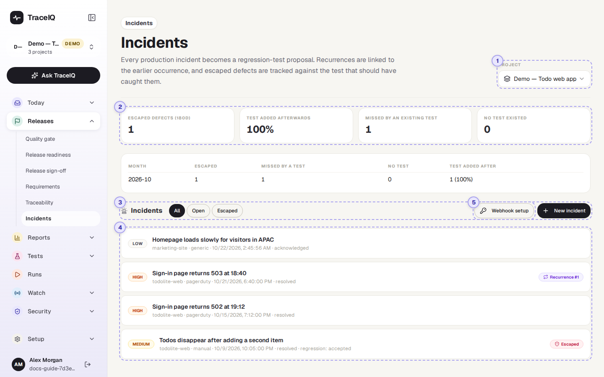
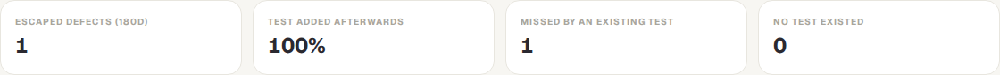
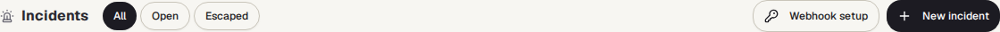
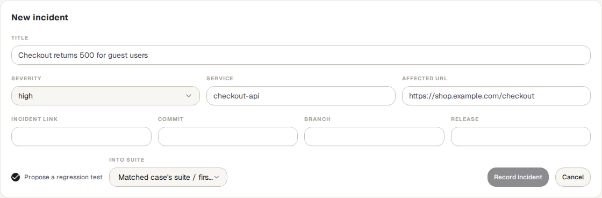
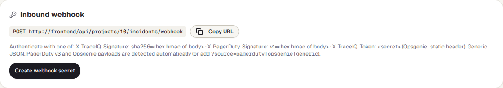

<!-- Generated from incidents.html by e2e/docs-capture/export_md.py. Edit the HTML, not this file. -->

# Incidents

Releases · Everyone with access to the project can see it · Editors can record and change incidents

> **In short**
>
> A list of the problems that reached your live site. For each one, TraceIQ notices when the same problem happened before, suggests a test that would catch it next time, and lets you record whether a test should have caught it. That last part gives the *escaped defects* count at the top.

## What it is for

An *incident* is something going wrong in production: an outage, an error page, a broken checkout. Incidents answers **"What got past our tests, and are we making sure it can't happen again?"** Incidents can be typed in by hand or sent in automatically by a paging tool such as PagerDuty or Opsgenie.

> **On-call and support**
>
> Record an incident and see straight away whether it has happened before.

> **Testers**
>
> Get a suggested test for each incident, so the same bug is caught before the next release.

> **Leads**
>
> Track escaped defects over time, and how often a test was added afterwards.

**Where to find it:** in the sidebar, open **Releases → Incidents**.

## A tour of the screen

The demo's web project has four incidents: two sign-in outages that are the same problem, one escaped defect and one minor slowdown. The numbers on the screenshot match the sections below.

*The Incidents page for the demo's web project. Click the picture to see it larger.*

## 1. Project

The project whose incidents are shown. This is the same choice as the project picker at the top of the sidebar: changing it here changes it for the whole app.

## 2. Escaped defects

An *escaped defect* is an incident that someone has marked as a bug the tests should have caught (see [Marking an escaped defect](#row)). The tiles count those that **started in the last 180 days**:

| Tile | What it counts |
|---|---|
| **Escaped defects (180d)** | All incidents marked as escaped defects. |
| **Test added afterwards** | The share of them that got a new regression test, created after the incident started. Linking a test that already existed doesn't count. Shows "—" while there are none. |
| **Missed by an existing test** | A test existed but didn't catch it. |
| **No test existed** | Nothing tested that part at all. |

Once there are escaped defects, a table under the tiles splits the same numbers by month (the month the incident started). In the demo, the one escaped defect was missed by an existing test, and a regression test was added after it, hence 100%.

## 3. Filters and buttons

- **All / Open / Escaped**: show every incident, only those with status *open*, or only escaped defects.
- **Webhook setup** (⑤) shows how a paging tool can send incidents in (see [below](#webhook)).
- **New incident** opens a form to record one by hand.

| Field | What to enter |
|---|---|
| **Title** | What went wrong, in a line. The only required field. |
| **Severity** | critical, high (chosen at first), medium or low. |
| **Service** | The part of the system affected, for example `checkout-api`. Used to recognise repeats. |
| **Affected URL** | The page or address that failed. Used to find the test that covers it, and as the starting page of the suggested test. |
| **Incident link, Commit, Branch, Release** | Optional: where the incident is described, and which version of the app was live. |
| **Propose a regression test** / **Into suite** | On at first: TraceIQ drafts a test meant to catch this problem, in the suite you pick (or, if you don't, the suite of the matching test, else the project's first suite). |

Press **Record incident** to save it, or **Cancel**. A message says whether it is a repeat ("Recorded — recurrence #2") and the number of the suggested test.

## 4. The incidents

Up to 200 incidents, newest first (by when they started). Each row shows the severity, the title, then the service, where it came from (*manual*, *pagerduty*, *opsgenie* or *generic*), when it started, its status and the state of its regression test. On the right, a **Recurrence #N** label when the same problem happened before, and **Escaped** when it is marked as an escaped defect. In the demo, the 503 sign-in outage is *Recurrence #1* of the 502 one a week earlier: same service, same title once the numbers are taken out. Click a row to open it:

*The escaped defect, opened. It was missed by the test *Add a todo*, which only checks that one item is visible.*

- **Details**: the incident link, the affected address, the release and commit, the previous occurrence (*incident #12*), what TraceIQ matched it to (a test and/or a failure group, with the reason), and its regression test or suggestion (which links to *Proposals*).
- **Status**: open, acknowledged or resolved. Changing it saves straight away; *resolved* also records the time it was resolved.
- **Propose regression test** asks for a suggested test again (only when there is no regression test and no suggestion waiting for review).
- **Delete** removes the incident after you confirm.
- **Marking an escaped defect**: under *Escaped defect — should have been caught by*, choose the test that should have caught it, or **No test existed**; add a note on why it slipped through, and press **Mark escaped**. **Clear** removes the mark.

> **How TraceIQ spots a repeat, and the related test**
>
> - **A repeat** has the same service and the same title once numbers, IDs and times are taken out. "Checkout API 503 for 12% of requests at 10:42" and "Checkout API 502 for 40% of requests" are the same problem. The new incident is labelled *Recurrence #N* and points to the previous one.
> - **The related test** is one that opens the affected address (the best evidence), or else one whose name shares at least two significant words with the title. A failure group from *Failure triage* is matched by shared words too. These are guesses, shown with their reason.

## 5. Webhook setup

A *webhook* lets another tool send incidents to TraceIQ as they happen. The panel shows the address to send them to, and how the sender proves it is allowed: a signature made with a shared secret (TraceIQ's own or PagerDuty's format), or, for Opsgenie, which can't sign, the secret itself in a header. TraceIQ recognises plain JSON, PagerDuty and Opsgenie messages by itself.

- **Create webhook secret** makes the secret and shows it **once**; copy it into your paging tool then. Later the button reads **Rotate secret**, which replaces it (the old one stops working at once).
- Once there is a secret: **Regression proposals go to** (the suite for suggested tests), **Enabled**, **Delete webhook**, and when the last incident arrived.
- While there is no secret, or the webhook is switched off, the address answers as if it didn't exist.
- When the paging tool updates an incident it already sent (acknowledged, resolved), TraceIQ updates the same incident instead of adding a new one.

Seeing this panel needs the *editor* role; creating, rotating, changing or deleting the webhook needs project *admin*, and can't be done with an API key.

## Watch it in use

[▶ Watch the video](../media/releases/incidents/walkthrough.mp4)

*Under a minute, with a spoken commentary. The captions at the bottom show the same words, so it also works with the sound off. Nothing is saved in the video.*

## How to…

### …record an incident by hand

1. Press **New incident**. (You need the *editor* role.)
2. Type the title, pick the severity, and fill in the service and affected address if you know them.
3. Leave **Propose a regression test** ticked, choose the suite, and press **Record incident**.
4. Review the suggested test on **Today → Proposals**.

### …send incidents in from PagerDuty or Opsgenie

1. Ask a project *admin* to open **Webhook setup** and press **Create webhook secret**.
2. Copy the address and the secret into the paging tool's webhook settings (the secret is shown only once).
3. Choose where suggested tests should go under **Regression proposals go to**. New incidents then arrive by themselves, each with a suggested test.

### …record that a test missed a bug

1. Open the incident.
2. Under **Escaped defect**, choose the test that should have caught it, or **No test existed**.
3. Add a short note and press **Mark escaped**. The tiles at the top update.

## Good to know

- **Suggested tests are only suggestions.** They wait on *Proposals* until a person accepts them (a workspace can let confident ones through automatically; an incomplete draft never). Without an AI set up, the suggestion is an empty outline to fill in.
- **A repeat is recognised from the incident as it arrived.** Editing an incident later doesn't change what it is matched with.
- **Incidents feed the delivery report.** The *Delivery (DORA)* report uses them for "change failure rate" and "time to restore".
- **Who can do what.** Anyone with access to the project can look. Recording, editing, marking and deleting need the *editor* role. Every change is written to the audit log.
- **Times are shown in your own time zone.**

## Related pages

> **Proposals**
>
> Where suggested regression tests wait for review.

> **Delivery (DORA)**
>
> Change failure rate and time to restore, worked out from deployments and incidents.

> **Failure triage**
>
> Failures grouped by cause; an incident can be matched to one of these groups.

> **On-call**
>
> Who gets paged when a monitor finds the live site down.

## Video script

What the walkthrough says, in order. The video and every picture on this page are made by the Playwright script [`releases-incidents.spec.ts`](../../../../e2e/docs-capture/pages/releases-incidents.spec.ts).

1. Incidents records problems that happened in production, for the selected project.
2. The tiles count escaped defects: bugs your tests let through, over the last hundred and eighty days.
3. The buttons show all incidents, only open ones, or only escaped defects.
4. Each row is one incident. Recurrence and Escaped labels sit on the right.
5. New incident records one by hand.
6. Give it a title, a severity and the service. TraceIQ can then suggest a test that would catch it.
7. Cancel closes the form without saving anything.
8. Webhook setup lets your paging tool send incidents here by itself.
