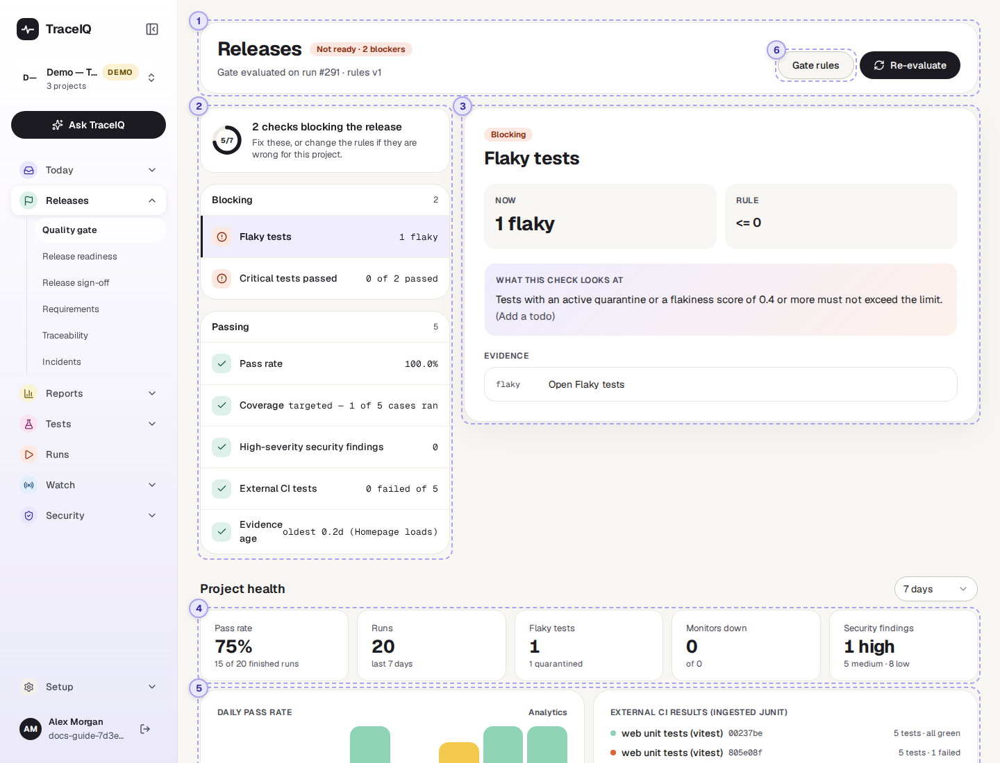
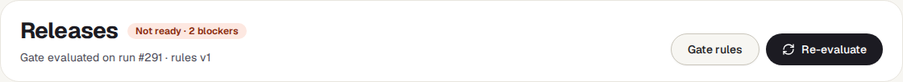
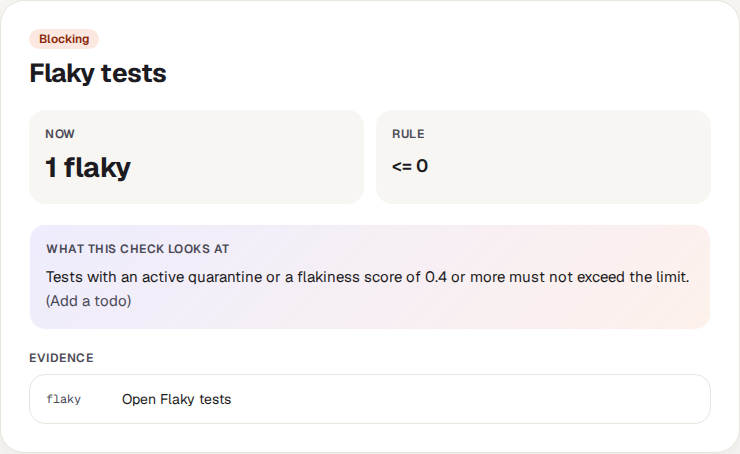
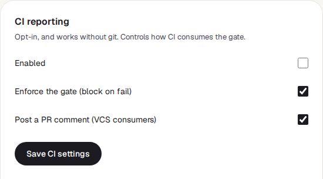
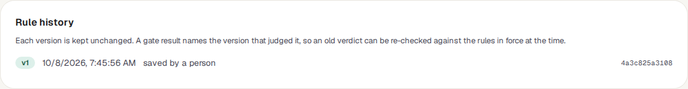

<!-- Generated from quality-gate.html by e2e/docs-capture/export_md.py. Edit the HTML, not this file. -->

# Quality gate

Releases · Everyone with access to the project can see it · Editors can change the rules

> **In short**
>
> A short list of rules a release has to meet, such as "every test passed" and "no serious security problem". The page checks the newest run against those rules and says **Ready to ship** or **Not ready**, with the reason for each rule.

## What it is for

The quality gate answers **"Can we release this, by the rules we agreed?"** Instead of everyone judging the test results in their own way, the team writes the rules down once (for example: a 100% pass rate, no high-severity security finding, all monitors up), and TraceIQ applies them the same way every time. The same verdict can also stop an automatic build from going out, when your build system asks TraceIQ.

> **Release managers**
>
> See in one word whether the project meets the release rules, and which rule is in the way.

> **Testers and developers**
>
> Find out which check is blocking and jump to the runs, failures or findings behind it.

> **Leads**
>
> Decide the rules for the project, and see when they were changed.

**Where to find it:** in the sidebar, open **Releases → Quality gate**. The page's own heading says **Releases**. It shows the project selected at the top of the sidebar.

## A tour of the screen

The verdict and its checks are at the top; the project's general health is underneath; the rules open from a button in the heading. The numbers on the screenshot match the sections below.

*The Quality gate page for the demo's web project. Click the picture to see it larger.*

## 1. The verdict

- **The label next to the heading** is the verdict: Ready to ship when every check passes, or Not ready · 2 blockers with the number of checks that fail.
- **The line underneath** says what was judged: the run number (for example *run #291*), its branch and commit if the run recorded them, and the version of the rules used (*rules v1*). If runs were left out because they were cancelled or timed out, it says how many.
- **Gate rules** (⑥) opens the rules below the heading (see [Gate rules](#rules)). Press it again to close them.
- **Re-evaluate** checks the gate again, for example after a new run has finished.

> **This page judges one run: the newest finished one**
>
> On this page, the gate looks only at the **most recent run that finished** in the project (passed, failed or error), whichever suite it was. So the pass-rate check is either 100% or 0% here. To judge everything that ran on one version of your app (one *commit*), use **Release readiness**, or let your build system ask the gate for a commit or a branch: then every finished run on it is counted.

## 2. The checks

The ring counts the checks that pass out of all checks. Below it, the checks are split into **Blocking** (failing, shown first) and **Passing**. Each row shows the check's name and, on the right, the value it found. Click a row to show it in detail on the right.

In the demo the newest run (#291) ran only one of the five tests, so *Critical tests passed* blocks (neither critical test ran in it), and *Flaky tests* blocks because the demo's rules allow no flaky test and *Add a todo* is quarantined.

Which checks appear depends on the rules. Three are always there:

| Check | What it looks at |
|---|---|
| **Pass rate** | The share of the judged runs that passed. Runs that were cancelled or timed out have no pass/fail answer and are left out. With no finished run at all, this check fails. |
| **Coverage** | For information only, it never blocks. *full suite* means the whole suite ran; *targeted — 4 of 30 cases ran* means only some tests ran, so a pass says less. |
| **High-severity security findings** | Security problems of high severity found *in the judged runs* by the checks TraceIQ makes on every run's traffic (and leak detection), whatever their status: a finding marked fixed or accepted still counts for the run it was found in. Standalone security scans are not counted. The rule says how many are allowed (0 by default). |

Others appear only when a rule switches them on: medium-severity findings, monitors up, external CI tests, the three performance budgets, and the release-readiness checks (flaky tests, critical tests, how fresh the results are, sign-off, accessibility) and breaking API changes. Each has a plain name, for example *Flaky tests* or *Critical tests passed*.

## 3. The selected check

- **Passing / Blocking**: whether this check meets its rule.
- **Now** is the value found; **Rule** is what it must be (`>=` means "at least", `<=` means "at most").
- **What this check looks at** explains the check in a sentence. Extra detail from the check appears in brackets, such as the names of the monitors that are down or of the tests that failed.
- **Evidence** links to the pages where you can look further: Runs, Failure triage, Security or Monitors. The Runs link opens the full list of runs, not only the judged one.

When the page opens, the first blocking check is shown; if nothing blocks, the first passing one.

## 4. Project health

The wider picture, separate from the verdict. The menu on the right chooses the period: the last **7**, **14** or **30 days**.

| Tile | What the number means |
|---|---|
| **Pass rate** | Of the runs in the period that finished with a verdict (passed, failed or error), the share that passed. |
| **Runs** | Every run started in the period, including ones still running, cancelled or timed out. |
| **Flaky tests** | Tests that currently pass and fail without anything changing (a flake score of 0.4 or more). This number is *not* limited to the period. Underneath: how many are quarantined, that is, left out of runs for the time being. |
| **Monitors down** | The project's monitors that are down right now, out of all its monitors. |
| **Security findings** | Security findings recorded in the period, by severity, whatever their status (fixed ones included). |

## 5. Daily pass rate and CI results

**Daily pass rate** has one bar for each day in the period on which at least one run finished; days without runs are simply left out. Days are counted in **UTC**. Point at a bar to see its date, pass rate and number of runs. The colours are the same as on Overview:

| Bar colour | Meaning |
|---|---|
| Green | 90% or more of that day's runs passed. |
| Yellow | Between 60% and 89% passed. |
| Orange | Less than 60% passed. A day where nothing passed still shows a thin orange stub. |

**External CI results** lists the five newest test reports your own build system has sent to TraceIQ (JUnit reports from tests that run outside TraceIQ), each with its number of tests and failures (the demo has two). Until one arrives it says "None yet". These reports count towards the verdict only when the rule *Require external CI tests green* is on.

## 6. Gate rules

Press **Gate rules** in the heading to open the rules. Anyone can read them; only *editors* can save changes. The demo's web project has a stricter set than the defaults listed below: 90% pass rate, external CI tests required, no flaky tests, every critical test passed and results no older than 7 days.

| Rule | What it does (default) |
|---|---|
| **Minimum pass rate (%)** | The pass rate the judged runs must reach (100). |
| **Maximum high findings** / **medium findings** | How many high or medium security findings the judged runs may have (0 high; medium not checked while blank). |
| **Require monitors up** | Blocks while any of the project's monitors is down (off). |
| **Require external CI tests green** | The newest report from your build system (for the commit being judged, if there is one) must have no failures. With no report at all, it blocks (off). |
| **Release readiness** section | Limits on flaky tests, "every critical test passed", how old the newest passing result may be, an approved sign-off, and no new serious accessibility problems. All off until filled in or ticked; *Release readiness* and *Release sign-off* explain them. |
| **API contract** section | **No breaking changes in the newest OpenAPI spec version**, compared against **the version before it** or **a pinned version** (then give its number). Fewer than two stored versions, or a pinned version that doesn't exist, blocks as missing data (off). |
| **Performance budgets** | The slowest page-load figure measured in the judged runs (LCP, CLS, TTFB) must stay under the limit. 0 = not checked. If no run measured it, the check passes with "no samples". |

Next to the rules is **CI reporting**, which tells TraceIQ's GitHub Action how to use the gate:

- **Enabled** and **Enforce the gate**: a failing gate stops the build only when *both* are ticked. Enabled is off by default, so out of the box a failing gate is reported but doesn't stop anything.
- **Post a PR comment**: whether the GitHub Action may write its summary as a comment on the pull request.

Below that is **Rule history**:

Every set of rules that has ever judged the project is kept unchanged, numbered v1, v2 and so on (the 10 newest are listed). *saved by a person* means someone changed the rules; *recorded at evaluation* means TraceIQ stored the rules in force when it first used them. Because each verdict names its version, an old verdict can be explained later with the rules of that day.

The panel also holds two project settings that are explained under *Project settings*: **Data capture and redaction** (what runs may record) and the project's **OpenAPI spec**.

## Watch it in use

[▶ Watch the video](../media/releases/quality-gate/walkthrough.mp4)

*About a minute, with a spoken commentary. The captions at the bottom show the same words, so it also works with the sound off.*

## How to…

### …find out why the project is not ready

1. Make sure the right project is selected at the top of the sidebar.
2. Look at the **Blocking** list. The first blocking check is already shown on the right.
3. Compare **Now** with **Rule**, and read the detail in brackets.
4. Follow a link under **Evidence** to the runs, failures or findings behind it.

### …change what a release must pass

1. Press **Gate rules**. (You need the *editor* role to save.)
2. Change the numbers or tick the boxes. Leave a box blank, or a budget at 0, to switch that rule off.
3. Press **Save rules**. The verdict is worked out again straight away, and the change is kept as a new version in **Rule history**.

### …make a failing gate stop your build

1. Press **Gate rules** and find **CI reporting**.
2. Tick **Enabled** and **Enforce the gate**, then press **Save CI settings**.
3. Your build must use TraceIQ's GitHub Action (or call the gate itself). Ask whoever looks after your builds.

## Good to know

- **No runs, no release.** If the project has no finished run, the gate is *Not ready*: TraceIQ can't vouch for something that wasn't tested.
- **Only the security checks on the runs count.** The security rules count findings that TraceIQ's automatic checks found in the judged runs, whatever their status. Findings from separate security scans (on the Security pages) are not part of this count.
- **Cancelled and timed-out runs are ignored**, and so are the check runs TraceIQ makes to test a suggested fix (see *Proposals*).
- **It doesn't update by itself.** Press **Re-evaluate**, or come back to the browser tab, to see newer results. Changing the period refreshes the health section.
- **Rule changes are recorded.** Besides the Rule history, every change of the rules is written to the audit log with who changed what, from which value to which.
- **One project at a time.** Each project has its own rules. Switch project at the top of the sidebar.

## Related pages

> **Release readiness**
>
> The next page in this guide: the same gate for one version (commit) of your app, with the tests, flaky tests and requirements behind it.

> **Release sign-off**
>
> A person's approval of a release, which the gate can require.

> **Failure triage**
>
> Failures grouped by cause, when the pass-rate check is blocking.

> **Scans & findings**
>
> Every security finding of the project, with its status and owner.

## Video script

What the walkthrough says, in order. The video and every picture on this page are made by the Playwright script [`releases-quality-gate.spec.ts`](../../../../e2e/docs-capture/pages/releases-quality-gate.spec.ts).

1. The quality gate says whether the selected project is ready to ship.
2. The line below names the run that was judged, and the version of the rules.
3. Every check is listed on the left. Blocking checks come first, then passing ones.
4. Click a check to see what it measured, and the rule it has to meet.
5. Evidence links take you to the page where you can look into it.
6. Gate rules shows what a release must pass. Editors can change the rules.
7. Rule history keeps every version of the rules that has judged a release.
8. Project health gives the wider picture, here over the last seven days.
9. You can switch to fourteen or thirty days.
10. Each bar is the pass rate of one day.
11. Re-evaluate checks the gate again against the newest results.
