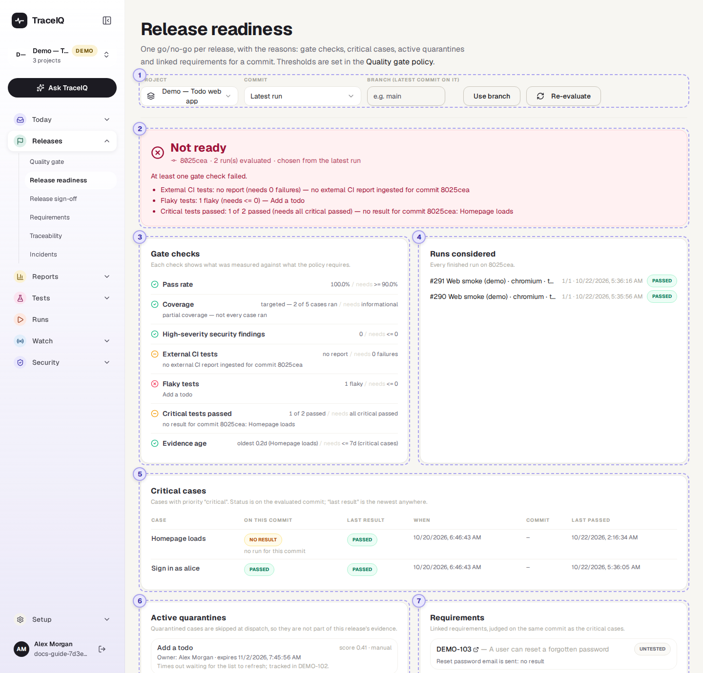
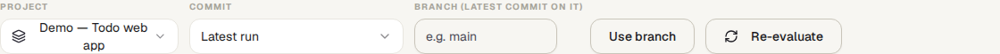
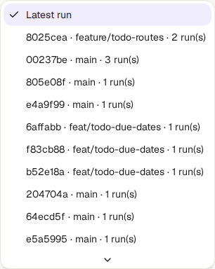
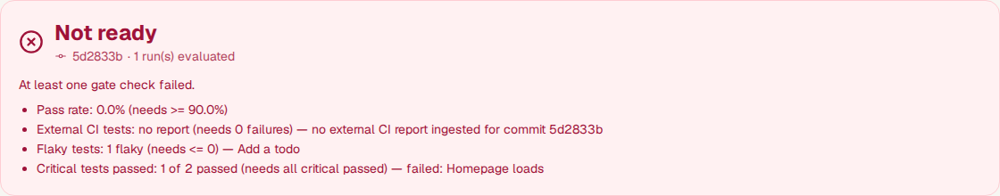
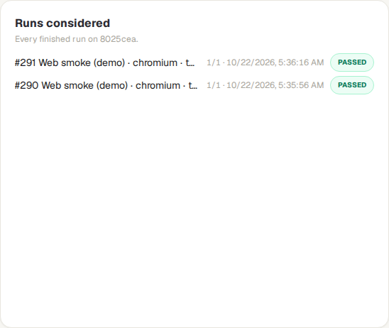
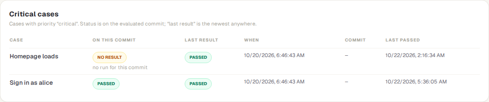
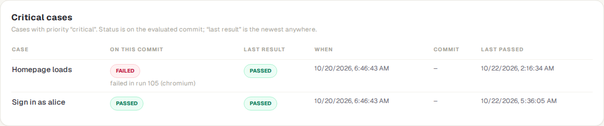
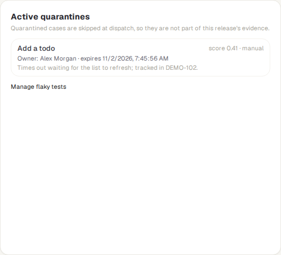

<!-- Generated from release-readiness.html by e2e/docs-capture/export_md.py. Edit the HTML, not this file. -->

# Release readiness

Releases · Everyone with access to the project can see it · Read-only page

> **In short**
>
> One answer for one version of your app: **Ready to release**, **Not ready** or **Insufficient data**. Underneath it, all the evidence the answer is based on: the quality-gate checks, the runs, your critical tests, the tests left out as flaky, and the requirements they cover.

## What it is for

Release readiness answers **"Is *this version* good enough to release, and what is that based on?"** A version is a *commit*: a saved state of your app's code, shown as a short code like `f4bfd81`. Several runs may have tested the same commit (different suites, different browsers). This page puts all of them together and judges them with the project's quality-gate rules, so the answer covers the whole version, not just one run.

> **Release managers**
>
> Get a yes or no for the version you are about to release, with the reasons written out.

> **Testers**
>
> See which critical tests have, or haven't, passed on that version, and which tests were left out.

> **Product owners**
>
> Check that the requirements for the release have passing tests behind them.

**Where to find it:** in the sidebar, open **Releases → Release readiness**.

## A tour of the screen

The controls are at the top, the answer below them, and the evidence underneath. The numbers on the screenshot match the sections below.

*The Release readiness page for the demo's web project. Click the picture to see it larger.*

## 1. Choosing what to judge

- **Project** picks the project. This is the same choice as the project picker at the top of the sidebar: changing it here changes it for the whole app.
- **Commit** picks the version to judge. *Latest run* (the starting point) takes the commit of the newest finished run in the project. The menu also lists the 20 most recent commits that have a finished run, each with its branch and number of runs.
- **Branch (latest commit on it)**: type a branch name, such as `main`, and press **Use branch** to judge the commit of the newest finished run on that branch.
- **Re-evaluate** works the answer out again, for example after a new run.

## 2. The answer

*The demo's newest commit. Its two runs passed, but the demo project's gate also asks for a report from the build system, no flaky tests, and every critical test passed on this commit.*

The coloured box gives the answer, the commit it is about, how many runs were judged, and the reasons as a list. The demo project's rules are strict on purpose (no flaky test at all, a build-system report on every commit), so no demo commit is ready to release.

| Answer | What it means |
|---|---|
| Ready to release | Every quality-gate check passed on the runs of this commit. |
| Not ready | At least one check failed. The reasons say which one, what it found and what it needed, for example *Pass rate: 0.0% (needs &gt;= 90.0%)*. |
| Insufficient data | Nothing failed, but evidence is missing: there is no finished run, or a required check has nothing to judge (a critical test that didn't run on this commit, no sign-off yet, no report from your build system). Missing evidence never counts as a pass. |

*An older demo commit whose only run failed. The critical-cases table below shows which test it was.*

When the commit was chosen for you (from *Latest run* or a branch), the line under the answer ends with "chosen from the latest run" or "chosen from the latest run on the branch". If the run it started from recorded no commit, only that one run is judged and the line says "no commit".

## 3. Gate checks

The checks of the project's **quality gate**, applied to every run in ④. Each line shows the value found, then "needs" and the rule. A green tick means passed, a red cross failed, and an amber dash failed *because evidence was missing*. A grey line under a check gives detail, such as the names of the tests concerned. In the demo, *External CI tests* and *Critical tests passed* are amber (no report arrived, and *Homepage loads* didn't run on this commit), and *Flaky tests* is red because *Add a todo* is quarantined. The checks appear under the same names as on the *Quality gate* page (*Pass rate*, *Critical tests passed*…), which explains each one; point at a name to read a one-line explanation.

Which checks there are depends on the project's rules, which are set on the *Quality gate* page under **Gate rules**. Four of them exist for this page in particular and are off until switched on there:

| Check | What it requires |
|---|---|
| **Flaky tests** | No more than N flaky tests: tests that are quarantined now, or have a flake score of 0.4 or more. |
| **Critical tests passed** | Every critical test passed on this commit. If the project has no critical test, this check fails: whoever switched it on expected it to protect something. |
| **Evidence age** | The newest pass of each critical test (of every test, when none is critical) is at most N days old, on any commit. This checks that the evidence is recent, not that this commit passed. |
| **Release sign-off** | The newest release sign-off for this commit is an approval. See *Release sign-off*. |

## 4. Runs considered

Every finished run on the commit (passed, failed or error), newest first: the run number, the suite, the browser, and "targeted" or "case" when only part of the suite ran. On the right: tests passed out of tests run, when it started, and its result. Click a run to open it.

## 5. Critical cases

A *case* is one test. The tests whose priority is set to **critical** are the ones a release depends on, and each gets a row:

| Column | What it shows |
|---|---|
| **On this commit** | passed, failed or no result (it didn't run on this commit). A failure names the run and, if known, the browser or device. |
| **Last result**, **When**, **Commit** | The newest result of the test anywhere in the project, whatever the commit. Useful when it didn't run on this one. |
| **Last passed** | When it last passed, on any commit. |

*On that older commit a critical test failed; its newest result anywhere has since passed.*

> **How "passed on this commit" is decided**
>
> - Results are matched to the test itself, never by its name, so renaming a test doesn't lose its history.
> - Each browser and device is judged separately, using its newest result. A green re-run replaces an earlier red one, but a pass in Chrome doesn't hide a failure in Firefox.
>
> "Critical" is matched without regard to capitals or spaces. For manual tests, the priority is chosen in the manual test editor; for automated tests, with **Priority** at the top of the step editor. Imports (suite import, Git sync) and AI assistants can set it too.

## 6. Active quarantines

Tests that are *quarantined* right now: flaky tests that TraceIQ leaves out of runs for a while. Because they didn't run, they are no evidence for this release. Each one shows its flake score, whether it was quarantined automatically or by a person, its owner, when the quarantine ends, and the reason given. **Manage flaky tests** opens the *Flaky tests* page. In the demo, *Add a todo* was quarantined by hand, with an owner and a reason. When nothing is quarantined, the box says "No active quarantines".

## 7. Requirements

Requirements (such as a ticket `DEMO-101`) that have tests linked to them, judged on the same commit as the critical tests. Under each one: its linked tests and their result on this commit. The ticket number links to the ticket when an address was saved with the link.

| Status | Meaning |
|---|---|
| failing | At least one linked test failed on this commit. Shown first. |
| untested | None of its tests has a result on this commit. |
| partial | Some tests passed, none failed, but some didn't run. |
| passing | Every linked test passed on this commit. |

**Manage requirement links** opens the *Traceability* page, where tests are linked to requirements.

## Watch it in use

[▶ Watch the video](../media/releases/release-readiness/walkthrough.mp4)

*About a minute, with a spoken commentary. The captions at the bottom show the same words, so it also works with the sound off.*

## How to…

### …check the version you are about to release

1. Find out the commit of that version (your developers or your build system can tell you; the first characters are enough to recognise it).
2. Choose it in the **Commit** menu. If it isn't listed, no finished run has tested it yet.
3. Read the answer and its reasons. For *Not ready* or *Insufficient data*, the reasons say which check is in the way.

### …check the newest version of a branch

1. Type the branch name, for example `main`, in **Branch**.
2. Press **Use branch**. The page judges the commit of the newest finished run on that branch.
3. To go back, choose **Latest run** in the Commit menu (it then still applies the branch), or clear the field and press Use branch again.

### …make critical tests count

1. Give the tests your release depends on the priority **critical** (see "How passed on this commit is decided" above for where priority is set).
2. On **Quality gate**, open **Gate rules** and tick **Require every critical case passed on the commit**. You need the *editor* role.
3. From then on, a critical test that failed makes the answer *Not ready*, and one that didn't run makes it *Insufficient data*.

## Good to know

- **Different scope from the Quality gate page.** That page judges only the newest finished run. This one judges *every* finished run of the chosen commit, so the two can disagree: a commit with one failed suite and one passed suite is *Not ready* here, even if the newest run passed.
- **Runs without a verdict don't count.** Runs that are still going, cancelled or timed out are left out, and so are the check runs TraceIQ makes to test a suggested fix (see *Proposals*).
- **The rules live on the Quality gate page.** Nothing can be changed here; the page only reads.
- **It doesn't update by itself.** Press **Re-evaluate**, or come back to the browser tab.
- **Times are shown in your own time zone**, as set on your computer.
- **The same answer is available to tools.** Build systems and AI assistants can ask for it with an API key; a key limited to one project can only ask about that project.

## Related pages

> **Release sign-off**
>
> The next page in this guide: a person's recorded approval of a release, which this answer can require.

> **Quality gate**
>
> The rules this page applies, and where they are changed.

> **Traceability**
>
> Link tests to requirements, so the Requirements box fills in.

> **Flaky tests**
>
> Why tests are quarantined, who owns them and when the quarantine ends.

## Video script

What the walkthrough says, in order. The video and every picture on this page are made by the Playwright script [`releases-release-readiness.spec.ts`](../../../../e2e/docs-capture/pages/releases-release-readiness.spec.ts).

1. Release readiness gives one answer for one version of your app: ready, or not.
2. Under the answer: the commit it judged, how many runs, and the reasons.
3. Pick another commit here to judge that version instead.
4. This commit is not ready. The reason says which check failed, and why.
5. Gate checks: what was measured, and what the rules require.
6. Runs considered: every finished run on that commit. Click one to open it.
7. Critical cases are the tests marked critical, with their result on this commit.
8. Quarantined tests are left out of runs, so they are no evidence for this release.
9. Requirements shows the linked requirements, judged on the same commit.
