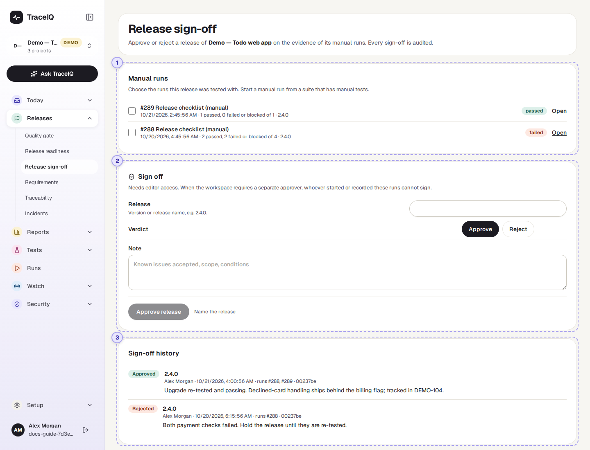
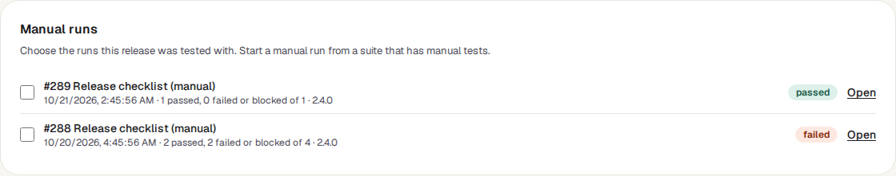
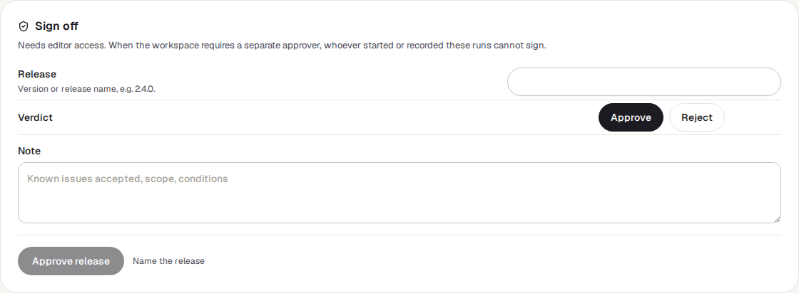
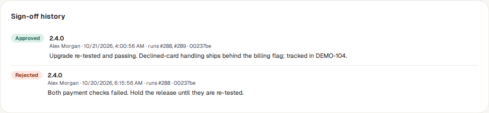

<!-- Generated from release-signoff.html by e2e/docs-capture/export_md.py. Edit the HTML, not this file. -->

# Release sign-off

Releases · Everyone with access to the project can see it · Editors can sign off

> **In short**
>
> Where a person puts their name to a release. You pick the manual test runs the release was checked with, name the release, and press **Approve** or **Reject**. The decision is kept for good, with who made it and when, and the quality gate can require it before a release counts as ready.

## What it is for

Some checks are done by people, not by machines: a tester follows written steps by hand and records what happened. That is a *manual run*. Release sign-off answers **"Who agreed that this release could go out, based on which testing?"** It turns that agreement into a record you can show an auditor or a customer, instead of a message in a chat.

> **Release managers**
>
> Approve a release once its manual testing is complete, or record why it was rejected.

> **Testers**
>
> See their manual runs listed, and continue one that is still in progress.

> **Auditors and compliance**
>
> Find who approved each release, when, and on the evidence of which runs.

**Where to find it:** in the sidebar, open **Releases → Release sign-off**. It shows the project selected at the top of the sidebar.

## A tour of the screen

The page has three cards, from top to bottom. The numbers on the screenshot match the sections below. In the demo's web project, release 2.4.0 was tested by hand twice: rejected after the first run, approved after the second.

*The Release sign-off page for the demo's web project. Click the picture to see it larger.*

## 1. Manual runs

The 50 most recent manual runs of the project, newest first. Each row has:

- **A tick box** to include the run in the sign-off.
- **The run number and suite**, then when it started and its counts, for example *"8 passed, 1 failed or blocked of 10"*, and the release name the tester gave it, if any.
- **A label**: In progress while the tester is still working, passed when it was completed with at least one test passed and none failed or blocked (skipped tests don't count against it), and failed otherwise.
- **Continue testing** (for a run in progress) or **Open**, which takes you to the run itself.

Manual runs are started from a suite that contains manual tests. Until there is one, the card says "No manual runs in this project yet".

## 2. Sign off

| Field | What to enter |
|---|---|
| **Release** | The version or name of the release, for example `2.4.0` (up to 120 characters). |
| **Verdict** | **Approve** (chosen at first) or **Reject**. The button at the bottom changes to *Approve release* or *Reject release* to match. |
| **Note** | Optional: known problems you accepted, what was in scope, conditions. |

The button stays greyed out, with a short message next to it, until the sign-off can be recorded:

- *Name the release*: the Release field is empty.
- *Pick at least one run*: no run is ticked in ①.
- *Complete the selected runs before approving*: a ticked run is still in progress. You can still *reject* a release while its testing is unfinished.

Once recorded, a message confirms it ("Approved 2.4.0"), the ticks and note are cleared, and the sign-off appears in the history below.

## 3. Sign-off history

The 50 most recent sign-offs, newest first. Each one shows Approved or Rejected, the release name, who signed and when, the runs it covered (*runs #12, #14*), the commit if there was one, and the note.

A sign-off can't be edited or deleted. If a decision changes, record a new one: the newest sign-off is the one that counts. That is what the demo shows: 2.4.0 was first rejected because both payment checks failed, then approved a day later once they were re-tested.

## Watch it in use

[▶ Watch the video](../media/releases/release-signoff/walkthrough.mp4)

*Under a minute, with a spoken commentary. The captions at the bottom show the same words, so it also works with the sound off. Nothing is saved in the video.*

## How to…

### …approve a release

1. Make sure every manual run for the release is completed. A run marked *In progress* can't be part of an approval.
2. Under **Manual runs**, tick the runs the release was tested with.
3. Type the release name, leave the verdict on **Approve**, and add a note if anything was accepted as it is.
4. Press **Approve release**. You need the *editor* role.

### …reject a release

1. Tick the runs that showed the problem (runs still in progress are allowed).
2. Type the release name and choose **Reject**.
3. Write in the note why, then press **Reject release**.

### …make releases wait for a sign-off

1. Open **Releases → Quality gate** and press **Gate rules**.
2. Tick **Require an approved release sign-off (manual testing)** and press **Save rules**.
3. From then on, the gate and *Release readiness* say *Insufficient data* until someone signs off, and *Not ready* if the newest sign-off is a rejection.

## Good to know

- **Only people can sign.** An API key (used by scripts, build systems and AI assistants) is refused, so every sign-off has a name behind it.
- **Separate approver.** When the workspace requires a separate approver (or the server's administrator has made it compulsory), you can't sign off runs that you started or recorded results in. Someone else has to.
- **Which sign-off the gate looks at.** When the gate judges a commit, it uses the newest sign-off for that commit; otherwise the newest sign-off in the project. A newer rejection overrides an older approval.
- **The commit comes from the runs.** If all the ticked runs were for the same commit, the sign-off is tied to it. If they were for different commits, or none, the sign-off has no commit, and only counts for a gate that isn't judging a particular commit.
- **Every sign-off is in the audit log**, with the runs it covered and whether a separate approver was required.

## Related pages

> **Requirements**
>
> The next page in this guide: tickets imported from Jira or Linear, and how well they are tested.

> **Release readiness**
>
> The ready / not-ready answer for a commit, which can include this sign-off.

> **Suites**
>
> Where manual tests are written and manual runs are started.

> **Audit log**
>
> Every sign-off, with who made it and when.

## Video script

What the walkthrough says, in order. The video and every picture on this page are made by the Playwright script [`releases-release-signoff.spec.ts`](../../../../e2e/docs-capture/pages/releases-release-signoff.spec.ts).

1. Release sign-off records a person approving or rejecting a release.
2. The approval rests on manual runs: tests that a person carried out by hand.
3. Tick the runs this release was tested with. Each shows its counts and whether it passed.
4. Then name the release, for example its version number.
5. Choose Approve or Reject, and add a note about anything you accepted.
6. The button stays greyed out until the form is complete. The message says what is missing.
7. Every decision is kept in the sign-off history, newest first.
