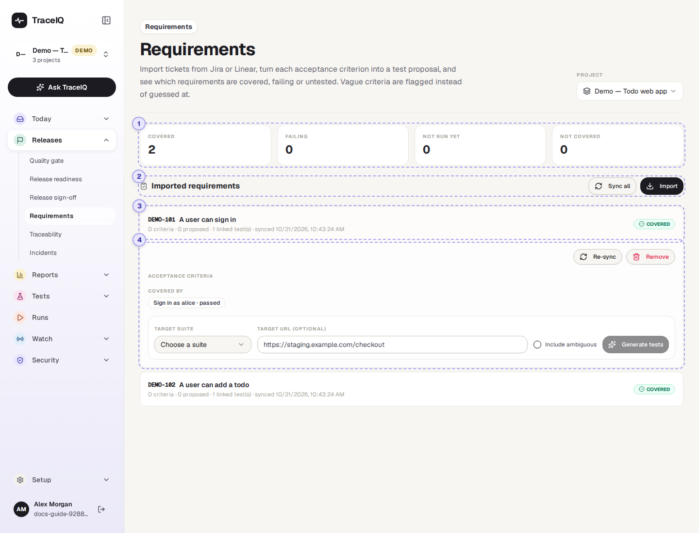
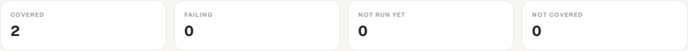
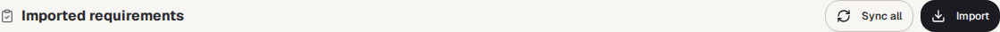
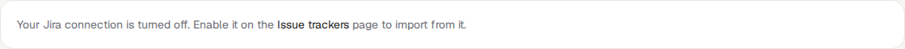
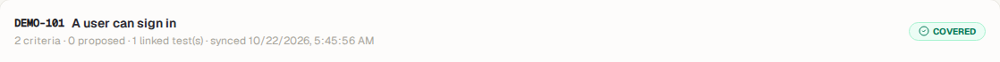

<!-- Generated from requirements.html by e2e/docs-capture/export_md.py. Edit the HTML, not this file. -->

# Requirements

Releases · Everyone with access to the project can see it · Editors can import and generate

> **In short**
>
> Bring your tickets (user stories, requirements) in from Jira or Linear. TraceIQ reads each ticket's acceptance criteria, can turn every criterion into a suggested test, and shows for each ticket whether its tests are passing, failing, not run yet, or missing.

## What it is for

Requirements answers **"Is everything we promised actually tested, and does it work?"** A ticket usually lists its *acceptance criteria*: the conditions that must be true for the work to count as done, such as "a guest can pay by card". This page keeps a copy of those tickets next to your tests, points out criteria that are too vague to test, and drafts a test for each of the others.

> **Product owners**
>
> See at a glance which tickets are covered by passing tests and which have none yet.

> **Testers**
>
> Get a first draft of a test for each acceptance criterion, and a warning when a criterion is too vague.

> **Leads**
>
> Find the gaps before a release: tickets that are failing or not covered at all.

**Where to find it:** in the sidebar, open **Releases → Requirements**.

## A tour of the screen

The counts are at the top, then the list of imported tickets. In the picture the first ticket has been opened. The numbers on the screenshot match the sections below.

*The Requirements page for the demo's web project. Click the picture to see it larger.*

The **Project** menu at the top right is the same choice as the project picker in the sidebar: changing it here changes it for the whole app.

## 1. The four counts

Every imported ticket falls into exactly one of these:

| Count | A ticket counts here when… |
|---|---|
| Covered | …it has linked tests, and the newest result of every one of them passed. |
| Failing | …the newest result of at least one linked test failed (or ended in error). |
| Not run yet | …it has linked tests, none failing, but at least one has never run. |
| Not covered | …no test is linked to it yet. |

> **"Linked" and "newest result"**
>
> A test is linked to a ticket when its requirement reference is the ticket's key (for example `DEMO-101`). Links come from accepting a test generated here, or are added by hand on the *Traceability* page; both count. "Newest result" means the test's most recent result in this project, whichever version of the app it ran on. To judge one particular version, use *Release readiness*.

## 2. Sync all and Import

- **Sync all** fetches every imported ticket again from Jira or Linear, so its title, status, description and acceptance criteria are up to date. A message says how many were synced and how many failed.
- **Import** opens the import panel (the button then reads **Close import**).

*The demo workspace's Jira connection is switched off, and the panel only offers connections that are switched on, so it says where to turn it on. With no connection at all, it says where to add one.*

Once a connection exists (set up on **Setup → Issue trackers**, and switched on), the panel has:

- **Connection**: which Jira or Linear connection to use.
- **For Jira, JQL**: a Jira search, for example `project = SHOP AND sprint in openSprints()`. **For Linear**: a team key, words in the title, and a label.
- **Search** shows up to 25 matching tickets with tick boxes; ones you already imported are marked "imported". **Import selected** brings in the ticked ones.
- Or type ticket keys (`SHOP-12, SHOP-14`) and press **Import by key**. Keys that don't exist are listed in a warning.

Importing a ticket that is already there updates it instead of adding a second copy.

## 3. A ticket

One row per imported ticket, in order of their keys. The first line is the ticket's key and title. The second line says how many acceptance criteria were found, how many already have a suggested test ("proposed"), how many are too vague ("ambiguous", in amber), how many tests are linked, and when it was last fetched. "sync error" in red means the last fetch failed. On the right is its count from ①. Click the row to open it.

The demo's web project has five tickets, one or more in each count: `DEMO-101` and `DEMO-102` are covered (102 has one vague criterion), `DEMO-103`'s test has never run, `DEMO-104` has a failing test, and `DEMO-105` has no test yet, only a suggested one.

## 4. An opened ticket

- **Open in jira / linear** (when the ticket has an address) opens the original ticket. **Re-sync** fetches just this one again. **Remove** takes the ticket off this page after you confirm; the tests and their links stay.
- **Acceptance criteria**: each criterion found in the ticket, numbered AC1, AC2… A criterion that already has a suggested test shows its number and state (for example *#41 pending*), which links to the *Proposals* page. A vague one says why in amber, for example *Ambiguous: vague term "fast"*. In the picture, `DEMO-101`'s two criteria are Given/When/Then scenarios.
- **Covered by**: the linked tests and the result of each one's newest run ("not run" if it never ran).
- **Generate tests**: pick the suite the suggested tests should go into, optionally the address of the page they should start on, and whether to include the vague criteria. Then press **Generate tests**.

> **Generated tests are suggestions, not tests yet**
>
> Generate tests makes one *proposal* per criterion and puts it in the queue on *Today → Proposals*, where a person accepts or rejects it. Only an accepted proposal becomes a real test, and it is then linked to the ticket by itself. A workspace can allow confident suggestions to be accepted automatically; a draft that still needs work never is.
>
> If no AI is set up for TraceIQ (or the AI allowance has run out), each proposal is an empty outline marked *needs authoring* that someone fills in.

| How criteria are found | Example |
|---|---|
| Given / When / Then scenarios | *Given a guest with items in the cart, When they pay by card, Then they see the order number* |
| A heading "Acceptance criteria" followed by lines | The lines under it, one criterion each |
| Bullet lists and checklists | *- [ ] The total includes VAT* |
| Numbered labels | *AC1: The page shows the delivery date* |

If the ticket's description contains none of these, its **title** becomes its one criterion. When a ticket is synced again, a criterion whose wording hasn't changed keeps its suggested test; a reworded one starts afresh.

A criterion is flagged as **ambiguous** when it is shorter than three words, uses a vague word such as *fast*, *easy*, *intuitive* or *works as expected*, or names nothing a test could check (Given/When/Then without a Then). Speed words are fine when a number goes with them: "loads within 2 s" is testable, "loads fast" is not.

## Watch it in use

[▶ Watch the video](../media/releases/requirements/walkthrough.mp4)

*Under a minute, with a spoken commentary. The captions at the bottom show the same words, so it also works with the sound off.*

## How to…

### …bring in this sprint's tickets

1. Press **Import**. (You need the *editor* role and to be a member of the workspace.)
2. Choose the connection and type a search, for example `project = SHOP AND sprint in openSprints()`.
3. Press **Search**, tick the tickets you want, and press **Import selected**.

### …get draft tests for a ticket

1. Click the ticket to open it, and read its acceptance criteria. Reword vague ones in Jira or Linear, then press **Re-sync**.
2. Under Generate tests, choose the **Target suite** and, if you know it, the page address.
3. Press **Generate tests**. A message says how many proposals were queued.
4. Open **Today → Proposals** to review and accept them.

### …find what isn't tested before a release

1. Look at **Failing** and **Not covered** in the counts.
2. Scan the list for those labels and open each ticket to see which test is failing, or that there is none.
3. For a release check of one version, use **Release readiness**, which judges the same links on that version's runs.

## Good to know

- **TraceIQ only reads from Jira and Linear.** Importing and syncing never change the ticket. (Tickets *to* Jira are filed from *Failure triage*; Linear connections are import-only.)
- **Who can do what.** Anyone with access to the project can look. Importing, syncing, removing and generating need the *editor* role; searching and importing also need workspace membership, because the connection belongs to the whole workspace.
- **One project at a time.** A ticket is imported into the selected project, and only that project's tests count towards it.
- **Criteria are not re-generated by accident.** A criterion whose suggestion is still waiting, or was already accepted, is skipped when you press Generate tests again.
- **Check runs don't count.** The runs TraceIQ makes to check a suggested fix are left out of the coverage.
- **Imports, removals and generated proposals are recorded** in the audit log.

## Related pages

> **Traceability**
>
> The next page in this guide: link tests to tickets by hand, and find tests linked to nothing.

> **Proposals**
>
> Where the generated tests wait for someone to accept or reject them.

> **Issue trackers**
>
> Connect Jira or Linear, so tickets can be imported.

> **Release readiness**
>
> The same tickets, judged on the runs of one version of your app.

## Video script

What the walkthrough says, in order. The video and every picture on this page are made by the Playwright script [`releases-requirements.spec.ts`](../../../../e2e/docs-capture/pages/releases-requirements.spec.ts).

1. Requirements lists the tickets imported from Jira or Linear, and how well they are tested.
2. The four counts sort them: covered, failing, not run yet, and not covered.
3. Each row is one ticket, with its coverage on the right.
4. Click a ticket to see its acceptance criteria and the tests that cover it.
5. Generate tests turns each criterion into a suggested test, for a person to review.
6. Import brings in more tickets, from a search or by their keys.
7. Sync all fetches the latest title, status and criteria of every ticket.
