<!-- Generated from test-cycles.html by e2e/docs-capture/export_md.py. Edit the HTML, not this file. -->

# Test cycles

Releases · Everyone with access to the project can see it · Editors can plan, assign, run and sign off

> **In short**
>
> A test cycle is one round of testing for a release. You choose the tests, by hand and automated together, give each one to a person, and start the testing from the cycle. The page then shows how far the round is, for the whole team and for each person, and it ends with someone approving or rejecting the release.

## What it is for

Before a release, a team usually has a list: these automated tests must pass, and these checks must be done by hand. A test cycle answers **"For this release, what has been tested, what is left, and who is doing it?"** without a spreadsheet kept on the side.

> **Test managers**
>
> Plan the round, share the tests out, and see at any moment what is left and with whom.

> **Testers**
>
> Open the tests given to them, work through them, and see their own progress.

> **Release managers**
>
> See that everything was tested, then approve or reject the release in the same place.

**Where to find it:** in the sidebar, open **Releases → Test cycles**. It shows the project selected at the top of the sidebar.

## The list of cycles

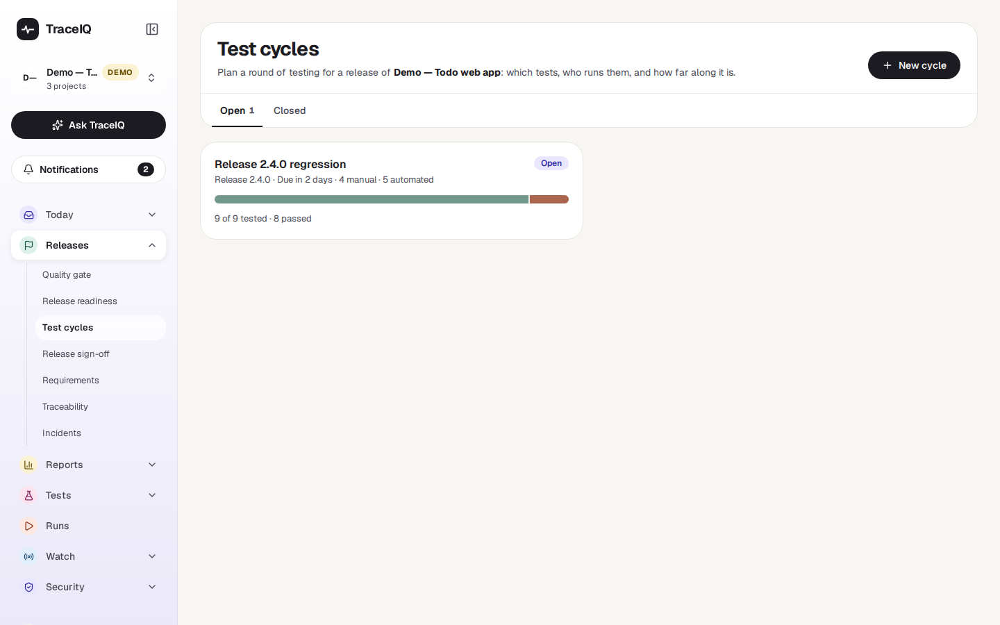

*The cycles of the demo's web project. Click the picture to see it larger.*

Two tabs, **Open** and **Closed**, each with a card per cycle (the newest 200). A card shows the cycle's name, its release, when it is due, how many manual and automated tests it holds, a progress bar, and a line such as *"9 of 9 tested · 8 passed"*. The label at the top right says:

- Open testing is under way.
- Overdue the cycle is open, its due date has passed, and at least one test has not passed.
- Closed, Closed · approved or Closed · rejected for a closed cycle, with its newest sign-off if it has one.

**New cycle** asks for a name, and optionally the release, a due date, a suite to start with (every test in that suite and the suites inside it) and notes. Click a card to open the cycle.

## A tour of one cycle

The numbers on the screenshot match the sections below. The demo's cycle is the regression round for release 2.4.0: nine tests, eight passed, one still failing.

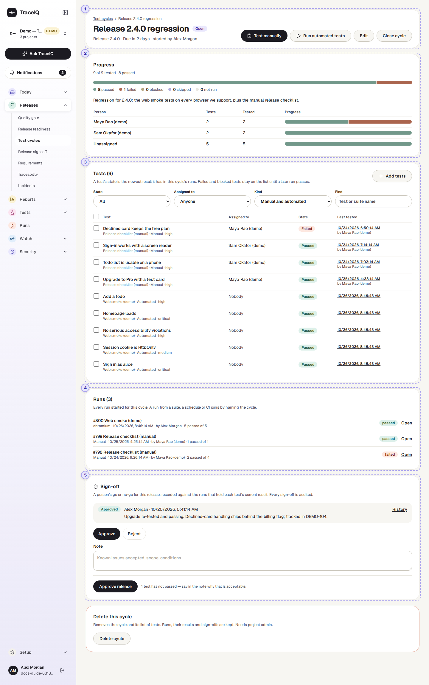

*The cycle "Release 2.4.0 regression".*

## 1. Header and buttons

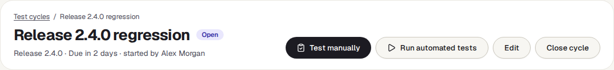

The name, the label (Open, Overdue or Closed), the release, when it is due and who started it. Editors also see these buttons:

| Button | What it does |
|---|---|
| **Test manually** | Opens a manual run with the steps to follow, for the manual tests of the cycle. Shown when the cycle has manual tests. |
| **Run automated tests** | Starts the cycle's automated tests. Shown when the cycle has automated tests. |
| **Edit** | Change the name, release, due date, commit and notes. |
| **Close cycle** / **Reopen** | A closed cycle can't be changed and no run can be added to it, until it is reopened. |

## 2. Progress

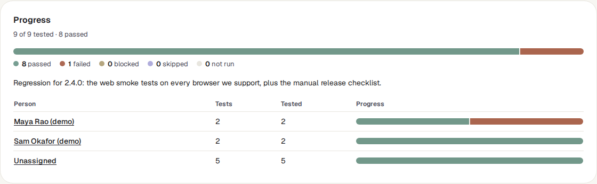

One bar for the whole cycle, with the counts written under it, then one row per person with their own bar. Each test is in exactly one of five states:

| State | Meaning |
|---|---|
| Passed | Its newest result in this cycle passed. |
| Failed | Its newest result failed. |
| Blocked | It could not be carried out: a tester marked it blocked, or an automated test stopped with an error or ran out of time. |
| Skipped | A tester chose to skip it. |
| Not run | It has no result in this cycle yet. |

"Tested" counts everything except *Not run*. Click a person's name to show only their tests in the list below.

## 3. Tests

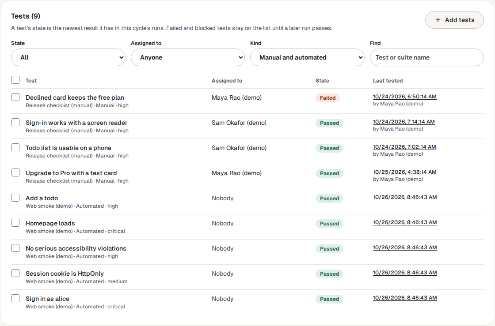

Every test in the cycle: its name, suite, whether it is manual or automated, who it is assigned to, its state, and when it was last tested (a link to that result). Four filters narrow the list: **State** (including *Still to do*, which is everything that has not passed), **Assigned to** (including *Me* and *Nobody*), **Kind** and **Find**.

An automated test that ran on several browsers shows the worst of them, with the note *"worst of 2 browsers"*: a pass on one browser does not hide a failure on another.

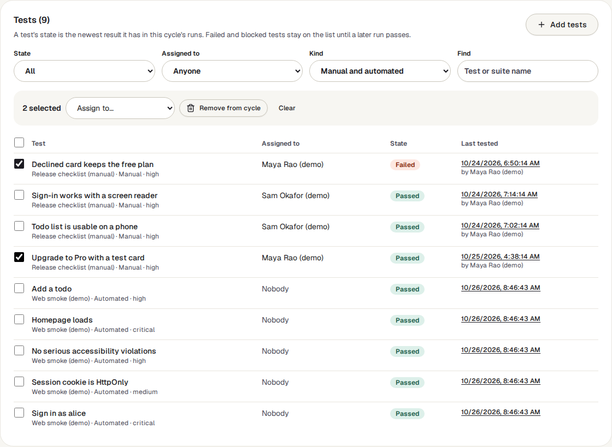

Editors can tick tests (or the box in the heading for all shown) and then **Assign to…** a person, or **Remove from cycle**. **Add tests** brings in a whole suite, or single tests found by name:

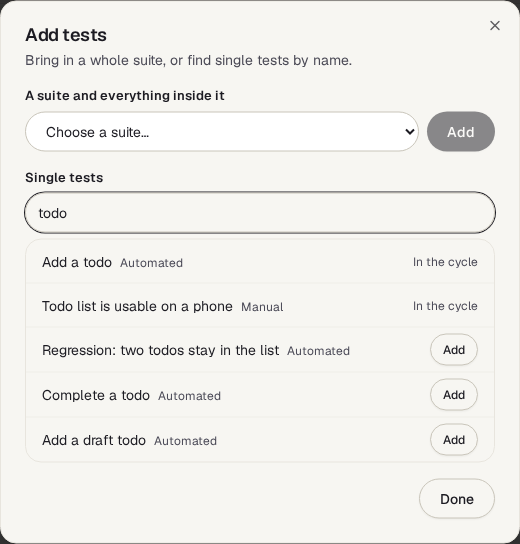

## 4. Runs

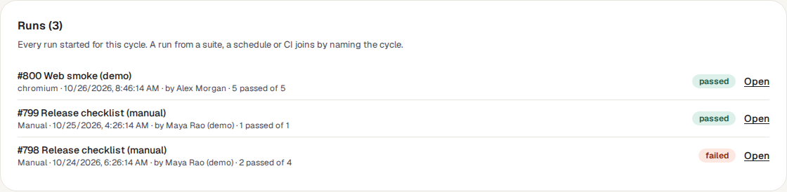

Every run made for the cycle, newest first (the newest 200): its number and suite, whether it was manual or which browser it used, when it started and who started it, its counts and its outcome. **Open** goes to the run; a manual run that is not finished says **Continue testing**.

## 5. Sign-off

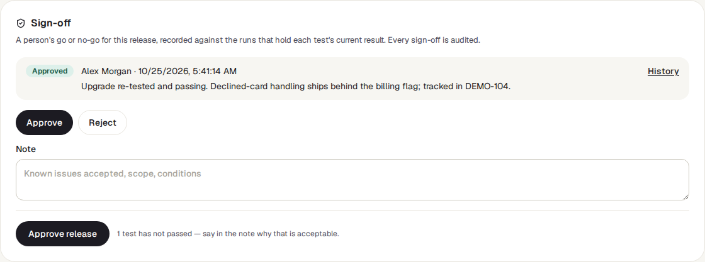

The newest go or no-go for this cycle, with who gave it, when, and their note. Editors can record a new one: choose **Approve** or **Reject**, write a note, and press the button. Next to the button the page says how many tests have not passed, so an approval with failures is a deliberate one. **History** opens *Release sign-off*, where every sign-off of the project is kept.

## Watch it in use

[▶ Watch the video](../media/releases/test-cycles/walkthrough.mp4)

*Under a minute, with a spoken commentary. The captions at the bottom show the same words, so it also works with the sound off. Nothing is saved in the video.*

## How to…

### …plan a cycle

1. Press **New cycle**, name it, and if you like pick the release, a due date and a suite to start with.
2. In the cycle, use **Add tests** for more suites or single tests, and **Remove from cycle** for the ones that don't belong.
3. Tick tests and choose a person under **Assign to…**. Only active members who can edit tests in the project are offered.

### …test by hand

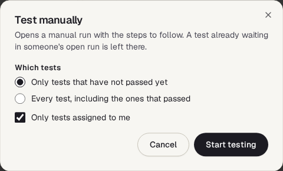

1. Press **Test manually**. It starts with *Only tests that have not passed yet* and *Only tests assigned to me*.
2. Press **Start testing**. The manual run opens with the steps to follow; record each test as passed, failed, blocked or skipped.
3. Come back to the cycle: the states and the bars have moved.

A manual run belongs to one top-level suite, so a cycle whose manual tests sit in several suites gets one run for each; they are listed under **Runs**. A test that is already waiting in someone's unfinished manual run is left there, so two people are not handed the same test.

### …run the automated tests

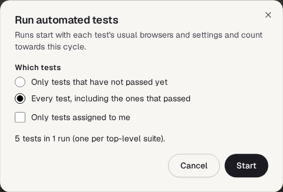

1. Press **Run automated tests** and choose which tests. The window says how many tests and runs that makes.
2. Press **Start**. One run starts per top-level suite, with each test's usual browsers and settings.
3. The page refreshes by itself while those runs are in progress.

### …count a run from your build system

A run started by a script joins a cycle when it names it. Add `cycle_id` to the body of the request that starts the run (the cycle's number is the last part of its page address):

`curl -X POST "$TRACEIQ_URL/api/runs?suite_id=12" \ -H "X-API-Key: $TRACEIQ_API_KEY" -H "Content-Type: application/json" \ -d '{"cycle_id": 7, "git_commit": "'"$GIT_SHA"'"}'`

### …finish a cycle

1. Check **Progress**, and filter the tests by *Still to do* to see what is left.
2. Under **Sign-off**, choose Approve or Reject, write the note, and press the button.
3. Press **Close cycle**. It moves to the Closed tab with its results.

## Good to know

- **Only the cycle's own runs count.** A test's state comes from runs started from the cycle, or started elsewhere with the cycle named. A pass in an ordinary nightly run does not tick the test off.
- **The newest result wins.** A later pass replaces an earlier failure, for each browser separately. A cancelled result, and a manual test nobody has recorded yet, count as nothing.
- **Nothing is ticked by hand.** Progress is worked out from the results each time the page opens. If a run is deleted, its results leave the cycle with it.
- **What a sign-off covers.** Every run that holds a current result of one of the cycle's tests, on each browser. You don't pick them. Only a person can sign, not an API key. An approval is refused while one of those runs is still in progress. If the workspace requires a separate approver, someone who started or recorded those manual runs can't sign.
- **Being assigned.** Open the bell (Notifications) and choose *Assigned to me*: cycles where you still have tests to run are listed there. No email or notification is sent when a test is assigned.
- **Deleting a cycle** needs the project *admin* role. It removes the cycle and its list of tests; the runs, their results and the sign-offs are kept.
- **Deleting a test** removes it from every cycle.
- **Limits.** 2,000 tests in a cycle, 500 cycles in a project.
- **Changes are in the audit log**: creating, editing, adding and removing tests, assigning, closing, reopening and deleting.

## Related pages

> **Release sign-off**
>
> The next page in this guide: every sign-off of the project, and signing off without a cycle.

> **Release readiness**
>
> The ready / not-ready answer for a commit from the automated evidence.

> **Suites**
>
> Where manual and automated tests are written.

> **Runs**
>
> Each run of the cycle in full, and working on a failure together.

## Video script

What the walkthrough says, in order. The video and every picture on this page are made by the Playwright script [`releases-test-cycles.spec.ts`](../../../../e2e/docs-capture/pages/releases-test-cycles.spec.ts).

1. A test cycle is one round of testing for a release.
2. Each card shows how far a cycle is: how many tests were run, and how many passed.
3. Progress counts every test in the cycle, and shows the same for each person.
4. The list holds manual and automated tests together, with who is testing each one.
5. Show only what is still to do. A failed test stays here until a later run passes.
6. Every run made for the cycle is listed, by hand or automated.
7. When testing is done, a person approves or rejects the release here.
