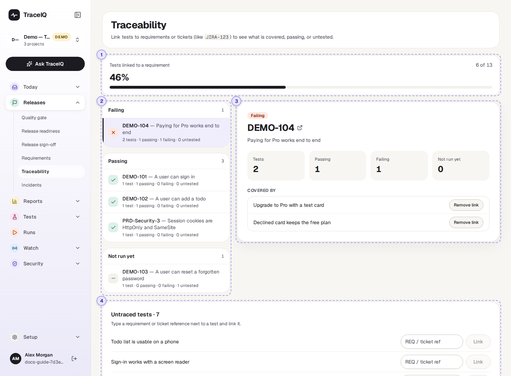
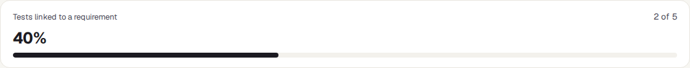
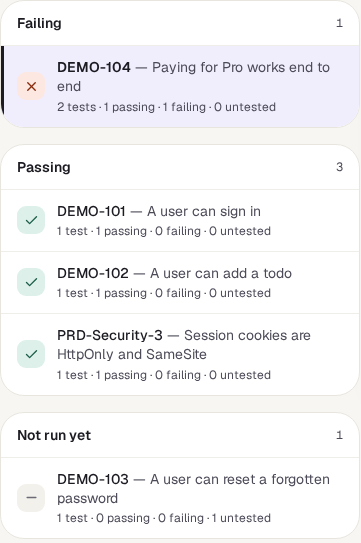
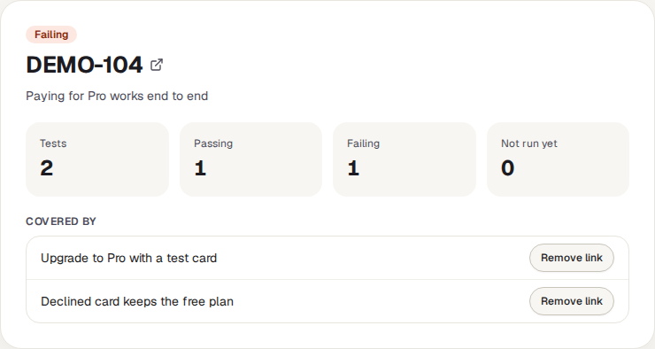
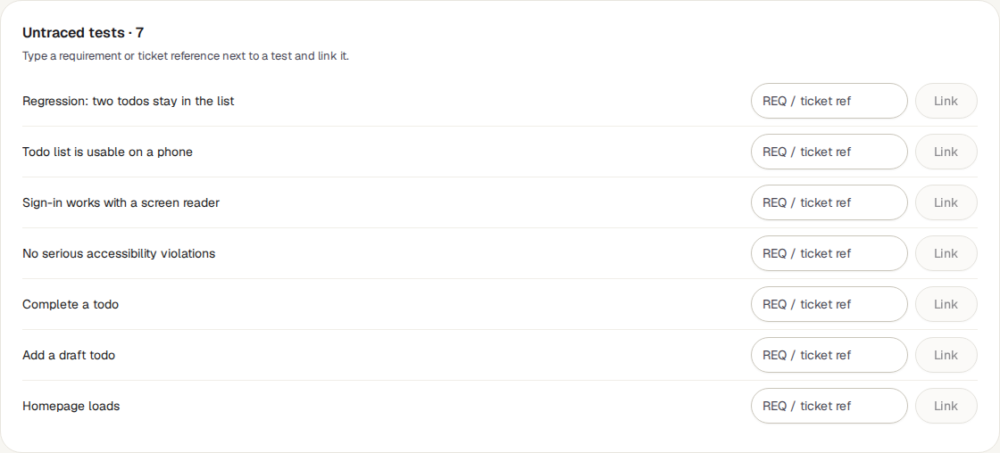

<!-- Generated from traceability.html by e2e/docs-capture/export_md.py. Edit the HTML, not this file. -->

# Traceability

Releases · Everyone with access to the project can see it · Editors can add links

> **In short**
>
> Connects tests to the requirements or tickets they check, such as `JIRA-123`. For each requirement you see its tests and whether they pass; at the bottom, the tests that aren't connected to anything yet, with a box to connect them.

## What it is for

Traceability answers two questions: **"Which tests prove that this requirement works?"** and **"Which tests don't belong to any requirement?"** The connection between a test and a requirement is called a *link*. It is just the requirement's reference (its ticket key, or any name you agree on), written next to the test. Requirements don't have to be imported first: typing a reference here is enough.

> **Testers**
>
> Link each test to the ticket it checks, and see which tests are still unlinked.

> **Product owners**
>
> See, ticket by ticket, whether the tests behind it pass.

> **Auditors**
>
> Show that a requirement was tested, and by which tests.

**Where to find it:** in the sidebar, open **Releases → Traceability**. It shows the project selected at the top of the sidebar.

## A tour of the screen

The share of linked tests is at the top, the requirements below it with the selected one on the right, and the unlinked tests at the bottom. The numbers on the screenshot match the sections below.

*The Traceability page for the demo's web project. Click the picture to see it larger.*

## 1. Tests linked to a requirement

How many of the project's tests have at least one link, out of all its tests, as a number and a percentage. A test with several links counts once.

## 2. The requirements

One row for every reference that has at least one test linked to it, boxed by status. The boxes come in this order, and inside a box the rows are in order of reference:

| Box | A requirement is here when… |
|---|---|
| Failing | …the newest result of at least one of its tests failed (or ended in error). |
| Mixed results | …some of its tests passed and the others have never run. None failed. |
| Passing | …the newest result of every one of its tests passed. |
| Not run yet | …none of its tests has run yet. |

Under each reference: its number of tests, and how many are passing, failing and untested. Click a row to show it on the right; until you do, the first one is shown.

If no test is linked to anything yet, the box says "No requirements linked yet".

## 3. The selected requirement

- **The label** is its status from the table above.
- **The reference**, and its title if one was saved with the link. When the link carries an address, the reference opens the ticket in a new tab.
- **Tests, Passing, Failing, Not run yet**: the counts behind the status.
- **Covered by**: the names of the linked tests. Editors see each one with **Remove link**, which unlinks that test from the requirement after asking.

## 4. Untraced tests

Every test of the project that isn't linked to anything, with the number in the heading. Type a reference in the box next to a test and press **Link**. The test then leaves this list, and the reference appears in ②. Up to 200 tests are listed; the line underneath says how many more there are. When every test is linked, this card disappears.

## Watch it in use

[▶ Watch the video](../media/releases/traceability/walkthrough.mp4)

*Under a minute, with a spoken commentary. The captions at the bottom show the same words, so it also works with the sound off. Nothing is linked in the video.*

## How to…

### …link a test to a ticket

1. Find the test under **Untraced tests**.
2. Type the ticket's key exactly as it is written in your tracker, for example `DEMO-103`.
3. Press **Link**. You need the *editor* role. A message says "Requirement linked".

### …check that a requirement is tested and working

1. Find its reference in the list. If it isn't there, no test is linked to it.
2. Click it and look at the counts. *Failing* above zero means at least one of its tests is broken now.
3. Open **Runs** or **Failure triage** to see why.

### …see how well the project is traced

1. Read the percentage at the top.
2. Work down the **Untraced tests** list. Some tests (for example a general "the site loads" check) may not belong to any one ticket, and that's fine.

## Good to know

- **Results are matched by test name here.** This page takes each test's newest result *with the same name* in the project, whatever version of the app it ran on. After a test is renamed, it shows as not run until it runs again under its new name. The *Requirements* and *Release readiness* pages match results to the test itself instead, so their numbers can differ.
- **The reference must match exactly.** For an imported ticket to count a link on the *Requirements* page, the reference must be written the same way as its key. `demo-101` and `DEMO-101` are two different references.
- **Removing a link** needs the *editor* role: select the requirement and press **Remove link** next to the test. A requirement with no tests left disappears from the list.
- **Other ways links are made.** Accepting a test that was generated from an imported requirement links it automatically.
- **It doesn't update by itself.** Come back to the browser tab or reload to see newer results.
- **Check runs don't count.** The runs TraceIQ makes to check a suggested fix are left out.

## Related pages

> **Incidents**
>
> The next page in this guide: production problems, recurring ones, and the bugs your tests let through.

> **Requirements**
>
> Import tickets from Jira or Linear, with their acceptance criteria.

> **Release readiness**
>
> The linked requirements, judged on one version of your app.

> **Suites**
>
> Where the tests themselves are written and organised.

## Video script

What the walkthrough says, in order. The video and every picture on this page are made by the Playwright script [`releases-traceability.spec.ts`](../../../../e2e/docs-capture/pages/releases-traceability.spec.ts).

1. Traceability links tests to the requirements or tickets they check.
2. The bar shows how many of the project’s tests are linked to a requirement.
3. Each requirement is listed, grouped by how its tests are doing.
4. Click one to see its tests on the right.
5. The counts say how many linked tests pass, fail, or have not run yet.
6. Covered by lists those tests by name.
7. Untraced tests are not linked to anything yet.
8. Type a ticket reference next to a test and press Link to connect them.
