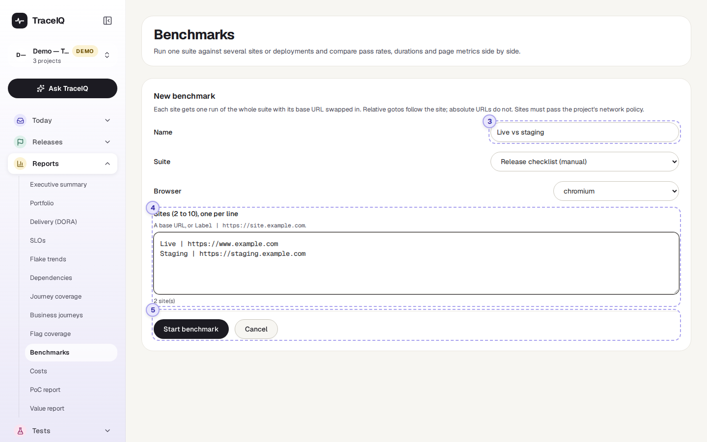
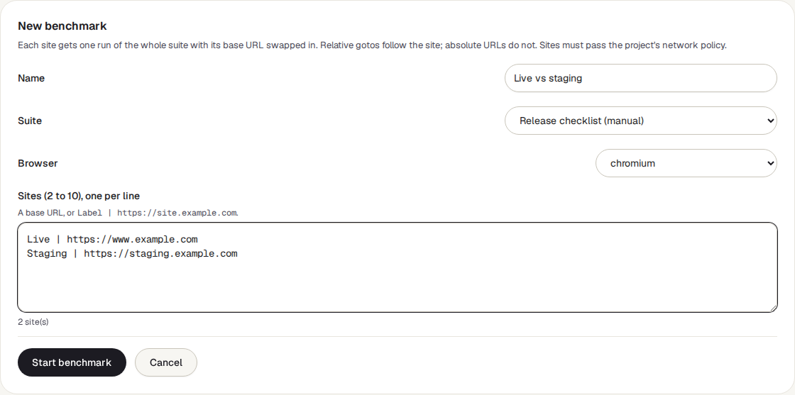

<!-- Generated from benchmarks.html by e2e/docs-capture/export_md.py. Edit the HTML, not this file. -->

# Benchmarks

Reports · Everyone with access to the project can see it · Editors can start and delete benchmarks

> **In short**
>
> A benchmark runs the same set of tests against two to ten sites at once (for example your live site and your staging site) and puts the results side by side: which site passed more tests, which was faster, and which tests behaved differently.

## What it is for

Benchmarks answers **"Does this site behave the same as that one?"** Typical uses: checking that a new version on staging passes everything the live site passes, comparing two regions or hosting providers, or comparing page speed before and after a change.

> **Testers**
>
> See in one table which tests pass on one site and fail on another.

> **Developers**
>
> Compare load times and page metrics of two deployments of the same app.

> **Leads**
>
> Get a simple "best pass rate" and "fastest" summary to back a go / no-go decision.

**Where to find it:** in the sidebar, open **Reports → Benchmarks**. It shows the project selected at the top of the sidebar.

A few words used on this page: a **suite** is a folder of tests; a **run** is one time TraceIQ carries out a suite and records the result of each test. A benchmark starts **one run per site**, all of the same suite.

## A tour of the screen

The page has two views: the list of benchmarks with the comparison for the one you pick, and the form to start a new benchmark. The numbers on the screenshots match the sections below.

*The Benchmarks page for the demo's web project, with its one benchmark opened. Click the picture to see it larger.*

## 1. New benchmark

Opens the form (parts 3 to 5 below). The button is hidden while the form is open.

## 2. Benchmarks and their results

Until the project has a benchmark, this says *"No benchmarks yet"*. Afterwards the left side lists the 50 newest benchmarks, newest first, each with its number of sites, the browser and when it was started, and a label: running while any of its runs is still queued or running, complete once they have all finished. The newest one is opened on the right until you click another.

The right side shows the chosen benchmark:

*The demo's benchmark: the same five tests against two sites. Every test passed on both, but the second site was slower.*

- **Its name**, the suite, the browser and the start time, with two buttons: **Run again** starts a new benchmark with the same suite and sites (it appears as a new entry in the list), and **Delete** removes the benchmark after asking; its runs stay in the run list.
- While runs are still going, a line says so, and the view refreshes by itself every 5 seconds.
- A yellow warning when some tests open a **full web address** (see "Which pages follow the site" below).
- **One row per site**, with the columns below.
- A summary line: **Best pass rate**, **Fastest**, and how many tests differ between sites.
- **Per test**: one row per test and one column per site, with each result and how long it took. Rows marked differs did not get the same result everywhere, or didn't run on every site.

| Column | What it means |
|---|---|
| **Site** | The label you gave the site, with its address underneath. |
| **Status** | The result of that site's run. Click it to open the run, with every step, screenshot and log. |
| **Pass rate** | Tests that passed ÷ all test results of that run. Results with no verdict (cancelled, timed out) count in the total too, so they lower the rate. |
| **Passed / total** | The same as two numbers. |
| **Duration** | How long the whole run took. |
| **Avg case** | How long one test took on average. **Fastest** in the summary is the site with the lowest average. |
| **LCP, FCP, CLS, INP, TTFB, Load** | Page-speed measurements, averaged over the run. They appear only if the suite has a "check page budget" step; otherwise the summary says no page-budget steps were measured. |

> **The page-speed measurements, in plain words**
>
> - **LCP** (largest contentful paint): when the main content appeared. **FCP** (first contentful paint): when anything appeared at all.
> - **CLS** (cumulative layout shift): how much the page jumped about while loading. A number, not a time; lower is better.
> - **INP** (interaction to next paint): how quickly the page reacted to a click.
> - **TTFB** (time to first byte): how long the server took to start answering. **Load**: when the page finished loading.
>
> For all of them, lower is better.

When one test appears several times in a run (for example once per row of test data), the cell shows the worst of its results.

### The form

*The form after pressing New benchmark, with an example filled in. It was left with Cancel, so nothing was started.*

## 3. Name, suite and browser

- **Name**: anything that tells the comparison apart, up to 200 characters.
- **Suite**: the folder of tests to run on every site. Every suite of the project is listed, including folders inside folders; the whole suite runs, sub-folders included.
- **Browser**: chromium (the starting value), firefox or webkit (the engine behind Safari). All sites use the same browser.

## 4. Sites

One site per line, between 2 and 10. Either just the address (`https://www.example.com`) or a label, a bar and the address (`Live | https://www.example.com`). Without a label, the site's name is used. Under the box, TraceIQ counts the sites it understood, or names the line that isn't a web address. The same address can't be listed twice.

> **Which pages follow the site**
>
> Each site's run uses that site's address in place of the project's usual one. A test step that opens a *relative* address such as `/cart` goes to `/cart` on each site in turn. A step that opens a *full* address such as `https://www.example.com/cart` goes to that same address on every run, so it compares nothing. The comparison warns you which tests do this.

> **Sites TraceIQ may refuse**
>
> Each address is checked when you press Start benchmark (and again on Run again). Addresses inside a private network are refused unless the server allows them, and if the project limits which sites its tests may reach (its network policy), every site must be on that list.

## 5. Start or cancel

**Start benchmark** stays grey until there is a name, a suite, and 2 to 10 sites with no mistakes. It starts one run per site straight away ("Started 2 runs") and opens the new benchmark. **Cancel** goes back without starting anything.

## Watch it in use

[▶ Watch the video](../media/reports/benchmarks/walkthrough.mp4)

*About a minute, with a spoken commentary. The captions at the bottom show the same words, so it also works with the sound off.*

## How to…

### …compare staging with the live site

1. Make sure the right project is selected at the top of the sidebar.
2. Press **New benchmark**, give it a name and choose the suite.
3. In **Sites**, type `Live | ` and the live address on the first line, and `Staging | ` and the staging address on the second.
4. Press **Start benchmark**. The comparison fills in as the runs finish.
5. Look at the **Per test** table for rows marked differs.

### …find out why a test fails on one site only

1. In the per-site table, click the **Status** of the site where it failed.
2. The run opens. Find the test and look at its failing step and screenshot.

### …repeat a comparison after a fix

1. Pick the benchmark in the list.
2. Press **Run again**. A new benchmark with the same name, suite and sites appears at the top of the list, so the old results stay for comparison.

## Good to know

- **Benchmark runs are ordinary runs.** They appear in *Runs*, count towards your plan's run allowance, and are recorded in the audit log.
- **The settings come from the suite.** Each run uses the suite's own headers and settings (inherited from the folders above it, as for any run), only with a different site address.
- **Deleting keeps the runs.** Delete removes only the benchmark grouping; its runs stay in the run list.
- **Who can do what.** Anyone with access to the project can look at benchmarks. Starting, re-running and deleting need the *editor* role.
- **Refresh.** A benchmark that is still running refreshes every 5 seconds. Otherwise the page refreshes when you come back to its browser tab.

## Related pages

> **Costs**
>
> The next page in this guide: what testing costs, in AI use and machine time.

> **Runs**
>
> Each benchmark run in full: every test, step, screenshot and log.

> **Frontend quality**
>
> Page budgets: limits on load time and page metrics, which feed the speed columns here.

> **Environments**
>
> The usual site address of a project, which a benchmark swaps for each site.

## Video script

What the walkthrough says, in order. The video and every picture on this page are made by the Playwright script [`reports-benchmarks.spec.ts`](../../../../e2e/docs-capture/pages/reports-benchmarks.spec.ts).

1. Benchmarks runs the same tests against several sites and compares the results.
2. For example, your live site against staging, or before and after a change.
3. New benchmark opens a form. Editors can use it.
4. Give it a name, and choose the suite of tests to run.
5. Then list the sites, one per line: a short label, a bar, and the address.
6. You need between two and ten sites. The count underneath checks what you typed.
7. Start benchmark would start one run per site. We press Cancel instead.
8. Each benchmark shows a row per site, and every test side by side.
