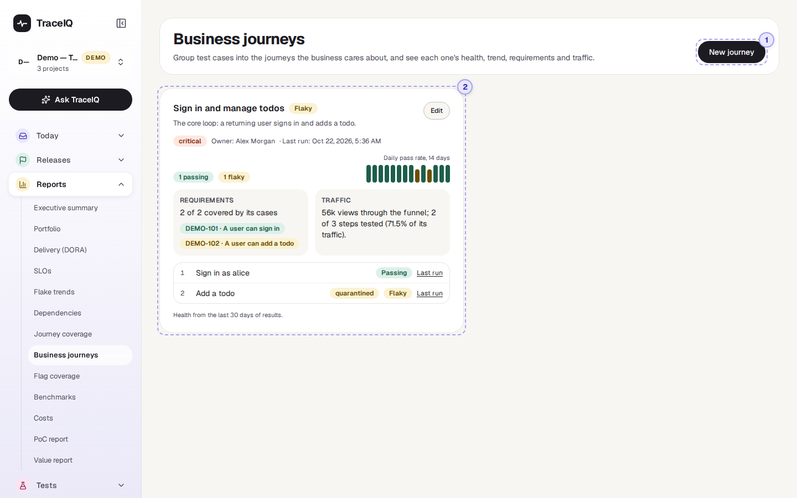
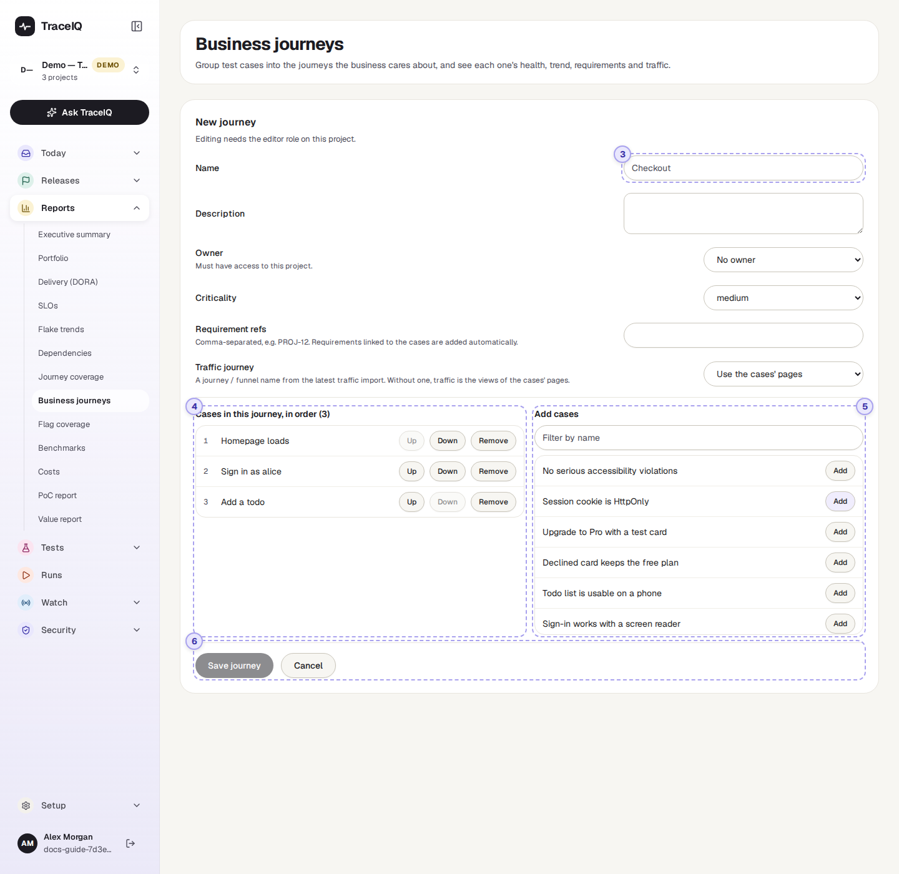
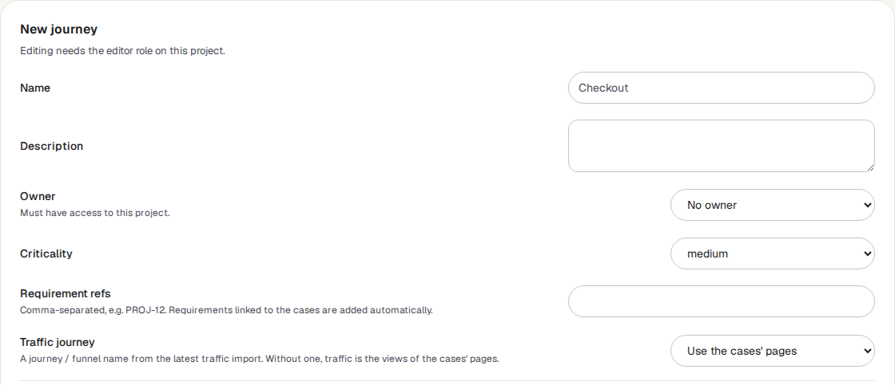

<!-- Generated from business-journeys.html by e2e/docs-capture/export_md.py. Edit the HTML, not this file. -->

# Business journeys

Reports · Everyone with access to the project can see it · Editors can change it

> **In short**
>
> A journey is something a customer does from start to finish, such as "Checkout" or "Sign up". You choose the tests that together check that journey, and this page shows how the journey as a whole is doing: healthy, failing or unreliable, plus its trend, its requirements and how much real traffic goes through it.

## What it is for

Business journeys answers **"Can our customers still do the things that matter most?"** Test results are usually listed one test at a time, which is hard to read if you think in terms of what the business sells. Here, a handful of tests become one card called, say, *Checkout*, with one verdict.

> **Product owners**
>
> See at a glance whether the journeys you are responsible for work, without reading test names.

> **Testers**
>
> Group existing tests by journey, spot journeys with tests that never ran, and see which requirements they cover.

> **Leads and managers**
>
> Check the critical journeys first, and see who owns each one.

**Where to find it:** in the sidebar, open **Reports → Business journeys**. It shows the project selected at the top of the sidebar.

A few words used on this page: a **test** (TraceIQ also calls it a *case*) is one scripted check, such as "Sign in as alice". A **run** is one time TraceIQ carried out a set of tests and recorded the result of each.

## A tour of the screen

The page has two views: the **board**, with one card per journey, and the **form** you use to create or change a journey. The numbers on the screenshots match the sections below.

*The board for the demo's web project, which has one journey. Click the picture to see it larger.*

## 1. New journey

Opens the form (parts 3 to 6 below) in place of the board. The button is hidden while the form is open.

## 2. The board

One card per journey, two cards side by side on a wide screen. **Critical** journeys come first, then high, medium and low; journeys with the same criticality are in alphabetical order. Until the project has a journey, the board says *"No journeys yet"*.

*The demo's journey: it is *Flaky* because one of its two tests, "Add a todo", is quarantined.*

Each card shows, from top to bottom:

- **The journey's name and its health** (see the table below), with the description underneath.
- **Its criticality, owner and last run**: when the most recent run of any of its tests started, in your own time zone.
- **A count of its tests by state**, for example "2 passing" and "1 not run".
- **Daily pass rate, 14 days**: one small bar per day, oldest on the left. Point at a bar to see that day's numbers, such as "2026-10-14: 75% of 4".
- **Requirements**: how many of the linked requirements are covered by the journey's tests, and a label per requirement coloured by the state of the tests that cover it.
- **Traffic**: how many real visits go through the journey, from the latest traffic file imported on *Journey coverage*.
- **Its tests, in order**, each with its own state and a **Last run** link to the run it last ran in. A test that is set aside as unreliable (*quarantined*) has an extra "quarantined" label.
- **Edit** (top right of the card) opens the same form as New journey, filled in.

| Health | When a test has it | When the journey has it |
|---|---|---|
| Failing | Its most recent result failed or ended in an error. | At least one of its tests is failing. |
| Flaky | Its latest result did not fail, but the test is unreliable: it is quarantined, its latest result was marked flaky (it passed only after a retry, or the test has a high flakiness score), or its last 10 results mix passes and failures. | No test is failing, but at least one is flaky. |
| Passing | Its most recent result passed, and none of the above applies. | No test is failing or flaky, and at least one is passing. |
| Not run | It has no result in the last 30 days, or its latest result has no verdict (still queued or running, cancelled or timed out). | None of its tests is passing, failing or flaky — usually because none has run in the last 30 days. |

A requirement whose label says No case is linked to the journey but none of the journey's tests covers it.

| Bar colour | Meaning |
|---|---|
| Dark green | Every result that day passed. |
| Brown | Some passed, some did not. The taller the bar, the more passed. |
| Dark red | Nothing passed that day. |
| Grey stub | None of the journey's tests ran that day. |

### The form

*The form after pressing New journey, with three tests added. It was left with Cancel, so nothing was saved.*

## 3. The details

| Field | What to put in it |
|---|---|
| **Name** | Required, up to 120 characters, and different from the project's other journeys. |
| **Description** | Optional. Shown under the name on the card. |
| **Owner** | Optional. Chosen from the people who have access to the project; TraceIQ refuses an owner who doesn't. |
| **Criticality** | Critical, high, medium (the starting value) or low. Decides the order of the board. |
| **Requirement refs** | Ticket keys separated by commas, such as `DEMO-101, DEMO-102` (up to 50). Requirements already linked to the journey's tests are added on their own; you don't need to type those. |
| **Traffic journey** | A journey (or funnel) name from the latest traffic import on *Journey coverage*. Leave it on *Use the cases' pages* to count the visits to the pages the tests open instead. |

## 4. Cases in this journey

The tests that make up the journey, numbered in the order a customer meets them. **Up** and **Down** change the order; **Remove** takes a test out of the journey (the test itself is not touched). A journey can hold up to 200 tests.

## 5. Add cases

Every test in the project that isn't in the journey yet. Type in **Filter by name** to narrow the list, and press **Add** to put a test at the end of the journey. The list shows at most 50 tests at a time, so use the filter in a large project.

## 6. Save or cancel

**Save journey** stores the journey and takes you back to the board; it stays grey until there is a name. **Cancel** goes back without saving. When you edit an existing journey there is also **Delete journey**, which asks you to confirm and removes only the journey, never its tests.

## Watch it in use

[▶ Watch the video](../media/reports/business-journeys/walkthrough.mp4)

*About a minute, with a spoken commentary. The captions at the bottom show the same words, so it also works with the sound off.*

## How to…

### …set up a journey

1. Make sure the right project is selected at the top of the sidebar.
2. Press **New journey** and type a name, such as *Checkout*.
3. Choose an owner and how critical the journey is.
4. Under **Add cases**, press **Add** next to each test that belongs to the journey. Put them in order with **Up** and **Down**.
5. Press **Save journey**. The card appears on the board straight away.

### …find out why a journey is red

1. On the journey's card, look down the list of tests for the ones marked Failing.
2. Press **Last run** next to it to open the run, with its screenshots and logs.
3. Check the 14-day bars: one red day after many green ones is a new problem; a long run of brown bars is a lasting one.

### …link a journey to its requirements

1. Press **Edit** on the journey's card.
2. Type the ticket keys into **Requirement refs**, separated by commas.
3. Press **Save journey**. The card's Requirements box shows how many of them the journey's tests cover. A title appears next to a key when that requirement has been imported on the *Requirements* page.

## Good to know

- **Health is worked out each time you open the page**, from the last 30 days of results in this project. Nothing is stored, so changing a journey's tests changes its health at once.
- **One project at a time.** A journey belongs to one project and can only contain that project's tests. Switch project at the top of the sidebar to see another project's journeys.
- **Deleted tests drop out by themselves.** If a test in a journey is deleted, the card says how many tests "no longer exist in this project and are ignored".
- **Days in the trend are UTC days.** In India (UTC+5:30), a result recorded at 2 a.m. counts towards the previous day.
- **Check runs are left out.** Runs TraceIQ makes only to try a suggested fix (see *Proposals*) count towards neither health nor trend. Runs that were cancelled or timed out don't count in the trend either.
- **Traffic needs an import.** Without a traffic file on *Journey coverage*, the Traffic box says "No traffic import" with a link to import one.
- **Who can do what.** Anyone with access to the project can see the board. Creating, editing or deleting a journey needs the *editor* role; others can open the form but saving is refused. Every change is recorded in the audit log.
- **It doesn't update by itself** while you look at it; it refreshes when you come back to its browser tab, or when you reload.

## Related pages

> **Flag coverage**
>
> The next page in this guide: which values of your feature flags have actually been tested.

> **Journey coverage**
>
> Import real traffic figures and see which pages and funnels your tests cover. The Traffic box here reads from it.

> **Requirements**
>
> Import tickets from Jira or Linear and see which are covered by tests. Gives requirement keys their titles here.

> **Flaky tests**
>
> Why a test counts as unreliable, and how quarantine works.

## Video script

What the walkthrough says, in order. The video and every picture on this page are made by the Playwright script [`reports-business-journeys.spec.ts`](../../../../e2e/docs-capture/pages/reports-business-journeys.spec.ts).

1. Business journeys groups tests into the journeys your business cares about.
2. For example, Checkout or Sign-up: several tests that, together, are one thing a customer does.
3. New journey opens a form. Editors can use it.
4. Give it a name, an owner, and how critical it is.
5. Requirement refs links it to tickets, such as demo one-oh-one.
6. Then pick the tests that make up the journey, in the order a customer meets them.
7. Up and Down change the order. Remove takes a test out again.
8. Save journey adds it to the board. We press Cancel, so nothing is saved.
9. On the board, each journey gets a card: its health, a fourteen-day trend, its requirements and its traffic.
