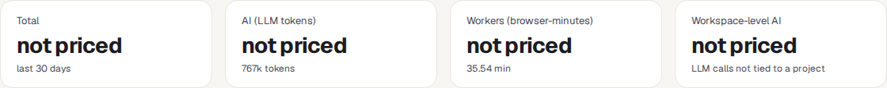
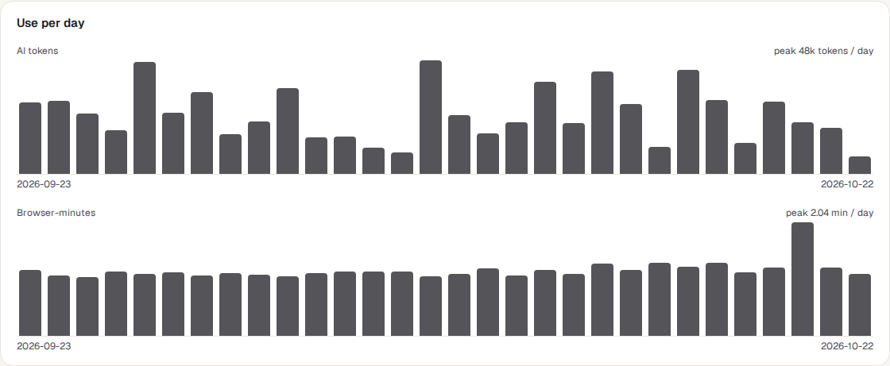
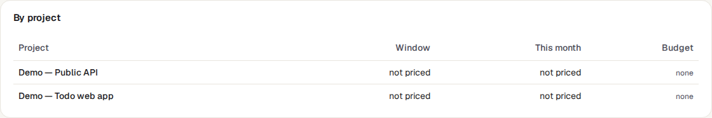
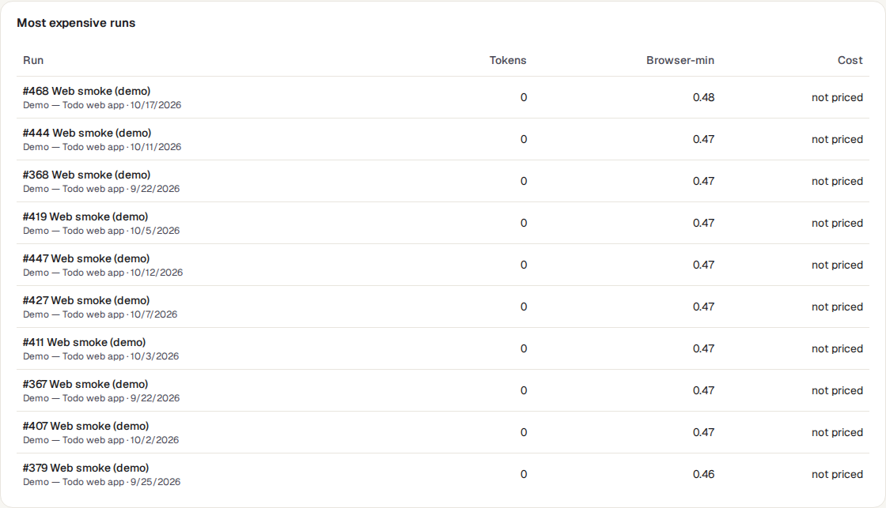
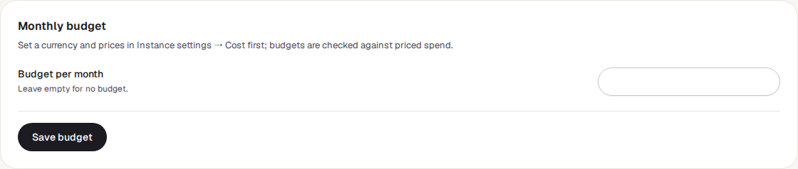

<!-- Generated from costs.html by e2e/docs-capture/export_md.py. Edit the HTML, not this file. -->

# Costs

Reports · Everyone can see it (their own projects) · Project admins set budgets

> **In short**
>
> What your testing costs. TraceIQ adds up two things it already records — how much AI it used, and how long test machines spent running tests — and turns them into money with a price list your server administrator sets. Each project can have a monthly budget, with an alert when it gets close.

## What it is for

Costs answers **"How much is testing costing us, and where does it go?"** It shows the spend per day, per AI model, per feature, per project and for the most expensive runs, so you can see which project or which kind of work drives the bill.

> **Project admins**
>
> Set a monthly budget and get warned at 80% and 100% of it.

> **Leads and managers**
>
> Compare projects, and see whether spend is going up or down over time.

> **Testers and developers**
>
> Find the runs that use the most AI or machine time, and make them cheaper.

**Where to find it:** in the sidebar, open **Reports → Costs**. The page has its own workspace and project pickers; it does not follow the project selected in the sidebar.

Two words used on this page: **tokens** are the units AI services count and charge by (roughly, pieces of words sent to and received from the AI). **Browser-minutes** are the minutes that tests spent running in a browser on TraceIQ's test machines.

## A tour of the screen

The numbers on the screenshot match the sections below.

*The Costs page for the demo workspace. This server has no prices set, so every amount says "not priced". Click the picture to see it larger.*

## 1. The pickers

- **Window**: the last 7, 30 (the starting value), 90 or 365 days, counted in whole UTC days up to now.
- **Workspace**: the page opens on the workspace of the project picked in the sidebar; choose another here.
- **Project**: *All my projects*, or one project. Choosing one project also shows its monthly budget (part 8).

## 2. When there are no prices

TraceIQ never invents a price. Until an instance administrator sets a currency in **Setup → Instance settings → Cost**, a yellow note says *"No currency is set, so usage is shown without money"*, and every amount reads **not priced**. Tokens and browser-minutes are still counted and shown.

With a currency set, the administrator can give a price per million tokens for each AI model, and a price per browser-minute. Anything without a price stays "not priced" (never 0, which would read as "free"); a second yellow note then says the total covers only the priced part.

## 3. The four tiles

| Tile | What it shows |
|---|---|
| **Total** | AI plus machine time, for the window. |
| **AI (LLM tokens)** | The cost of AI use (failure analysis, fixing broken selectors, writing tests…), with the number of tokens underneath. |
| **Workers (browser-minutes)** | The cost of test-machine time, with the minutes underneath (and the price per minute, once set). |
| **Workspace-level AI** | Shown to workspace admins in the all-projects view: AI used for the workspace as a whole rather than for one project. Others see **Projects covered**, the number of projects in the report. |

## 4. Per day

One bar per day of the window, oldest on the left. With prices it is called **Spend per day** and the bars are money. Without prices it is called **Use per day** and shows two charts, one for AI tokens and one for browser-minutes (machine time), since they can't share one scale. **Point at a day** to see its numbers. With nothing used in the window it just says "No AI use or test time in this window".

Under the chart, a short note explains how browser-minutes are counted (see [Good to know](#good-to-know)).

## 5. By model and by feature

The AI use split two ways: by **model** (which AI, with its provider, and the tokens sent in and received out) and by **feature** (what TraceIQ used it for, such as Failure analysis, Selector healing or Test generation). The most expensive comes first. When nothing used AI in the window, both say "No AI usage in this window."

## 6. By project

Shown when *All my projects* is picked. For each project: the cost in the window, the cost so far **this month** (from the 1st, UTC), and its budget. A budget shows as a label such as "85% of €200.00": green below 80%, yellow from 80%, peach from 100%. Click a project's name to look at that project alone.

## 7. Most expensive runs

The ten runs that cost the most in the window, with their tokens, browser-minutes and cost. Without prices they are ranked by tokens, then by minutes. Click a run to open it.

## 8. Monthly budget

Appears at the bottom when one project is picked. Type an amount per month and press **Save budget**; leave the box empty and save to remove the budget. Only a project *admin* can change it; others see the amount and "Changing the budget needs the project admin role".

Once an hour TraceIQ compares this month's priced spend with the budget. When it reaches **80%**, and again at **100%**, it sends one alert to the project's own notification recipients and its Slack or Teams channels (set in the project's notification settings). Each alert is sent at most once per month (one message if both are crossed at once), and only if the project's notifications are switched on. Without a currency nothing is priced, so no alert is ever sent.

## Watch it in use

[▶ Watch the video](../media/reports/costs/walkthrough.mp4)

*About a minute, with a spoken commentary. The captions at the bottom show the same words, so it also works with the sound off.*

## How to…

### …see which project costs the most

1. Choose the **Workspace** and a window, such as 30 days.
2. Leave the project on **All my projects**.
3. Compare the **Window** column in **By project**.

### …set a monthly budget for a project

1. Make sure prices are set (no yellow "No currency is set" note). If not, ask your TraceIQ administrator.
2. Click the project's name in **By project**, or pick it in the Project picker.
3. Under **Monthly budget**, type the amount and press **Save budget**.
4. Check that the project's notification settings have the right people and channels, because that is where the alerts go.

### …find what makes testing expensive

1. Look at **By feature**: is most AI spent on analysing failures, or on fixing selectors?
2. Look at **Most expensive runs** and open the top ones. Long-running suites and runs with many failures (each analysed by AI) usually lead the list.

## Good to know

- **Browser-minutes are an approximation.** They add up how long each test ran. Time a test machine spends idle, starting a browser, or waiting between retries is not included, so the real machine time is higher.
- **What isn't counted as machine time:** manual tests (a person's time, not a machine's) and runs on a developer's own computer (local worker). Check runs for suggested fixes *are* counted, because they use machine time too.
- **You only see your own projects.** The report covers the workspace's projects you can access. AI use not tied to any project is shown only to workspace admins. You need access to at least one project in the workspace (or be its admin) to see the page at all.
- **Rounding.** Amounts are rounded once, to the currency's smallest unit (cents, or whole yen). A total can therefore differ by one cent from the sum of its rounded lines, as on an invoice.
- **Days and months are UTC.** "This month" starts at midnight UTC on the 1st.
- **Budget changes are recorded** in the audit log, with the old and new amount.

## Related pages

> **PoC report**
>
> The next page in this guide: a one-page summary of a trial, with a labelled time-saved estimate.

> **AI usage**
>
> AI use in tokens, by feature and over time, and the monthly token limit.

> **Instance settings**
>
> Where an administrator sets the currency and the price list (the Cost section).

> **Project settings**
>
> The notification recipients and channels that receive budget alerts.

## Video script

What the walkthrough says, in order. The video and every picture on this page are made by the Playwright script [`reports-costs.spec.ts`](../../../../e2e/docs-capture/pages/reports-costs.spec.ts).

1. Costs shows what testing costs: AI use, and the time test machines spend running tests.
2. First choose the workspace. Here, the demo workspace.
3. You can also choose how far back to look, and one project or all of them.
4. No currency has been set on this server, so the page shows usage without money.
5. The tiles split the total into AI tokens and browser-minutes.
6. The chart shows each day. Point at a day to see its numbers.
7. By project compares this window and this month with each project's budget.
8. Most expensive runs lists the ten runs that used the most. Click one to open it.
9. Click a project name to look at that project alone.
10. Its monthly budget is at the bottom. Project admins can set it.
