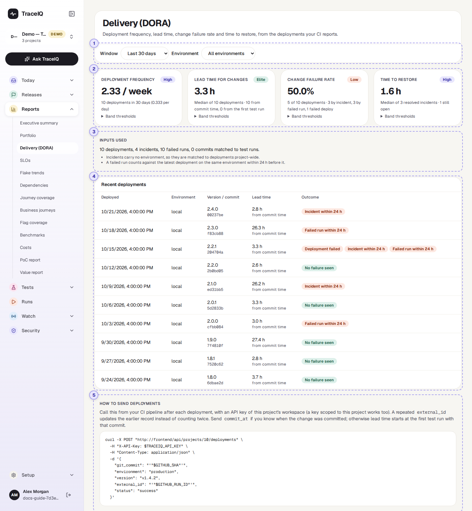
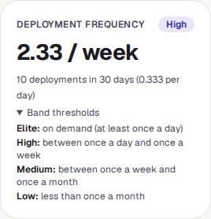
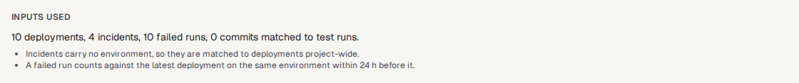
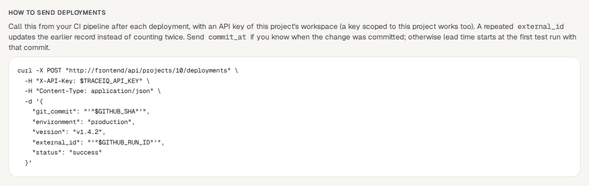

<!-- Generated from delivery.html by e2e/docs-capture/export_md.py. Edit the HTML, not this file. -->

# Delivery (DORA)

Reports · Everyone with access to the project can see it · Read-only page

> **In short**
>
> Four measures of how well your team delivers software: how often you deploy, how long a change takes to reach users, how often a deployment goes wrong, and how quickly you recover when it does. TraceIQ works them out from the deployments your build pipeline reports, plus your test runs and incidents.

## What it is for

This page answers **"Are we shipping quickly *and* safely?"** The four measures come from DORA (DevOps Research and Assessment), a long-running research programme into how software teams work. They are widely used because they balance each other: deploying more often only counts as progress if deployments don't fail more often too.

> **Engineering managers**
>
> See whether delivery is speeding up or slowing down, and compare with the published research bands.

> **Team leads**
>
> Find out which recent deployments were followed by failed tests or an incident.

> **Release and platform engineers**
>
> Check that the build pipeline reports every deployment, with the details the measures need.

**Where to find it:** in the sidebar, open **Reports → Delivery (DORA)**.

> **TraceIQ doesn't see your deployments by itself**
>
> A **deployment** is putting a new version of your app live. TraceIQ only knows a deployment happened when your build pipeline (CI, for example GitHub Actions or GitLab) tells it, with one web request after each deployment. Until that is set up, this page has nothing to measure. See [⑤ How to send deployments](#how-to-send).

## A tour of the screen

The page shows the project selected at the top of the sidebar. The numbers on the screenshot match the sections below.

*The Delivery page for the demo's web project. Click the picture to see it larger.*

## 1. Window and environment

- **Window**: the last 7, 30, 90 or 180 days, counting back from this moment. 30 days is chosen first. Only deployments made in the window are measured.
- **Environment**: all environments, or just one, for example production. Environments are the places your tests run against, set up on the *Environments* page; a deployment is linked to one when the pipeline names it.

## 2. The four measures

Each tile shows the measure, a coloured **band**, and underneath, what the number is based on. A dash (—) and No band mean there was nothing to measure; the line underneath then says what is missing.

| Measure | How TraceIQ works it out |
|---|---|
| **Deployment frequency** | The number of deployments in the window, shown per week (and per day underneath). |
| **Lead time for changes** | For each deployment: the time from when the change was made to when it went live. "When the change was made" is the commit time if the pipeline sent it; otherwise the first test run in TraceIQ of that exact version of the code (its commit). The tile shows the **median**: half of the deployments were quicker, half slower. Deployments with neither time are left out. |
| **Change failure rate** | The share of deployments that went wrong. A deployment went wrong if any of three things happened (the line underneath counts each): the pipeline reported the deployment itself as *failed*; an incident started within 24 hours after it; a test run on the same environment failed (or ended in error) within 24 hours after it. |
| **Time to restore** | For each incident that started in the window and has been resolved: the time from start to resolution. The tile shows the median, and how many incidents are still open. |

**Band thresholds** under each tile folds out the limits for that measure. They are the ones published in the 2023 *State of DevOps* report:

| Band | Deploys | Lead time | Change failure rate | Time to restore |
|---|---|---|---|---|
| Elite | at least once a day | under 1 day | 5% or less | under 1 hour |
| High | once a day to once a week | 1 day to 1 week | 10% or less | under 1 day |
| Medium | once a week to once a month | 1 week to 1 month | 15% or less | 1 day to 1 week |
| Low | less than once a month | over 1 month | over 15% | over 1 week |

## 3. Inputs used

What the four measures were worked out from, in this window: the deployments, the incidents, the failed test runs on the deployments' environments, and how many deployed versions TraceIQ could match to a test run (for lead time). In the demo, every deployment sent its commit time, so none needed matching to a test run, and the count is 0. If a measure looks wrong, start here. The two notes repeat the matching rules: incidents have no environment, so they are matched across the whole project; a failed run counts against the latest deployment to the same environment in the 24 hours before it.

## 4. Recent deployments

The deployments in the window, newest first (up to 50):

- **Deployed**: date and time it went live.
- **Environment**: where it went; "default" if the pipeline named none.
- **Version / commit**: the version name and/or the first 12 characters of the commit, as the pipeline sent them.
- **Lead time**: for this deployment, and whether it was measured "from commit time" or "from first test run". A dash if neither was available.
- **Outcome**: No failure seen, or one label per reason it counts as a failure: Deployment failed, Incident within 24 h, Failed run within 24 h.

The table is hidden when there are no deployments in the window.

## 5. How to send deployments

The example request your build pipeline sends after each deployment, filled in with this project's address. A developer or whoever looks after the pipeline adds it as the last step of the deployment job. It needs an **API key** (made under *Setup → API keys*) belonging to someone with the *editor* role on the project.

| Field | What it is for |
|---|---|
| `git_commit` | Which version of the code went out. Needed for lead time when `commit_at` is not sent. |
| `environment` | The environment's name exactly as on the *Environments* page. An unknown name is refused. |
| `version` | A version name people recognise, e.g. "v1.4.2". Also used to link an incident that names the release. |
| `status` | `success` or `failed`. A failed deployment counts towards the change failure rate. |
| `external_id` | The pipeline's own run number. If the same number is sent twice (a retried step), the first record is updated instead of counting a second deployment. |
| `commit_at` | Optional: when the change was committed. Gives the most accurate lead time. |
| `deployed_at` | Optional: when it went live. Left out, it is the moment the request arrives. A time in the future is refused. |

## Watch it in use

[▶ Watch the video](../media/reports/delivery/walkthrough.mp4)

*About a minute, with a spoken commentary. The captions at the bottom show the same words, so it also works with the sound off.*

## How to…

### …start measuring delivery

1. Make an API key under **Setup → API keys**. It acts as you, so you need the *editor* role on this project.
2. Copy the request from **How to send deployments** at the bottom of this page.
3. Have it added as the last step of your deployment job, with the key stored as a secret in the pipeline.
4. After the next deployment, open this page: the deployment appears in **Recent deployments**.

### …find out why the change failure rate is high

1. Look at the line under **Change failure rate**: it says how many failures came from incidents, from failed runs and from failed deployments.
2. In **Recent deployments**, find the rows with orange labels.
3. For *Failed run within 24 h*, open *Runs* and look at the failed runs on that environment after that time. They may be test problems rather than a bad deployment.

### …look at production only

1. Choose your production environment in the **Environment** menu.
2. Read the tiles again: deployments and failed runs now come from production only. Incidents still come from the whole project.

## Good to know

- **A failure is blamed on one deployment.** An incident goes to the deployment whose commit or version it names; otherwise to the latest deployment in the 24 hours before it started. A failed run goes to the latest deployment to the same environment in the 24 hours before it. Failures more than 24 hours after any deployment are not counted.
- **Incidents ignore the environment menu.** Incidents (from the *Incidents* page) don't record an environment, so they are matched across the whole project, and *Time to restore* uses all of the project's incidents whatever you pick.
- **Lead time from a test run needs the exact commit.** The commit the pipeline sends must be the same as the one on the test run. Runs started without a commit can't be matched.
- **Which runs count.** Only runs that ended *Failed* or *Error* make a deployment count as failed. The check runs TraceIQ makes for a suggested fix (see *Proposals*) are left out.
- **Deployments are removed only through the API.** There is no button on this page to delete one; an editor can do it with a request to the API.
- **It doesn't update by itself.** The page fetches the numbers when you open it, change a menu, or come back to its browser tab.
- **Times are shown in your browser's time zone.**

## Related pages

> **SLOs**
>
> The next page in this guide: whether your monitors meet the availability you promised, and how much error budget is left.

> **Incidents**
>
> Where incidents arrive from PagerDuty or Opsgenie, and are marked resolved. They feed the change failure rate and time to restore.

> **Environments**
>
> The environments a deployment can name, and that runs are linked to.

> **API keys**
>
> Make the key your build pipeline uses to report deployments.

## Video script

What the walkthrough says, in order. The video and every picture on this page are made by the Playwright script [`reports-delivery.spec.ts`](../../../../e2e/docs-capture/pages/reports-delivery.spec.ts).

1. Delivery measures how your team ships, from the deployments your build pipeline reports.
2. Deployment frequency: how often you deploy.
3. Each figure gets a band, from Low to Elite, using the published Dora research thresholds.
4. Lead time: how long a change takes to reach production.
5. Change failure rate: the share of deployments that went wrong.
6. Time to restore: how long incidents took to fix.
7. A dash means there was nothing to measure. The line below it says what is missing.
8. Recent deployments, newest first, and whether a failure followed each one.
9. Choose a longer window, or one environment, at the top.
10. At the bottom: the call your pipeline makes after each deployment.
