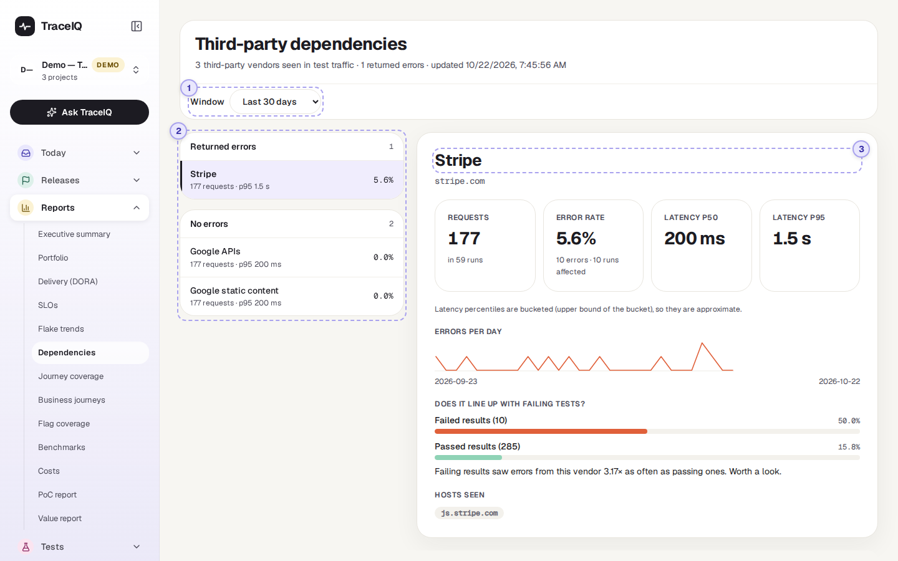
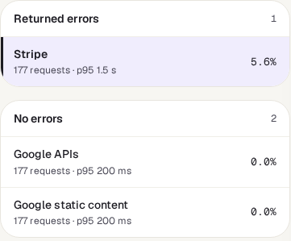

<!-- Generated from dependencies.html by e2e/docs-capture/export_md.py. Edit the HTML, not this file. -->

# Dependencies

Reports · Everyone with access to the project can see it · Read-only page

> **In short**
>
> Your app probably loads things from other companies' servers: analytics, payments, fonts, maps, a content delivery network. This page lists those outside services, as seen during your test runs, with how often they returned errors, how slow they were, and whether their errors happen more often when tests fail.

## What it is for

This page answers **"Is it us, or is it them?"** When tests fail, the cause is sometimes not your app at all but a service it depends on, such as a payment provider having a bad day. TraceIQ already records the requests the browser makes during each run, so it can tell you which outside services were involved and how they behaved.

> **Testers**
>
> Check whether a failing test lines up with errors from an outside service before reporting a bug in your own app.

> **Developers**
>
> See which outside services your pages load, and which of them are slow.

> **Leads and architects**
>
> Know which vendors you depend on, and how reliable they have been.

**Where to find it:** in the sidebar, open **Reports → Dependencies**. The page's own heading says **Third-party dependencies**.

## A tour of the screen

The page shows the project selected at the top of the sidebar. The line under the heading says how many outside services were seen, how many returned errors, and when the figures were last added up. Below it, the page splits in two: a list on the left, details on the right. The numbers on the screenshot match the sections below.

*The Dependencies page for the demo's web project, whose pages load Google Fonts and Stripe's script. Click the picture to see it larger.*

## 1. Window

How many days to cover: the last 7, 30 (chosen first), 90 or 180 days, counted in whole calendar days (UTC) up to and including today.

## 2. The list of services

Services are in two groups, **Returned errors** first, then **No errors**; within each, the services with the most errors (then the most requests) come first. Each row shows the service's name, its number of requests and its p95 speed (see below), with its error rate on the right. Click a row to show it on the right; until you do, the first one is shown.

A **service** is a web domain, such as `stripe.com`. Well-known ones get a readable name ("Stripe", "Google Analytics", "jsDelivr CDN"…); others are shown by their domain.

## 3. The selected service

*In the demo, half of the failed results came from runs where Stripe's script answered with an error, against about one in six passed results: "Worth a look".*

| Part | What it shows |
|---|---|
| **Requests** | How many responses the browser got from this service, and in how many runs. |
| **Error rate** | The share of those responses that were errors (an HTTP status of 400 or more, or no status at all), with the number of errors and of runs that had at least one. |
| **Latency p50 / p95** | How long its responses took. *p50*: half were quicker than this; *p95*: 95% were. These are approximate: TraceIQ sorts times into ranges (up to 25 ms, up to 50 ms, … up to 30 s) and shows the top of the range. |
| **Errors per day** | A small line of the number of errors each day in the window. |
| **Does it line up with failing tests?** | Two bars: of the *failed* test results, the share whose run saw an error from this service; and the same for *passed* results. Then one sentence: If failing results saw its errors more than 1.5 times as often as passing ones: "Worth a look". When no passing result saw an error at all, the figure is a minimum and reads "at least N×". Otherwise: "It is unlikely to be the cause". "Not enough data on both sides to compare" when either side has nothing to compare. |
| **Hosts seen** | The exact server names used under that domain, for example `js.stripe.com` and `api.stripe.com` (up to 20). |

At the bottom, **How this is built** repeats the rules in short (see [Good to know](#good-to-know)).

### When there is nothing to list

When no run in the window loaded anything from an outside service, or the runs haven't been added up yet, the page shows only the window menu and a box saying *"No third-party requests"*. That is normal for an API-only project, or a site that serves everything itself.

## Watch it in use

[▶ Watch the video](../media/reports/dependencies/walkthrough.mp4)

*About 45 seconds, with a spoken commentary. It was recorded before the demo project loaded any outside services, so its list is empty. The captions at the bottom show the same words, so it also works with the sound off.*

## How to…

### …check whether an outside service broke your tests

1. Choose a window that covers the failures, for example **Last 7 days**.
2. Look at the **Returned errors** group and click the service at the top.
3. Read **Does it line up with failing tests?** "Worth a look" means its errors came with failing tests much more often than with passing ones.
4. Check **Errors per day**: errors on the same days as the failures make the link stronger.

### …find the slowest outside services

1. Read the p95 figure in each row of the list.
2. Click a slow one and compare **Latency p50** and **p95**: a big gap means it is usually quick but sometimes very slow.

## Good to know

- **What counts as outside.** A request is to an outside service when its domain is different from your app's own: the site of the first page each test opened, the address a run was pointed at, and the environment's base address. `cdn.example.com` and `www.example.com` are the same domain, so they count as your own.
- **Only answered requests.** Requests that got no response at all (for example blocked or timed out in the browser) are not in the figures.
- **Only server names are kept**, never the rest of the address (paths or anything after a `?`), so nothing private from the requests is stored here.
- **Which runs count.** Finished runs (passed, failed or error). The check runs TraceIQ makes for a suggested fix (see *Proposals*) are left out.
- **Updated hourly.** Each hour TraceIQ adds up today and yesterday again. Figures are kept for 180 days.
- **A link is not proof.** "Worth a look" says errors and failures happened in the same runs; it doesn't say which caused which. Open a failing run and look at its network requests to be sure.

## Related pages

> **Journey coverage**
>
> The next page in this guide: how much of your real visitors' traffic your tests cover.

> **Runs**
>
> A run's own page, with the network requests it recorded, for the details behind these figures.

> **Failure triage**
>
> Failures grouped by cause; a *Network* group often points at an outside service.

> **Script inventory**
>
> The scripts your pages load from other sites, from a security point of view.

## Video script

What the walkthrough says, in order. The video and every picture on this page are made by the Playwright script [`reports-dependencies.spec.ts`](../../../../e2e/docs-capture/pages/reports-dependencies.spec.ts).

1. Dependencies lists the outside services your app loads while the tests run.
2. For example analytics, payments, fonts or a content delivery network.
3. Services that returned errors come first, with their error rate on the right.
4. The selected one is shown in detail: requests, error rate and how slow it was.
5. And whether its errors came with failing tests more often than with passing ones.
6. The window menu picks how many days to cover, up to a hundred and eighty.
