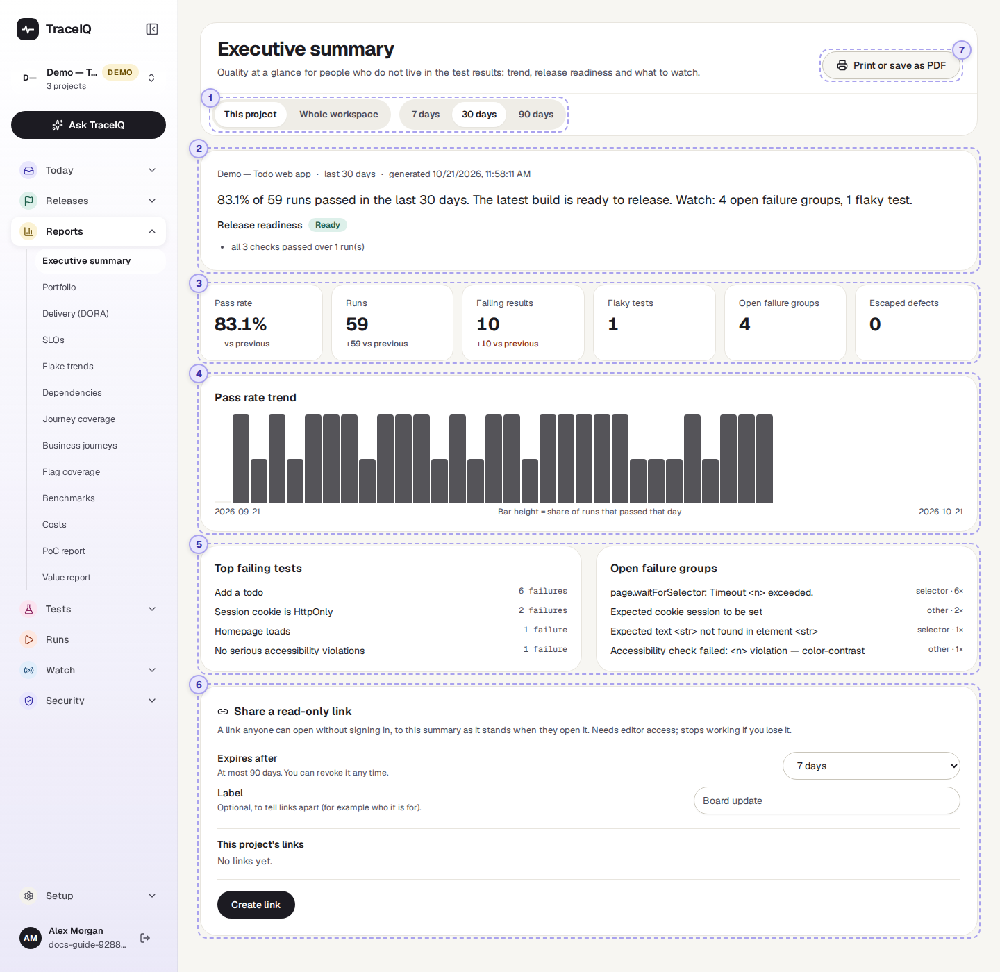
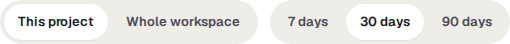
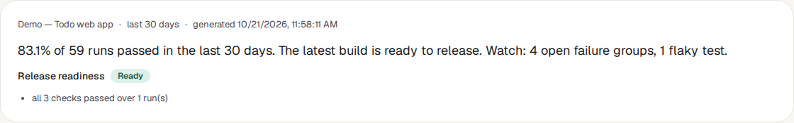
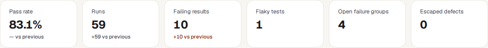
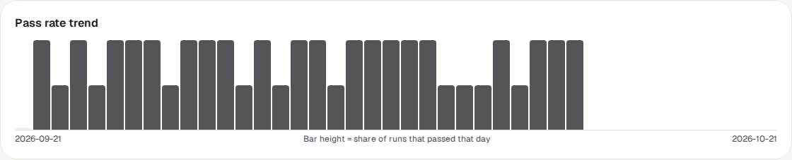
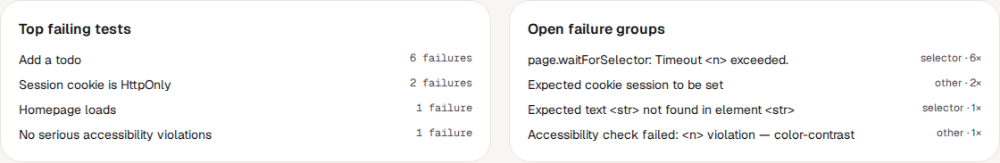
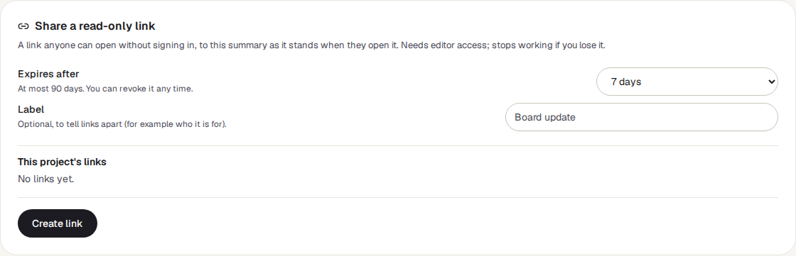
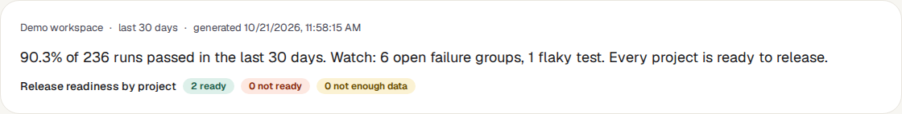
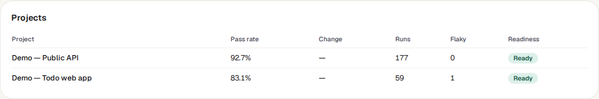

<!-- Generated from executive-summary.html by e2e/docs-capture/export_md.py. Edit the HTML, not this file. -->

# Executive summary

Reports · Everyone with access to the project can see it · Editors can share it

> **In short**
>
> One page, in plain words, about how testing is going: the pass rate and how it has changed, whether the latest version is ready to release, and what to keep an eye on. For one project or for a whole workspace. You can print it, save it as a PDF, or send a read-only link to people without a TraceIQ account.

## What it is for

The executive summary answers **"In short, how are we doing?"** for people who don't read test results every day. It takes the same numbers the rest of TraceIQ uses and puts them on one page, with a sentence at the top that says what they mean.

> **Managers and leadership**
>
> Read one sentence and six numbers instead of a list of runs. Print it for a meeting.

> **Team leads**
>
> Send a weekly or monthly update to stakeholders with a link that always shows the latest numbers.

> **Testers**
>
> See which tests failed most over the period, and how many separate problems are still open.

**Where to find it:** in the sidebar, open **Reports → Executive summary**.

## A tour of the screen

When the page opens it shows the project selected at the top of the sidebar, over the last 30 days. The numbers on the screenshot match the sections below.

*The Executive summary for the demo's web project. Click the picture to see it larger.*

## 1. Scope and period

- **This project** shows the project selected at the top of the sidebar.
- **Whole workspace** adds up every project in the workspace that *you* can see, and adds a table with one row per project (see [below](#workspace)). If you belong to more than one workspace, a **Workspace** menu appears so you can pick which one.
- **7 days, 30 days, 90 days** is the period the numbers cover. It counts back from this moment, not from the start of a calendar week or month.

## 2. The headline

The top line names the project, the period and when the summary was made. Then TraceIQ writes one to three sentences from the numbers:

- **The pass rate**, and whether it went up or down compared with the period before. A change of less than half a point reads "about the same".
- **Release readiness**: whether the latest version of your app is ready to ship, by the rules set on the *Quality gate* page. TraceIQ takes the newest finished run, and judges every run of that same version of the code. The coloured label repeats the answer, and the lines underneath give the reasons.
- **Watch:** the things worth a look, but only those that are above zero: open failure groups, flaky tests and escaped defects.

| Label | What it means |
|---|---|
| Ready | The latest version passed every check of the project's quality gate. |
| Not ready | At least one check failed. The reasons say which. |
| Not enough data | TraceIQ can't judge yet, for example because a check needs results that don't exist. |

If readiness can't be worked out at all, the label is left out.

## 3. The six tiles

| Tile | What the number means |
|---|---|
| **Pass rate** | The share of finished runs in the period that passed. A run that ended in *Error* counts as not passed. The line underneath is the change in **points** ("+3.1 pts" = from, say, 80% to 83.1%). |
| **Runs** | How many runs finished with a result (passed, failed or error) in the period, and how many more or fewer than in the period before. |
| **Failing results** | How many times a single test failed or ended in error. One run with three failing tests counts as three. This is the number that goes down when a team fixes things. |
| **Flaky tests** | Tests that are quarantined right now, or that TraceIQ currently rates as flaky (a flakiness score of 0.4 or more). This is today's count, not a count over the period. |
| **Open failure groups** | Problems on the *Failure triage* page that are still *Open* or *Investigating*, whenever they started. |
| **Escaped defects** | Incidents marked as escaped defects (bugs that reached users without a test catching them) in the period. If a critical incident is still open, the tile says so underneath. |

"vs previous" compares with the period of the same length just before: with 30 days selected, the 30 days before those. The change is coloured green when things got better and orange when they got worse. A pass-rate change shows "—" when either period had no finished runs, because there is nothing to compare.

## 4. Pass rate trend

One bar for each day of the period, oldest on the left and today on the right. The height of a bar is the share of that day's runs that passed: a full bar is 100%, a half bar 50%. A flat grey line means no run finished that day. **Point at a bar** to see its date, percentage and number of runs, for example *"2026-10-14: 50% of 2 runs"*.

The bars are all one colour on purpose, so the page prints well in black and white. Days are calendar days in **UTC**, and the first bar is usually a part day, because the period starts at this time of day, N days ago.

## 5. Failing tests and failure groups

- **Top failing tests**: the five tests that failed most often in the period, with how many times. Tests are matched by name.
- **Open failure groups**: the five open problems that have caused the most failures, with their kind (selector, assertion, timeout, network, navigation or other) and their count. A group is one cause behind many failures; the *Failure triage* page explains them.

## 6. Share a read-only link

A link anyone can open **without signing in**, for people who don't have a TraceIQ account. They see this summary, but with less in it (see the table below).

- **Expires after**: 1, 7, 30 or 90 days. 7 is chosen first.
- **Label**: optional, to tell your links apart later, for example who it is for.
- **Create link** shows the link once, with a **Copy link** button. Copy it then: TraceIQ keeps only a scrambled form of it and can't show it again.
- The list underneath shows each link with its status (Active, Expired or Revoked), who made it, when it expires, how many times it has been opened and when it was last opened. **Revoke** stops a link working straight away.

The link always covers the period that was selected when you made it (7, 30 or 90 days), and its numbers are worked out again **every time someone opens it**, so it always shows the latest state, not a copy from the day you sent it.

| On the shared page | What is in it |
|---|---|
| **Shown** | The headline, the tiles, the chart, the top failing tests (their names and counts) and the readiness label. For a workspace: the project names and their numbers. |
| **Left out** | The list of open failure groups (their names can quote error messages), the reasons under release readiness, and anything else from the runs: no screenshots, errors, web addresses or email addresses. |

On **This project**, the list also shows the project's links to single runs, made with **Share** on a run's page.

## 7. Print or save as PDF

The **Print or save as PDF** button opens your browser's print window. The sidebar, the buttons and the share card are left out of the printout. To get a PDF, choose *Save as PDF* as the printer.

### The whole-workspace view

With **Whole workspace** chosen, the numbers add up all the projects you can see in that workspace. The headline then counts projects by readiness instead of showing one label:

Below the chart, a **Projects** table gives each project's pass rate, the change in points against the period before, its runs, its flaky tests and its readiness label:

A line under the page says how many projects it covers.

## Watch it in use

[▶ Watch the video](../media/reports/executive-summary/walkthrough.mp4)

*About a minute, with a spoken commentary. The captions at the bottom show the same words, so it also works with the sound off.*

## How to…

### …prepare a monthly update for a meeting

1. Select the project at the top of the sidebar, or choose **Whole workspace**.
2. Choose **30 days**.
3. Press **Print or save as PDF**, and choose *Save as PDF* in the print window.

### …send stakeholders a link that stays up to date

1. Choose the scope and the period the link should cover.
2. In **Share a read-only link**, choose how long it should work and give it a label, for example "Board update".
3. Press **Create link**, then **Copy link**, and paste it into your email or chat. It is not shown again.
4. When it is no longer needed, press **Revoke** next to it in the list.

### …compare this week with last week

1. Choose **7 days**.
2. Read the lines under the tiles: each compares the last 7 days with the 7 days before.
3. If the pass rate went down, look at **Top failing tests** to see which tests are behind it.

## Good to know

- **Which runs count.** Only runs that finished with a result: passed, failed or error. Cancelled and timed-out runs, runs still going, and the check runs TraceIQ makes for a suggested fix (see *Proposals*) are left out.
- **You only see your own projects.** The workspace view adds up only the projects you have access to, so two people can see different numbers for the same workspace.
- **Who can share.** Anyone who can see the project can read this page. Making a project link needs the *editor* role on it. A workspace link needs editor on at least one project, and covers **only the projects where you are an editor**, so it can show fewer projects than you see on screen.
- **A link stops working** when it expires, when it is revoked, or when the person who made it loses editor access or their account is switched off. A project link can be revoked by any editor of the project; a workspace link by the person who made it or a workspace admin.
- **It doesn't update by itself.** The page fetches the numbers when you open it, change scope or period, or come back to its browser tab.
- **The same numbers everywhere.** The weekly digest email set up on the *Analytics* page and the *Portfolio* page are built from the same counts, so they can't disagree with this page for the same project and period.

## Related pages

> **Portfolio**
>
> The next page in this guide: every project in the workspace side by side, in one sortable table.

> **Release readiness**
>
> The full "ready / not ready" answer behind the label in the headline, with every check and reason.

> **Failure triage**
>
> The open failure groups in detail: the error, every test it broke, and who is working on it.

> **Analytics**
>
> One project in more depth, and where the weekly digest email is set up.

## Video script

What the walkthrough says, in order. The video and every picture on this page are made by the Playwright script [`reports-executive-summary.spec.ts`](../../../../e2e/docs-capture/pages/reports-executive-summary.spec.ts).

1. The executive summary shows how testing is going, on one page you can print.
2. The headline says it in a sentence or two: pass rate, release readiness and what to watch.
3. The tiles give the numbers, with the change against the period before.
4. The period buttons choose seven, thirty or ninety days.
5. One bar per day. The taller the bar, the more runs passed that day.
6. Below: the tests that failed most, and the open failure groups behind them.
7. Whole workspace adds up every project you can see, with one row per project.
8. Share a read-only link with people who have no TraceIQ account. It shows numbers and names only.
9. Print or save as PDF gives a clean printout of the summary.
