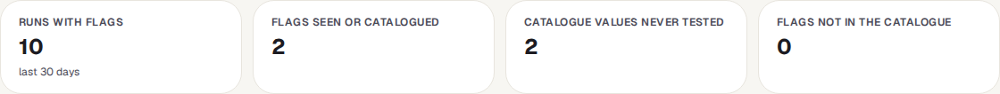
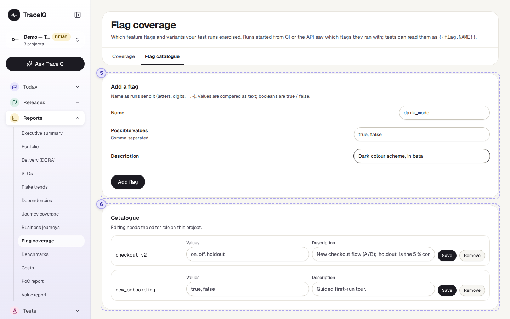
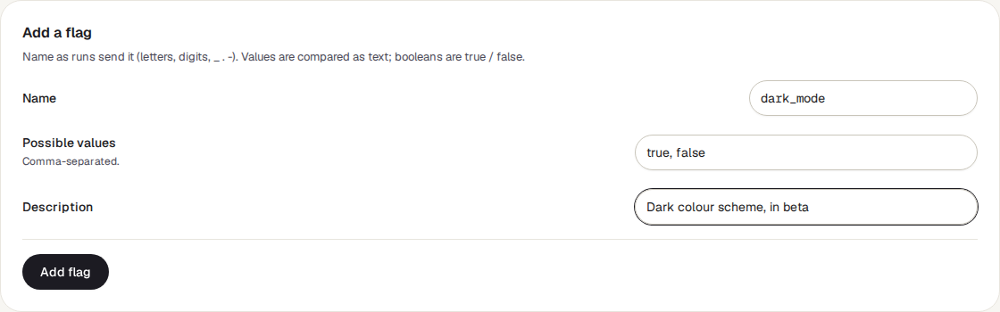

<!-- Generated from flag-coverage.html by e2e/docs-capture/export_md.py. Edit the HTML, not this file. -->

# Flag coverage

Reports · Everyone with access to the project can see it · Editors can change the catalogue

> **In short**
>
> Many apps can be switched into different versions with **feature flags** ("new checkout on or off") or **A/B variants** ("layout A or B"). This page shows which of those settings your test runs have actually tried, how those runs went, and which settings no run has tested at all.

## What it is for

Flag coverage answers **"Have we tested every version of the app our customers might see?"** If the new checkout is switched on for half of your customers but every test ran with it switched off, the tests say nothing about what that half sees. This page makes that gap visible.

> **Testers**
>
> Find flag values that no run has tried yet, and see whether runs with a value pass as often as runs without it.

> **Developers**
>
> Check that a flag you are about to switch on has been tested in both positions.

> **Product owners**
>
> Keep a list of the flags and experiments that exist, with a short description of each.

**Where to find it:** in the sidebar, open **Reports → Flag coverage**. It shows the project selected at the top of the sidebar.

## Where the flag values come from

TraceIQ doesn't read your app's flag settings. Instead, whoever *starts* a test run says which flags it runs with. A **run** is one time TraceIQ carries out a set of tests and records the result of each. Runs started from a build pipeline (CI) or by a script through TraceIQ's API can include a list such as `checkout_v2 = true`, `layout = B`. Runs started with the buttons in TraceIQ itself don't carry flags.

Ask the person who looks after your build pipeline to add the flags when it starts a run. (For them: the `flags` field of the `POST /api/runs` body, up to 50 names, each a text or true/false value.) Tests can also use the value in their steps, written as `{{flag.checkout_v2}}`.

## A tour of the screen

The page has two tabs: **Coverage** (the report) and **Flag catalogue** (the list of flags you expect). The numbers on the screenshots match the sections below.

*The Coverage tab for the demo's web project, where ten runs said which flags they ran with. Click the picture to see it larger.*

## 1. The tabs

**Coverage** is open when the page loads. **Flag catalogue** is where you list the flags and values you expect (parts 5 and 6).

## 2. Window

How far back to look: the last 7, 30 (the starting value), 90 or 180 days. Only runs started in that time count.

## 3. The four tiles

| Tile | What the number means |
|---|---|
| **Runs with flags** | Runs in the window that said which flags they ran with. Runs without flags are not counted anywhere on this page. |
| **Flags seen or catalogued** | Every flag name that appears in those runs, in the catalogue, or in both. |
| **Catalogue values never tested** | Values listed in the catalogue that no run in the window has used. This is the number to bring down. |
| **Flags not in the catalogue** | Flag names runs sent that nobody has added to the catalogue, often a typo or a new flag. |

## 4. One card per flag

Below the tiles there is one card per flag, in alphabetical order. While no run has sent flags and the catalogue is empty, there is only the message *"No flags yet"*.

*In the demo, runs tried `on` and `off`, but no run has tried the catalogue's third value, `holdout`.*

A card shows:

- **The flag's name**, with labels: not in catalogue when runs sent it but it isn't listed, and 2 value(s) never tested when catalogue values are missing from the runs. The catalogue's description is shown underneath.
- **Never tested:** the catalogue values no run has used.
- **A table with one row per value runs used**, the most used first:

| Column | What it means |
|---|---|
| **Value** | The value, such as `true` or `B`. A not catalogued label means the flag is in the catalogue but this value isn't in its list. |
| **Runs** | How many runs used this value. |
| **Cases** | How many different tests those runs carried out. |
| **Passed** / **Failed** | How many of those runs passed, and how many failed or ended in an error. Runs still going, cancelled or timed out are in neither. |
| **Last seen** | When the newest run with this value started, in your time zone, with a **run** link to open it. |

A catalogued flag that no run used shows "No run in this window used this flag." instead of a table.

### The Flag catalogue tab

*The catalogue tab with an example typed in. Add flag was not pressed, so nothing was saved.*

## 5. Add a flag

- **Name**: exactly as runs send it, up to 64 letters, digits, `_`, `.` or `-`. Capital letters count: `Checkout` and `checkout` are two flags.
- **Possible values**: separated by commas, up to 50. Values are compared as text; for an on/off flag, type `true, false`.
- **Description**: optional, shown on the flag's card.
- **Add flag** saves it. A name that is already in the catalogue is refused.

## 6. Catalogue

Every catalogued flag, one row each, in alphabetical order. You can change a flag's values and description and press **Save**, or press **Remove** (it asks first). The name can't be changed: remove the flag and add it again. Removing a flag only takes it off the list; the runs that used it still count on the Coverage tab.

## Watch it in use

[▶ Watch the video](../media/reports/flag-coverage/walkthrough.mp4)

*About a minute, with a spoken commentary. The captions at the bottom show the same words, so it also works with the sound off.*

## How to…

### …find flag values nobody has tested

1. On the **Flag catalogue** tab, make sure each flag lists all its possible values.
2. Go back to **Coverage** and choose a window, such as the last 30 days.
3. Look at **Catalogue values never tested**, then for cards with a red "never tested" label. Each one names the values missing.
4. Ask for a run with those values, for example by adding them to the build pipeline.

### …see whether a flag value makes tests fail

1. Find the flag's card on the **Coverage** tab.
2. Compare the **Passed** and **Failed** columns between its values. If one value fails much more often, it is worth a look.
3. Press **run** under Last seen to open the newest run with that value.

### …tidy up flags that runs send but nobody listed

1. Look for cards with not in catalogue.
2. If the name is a typo, ask for the pipeline to be fixed. If it is a real flag, add it on the **Flag catalogue** tab with its values.

## Good to know

- **Only runs that send flags count.** TraceIQ doesn't know which flags were on in your app unless the run says so.
- **Runs, not tests, carry flags.** Every test in a run counts towards each flag value that run sent.
- **At most 5,000 runs are counted**, the newest ones. When the window holds more, the first tile says "newest 5,000 counted".
- **Check runs are left out.** Runs TraceIQ makes only to try a suggested fix (see *Proposals*) are not counted.
- **In a test step**, `{{flag.NAME}}` is replaced by the value the run sent. If the run didn't send that flag, the text stays as it is.
- **Who can do what.** Anyone with access to the project can see both tabs. Adding, changing or removing catalogue flags needs the *editor* role; every change is recorded in the audit log. A project can catalogue up to 500 flags.
- **It doesn't update by itself** while you look at it; it refreshes when you come back to its browser tab, or when you reload.

## Related pages

> **Benchmarks**
>
> The next page in this guide: run the same tests against several sites and compare them side by side.

> **Business journeys**
>
> The previous page: group tests into the journeys your customers make, and see each one's health.

> **Runs**
>
> Every run, with each test's steps, screenshots and logs.

> **API keys**
>
> The keys a build pipeline uses to start runs, including runs that send flags.

## Video script

What the walkthrough says, in order. The video and every picture on this page are made by the Playwright script [`reports-flag-coverage.spec.ts`](../../../../e2e/docs-capture/pages/reports-flag-coverage.spec.ts).

1. Flag coverage shows which feature flags and variants your test runs have tried.
2. A run says which flags it ran with when it is started from C I or the A P I.
3. Choose how far back to look: from seven to a hundred and eighty days.
4. The tiles count the runs that sent flags, and the values no run has tried yet.
5. Below them, one card per flag: each value, how many runs used it, and how they went.
6. A red label counts the catalogue values that no run has tried.
7. The Flag catalogue tab lists the flags you have and every value they can take.
8. Type its name exactly as runs send it, and its possible values.
9. Add flag would save it. Editors can do this; here we leave it unsaved.
10. Once it is in the catalogue, values that no run has tried are counted on the Coverage tab.
