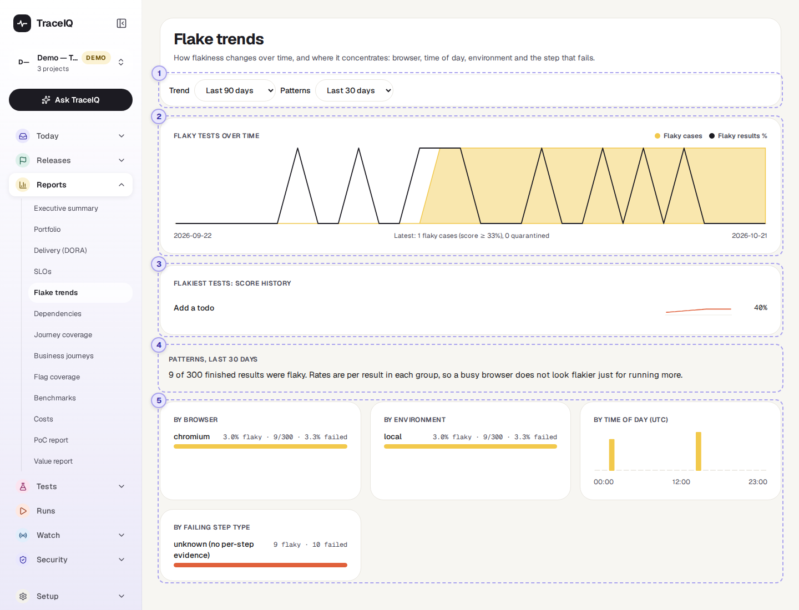
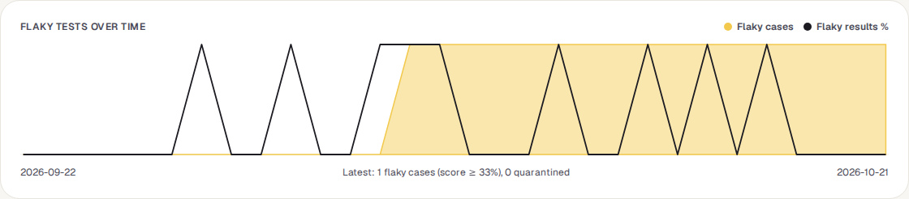
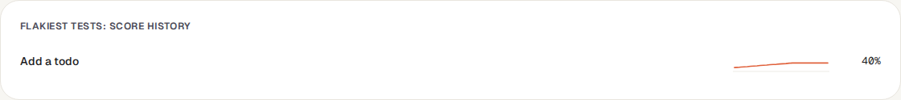
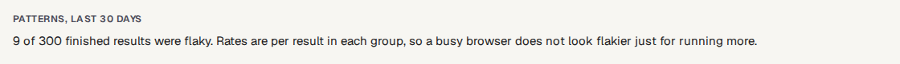
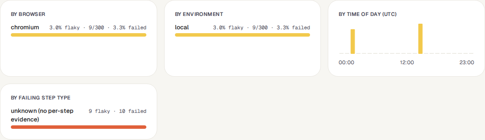

<!-- Generated from flake-trends.html by e2e/docs-capture/export_md.py. Edit the HTML, not this file. -->

# Flake trends

Reports · Everyone with access to the project can see it · Read-only page

> **In short**
>
> Whether flaky tests are becoming more or less common over time, which tests are the flakiest, and where flakiness gathers: in one browser, one environment, at one time of day, or in one kind of test step.

## What it is for

A **flaky test** passes and fails without anything having changed, so its failures can't be trusted. The *Flaky tests* page deals with them one by one. This page steps back and answers **"Is flakiness getting better or worse, and is there a common cause?"** If most flaky results come from one browser, or from runs at 2 a.m., the cause is probably the environment rather than each test.

> **Quality leads**
>
> Show whether the effort spent on flaky tests is paying off, month by month.

> **Testers**
>
> See which tests have been getting flakier, before they are quarantined.

> **Platform engineers**
>
> Spot a browser, environment or time of day where tests are unstable, which points at the infrastructure.

**Where to find it:** in the sidebar, open **Reports → Flake trends**.

> **The flakiness score**
>
> For every test, TraceIQ looks at its last 20 results and counts how often the result flipped between pass and fail. A test that always passes (or always fails) scores 0%; one that flips every time scores 100%. The page shows it as a percentage.

## A tour of the screen

The page shows the project selected at the top of the sidebar. The upper half is the trend over time; the lower half is the patterns. The numbers on the screenshot match the sections below.

*The Flake trends page for the demo's web project. Click the picture to see it larger.*

## 1. Trend and Patterns

- **Trend**: how far back the chart and the score history go: the last 30, 90 (chosen first) or 180 days.
- **Patterns**: which test results the lower half looks at: those of runs in the last 7, 30 (chosen first) or 90 days.

## 2. Flaky tests over time

One point per day, oldest on the left.

| Line | What it shows |
|---|---|
| Yellow area | **Flaky cases**: how many tests had a flakiness score of 33% or more that day. |
| Dark line | **Flaky results %**: of that day's test results, the share that were flaky (see [Good to know](#good-to-know) for what makes a result flaky). |

The line underneath gives the latest day's figures: the number of flaky tests and how many are quarantined (set aside so their failures don't count).

> **Read the shape, not the height**
>
> The chart has no scale, and each of the two lines is stretched to fill the height on its own. A peak at the top means "the most in this period", whether that is 1 test or 40. Use the "Latest" line for an exact number.

**Where the points come from.** TraceIQ takes a snapshot of every project every 6 hours; the last one of a day is that day's point. Days before the first snapshot have no point, and snapshots are kept for 180 days. A brand-new project says "No snapshots yet" until the first one is taken.

## 3. The flakiest tests

Up to 8 tests with the highest flakiness score in the latest snapshot (tests scoring 0% are left out). For each: a small line of how its score moved over the trend period (bottom = 0%, top = 100%), and its latest score. A line going up is a test that is getting flakier. The box is hidden when no test has a score.

## 4. Patterns summary

How many of the period's finished test results were flaky. In the boxes below, every figure is a **rate** within its group, so a browser that runs ten times as often doesn't look ten times as flaky.

## 5. Where flakiness gathers

| Box | What it shows |
|---|---|
| **By browser** | One row per browser, the flakiest first: "3.0% flaky · 9/300 · 3.3% failed" means 9 of its 300 results were flaky (3.0%), and 3.3% failed or ended in error. |
| **By environment** | The same per environment. Runs without an environment are grouped as "default (no environment)". |
| **By time of day (UTC)** | 24 bars, one per hour of the day in UTC, by when the run started. The taller the bar, the higher that hour's flaky rate. A grey stub means no run started in that hour. |
| **By failing step type** | For flaky and failed results: the kind of step that failed first (for example a click, or an expected text). The bar is the total; the text splits it into flaky and failed. "unknown (no per-step evidence)" counts results that didn't record their steps, or flaky ones that passed in the end and so have no failed step. |

In India (UTC+5:30), a bar at 02:00 UTC is 7:30 in the morning.

## Watch it in use

[▶ Watch the video](../media/reports/flake-trends/walkthrough.mp4)

*About a minute, with a spoken commentary. The captions at the bottom show the same words, so it also works with the sound off.*

## How to…

### …show whether flakiness went down this quarter

1. Choose **Last 90 days** in the **Trend** menu.
2. Compare the left and right ends of the yellow area. Lower on the right is fewer flaky tests.
3. Read the exact current number in the "Latest" line under the chart.

### …check whether the infrastructure is the cause

1. Choose **Last 30 days** in the **Patterns** menu.
2. Compare the rows in **By browser** and **By environment**. One row with a much higher flaky rate points at that browser or environment.
3. Look for one or two tall bars in **By time of day**: a busy time on a shared server, or a nightly job, can make tests unstable.

### …find a test that is getting worse

1. In **The flakiest tests**, look for a line that rises towards the right.
2. Open *Flaky tests* to give it an owner, or quarantine it while it is fixed.

## Good to know

- **What makes a result flaky.** A single test result is flaky when it passed only after being retried, or when its test's flakiness score was 40% or more at the time.
- **Two different lines are drawn.** The chart counts a test as flaky from a score of 33%, while a single result (and the *Executive summary*, *Portfolio* and release readiness) uses 40%. So the chart can show a flaky test before the other pages do.
- **Which results count.** Finished results only (passed, failed, error), from runs in the chosen period. The check runs TraceIQ makes for a suggested fix (see *Proposals*) are left out.
- **Days and hours are in UTC.**
- **It doesn't update by itself.** The page fetches the numbers when you open it, change a menu, or come back to its browser tab. The chart itself moves on only when a new snapshot is taken (every 6 hours).
- **Nothing here can be changed.** To quarantine a test or give it an owner, use the *Flaky tests* page.

## Related pages

> **Dependencies**
>
> The next page in this guide: outside services your app loads during tests, and whether their errors line up with failing tests.

> **Flaky tests**
>
> Every flaky test with its score, owner and quarantine, and the place to act on them.

> **Failure triage**
>
> Failures grouped by cause; a flaky test shows up there whenever it fails.

> **Analytics**
>
> One project's flakiest, slowest and most-failing tests over 7, 30 or 90 days.

## Video script

What the walkthrough says, in order. The video and every picture on this page are made by the Playwright script [`reports-flake-trends.spec.ts`](../../../../e2e/docs-capture/pages/reports-flake-trends.spec.ts).

1. Flake trends shows whether flaky tests are becoming more or less common, and where they cluster.
2. The yellow area is how many tests counted as flaky each day.
3. The dark line is the share of that day’s results that were flaky.
4. The flakiest tests, with how their flakiness score has moved.
5. Patterns: is flakiness worse in one browser, one environment, or at one time of day?
6. And which kind of step was failing when a test went wrong.
7. The trend can cover up to a hundred and eighty days; the patterns up to ninety.
8. A shorter pattern window shows what is happening this week.
