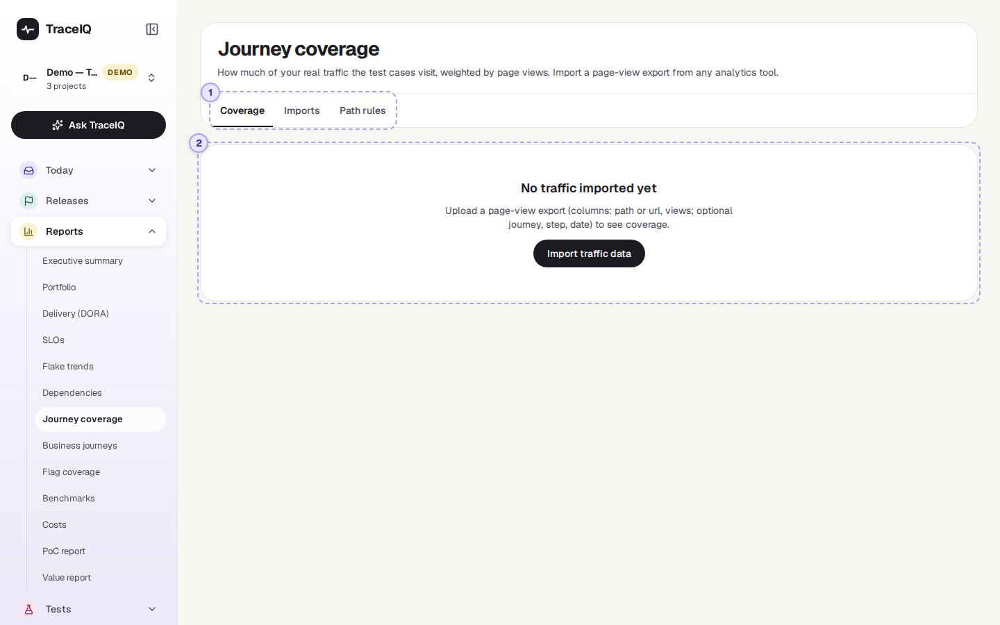
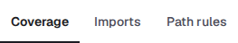
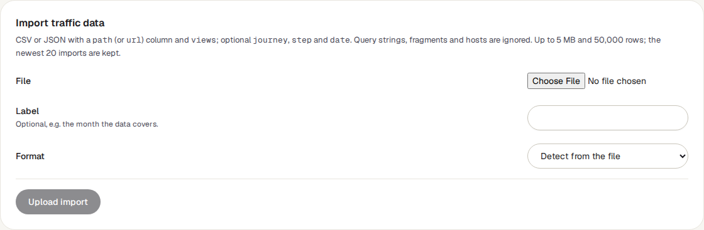
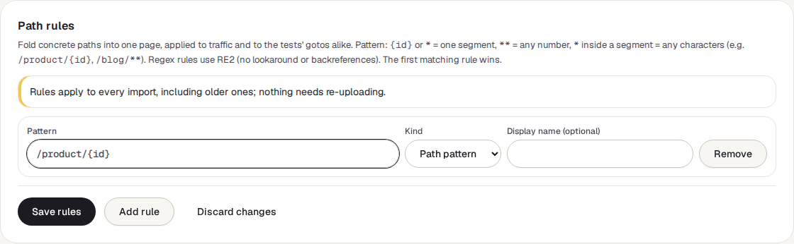

<!-- Generated from journey-coverage.html by e2e/docs-capture/export_md.py. Edit the HTML, not this file. -->

# Journey coverage

Reports · Everyone with access to the project can see it · Editors can import data and change rules

> **In short**
>
> You upload a list of your site's pages with how many times each was viewed, exported from your analytics tool. TraceIQ compares it with the pages your tests open and tells you what share of real traffic is tested, and which busy pages have no test at all.

## What it is for

This page answers **"Are we testing the pages people actually use?"** A hundred tests can still miss the page half your visitors land on. Weighting by page views shows where a missing test hurts most, and where tests guard pages almost nobody visits.

> **Testers**
>
> Decide which test to write next: the busiest page that no test opens.

> **Product owners**
>
> Check that the key journeys, such as sign-up or checkout, are tested step by step.

> **Leads**
>
> Report test coverage in terms of real use ("80% of page views") rather than a count of tests.

**Where to find it:** in the sidebar, open **Reports → Journey coverage**.

## A tour of the screen

The page shows the project selected at the top of the sidebar, in three tabs. The demo projects have no traffic data yet, so the screenshot shows the **Coverage** tab before the first import; [When there is data](#with-data) describes the full report. The numbers on the screenshot match the sections below.

*The Journey coverage page for the demo's web project, before any traffic data is imported. Click the picture to see it larger.*

## 1. The three tabs

- **Coverage**: the report. Opens first.
- **Imports**: upload page-view data, and the list of earlier uploads.
- **Path rules**: tell TraceIQ which addresses are really the same page.

## 2. Before the first import

Until someone uploads traffic data, the Coverage tab says so. **Import traffic data** takes you to the Imports tab.

### The Imports tab

Export a page-view report from your analytics tool (Google Analytics, Matomo, Adobe and others all can) as a **CSV** or **JSON** file, choose it under **File**, optionally give it a **Label** such as the month it covers, and press **Upload import**. TraceIQ recognises the columns by name (upper or lower case, spaces allowed):

| Column | Names it looks for |
|---|---|
| **The page** (needed) | `path`, `url`, `page`, `page path`, `page url`, `landing page`, `page location`, `pathname`, `route` |
| **Views** | `views`, `pageviews`, `screenPageViews`, `count`, `hits`, `sessions`, `visits`, `users`. With none of these, every row counts as one view, and the import shows a warning. |
| **Journey** (optional) | `journey`, `funnel`, `flow`: the name of a journey such as "Checkout". |
| **Step** (optional) | `step`, `order`, `position`: the page's place in that journey. |
| **Date** (optional) | `date`, `day`, `start date`, `end date`: used to show the period the data covers. |

> **Rename a column if it isn't recognised**
>
> The names must match one of these, apart from upper/lower case and spaces. An export whose page column is called, say, "Page path and screen class" is refused with "no path column"; rename that column to `page path` in a spreadsheet and upload again.

A file can be up to 5 MB and 50,000 rows. The **Import history** below the form lists each upload with its rows, views and period, any warnings (for example rows skipped because they had no page), **View coverage** to see the report for an older upload, and **Delete**. The 20 newest uploads are kept; the newest one, marked latest, is the one the Coverage tab uses.

### The Path rules tab

*An example rule, typed in for the picture and then discarded.*

Your analytics tool sees `/product/123`, `/product/456` and so on as separate pages, but a test that opens one product page covers them all. A **path rule** folds them into one page:

| In a pattern | Matches |
|---|---|
| `{id}` or `*` as a whole part | Exactly one part of the address between slashes: `/product/{id}` matches `/product/123` but not `/product/123/reviews`. |
| `**` | Any number of parts: `/blog/**` matches every address under `/blog/`. |
| `*` inside a part | Any characters: `/files/*.pdf`. |

For harder cases, set **Kind** to *Regex (RE2)* and write a regular expression. A **Display name** is optional; without one, the pattern is the page's name in the report. The first rule that matches wins. Rules apply to the uploaded traffic *and* to your tests' addresses, and to every import, old ones included, so nothing needs uploading again. **Save rules** keeps them; **Discard changes** goes back to the saved ones. Up to 100 rules.

## When there is data

After an upload, the Coverage tab starts with the import's name, the period it covers and when it was uploaded, then four figures:

| Figure | What it means |
|---|---|
| **Traffic covered** | Page views of pages that some test opens, as a share of all page views in the file. The headline number. |
| **Pages covered** | How many of the file's pages (after path rules) a test opens, out of how many pages there are. |
| **Pages tests visit** | How many different pages your tests open. |
| **Journeys** | How many named journeys the file has. |

Then four boxes, each listing up to 50 pages with their views and share of all views:

- **Top uncovered pages**: the busiest pages that no test opens. Start here.
- **Tested, little or no traffic**: pages your tests open that get under 0.5% of views, or none at all. Worth checking the test still matters, or that the address is right.
- **Journeys and funnels**: for each journey in the file, its steps in order, each labelled tested or untested, with "N of M steps tested", the share of the journey's views that is tested, and the first untested step ("first gap").
- **Covered pages**: the pages tests open, busiest first, with the names of up to three tests that open each one.

"(3 paths)" after a page means three different addresses were folded into it by a path rule.

## Watch it in use

[▶ Watch the video](../media/reports/journey-coverage/walkthrough.mp4)

*About a minute, with a spoken commentary, on the demo project before any import. The captions at the bottom show the same words, so it also works with the sound off.*

## How to…

### …see how much of your traffic is tested

1. In your analytics tool, export the page views per page for a recent period (a month is a good start) as CSV.
2. Open the **Imports** tab, choose the file, give it a label and press **Upload import**. A message says how many rows and views were read.
3. Open the **Coverage** tab and read **Traffic covered**.

### …decide which test to write next

1. On the Coverage tab, look at **Top uncovered pages**.
2. If the list is full of near-identical addresses (one per product, per article), add a path rule for them first; the list then shows the real gaps.
3. Write a test that opens the page at the top of the list.

### …check a checkout or sign-up journey

1. Export the journey from your analytics tool with a journey name and a step number per row, and upload it.
2. In **Journeys and funnels**, find the journey and look for the first untested step.

## Good to know

- **Pages are compared by address only.** The site name, anything after `?` or `#`, and a final `/` are dropped on both sides, so a test against your test environment still covers the same page on the live site. Upper and lower case matter: `/Cart` and `/cart` are two pages.
- **What "a test opens a page" means.** TraceIQ looks at the *Go to* steps of every test in the project, whether or not it has run. A page reached by clicking a link, without a Go to step, doesn't count.
- **Page rows and journey rows.** If a file has both, only the page rows count towards the total views, because journey steps repeat views already counted.
- **Who can do what.** Anyone with access to the project can read the report. Uploading, deleting an import and saving path rules need the *editor* role.
- **Your data stays aggregated.** TraceIQ keeps only page addresses (without their query part) and view counts, not individual visits.

## Related pages

> **Business journeys**
>
> The next page in this guide: your key journeys as an ordered list of tests, with their health and traffic.

> **Suites**
>
> Where tests are written, including the Go to steps this page reads.

> **Requirements**
>
> Coverage of requirements instead of traffic: which acceptance criteria have a test.

> **Flag coverage**
>
> Which feature-flag values your runs have tested.

## Video script

What the walkthrough says, in order. The video and every picture on this page are made by the Playwright script [`reports-journey-coverage.spec.ts`](../../../../e2e/docs-capture/pages/reports-journey-coverage.spec.ts).

1. Journey coverage compares the pages real visitors use with the pages your tests visit.
2. It needs a page-view export from your analytics tool. The demo has none yet.
3. Imports is where an editor uploads that export, as a CSV or JSON file.
4. Each row needs a page address and a number of views. Journey and step are optional.
5. Import history keeps the twenty newest uploads. The newest one drives the coverage view.
6. Path rules fold similar addresses into one page, such as every product page.
7. Rules apply to old imports too, so nothing needs uploading again. This example is discarded, not saved.
8. Back on Coverage, the result is the share of all page views that some test visits.
