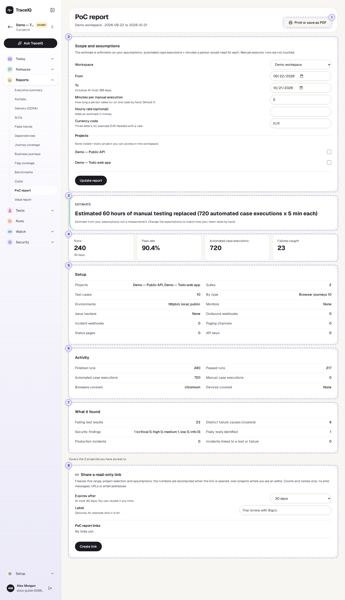
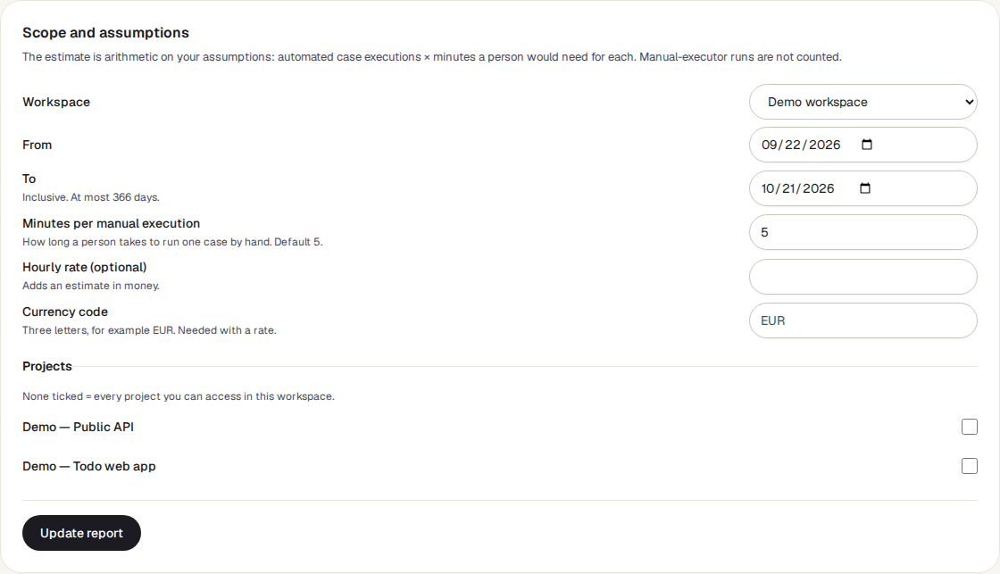
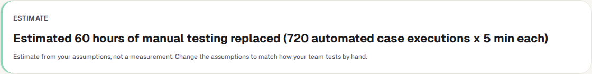
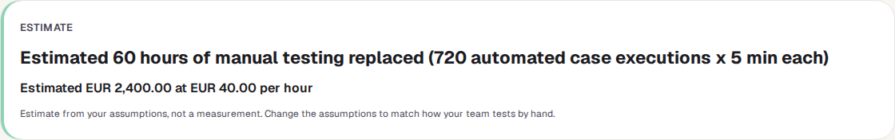
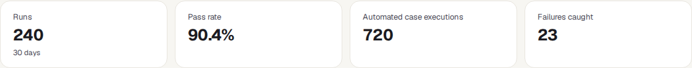
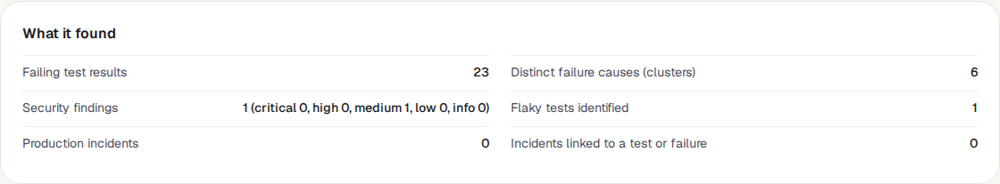
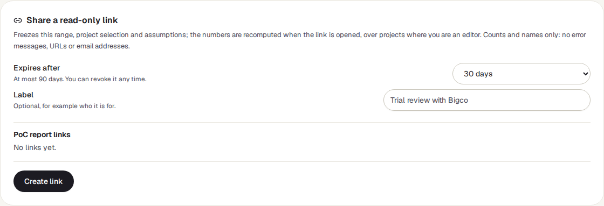

<!-- Generated from poc-report.html by e2e/docs-capture/export_md.py. Edit the HTML, not this file. -->

# PoC report

Reports · Every workspace member can see it (their own projects) · Editors can share it

> **In short**
>
> A one-page summary of a trial of TraceIQ (a "proof of concept", or PoC): what was set up, how much testing ran, what it found, and an estimate of the hours of manual testing it replaced. You can print it, save it as a PDF, or send a read-only link.

## What it is for

The PoC report answers **"What did we get out of the trial?"** At the end of a trial someone has to explain to a manager or a buyer what happened. This page collects the facts in one place, and keeps the one number that is a guess (the time saved) clearly marked as an estimate, with the assumptions next to it.

> **Trial leads**
>
> Produce the end-of-trial summary in a few clicks, for exactly the dates and projects of the trial.

> **Managers and buyers**
>
> Read a short, printable page with counts and names only, and an honest estimate.

> **Testers**
>
> Check that the work done during the trial is reflected, and adjust the minutes per test to how long it really takes by hand.

**Where to find it:** in the sidebar, open **Reports → PoC report**. It covers a whole workspace (or the projects you tick), not the project selected in the sidebar.

A few words used on this page: a **test** (also called a *case*) is one scripted check; a **run** is one time TraceIQ carries out a set of tests; one **case execution** is one test carried out once in a run.

## A tour of the screen

The page is one long report. The numbers on the screenshot match the sections below.

*The PoC report for the demo workspace, last 30 days. Click the picture to see it larger.*

The line under the heading names the workspace and the dates, for example *"Demo workspace · 2026-09-22 to 2026-10-21"*.

## 1. Print or save as PDF

Opens your browser's print window. The sidebar, the assumptions form and the sharing box are left out of the printout, so the paper (or PDF) holds just the report. Choose "Save as PDF" as the printer to get a file.

## 2. Scope and assumptions

| Field | What it does |
|---|---|
| **Workspace** | Shown only if you belong to more than one. The page starts on your first workspace, so pick the trial's one. Changing it reloads the report at once. |
| **From** / **To** | The trial's dates, both days included, at most 366 days. The last 30 days to begin with. Days are UTC days. |
| **Minutes per manual execution** | How long a person would take to carry out one test by hand. 5 to begin with; anything above 0 and up to 480. |
| **Hourly rate** and **Currency code** | Optional. With both, the estimate also gives an amount of money. The code is three letters, such as EUR or INR; a rate without a code is refused. |
| **Projects** | Tick the projects the trial used. None ticked = every project of the workspace you can see. |

Typing doesn't change the report: press **Update report** when you are done. If something is wrong (a rate with no currency, say), the button is grey and a message says why.

## 3. The estimate

The hours of manual testing the automated tests replaced, worked out as:

**hours = automated case executions × minutes per manual execution ÷ 60**

In the demo, 720 case executions × 5 minutes = 3,600 minutes = 60 hours. With a rate and a currency there is a second line, hours × rate:

> **It is an estimate, and says so**
>
> Nothing here is measured: it is your own assumption multiplied by a count. It also assumes every automated test would otherwise have been done by hand, every time. Pick minutes that match how your team really tests, and say how you chose them when you share the report.

Only tests that finished with a pass or fail count, and only from automated runs: tests that people carry out by hand (manual tests) are left out.

## 4. The four tiles

| Tile | What the number means |
|---|---|
| **Runs** | Runs started in the date range that finished with a verdict (passed, failed or error). Runs that were cancelled, timed out or are still going are left out. |
| **Pass rate** | Passed runs ÷ those runs. |
| **Automated case executions** | The number the estimate is based on (see above). |
| **Failures caught** | Test results that failed or ended in an error, manual ones included. |

## 5. Setup

What exists in the covered projects *today* (not only what was added during the dates): their names, how many suites and tests, tests by type (for example "Browser journeys 10"), environment names, active monitors, and the connections made: issue trackers, outbound webhooks, incident webhooks, paging channels, status pages and API keys that haven't been revoked. Issue trackers, webhooks and API keys that belong to the whole workspace are counted too.

## 6. Activity

Finished runs and passed runs (as in the tiles), automated and manual case executions, and the browsers and devices that runs used in the date range.

## 7. What it found

| Line | What it counts |
|---|---|
| **Failing test results** | The same as *Failures caught*. |
| **Distinct failure causes (clusters)** | Groups of failures with the same cause (as on *Failure triage*) that happened at some point in the date range. |
| **Security findings** | Security problems first recorded in the date range, by severity. A problem seen by several scans counts once. |
| **Flaky tests identified** | Tests that are unreliable as of the end date: quarantined then, or with a high flakiness score now. |
| **Production incidents** | Incidents (from *Incidents*) that started in the date range. |
| **Incidents linked to a test or failure** | Of those, the ones connected to a test, a failure group, a new regression test, or a test that should have caught it. |

Under the report, a line says how many projects it covers.

## 8. Share a read-only link

- **Expires after**: 1, 7, 30 (the starting value) or 90 days.
- **Label**: optional, for example who the link is for.
- **Create link** makes the link and shows it once, with a **Copy link** button. It is not shown again, so copy it straight away.
- **PoC report links** lists the workspace's PoC links: who made each, when it expires, how often it was opened, and a **Revoke** button that switches it off at once (no confirmation).

The link keeps the dates, project selection and assumptions you last applied with Update report. The numbers themselves are worked out again each time someone opens it. Anyone with the link can open it without signing in, until it expires. It shows names and counts only: no error messages, web addresses or email addresses.

## Watch it in use

[▶ Watch the video](../media/reports/poc-report/walkthrough.mp4)

*About a minute, with a spoken commentary. The captions at the bottom show the same words, so it also works with the sound off.*

## How to…

### …make the end-of-trial report

1. Choose the trial's **Workspace**.
2. Set **From** and **To** to the first and last day of the trial.
3. Tick the projects the trial used (or leave them all unticked for every project).
4. Set **Minutes per manual execution** to a realistic figure for your team.
5. Press **Update report**, then check the numbers.

### …show the saving in money

1. Type an **Hourly rate**, for example the cost of a tester's hour.
2. Type the three-letter **Currency code**, such as EUR.
3. Press **Update report**. A second line under the estimate gives the amount.

### …send it to someone without a TraceIQ account

1. Set up the report as above and press **Update report**.
2. In **Share a read-only link**, choose how long it should work and add a label.
3. Press **Create link** and copy the link straight away. Or press **Print or save as PDF** and send the file.

## Good to know

- **You see only your own projects.** The report covers the workspace's projects you have access to. Ticking a project you can't see does nothing.
- **A shared link covers less, not more.** A link only reaches projects where you are an *editor*, and you need the editor role on at least one project to create one. If you later lose that access, the link stops showing those projects.
- **Check runs are left out.** Runs TraceIQ makes only to try a suggested fix (see *Proposals*) are not counted as trial activity.
- **Revoking.** The person who made a link, or a workspace admin, can revoke it.
- **Nothing is saved.** The form's values are forgotten when you leave the page; only a shared link keeps them.

## Related pages

> **Value report**
>
> The next page in this guide: measured numbers for a pilot, such as how quickly failures get diagnosed.

> **Executive summary**
>
> A short status of one project or a workspace for leadership, also shareable as a link.

> **Costs**
>
> The other side of the ledger: what the testing cost in AI use and machine time.

> **Failure triage**
>
> The failure groups counted as "distinct failure causes" here.

## Video script

What the walkthrough says, in order. The video and every picture on this page are made by the Playwright script [`reports-poc-report.spec.ts`](../../../../e2e/docs-capture/pages/reports-poc-report.spec.ts).

1. The PoC report sums up a trial of TraceIQ: what was set up, what ran, and what it found.
2. First choose the workspace the trial used. Here, the demo workspace.
3. From and To set the dates. The last thirty days are chosen to begin with.
4. The estimate: each automated test run, times the minutes a person would need to do it by hand.
5. Change the minutes, and add an hourly rate and currency for an amount of money.
6. Update report works it out again. Nothing is saved.
7. The result is always labelled as an estimate, with the assumptions next to it.
8. Below: the setup, the activity, and what testing found.
9. To show someone outside, create a read-only link, or print the page.
