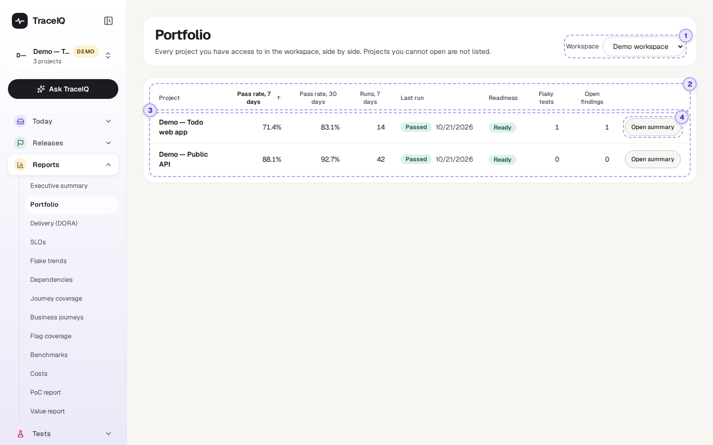
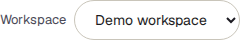
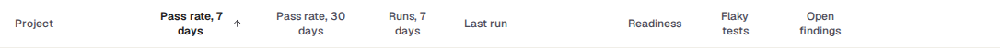
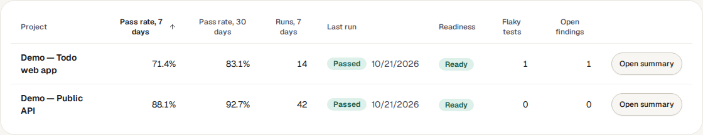

<!-- Generated from portfolio.html by e2e/docs-capture/export_md.py. Edit the HTML, not this file. -->

# Portfolio

Reports · Every workspace member can see it · Read-only page

> **In short**
>
> All the projects of a workspace in one table, one row each: how often their runs pass, when they last ran, whether they are ready to release, and how many flaky tests and open security findings they have. The project that needs attention most comes first.

## What it is for

Portfolio answers **"Which of our projects needs attention?"** The executive summary describes one project (or adds them all up); this page puts them next to each other so you can compare them.

> **Managers and leadership**
>
> See every team's project at once, and which ones are not ready to release.

> **Quality leads**
>
> Find the project with the worst pass rate or the most flaky tests, and start there.

> **Security and compliance**
>
> Spot projects that still have open security findings, or that haven't run for a while.

**Where to find it:** in the sidebar, open **Reports → Portfolio**.

## A tour of the screen

The page is one table. The numbers on the screenshot match the sections below.

*The Portfolio of the demo workspace. Click the picture to see it larger.*

## 1. Workspace

The table shows one workspace at a time. If you belong to more than one, this menu picks which; otherwise it isn't shown. When the page opens, the first workspace in your list is chosen. It does *not* follow the project selected in the sidebar.

## 2. Sorting

- When the page opens, rows are sorted by **Pass rate, 7 days**, lowest first, so the project in most trouble is at the top. The small arrow marks the column the table is sorted by.
- **Click a heading** to sort by that column, highest first (for *Project*: A to Z). Click it again to turn the order round.
- *Readiness* sorts Not ready, then Not enough data, then Ready (or the other way round).
- Projects with no value in that column, such as no pass rate because nothing ran, always go to the bottom.

The order isn't remembered: it goes back to the worst 7-day pass rate the next time you open the page.

## 3. The project rows

| Column | What it shows |
|---|---|
| **Pass rate, 7 days** | The share of the project's finished runs in the last 7 days (counting back from now) that passed. A run that ended in *Error* counts as not passed. "—" means no run finished in that time. |
| **Pass rate, 30 days** | The same over the last 30 days. Comparing the two shows whether things got better or worse lately. |
| **Runs, 7 days** | How many runs finished with a result (passed, failed or error) in the last 7 days. A pass rate based on 2 runs means less than one based on 200. |
| **Last run** | The result and date of the project's newest run that finished with a result. "never" if none has. |
| **Readiness** | Whether the latest version of the app is ready to release, by the project's quality gate: Ready, Not ready, Not enough data, or Unknown when it can't be worked out. |
| **Flaky tests** | Tests that are quarantined right now, or that TraceIQ currently rates as flaky (a flakiness score of 0.4 or more). |
| **Open findings** | Security findings with the status *Open*. Findings someone is working on, has marked fixed, or has accepted as a risk are not counted. |

The result label under *Last run* is green for Passed and orange for Failed or Error.

## 4. Open summary

**Open summary** at the end of a row selects that project in the sidebar and opens its *Executive summary*. The project stays selected afterwards, so other pages you open show it too.

## Watch it in use

[▶ Watch the video](../media/reports/portfolio/walkthrough.mp4)

*About 50 seconds, with a spoken commentary. The captions at the bottom show the same words, so it also works with the sound off.*

## How to…

### …find the project that needs attention most

1. Open the page. The project with the lowest pass rate over the last 7 days is at the top.
2. Check **Runs, 7 days** on that row: a low pass rate from very few runs may be one bad day.
3. Press **Open summary** to see which tests are failing.

### …see which projects are not ready to release

1. Click the **Readiness** heading once. *Ready* projects come first.
2. Click it again: *Not ready* projects move to the top.
3. Open the *Release readiness* page for one of them to see exactly which checks failed.

### …find projects that have stopped running

1. Click the **Last run** heading. The most recent runs come first.
2. Click it again: the projects that ran longest ago move to the top, and projects that never ran stay at the bottom.

## Good to know

- **Only the projects you can open.** Projects in the workspace that you have no access to are left out, not shown as empty. Two people can see different rows.
- **Which runs count.** Only runs that finished with a result: passed, failed or error. Cancelled and timed-out runs, runs still going, and the check runs TraceIQ makes for a suggested fix (see *Proposals*) are left out.
- **Flaky tests, readiness and open findings are "right now"**, not counted over 7 or 30 days.
- **The same numbers as the executive summary.** Both pages are built from the same counts, so a project's 7-day or 30-day pass rate here matches its summary for that period.
- **It doesn't update by itself.** The table is fetched when you open the page, change workspace, or come back to its browser tab.
- **Nothing here can be changed.** The page only reads.

## Related pages

> **Delivery (DORA)**
>
> The next page in this guide: how often you deploy, how long a change takes to reach production, and how often a deployment goes wrong.

> **Executive summary**
>
> One project, or the whole workspace, on one printable page.

> **Release readiness**
>
> Why a project is "Not ready": every check of its quality gate, with reasons.

> **Scans & findings**
>
> The security findings behind the "Open findings" column.

## Video script

What the walkthrough says, in order. The video and every picture on this page are made by the Playwright script [`reports-portfolio.spec.ts`](../../../../e2e/docs-capture/pages/reports-portfolio.spec.ts).

1. Portfolio puts every project of a workspace side by side, one row each.
2. Pick the workspace here, if you belong to more than one.
3. The pass rate over the last seven days and the last thirty days.
4. The newest run with a result, and whether the latest version is ready to release.
5. Flaky tests, and security findings that are still open.
6. The worst seven-day pass rate comes first. Click a heading to sort by that column.
7. Click it again to turn the order round.
8. Open summary shows the executive summary of that project.
9. The sidebar now has that project selected, too.
