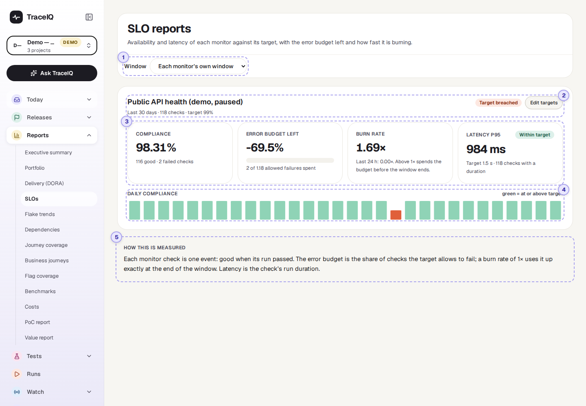
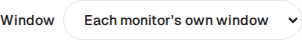
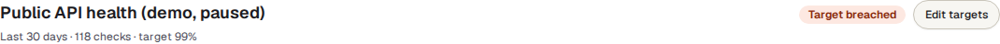
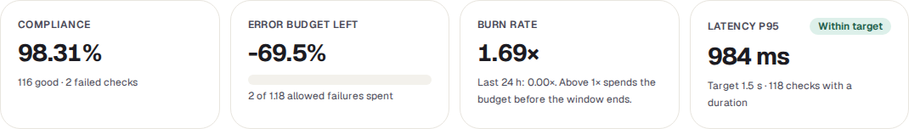
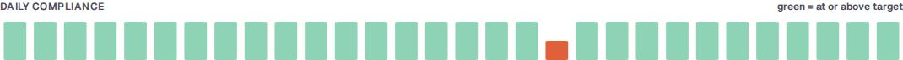
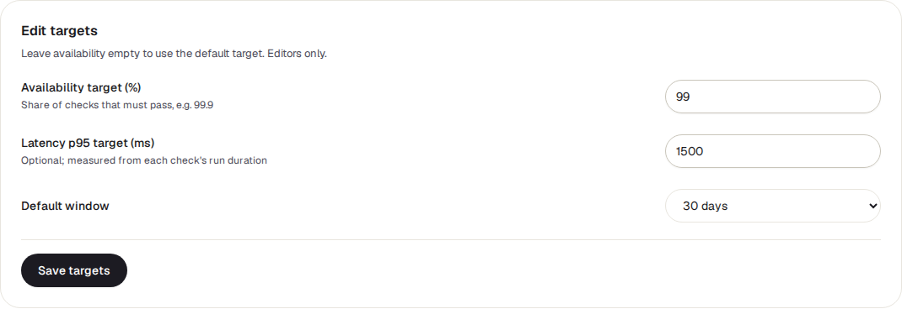

<!-- Generated from slo.html by e2e/docs-capture/export_md.py. Edit the HTML, not this file. -->

# SLOs

Reports · Everyone with access to the project can see it · Editors can change the targets

> **In short**
>
> For every monitor in the project: how often its checks passed, compared with the target you set, how much room for failures is left before the target is missed, and how quickly that room is being used up. Also how fast the checks were.

## What it is for

An **SLO** (service level objective) is a promise about how reliable a service should be, for example *"99.9% of checks pass over 30 days"*. This page answers **"Are we keeping that promise, and will we still be keeping it at the end of the month?"**

The numbers come from **monitors**: schedules that check a live site or API on a timer (a schedule with monitor mode turned on; see *Watch → Monitors*). Each time a monitor runs is one **check**. A check is good when its test run passed.

> **Service owners**
>
> See whether the service meets its target, and how many more failures it can take this month.

> **On-call and operations**
>
> Spot a fast burn: a recent run of failures that will break the target soon if it continues.

> **Managers**
>
> Report reliability against an agreed number instead of "it felt stable".

**Where to find it:** in the sidebar, open **Reports → SLOs**. The page's own heading says **SLO reports**.

## A tour of the screen

The page shows the monitors of the project selected at the top of the sidebar, one card each, in name order. The numbers on the screenshot match the sections below.

*The SLO reports page for the demo's API project, which has one (paused) monitor. Click the picture to see it larger.*

## 1. Window

How many days of checks to count, ending now. **Each monitor's own window** uses the default saved for each monitor (30 days unless someone changed it). Choosing **Last 7, 30 or 90 days** applies that window to every monitor on the page, without changing what is saved.

## 2. Name, target and status

The monitor's name, then the window, the number of checks in it and the availability target. "(default target)" means no target has been set, so TraceIQ uses **99.9%**.

| Status | What it means |
|---|---|
| Meeting target | The share of good checks is at or above the target, and the last 24 hours look fine. |
| At risk (fast burn) | Still above the target over the window, but in the last 24 hours checks failed faster than the target allows. If that continues, the target will be missed. |
| Target breached | The share of good checks in the window is below the target. |
| No data | No checks in the window. The card then says so instead of showing the tiles. |

**Edit targets** opens the targets form; see [below](#targets).

## 3. The four tiles

| Tile | What it means |
|---|---|
| **Compliance** | The share of checks in the window that were good. Underneath: how many were good and how many failed. |
| **Error budget left** | The **error budget** is how many failed checks the target allows. With a 99% target and 118 checks, 1% of 118 = 1.18 checks may fail. The tile shows how much of that is left: 100% = no failures yet, 0% = used up exactly. **Below zero means overspent**: in the example, 2 failures against 1.18 allowed is −69.5%. The bar is green, turns yellow under 25% and red at 0% or below. |
| **Burn rate** | How fast the budget is being used. **1×** uses it up exactly at the end of the window; 2× twice as fast; under 1× leaves some over. The big number is for the whole window; the line underneath is for the last 24 hours, the early warning. |
| **Latency p95** | How long checks took: 95% of checks were this quick or quicker, so a few slow ones don't hide behind the average. It is the duration of the check's whole test run. With a latency target set, a label says Within target or Over target. |

> **A 100% target leaves no budget**
>
> With a target of 100%, no failure is allowed at all. The error budget shows 100% while every check passes, and "—" as soon as one fails.

## 4. Daily compliance

One bar per day of the window, oldest on the left. The height is that day's share of good checks.

| Bar colour | Meaning |
|---|---|
| Green | That day met the target. |
| Orange | That day was below the target. |
| Grey line | No checks that day, for example while the monitor was paused. |

Because the bars start at zero, a 98% day and a 100% day look almost the same height: go by the colour. Days are calendar days in **UTC**.

If a monitor checks from more than one **region** (place in the world), a **By region** table follows, with the same figures per region.

## 5. How this is measured

A short reminder, at the bottom of the page, of the rules above: each check is one event, good when its run passed; the error budget is the share of checks the target allows to fail; latency is the check's run duration.

### Editing the targets

- **Availability target (%)**: the share of checks that must pass, e.g. 99.9. Leave it empty to use the default of 99.9%.
- **Latency p95 target (ms)**: optional, in milliseconds (1500 = 1.5 seconds).
- **Default window**: 7, 30 or 90 days; used when the page's window menu is on "Each monitor's own window".

**Save targets** needs the *editor* role on the project; others get an error message. Every change is recorded in the audit log with the old and new values. **Close targets** closes the form without saving.

## Watch it in use

[▶ Watch the video](../media/reports/slo/walkthrough.mp4)

*About a minute, with a spoken commentary. The captions at the bottom show the same words, so it also works with the sound off.*

## How to…

### …set a target for a monitor

1. Select the monitor's project at the top of the sidebar.
2. On the monitor's card, press **Edit targets**.
3. Enter the availability target, and a latency target if you have one. Choose the window your target is measured over.
4. Press **Save targets**. The card updates straight away.

### …tell whether there is still room for failures this month

1. Choose **Last 30 days** in the window menu.
2. Read **Error budget left**. Above zero, the target still holds; how far above says how many more failures it can take.
3. Read the **Burn rate** line for the last 24 hours. Above 1×, the budget is shrinking faster than planned.

### …find the bad days

1. Look for orange bars in **Daily compliance**.
2. Open *Watch → Monitors* for that monitor to see its recent checks.

## Good to know

- **Only monitors.** Ordinary schedules and runs you start yourself don't count. A project with no monitors shows "No monitors".
- **Paused monitors are listed too**, with the checks they made before they were paused. Once the window has moved past those, the card says there are no checks.
- **The window is rolling.** "Last 30 days" counts back from this moment, not from the start of the month, so the numbers move a little every day as old checks drop out.
- **Latency includes the whole test.** It is the run's duration, not just the time the site took to answer, so a long test makes it larger.
- **It doesn't update by itself.** The page fetches the numbers when you open it, change the window or project, or come back to its browser tab.

## Related pages

> **Flake trends**
>
> The next page in this guide: whether tests that pass and fail at random are becoming more or less common, and where.

> **Monitors**
>
> The monitors these numbers come from: their state, recent checks and alerts.

> **On-call**
>
> Who gets paged when a monitor goes down.

> **Delivery (DORA)**
>
> How often you deploy and how often a deployment goes wrong.

## Video script

What the walkthrough says, in order. The video and every picture on this page are made by the Playwright script [`reports-slo.spec.ts`](../../../../e2e/docs-capture/pages/reports-slo.spec.ts).

1. SLOs show whether your monitors meet the availability you promised.
2. Monitors belong to a project, so pick the project in the sidebar.
3. One card per monitor: its target, and whether it is meeting it.
4. Compliance: the share of checks that passed in the window.
5. The error budget is how many failed checks the target allows. Below zero means it is overspent.
6. Burn rate: how fast the budget is being used. Above one times, it runs out before the window ends.
7. Latency: how long the slowest checks took, against an optional target.
8. One bar per day. Green days met the target; orange days did not.
9. Edit targets sets the goal for this monitor. Only editors can save it.
10. The window menu shows the last seven, thirty or ninety days for every monitor at once.
