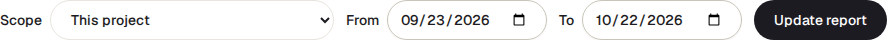

<!-- Generated from value-report.html by e2e/docs-capture/export_md.py. Edit the HTML, not this file. -->

# Value report

Reports · Everyone with access to the project can see it · Read-only page

> **In short**
>
> Four numbers that show what TraceIQ did for you over a period: how quickly new failures got looked at, how often its AI explanation of a failure was right, how much test time targeted runs saved, and what happened to the fixes it suggested. Each number says whether it is **measured** or an **estimate**, and how it was worked out.

## What it is for

The Value report answers **"Is TraceIQ actually helping, and how do we know?"** It is meant for the end of a pilot or a quarterly review, where numbers have to be defensible. That is why every card shows its sample size, its definition and its data source, and why a number with too little data behind it is left out rather than shown as zero.

> **Pilot sponsors**
>
> Get honest numbers to decide whether to continue, with what each one is based on.

> **Leads**
>
> See whether failures are picked up quickly, and whether the team trusts the suggested fixes.

> **Testers**
>
> Check that your work (triaging, rating AI explanations) is being counted.

**Where to find it:** in the sidebar, open **Reports → Value report**. It starts on the project selected at the top of the sidebar.

## A tour of the screen

The numbers on the screenshot match the sections below.

*The Value report for the demo's web project, last 30 days. Click the picture to see it larger.*

## 1. Scope and dates

- **Scope**: *This project* (the one selected in the sidebar) or *Workspace (projects you can read)*, which adds up every project of a workspace you have access to. With more than one workspace, a **Workspace** picker appears; it starts on your first one.
- **From** / **To**: the period, both days included, the last 30 days to begin with, at most 366 days. New dates apply when you press **Update report**; the scope and workspace apply at once.
- **Print**, above the controls, opens your browser's print window (choose "Save as PDF" for a file).

## 2. What is covered

One line naming the project (or the workspace and how many projects), the dates, and a reminder that *validation runs are excluded*: the check runs TraceIQ makes only to try a suggested fix (see *Proposals*) never count in any number here.

### How every card is built

- **The label** top right: Measured means counted from what happened; Estimate means worked out from assumptions.
- **The big number**, with what it is ("median", for instance). If there isn't enough data, a grey box says why instead, such as "No targeted run in this window". It never shows 0 for "no data".
- **Sample**: how many things the number is based on. A number from 2 items is a hint, not a result.
- **Details**, then **Definition** and **Data source**: the exact rule, always shown so the reader can check it.

## 3. Time to diagnosis

How long a new problem waited before someone did something about it. It looks at each failure group (a set of failures with the same cause, as on *Failure triage*) whose first failure falls in the period, and measures the time from that first failure to the first sign that it was dealt with:

- someone set the group to *Investigating* or *Resolved* on Failure triage;
- a ticket was filed for it;
- one of its tests was quarantined (set aside as unreliable);
- one of its tests passed again on a different version of the code (git commit).

The big number is the **median** (half were faster, half slower); the **90th percentile** underneath is the time 9 in 10 were dealt with by. Groups nobody has dealt with yet are counted separately ("not diagnosed yet") and left out of both. The lines "First signal …" say which sign came first, and how often.

## 4. AI failure-analysis accuracy

How often the AI's best explanation of a failure was right. On a run's page, each failure has an AI analysis with ranked explanations ("hypotheses"), and editors can mark each one **👍 Correct** or **👎 Incorrect**. This card takes the *top* explanation of each rated failure and counts the share the reviewers marked correct (by majority; ties are "split" and left out). It also shows the votes, and the split between explanations from the AI model and from TraceIQ's built-in rules.

It is a **reviewed sample**: only failures someone rated are included. With fewer than **5** rated explanations the share is not shown at all.

## 5. CI time saved by targeted runs

An **estimate**. A *targeted* run carries out only the tests affected by a change, instead of the whole suite (it is started from a build pipeline, CI — for example by TraceIQ's GitHub Action — or by an AI agent). For each one, TraceIQ looks for the newest earlier *full* run of the same suite in the 30 days before it, and estimates:

**saved = full run's test time × (1 − tests run ÷ tests in the suite)**

The big number is browser time saved; underneath are the wall-clock time saved (also an estimate) and the counts it rests on, including targeted runs that had no full run to compare with. Manual runs are left out. Times under an hour are rounded to whole minutes: the demo's one targeted run skipped 3 of 5 tests of a suite that takes well under a minute, so its saving reads *0 min*.

## 6. Proposal outcomes

What happened to the fixes TraceIQ (or an AI agent) suggested in the period: new or changed tests (*case proposals*) and new ways to find a page element that moved (*heal proposals*). The big number is the share of decided proposals that were applied. Underneath, for each kind: how many were created, the share accepted, auto-applied (accepted by the workspace's rule, with no person deciding) and rejected, and how many are still waiting. Two more lines:

- **Reverted later**: of the accepted changes, how many were later undone by someone putting back the earlier steps. Only changes to existing tests can be checked; others are "not measurable".
- **Repair validation**: how often a trial run of a suggested fix passed under the same conditions as the failure, and how many accepted fixes were tried that way first.

## 7. Reported elsewhere

Links to related numbers that live on their own pages and are not repeated here: **Flake trend** (unreliable tests over time), **Escaped defects** (incidents no test caught, on *Incidents*) and **Delivery (DORA)** (how fast and safely changes reach production).

## Watch it in use

[▶ Watch the video](../media/reports/value-report/walkthrough.mp4)

*About a minute, with a spoken commentary. The captions at the bottom show the same words, so it also works with the sound off.*

## How to…

### …prepare the numbers for a pilot review

1. Set **Scope** to *Workspace* and pick the pilot's workspace.
2. Set **From** and **To** to the pilot's first and last day, and press **Update report**.
3. For every number you quote, also quote its **Sample**, and say whether it is measured or an estimate.
4. Press **Print** to save the page as a PDF.

### …make the AI accuracy number appear

1. Open a failed run on the *Runs* page and look at the AI analysis of a failing test.
2. Press **👍 Correct** or **👎 Incorrect** under the top explanation (editors only).
3. Once at least 5 failures in the period are rated, the card shows a percentage.

### …bring the time to diagnosis down

1. Look at new problems on *Failure triage* every day.
2. Set each one to **Investigating** as soon as someone picks it up: that moment is what this card measures.

## Good to know

- **Nothing here can be changed.** The page only reads. The ratings and triage it counts are made on the run pages and on Failure triage.
- **You see only what you can access.** The workspace scope adds up only the projects you can read.
- **Days are UTC days.** The period runs from midnight UTC on the first day to the end of the last day.
- **Ratings are made by people.** Only editors can rate an AI explanation, and an API key (used by scripts and agents) can't, so an agent can't rate its own work. If the analysis is regenerated after you open the page, your vote is refused rather than counted against a different explanation.
- **Small samples.** The demo's 24.6 hours comes from 3 problems. Read any number with a small sample as a direction, not a result.
- **Not in shared links.** Unlike the PoC report and the executive summary, the Value report can't be shared as a public link; print it instead.

## Related pages

> **Failure triage**
>
> Where problems are set to Investigating or Resolved, which Time to diagnosis measures.

> **Proposals**
>
> The suggested fixes counted in Proposal outcomes, and where they are accepted or rejected.

> **PoC report**
>
> The previous page: a one-page trial summary with a labelled time-saved estimate.

> **Flake trends**
>
> Unreliable tests over time, linked from Reported elsewhere.

## Video script

What the walkthrough says, in order. The video and every picture on this page are made by the Playwright script [`reports-value-report.spec.ts`](../../../../e2e/docs-capture/pages/reports-value-report.spec.ts).

1. The Value report shows what TraceIQ did for you over a period, in four numbers.
2. Each card says whether its number is measured, or an estimate.
3. Time to diagnosis: how long a new failure waited before someone acted on it.
4. Under every number: how many cases it is based on, what it means, and where the data comes from.
5. A card with too little data says so, instead of showing a zero.
6. Scope switches between this project and the whole workspace.
7. In a workspace, choose which one. Then pick the dates and press Update report.
8. The line above the cards says what was covered: here, both demo projects.
9. Reported elsewhere links to related numbers kept on other pages.
