<!-- Generated from runs.html by e2e/docs-capture/export_md.py. Edit the HTML, not this file. -->

# Runs

Runs · Everyone can see the runs of their projects · Editors can cancel, re-analyse and delete

> **In short**
>
> Every time tests are executed, that is a **run**. This page lists all runs of all your projects, newest first, with search and filters. Open one to see what happened: which tests passed, which failed, the error of each failure, and TraceIQ's guess at the cause.

## What it is for

Runs answers **"What happened when the tests ran?"** The list helps you find a run (last night's, the one for a change, the failed ones). The run's own page helps you understand it, down to the single step that went wrong.

> **Testers**
>
> Open last night's failed run, see which tests failed and read their errors.

> **Developers**
>
> Find the run for their change and see whether the failure is the app, the test or the environment.

> **Leads**
>
> Share a read-only summary of a run, or file a ticket for it, without copying anything by hand.

**Where to find it:** in the sidebar, open **Runs**. The page's own heading says **Test runs**. A run's own page opens when you click a run here, or anywhere else a run is mentioned (Overview, Failure triage, Monitors…).

> **Runs, suites and tests**
>
> A **test** is one journey, such as "Sign in". A **suite** is a folder of tests. A run executes a whole suite, or a single test, once, in one browser. Each test in it gets its own result.

## A tour of the list

The numbers on the screenshot match the sections below.

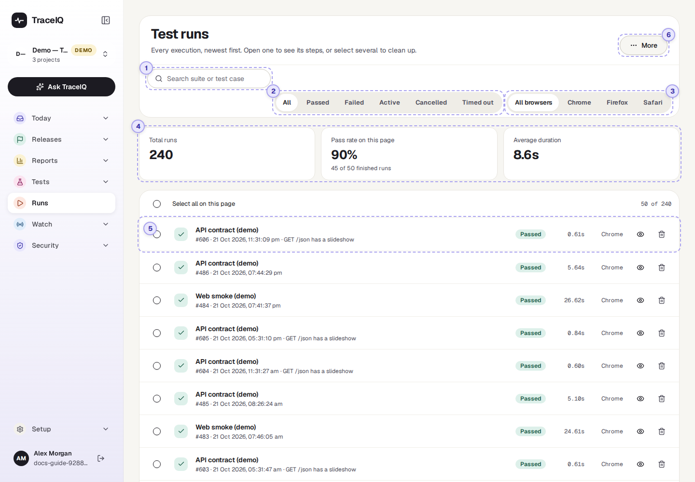

*The Runs list in the demo workspace. Click the picture to see it larger.*

## 1. Search

Type part of a suite's or a test's name to show only matching runs. The search **matches upper and lower case exactly**: "Web" finds "Web smoke (demo)", "web" does not.

## 2. Filter by result

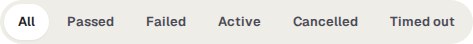

Shows only runs with one result. Each button matches exactly one status:

- **Failed** shows runs marked Failed only, not those that ended in *Error*. There is no button for Error; use *All*.
- **Active** shows runs that are running right now, not those still queued.

## 3. Filter by browser

**All browsers**, **Chrome**, **Firefox** or **Safari**: the browser the run used. When any filter or a search is set, a **Clear** button appears next to them.

## 4. The three tiles

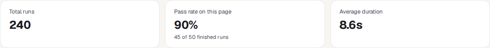

| Tile | What the number means |
|---|---|
| **Total runs** | How many runs match the search and filters, across all your projects. |
| **Pass rate on this page** | The share of passed runs **among those on the current page** of the list (50 by default), counting only runs with a pass/fail answer: cancelled, timed-out, queued and running ones are left out. The line below says how many it is based on. |
| **Average duration** | The average length of those same runs. |

## 5. One run in the list

- **The name** is the suite that ran (or the test, when only one ran). Underneath: the run number, when it started, and the test's name if a single test of a suite ran. Runs of manual tests carry a Manual label and open their own page.
- **On the right**: the result, how long it took, and the browser.
- **Click the row** (or the eye button) to open the run. The tick box on the left selects it; the bin button deletes it.

| Result | What it means |
|---|---|
| Passed | Every test in the run did what it should. |
| Failed | At least one test found a problem. |
| Error | Something went wrong around the tests, for example the run could not be started. Treat it like a failure. |
| Running / Queued | Happening now / waiting for a free test machine. |
| Cancelled | Someone stopped it. No verdict. |
| Timed out | It went past TraceIQ's time limit. No verdict. |

## 6. More, deleting and pages

- Select runs with their tick boxes (or **Select all on this page**) and a **Delete N selected** button appears at the top.
- **More → Delete all runs** deletes every run in every project where you are an editor, whatever the search or filters show. Use it with care.
- Deleting removes the run with its screenshots, videos and logs, and asks you to confirm first. It is recorded in the audit log.
- At the bottom, the page controls move through the list, and set how many runs a page shows (25, 50 or 100).

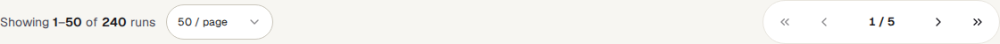

## A tour of one run

Clicking a run opens its own page. This one is a failed run of the demo's web suite. The numbers continue from the list above.

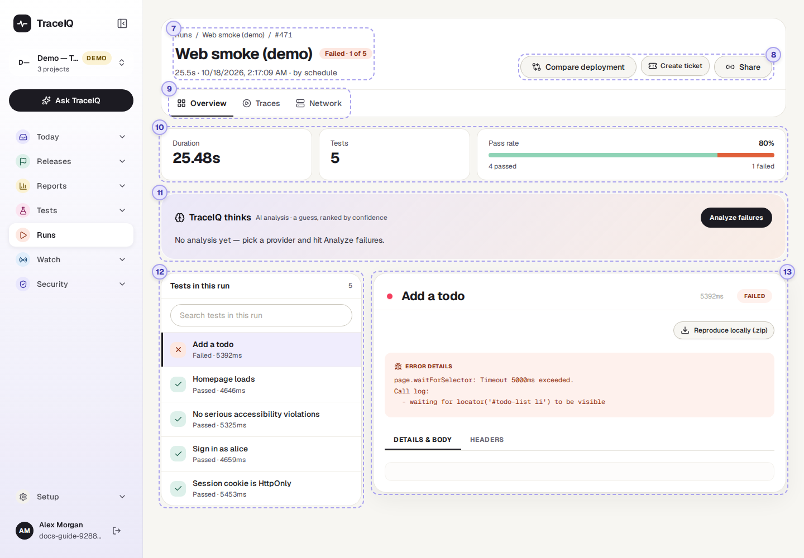

*A failed run in the demo workspace. Click the picture to see it larger.*

## 7. Title and result

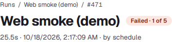

The suite (or test) that ran, and its result: for a failed run, how many of its tests failed. Below: how long it took, when it started, the code version (commit) and branch it tested if it was started from a build pipeline, and who or what started it (*by human*, *by schedule*, *by ci*, *by api_agent*, *by webhook*).

## 8. The buttons

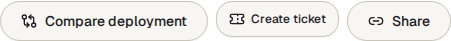

| Button | What it does |
|---|---|
| **Compare deployment** | Runs the same suite again against another address of your app (say, the new version on a staging site) and shows the two results side by side. |
| **Create ticket** | Files a ticket for this run in a connected issue tracker (Jira, GitHub or iTop). |
| **Share** | Makes a read-only link for people without a TraceIQ account. It shows test names, results and timings only; never screenshots, videos, errors or addresses. It expires after the number of days you choose. |
| **Cancel run** | Only while it runs. Queued tests don't start, and a running test stops before its next step. The run ends as Cancelled and nobody is notified. |
| **Force complete** | Only for a run that has said "running" for more than 10 minutes, i.e. one that seems stuck. Marks it as finished with an Error. |

## 9. The tabs

- **Overview** (opens first): everything described below.
- **Traces**: the recordings the run kept, if any: a step-by-step trace you can play back, a video, a file of all network traffic (HAR) to download, and every screenshot. A project records video, traces and network files only when its data settings allow the fullest level of capture.
- **Network**: the web requests the browser made during the run, grouped, with their status codes.
- **Sweep** appears only for runs that ran the same tests at several screen sizes or languages.

## 10. Duration, tests and pass rate

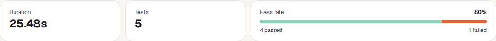

How long the run took, how many tests it held, and the share that passed. The bar is green for passed tests and orange for failed ones. Tests that were cancelled or timed out are not in the pass rate; the line underneath says how many were "not counted".

Above these, banners can appear: the run's data seed (with **Re-run with this seed**, to repeat it with the same generated test data), a run that is waiting for a shared test environment to be free, a cancelled or timed-out run, or a *validation run* that tried a suggested fix from *Proposals*.

## 11. TraceIQ thinks (AI analysis)

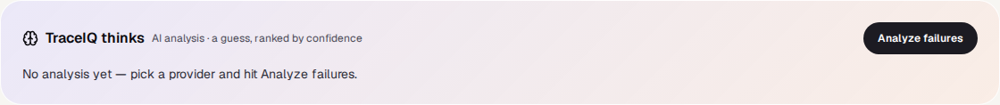

For a failed run (or one that ended in Error), TraceIQ looks at the failures and suggests a likely cause. When a run fails this starts by itself; it uses simple rules always, and an AI model as well when one is set up.

- Each finding has a **kind**: *app bug*, *test bug*, *environment*, *flake* or *unknown*, with a confidence, a short explanation and often a **suggested fix**.
- Newer findings list what was observed and several possible causes, each pointing at the evidence it is based on. Click a piece of evidence to jump to that step of that test. Editors can mark each cause as right or wrong; those votes feed the *Value report*.
- **Analyze failures** (or **Re-analyze**) runs it again, optionally with another AI provider from the menu next to it. It needs the editor role.
- It is a guess. Read the error and the evidence before acting on it.

The demo's runs have no analysis yet, so the box says "No analysis yet".

## 12. Tests in this run

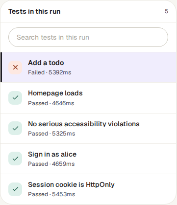

Every test of the run, **failed ones first**, then the rest, then passed ones; the first is shown on the right straight away. Each row gives the result, what kind of failure it was (see below) and how long it took. The search box filters the list by name (upper and lower case don't matter here).

## 13. The selected test

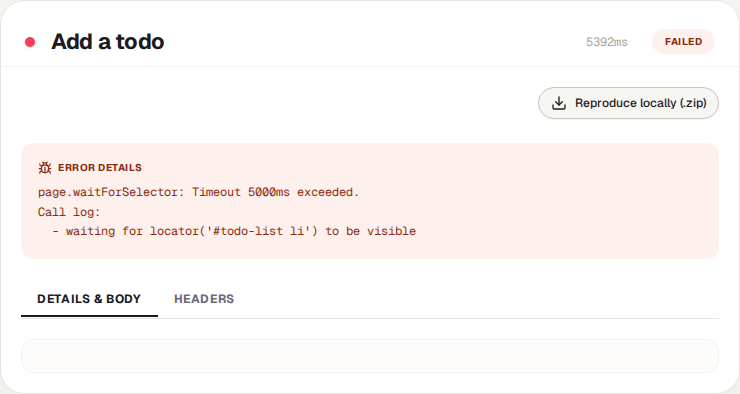

The test's name, result and duration, then whatever the run recorded for it:

- **Error Details**: the full error message of a failure.
- **Retries**: when the test was tried more than once, each attempt and its result.
- **Step evidence**: each step in order with its result, and for the failing step its console messages, failed requests, a screenshot and a piece of the page. How much is kept depends on the project's data settings.
- **Reproduce locally (.zip)**: a download with the test, its settings and a script a developer can run on their own computer. Passwords and keys are never included; the script asks for them.
- Tabs for the request and response **details**, **headers**, the test's own **media** and its **network** requests, when there are any.

| Kind of failure | What it tells you |
|---|---|
| **Test failure** | A step or check failed against the app. Look at the app or the test. |
| **Setup failed** | The suite's preparation steps failed, so the test never ran. |
| **Infrastructure** | The browser or the test machine failed. Not a verdict on the app. |
| **Time limit** | TraceIQ's time limit stopped it. Not a verdict on the app. |

The demo's history was generated, so its tests have an error message but no step evidence, screenshots or network requests. A real run shows them here.

## Watch it in use

[▶ Watch the video](../media/runs/runs/walkthrough.mp4)

*About a minute, with a spoken commentary. The captions at the bottom show the same words, so it also works with the sound off.*

## How to…

### …find out why last night's run failed

1. On the Runs list, press **Failed**.
2. Click the run. The failed test is already selected on the right.
3. Read **Error Details**, then **TraceIQ thinks** for a likely cause.
4. If the same failure appears in many runs, go to *Failure triage* and deal with it once.

### …find the run for a particular suite

1. Type the start of the suite's name in the search box, with the same capital letters.
2. Add a result or browser filter if you need to.
3. Press **Clear** to see everything again.

### …show a run to someone without an account

1. Open the run and press **Share**.
2. Choose how long the link should work, then **Create link**, and copy it.
3. Send it. It shows names, results and timings only, and stops working when it expires.

## Good to know

- **All your projects at once.** The list covers every project you have access to, not only the one selected in the sidebar.
- **It updates by itself.** The list refreshes every 5 seconds. A run's page updates live while it is running, and stops once it is finished.
- **Everything is here.** Scheduled runs, monitor checks, runs from build pipelines and AI agents, and validation runs for suggested fixes are all listed. Some of them (validation runs) are left out of pass rates and reports elsewhere.
- **Who can do what.** Anyone with access to a project sees its runs. Cancelling, re-analysing, force-completing and deleting need the *editor* role; deleting a run you may not edit is refused.
- **Old runs may be removed automatically** after the number of days set in the project's data settings or by the server administrator.

## Related pages

> **Monitors**
>
> The next page in this guide: tests on a timer against the live site.

> **Failure triage**
>
> Failures from many runs grouped by cause, so you fix each problem once.

> **Overview**
>
> The newest runs and the pass-rate trend, at a glance.

> **Suites**
>
> Where tests are written and runs are started.

## Video script

What the walkthrough says, in order. The video and every picture on this page are made by the Playwright script [`runs-runs.spec.ts`](../../../../e2e/docs-capture/pages/runs-runs.spec.ts).

1. Runs lists every test run in all your projects, newest first.
2. Each row is one run: its suite, number, start time, result and duration.
3. Search by suite or test name, or filter by result and browser.
4. Here only failed runs are shown. Click one to open it.
5. The run page. At the top: what ran, the result, and when.
6. Duration, the number of tests, and the share that passed.
7. For a failed run, AI analysis can suggest a likely cause, when it is set up.
8. Every test in the run. Failed ones come first, and the first is already open.
9. On the right: the selected test, with its error message.
10. The tabs at the top show recordings and network traffic, when the run captured them.
