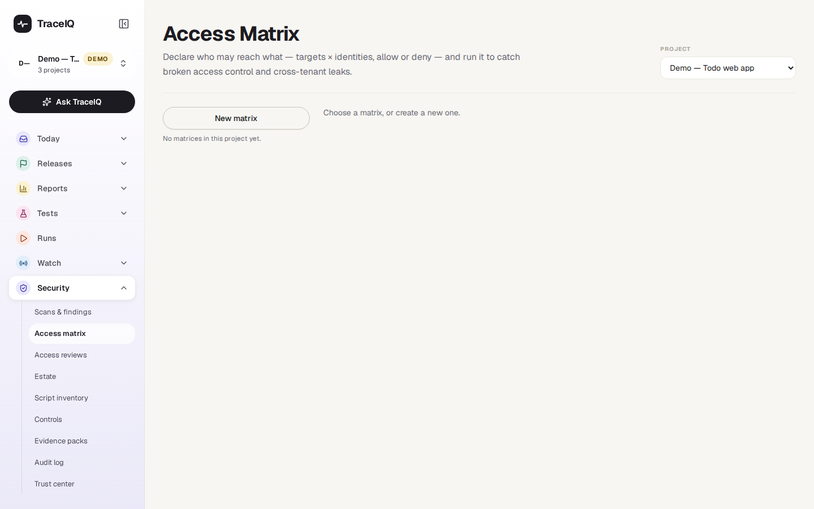
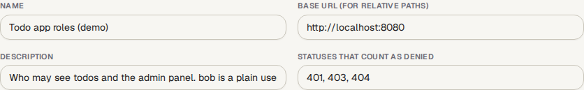
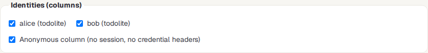
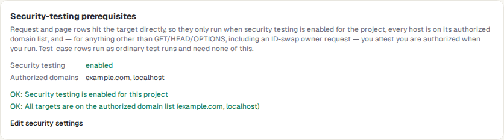
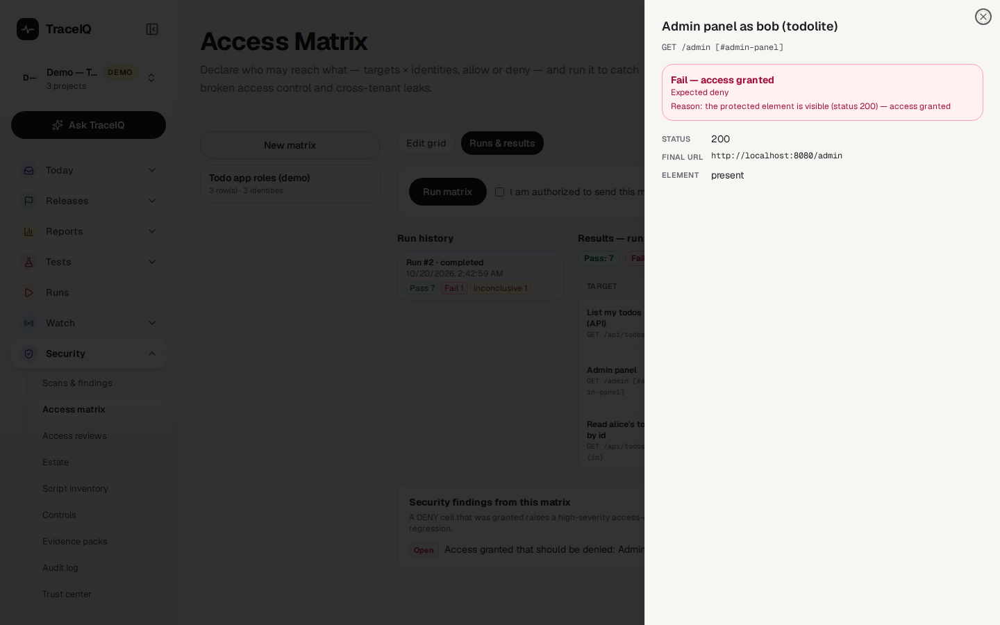
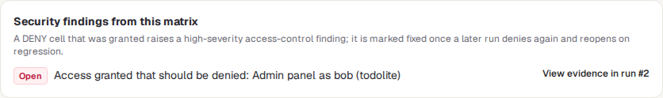

<!-- Generated from access-matrix.html by e2e/docs-capture/export_md.py. Edit the HTML, not this file. -->

# Access matrix

Security · Everyone with access to the project can see it · Editors can create, change and run matrices

> **In short**
>
> A table that says who may reach what in your app: one row per page or request, one column per kind of user, and in each cell "allow" or "deny". TraceIQ then tries every cell as that user and tells you where reality differs, for example when a visitor who isn't logged in can open an admin page.

## What it is for

**Access control** is the part of an app that decides who may see or do what. When it is broken, people see things they shouldn't: another customer's orders, an admin screen, someone else's account. It is one of the most common serious security problems, and ordinary tests rarely catch it, because they test what users *should* be able to do, not what they shouldn't.

An access matrix answers **"Can each kind of user reach only what they are meant to?"** You write down the rules once; TraceIQ checks them every time you run the matrix, and turns any rule that was broken into a security finding.

> **Security leads**
>
> Turn an access policy ("only admins see the user list") into a check that runs again and again.

> **Testers**
>
> Check every role against every important page in one go, instead of logging in and out by hand.

> **Developers**
>
> See exactly which user reached which address and what the server answered, before a release.

**Where to find it:** in the sidebar, open **Security → Access matrix**. The page's own heading says **Access Matrix**.

## A tour of the screen

When the page opens, the list on the left shows the project's matrices and the right says "Choose a matrix, or create a new one.". The demo's web project has one matrix:

The picture below shows that matrix opened on its **Edit grid** tab: three rows (the todo list as a request, the admin panel as a page, and one user's todo read by its ID) checked against two logged-in users, alice and bob, and someone who is not logged in. The numbers match the sections below.

*The demo matrix in the web project. Click the picture to see it larger.*

## 1. The list of matrices

The project's matrices, each with its number of rows and identities. Click one to open it; **New matrix** starts an empty one. A saved matrix has two tabs: **Edit grid** (what you see here) and **Runs & results** (see [Reading the results](#results)).

The **Project** menu at the top right of the page chooses the project. It is the same choice as the project picker at the top of the sidebar: changing it here changes it for the whole app.

## 2. Name and address

- **Name** (required) and **Description**: for people.
- **Base URL**: the address of the app. Rows can then give just a path, such as `/api/todos`.
- **Statuses that count as denied**: when the app refuses someone, it answers with a status number. By default `401` (not logged in), `403` (not allowed) and `404` (not found) count as "denied". Change the list if your app refuses in another way.

## 3. Identities (columns)

Each column is one **identity**: who TraceIQ pretends to be. A **persona** is a saved login for a particular user or role, for example a normal customer and an administrator; the list shows the project's personas and the workspace-wide ones. **Anonymous** is someone who is not logged in: TraceIQ sends no login and none of the project's login headers. Choose at least one column; a matrix can have up to 20.

## 4. The grid

Each row is one thing to try. Press **Add row** for another, and **Remove row** to drop one (up to 200 rows).

| Kind of row | What TraceIQ does |
|---|---|
| **Request** | Sends one request (GET, POST, DELETE…) to a URL or path and looks at the answer's status. A *Body* field appears for methods that send data. |
| **Page** | Opens the page in a browser. With an *Element selector* (a description of one part of the page, such as the admin panel), it also checks whether that part is shown. |
| **Test case** | Runs one of your existing tests as each identity. These run as ordinary test runs, so they also appear under *Runs*. |

**Click a cell** to change what should happen for that identity. Each click moves on to the next choice:

| Cell | Meaning |
|---|---|
| Allow | This identity should get in. The small *Status* box can require one exact answer (for example 200); empty means any success. |
| Deny | This identity should be refused. The *+deny* box adds one more status that counts as a refusal for this cell. |
| Skip | Not checked. Cells start as Skip. |

> **ID swap: can one user open another user's things?**
>
> A common hole is that user B can open user A's order just by changing the number in the address. Tick **ID swap** on a row to test this: TraceIQ first logs in as the *owner persona*, asks the *owner URL* for a list of that person's things, takes an ID from the answer (the *extractor* says where), puts it in place of the placeholder (`{id}`) in the row's URL, and then tries that address as every identity. Usually you expect Allow for the owner and Deny for everyone else. With two personas from different customer accounts, this checks that one customer can't see another's data.

## 5. Security-testing prerequisites

Request and page rows contact your app directly, so TraceIQ only runs them when the project allows security testing. This box checks your draft against those rules before you run it:

- **Security testing** must be enabled for the project, and
- every address must be on the project's **authorized domains**. Both are set under *Scans & findings → Authorization* (the **Edit security settings** link goes there).
- A row that **changes data** (any method other than GET, HEAD or OPTIONS, including the owner request of an ID swap) also needs you to tick "I am authorized…" when you run the matrix.

In the demo project both are in order, so the box shows two green *OK* lines; otherwise each problem is listed under *Needs attention*. Test-case rows need none of this. The box is only a preview: when you run the matrix, TraceIQ checks again, and if it refuses, its reason is shown word for word.

## 6. Save changes

On a saved matrix, **Save changes** saves your edits; it sits next to **Delete matrix**, which asks first and also deletes all of the matrix's runs. For a new matrix the button says **Create matrix** (greyed out until it has a name). Nothing is saved until you press the button; leaving the page throws your changes away.

### Reading the results

On a saved matrix, the **Runs & results** tab has a **Run matrix** button, the **Run history** (newest first) and the results of the selected run: the same grid, with each cell showing what was expected, what was observed, and a verdict. While a run is going, the page refreshes every 3 seconds.

*The demo run: bob, a plain user, could open the admin panel, and the visit as Anonymous timed out.*

| Verdict | What it means |
|---|---|
| Pass | What happened matches the cell. |
| Fail — access granted | The cell said Deny, but the identity got in. This is the serious one: TraceIQ records it as a high-severity security finding. |
| Fail — allow regression | The cell said Allow, but the identity was refused. Something that should work is broken; it is counted, but not a security finding. |
| Inconclusive | TraceIQ couldn't tell, for example the request timed out, the server had an error, or it was sent somewhere else. It is never counted as a pass. |
| Pending | Still waiting for a result. |

**Click a cell** to see its evidence: the status, the address it ended up on, whether the element was shown, the ID that was swapped in, the response headers and a piece of the response (with secrets removed), a screenshot for page rows, and a link to the test run for test-case rows.

*The evidence for the failed cell opens at the side of the page.*

Below the results, **Security findings from this matrix** lists the findings it raised, each with its status and a link to the run that showed the problem.

## Watch it in use

[▶ Watch the video](../media/security/access-matrix/walkthrough.mp4)

*About a minute, with a spoken commentary. The captions at the bottom show the same words, so it also works with the sound off. Nothing in the video is changed.*

## How to…

### …check that visitors can't reach admin pages

1. Make sure the project allows security testing and lists your app's domain (*Scans & findings → Authorization*, project admin).
2. Press **New matrix**, give it a name and your app's **Base URL**.
3. Tick an administrator persona, a normal-user persona and **Anonymous**.
4. Add a row per admin page or address. Set the administrator's cell to **Allow** and the others to **Deny**.
5. Press **Create matrix**, open **Runs & results** and press **Run matrix**.
6. Any red *Fail — access granted* cell is a hole. Click it for the evidence.

### …check that one customer can't see another's data

1. Use two personas logged in to two different customer accounts, A and B.
2. Add a request row whose URL contains `{id}`, for example `/api/orders/{id}`.
3. Tick **ID swap**: owner persona = A, owner URL = the address that lists A's orders, extractor = where the ID is in that answer.
4. Set A's cell to **Allow**, and B's and Anonymous's cells to **Deny**. Save and run.

### …follow up a problem it found

1. On **Runs & results**, look under **Security findings from this matrix**.
2. Press **View evidence in run #…** to see what happened.
3. Give the finding an owner and work on it in *Scans & findings → Findings register*. After the fix, run the matrix again.

## Good to know

- **Findings look after themselves.** A Deny cell that got through creates one high-severity finding per row and identity, and a later run that gets through again updates the same finding rather than adding another. When a later run denies it again, the finding is marked *Verified fixed* by itself; if access gets through after that, it reopens. A finding marked *false positive* stays that way. Inconclusive cells change nothing.
- **It only looks.** Request and page rows observe what the app answers; the only data they change is what a row itself sends (which is why those rows need your "I am authorized").
- **Old results keep their labels.** Each run stores a copy of the matrix as it was, so editing the matrix later doesn't relabel past results.
- **A run gives up after 45 minutes.** Cells still waiting then become *Inconclusive*, never Pass.
- **A failed test is not proof of "denied".** For test-case rows, a Deny cell passes only if the test failed with a refusal status (such as "expected 200 but got 403"). A test that failed for another reason, such as a timeout, is Inconclusive.
- **Runs count towards your plan.** Test-case rows start ordinary test runs, which count towards the monthly run allowance.
- **Who can do what.** Anyone with access to the project can look at matrices and results. Creating, changing, deleting and running a matrix needs the *editor* role.
- **Old run history.** Finished matrix runs and their screenshots are deleted after the project's retention period, like other runs. The matrix itself is kept.

## Related pages

> **Access reviews**
>
> The next page in this guide: check, by hand and on a schedule, who has access to TraceIQ itself.

> **Scans & findings**
>
> Where the project allows security testing, and where this matrix's findings are tracked.

> **Runs**
>
> The test runs started by test-case rows, with every step, screenshot and log.

> **Suites**
>
> Where the tests used by test-case rows are written.

## Video script

What the walkthrough says, in order. The video and every picture on this page are made by the Playwright script [`security-access-matrix.spec.ts`](../../../../e2e/docs-capture/pages/security-access-matrix.spec.ts).

1. An access matrix checks that each kind of user can reach only what they should.
2. The list on the left holds the project's matrices. Open one to see its grid.
3. The columns are identities: saved logins called personas, plus Anonymous, someone not logged in.
4. Each row is something to try: a page, a request, or one of your tests.
5. Each cell says what should happen: Allow, Deny, or Skip. A click changes it.
6. Here only alice, the admin, should reach the admin panel.
7. Runs and results shows what really happened, cell by cell.
8. Red means access was granted that should have been denied. bob, a plain user, reached the admin panel.
9. Click a cell to see its evidence.
10. Each such hole becomes a security finding, listed below the results.
