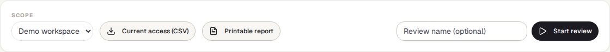
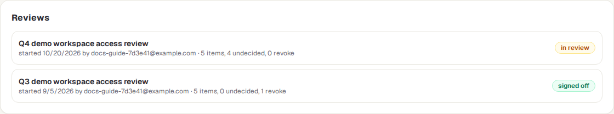
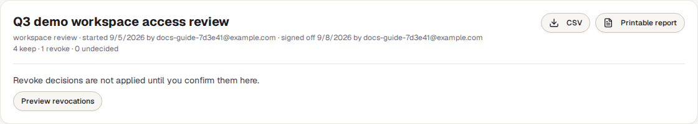

<!-- Generated from access-reviews.html by e2e/docs-capture/export_md.py. Edit the HTML, not this file. -->

# Access reviews

Security · Workspace admins only · Whole-server reviews: instance admins only

> **In short**
>
> Every so often, someone responsible looks at the list of people and API keys that can get into TraceIQ, decides for each one whether it should keep its access, and signs the review off. This page lists everyone's access, runs that review, keeps a record of every decision, and removes access only when you confirm it.

## What it is for

People change jobs, leave, or keep access they needed for one project long ago. An **access review** is the regular check that catches this: a named person goes through who has access and confirms or removes each one. Security standards and auditors (SOC 2, ISO 27001, PCI DSS) usually ask for one every quarter, with proof that it happened. This page answers **"Who can get into our TraceIQ, should they still, and can we prove we checked?"**

An **API key** is a password for a program rather than a person, for example the key a build server uses to start test runs. Keys are reviewed too.

> **Workspace admins**
>
> See everyone's roles and how they sign in, and remove access that is no longer needed.

> **Security and compliance**
>
> Run the quarterly review and keep the signed-off record for audits.

> **Auditors**
>
> Get a spreadsheet or a printable page of who had access, who decided what, and when.

**Where to find it:** in the sidebar, open **Security → Access reviews**. The page's own heading says **Access Reviews**.

## A tour of the screen

The page opens on the list of reviews. The numbers on the screenshot match the sections below.

*Access reviews for the demo workspace, with two reviews. Click the picture to see it larger.*

## 1. Scope

What to review. Choose one of your workspaces, or (instance admins only) **Whole instance** for every account on the TraceIQ server. When the page opens it picks the workspace of the project selected in the sidebar.

Reviewing a workspace needs the *workspace admin* role there. The whole-server review needs an *instance admin* (someone who runs the server), and only they see the **Whole instance** choice.

## 2. Current access

Two buttons give today's list for the chosen scope, without starting a review:

- **Current access (CSV)** downloads a spreadsheet file. A person with access to two workspaces is two rows, so you can filter by workspace.
- **Printable report** opens a page you can print or save as PDF.

For each **person**: their role in each workspace, their teams, their role in each project and how they got it (directly or through a team), whether they are an instance admin, how they sign in (password, or single sign-on such as SAML, OIDC or LDAP), whether two-step login (MFA) is on, and when they last signed in. For each **API key** that hasn't been revoked: what it can reach and with which role, who created it and when, when it was last used and when it expires.

## 3. Start review

Type a name if you like; without one, TraceIQ names it after the quarter, for example *2026 Q4 workspace access review*. Then press **Start review**. TraceIQ takes a snapshot of the current access as one **item** per person and per API key, and opens the review. The snapshot doesn't change afterwards, so the review shows exactly what was checked, even if access changes while it is going on.

## 4. Reviews

Past and current reviews for the chosen scope, each with its name, when it was started and by whom, the number of items, how many are undecided and how many are marked revoke, and a label: in review or signed off. Click one to open it.

### Inside a review

An open review is a table with one row per item:

*The demo's Q4 review, still in review: one item decided, four to go.*

| Column | What it shows |
|---|---|
| **Who / what** | The person's email address, or the key's name and the first characters of the key, labelled *person* or *API key*. |
| **Access at review start** | The snapshot: roles, teams and projects, and the sign-in facts listed under ②. |
| **Note** | Why you decided as you did. Required for Revoke. Under it: who decided, and when. |
| **Decision** | **Keep** or **Revoke**. Each click is saved straight away and can be changed until the review is signed off. |

Above the table: keep / revoke / undecided counts, the **CSV** and **Printable report** buttons for this review, and the sign-off. **Sign off review** stays greyed out until every item is decided ("Decide every item first."); a sign-off note is optional. **All reviews** goes back to the list.

*A signed-off review whose Revoke decision has not been applied yet.*

After sign-off, Revoke decisions still change nothing until someone applies them. **Preview revocations** lists what would be removed, and **Confirm and revoke** then removes it (**Cancel** leaves everything as it is).

## Watch it in use

[▶ Watch the video](../media/security/access-reviews/walkthrough.mp4)

*About a minute, with a spoken commentary. The captions at the bottom show the same words, so it also works with the sound off.*

## How to…

### …run the quarterly review

1. Choose the workspace under **Scope**, type a name and press **Start review**.
2. Go down the table. For each item, press **Keep**, or write a note (for example "left the company in August") and press **Revoke**.
3. When nothing is undecided, add a sign-off note if you like and press **Sign off review**. Decisions can't be changed after this.
4. Download the **CSV** or **Printable report** of the review for your records.

### …remove the access you marked Revoke

1. Open the signed-off review. Nothing has been removed yet.
2. Press **Preview revocations**. TraceIQ lists exactly what it will revoke, with your notes.
3. Press **Confirm and revoke** (or **Cancel**). Each item then shows what was done under its note.

### …give an auditor a list of who has access today

1. Choose the scope.
2. Press **Current access (CSV)** for a spreadsheet, or **Printable report** and save it as PDF.

## Good to know

- **What "revoke" does.** In a workspace review, a person is removed from the workspace, its teams and its projects (their account stays), and an API key is revoked. In a whole-server review, the person's account is deactivated and their logins are ended at once. Accounts are never deleted, so their history stays.
- **You can't revoke yourself.** If the person confirming is one of the Revoke items, that item is skipped.
- **Sign-off needs every item decided.** The button stays greyed out until nothing is undecided ("Decide every item first").
- **Everything is recorded.** Starting a review, every decision, the sign-off (with the reviewer and time) and every revocation go into the *Audit log*.
- **People only.** Reviews can't be done with an API key: a program calling TraceIQ is refused, so a real person always signs.
- **It feeds your controls.** On the *Controls* page, a control can check that an access review was signed off within a number of days.
- **Downloads are safe to open.** Cells that would start a formula in a spreadsheet are neutralised in the CSV.

## Related pages

> **Estate**
>
> The next page in this guide: your public domains and certificates, scored from the outside.

> **Workspace**
>
> Where members, teams and roles are changed day to day.

> **Controls**
>
> Compliance checks, including "an access review was signed off recently".

> **Audit log**
>
> The record of every review decision, sign-off and revocation.

## Video script

What the walkthrough says, in order. The video and every picture on this page are made by the Playwright script [`security-access-reviews.spec.ts`](../../../../e2e/docs-capture/pages/security-access-reviews.spec.ts).

1. An access review is a regular check of who can get into TraceIQ, and what they can do there.
2. Scope chooses what to review: one workspace, or the whole server.
3. These two buttons give today's list of people and API keys, as a spreadsheet or a printable page.
4. Start review freezes that list, so each person and key can be checked one by one.
5. For each one, the reviewer chooses Keep, or Revoke with a note saying why.
6. Once every item is decided, the reviewer signs the review off. That is recorded in the audit log.
7. Access is only removed after sign-off, when someone confirms the revocations.
8. Past reviews stay listed here: one still in review, one signed off.
