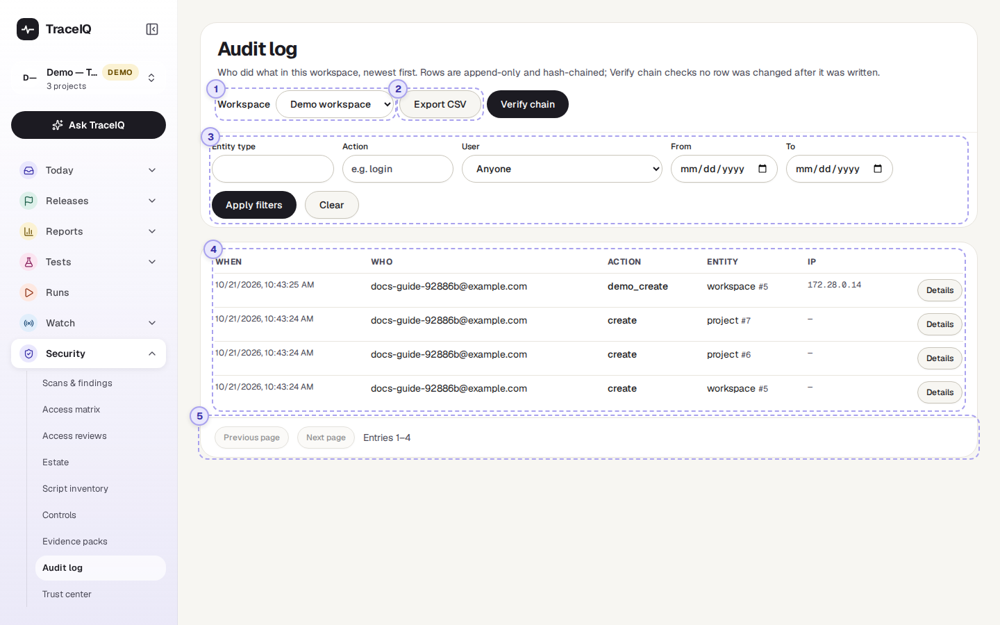
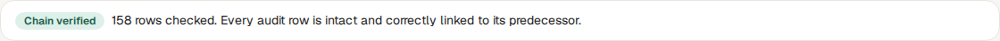
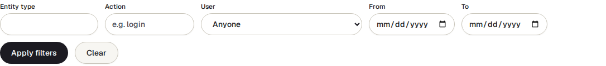
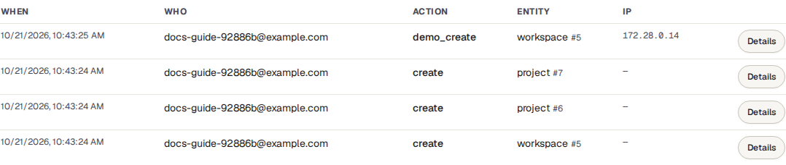
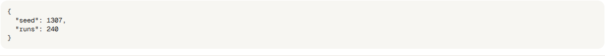

<!-- Generated from audit-log.html by e2e/docs-capture/export_md.py. Edit the HTML, not this file. -->

# Audit log

Security · Workspace admins only · Read-only page

> **In short**
>
> A diary TraceIQ keeps of everything important that happens in a workspace: who created or changed a test, who removed someone's access, what TraceIQ did by itself. Nobody can edit or delete its entries, and a button checks that none has been changed afterwards.

## What it is for

An **audit log** (or audit trail) answers **"Who did this, and when?"** after the fact: when a test disappeared, when someone's access changed, or when an auditor asks you to show that access to sensitive settings is recorded. Security standards (SOC 2, ISO 27001, PCI DSS) require one, and require that it can't be quietly rewritten.

TraceIQ's log is **append-only**: entries are only ever added. Each entry also carries a fingerprint of the entry before it, like links in a chain, so changing one old entry would break every link after it, and the **Verify chain** check would show where.

> **Workspace admins**
>
> Find out who changed or deleted something, and when.

> **Security teams**
>
> Look into an unexpected change of access or settings.

> **Auditors**
>
> Get a complete, verifiable record for a period.

**Where to find it:** in the sidebar, open **Security → Audit log**.

## A tour of the screen

The page shows the newest entries first. The numbers on the screenshot match the sections below.

*The audit log of the demo workspace, which has only its first few entries. Click the picture to see it larger.*

## 1. Workspace

Each workspace has its own log. The page shows the workspace of the project selected in the sidebar; pick another here. The menu only appears if you belong to more than one workspace.

## 2. Export CSV and Verify chain

- **Export CSV** downloads the entries that match the current filters as a spreadsheet file, oldest first, for an auditor or a security monitoring tool. It contains every matching entry, not just the 50 on screen.
- **Verify chain** checks every link of the chain and shows the result above the table:

The chain runs through the whole server's audit trail, not just this workspace, so the number of rows checked is larger than the number of entries you can see. If the check fails it shows Chain broken, the first bad entry and whether it is in this workspace. Entries written before the chain was introduced can't be checked, and it says so.

## 3. Filters

- **Entity type**: what kind of thing the entry is about, for example `project`, `case`, `api_key`, `access_review` or `security_finding`. The box suggests common ones as you type.
- **Action**: what was done, typed exactly, for example `create`, `delete` or `status_change`.
- **User**: one member of the workspace.
- **From** and **To**: whole days, in UTC.

Filters take effect when you press **Apply filters** (or Enter); **Clear** removes them all.

## 4. The entries

| Column | What it shows |
|---|---|
| **When** | The date and time, in your browser's time zone. |
| **Who** | The person's email address. When it wasn't a person, it names what did it (for example *finding-lifecycle* when TraceIQ reopened a finding, or a directory sync) and says what kind of actor that was: *system*, an API key, and so on. |
| **Action** | What happened, for example `create`, `status_change`, `sign_off`. |
| **Entity** | The kind of thing and its number, for example *project #6*. |
| **IP** | The network address the request came from, when it was recorded. |
| **Details** | Shows exactly what changed (before and after values). |

## 5. Pages

The table shows 50 entries at a time. **Next page** and **Previous page** move through older and newer ones; the line next to them says which entries you are looking at.

## Watch it in use

[▶ Watch the video](../media/security/audit-log/walkthrough.mp4)

*About a minute, with a spoken commentary. The captions at the bottom show the same words, so it also works with the sound off.*

## How to…

### …find out who deleted something

1. Type `delete` under **Action**, and the kind of thing (for example `case`) under **Entity type**.
2. Set **From** and **To** around when it disappeared, and press **Apply filters**.
3. Press **Details** on the entry to see its name and other values.

### …see everything one person did

1. Choose them under **User** and press **Apply filters**.
2. Use **Next page** to go further back.

### …give an auditor the log for a period

1. Set **From** and **To** and press **Apply filters**.
2. Press **Verify chain** and keep a screenshot of the result.
3. Press **Export CSV**. An *Evidence pack* includes the same log with a signed list of files, if the auditor wants more.

## Good to know

- **Nobody can edit it.** The database itself refuses to change an entry, and refuses to delete one except for the retention clean-up, if your server has one set up (by default entries are kept forever).
- **Secrets are not written down.** Passwords, tokens and similar values are removed from an entry's details before it is saved.
- **Entries outlive what they describe.** A deleted project or a removed user still has their entries, so the history stays complete.
- **Sign-ins are not here.** Sign-in entries aren't tied to a workspace, so this page doesn't show them, even though the Action box suggests `login`. Only changes made in this workspace appear.
- **Who can see it.** Only workspace admins (people allowed to manage the workspace's members). Everyone else is refused, because the log shows who did what across the whole workspace.
- **It doesn't refresh by itself.** Reload the page, or press Apply filters again, to see new entries.

## Related pages

> **Trust center**
>
> The next page in this guide: a public page that can show the date of your last audit-chain check.

> **Evidence packs**
>
> The audit log for a period, packed with your other records and signed.

> **Controls**
>
> One control source checks that this log's chain verifies.

> **Access reviews**
>
> Reviews whose every decision and sign-off is recorded here.

## Video script

What the walkthrough says, in order. The video and every picture on this page are made by the Playwright script [`security-audit-log.spec.ts`](../../../../e2e/docs-capture/pages/security-audit-log.spec.ts).

1. The audit log is TraceIQ's record of who did what in this workspace, newest first.
2. Each row says when, who, what they did, and to which thing.
3. Details shows exactly what changed.
4. Filters narrow the list, for example to one person, one kind of action, or a range of days.
5. Rows can never be edited or deleted, and each one is linked to the one before it.
6. Verify chain checks those links, so you can prove that nothing was changed afterwards.
7. Export C S V downloads the rows you are looking at, for an auditor or another tool.
