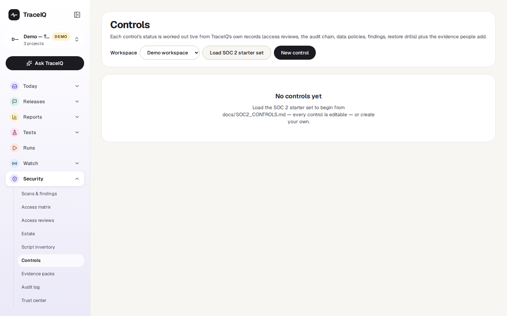
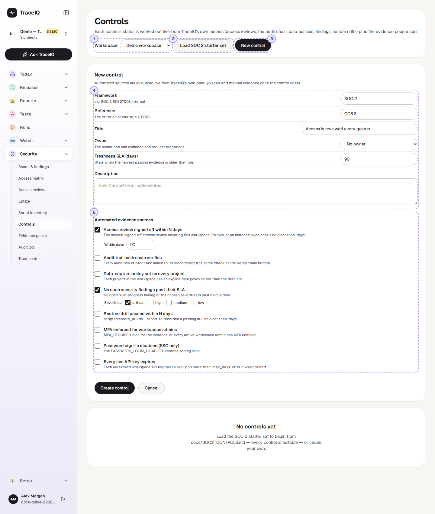
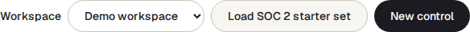
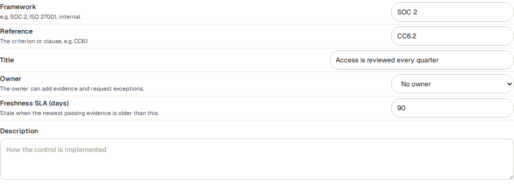
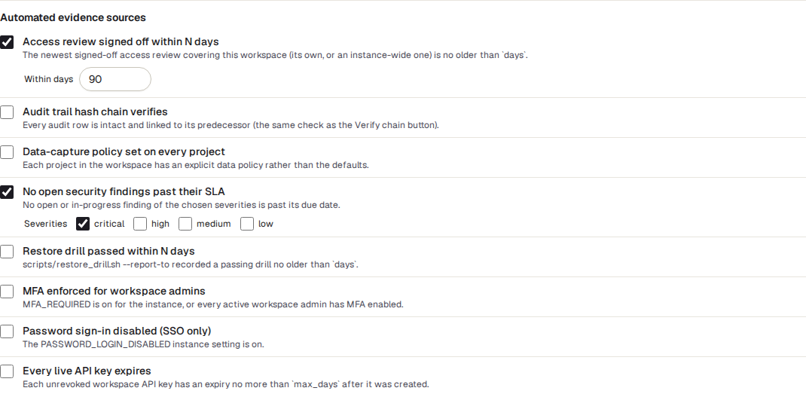

<!-- Generated from controls.html by e2e/docs-capture/export_md.py. Edit the HTML, not this file. -->

# Controls

Security · Every workspace member can see it · Workspace admins change it; owners add evidence

> **In short**
>
> A list of the security promises your organisation makes, such as "admins use two-step login" or "access is reviewed every quarter". For each one TraceIQ shows, live, whether the promise is being kept: from its own records where it can, and from the evidence people add where it can't.

## What it is for

A **control** is one safeguard you have promised to have in place. Security standards such as **SOC 2** or **ISO 27001** are, in practice, long lists of controls, and an audit is someone checking you can prove each one. The proof is called **evidence**: a screenshot, a signed-off review, a log.

Gathering evidence once a year is slow and it goes out of date. This page answers **"Which of our promises are we keeping today, and which need attention?"** Many answers come from data TraceIQ already holds (access reviews, the audit log, security findings…), so they stay current by themselves.

> **Compliance leads**
>
> One list of controls with owners, worst first, ready for the next audit.

> **Control owners**
>
> See what is expected of you, add evidence, and ask for an exception when you can't comply yet.

> **Auditors**
>
> See each control's status, its evidence and the full history of changes.

**Where to find it:** in the sidebar, open **Security → Controls**.

## A tour of the screen

The demo workspace has no controls yet, so the page first shows "No controls yet":

The picture below shows a new control being written. The numbers match the sections below.

*A control being written in the demo workspace (not saved). Click the picture to see it larger.*

## 1. Workspace

Controls belong to a workspace. The page shows the workspace of the project selected in the sidebar; pick another here. The menu only appears if you belong to more than one workspace.

## 2. Load SOC 2 starter set

Adds 17 ready-written controls for SOC 2 (references such as CC6.1, CC7.2, A1.2), with descriptions of how TraceIQ meets them and the automated checks already chosen. Every one can be edited afterwards. Pressing it again adds only the ones that are missing, so it is safe to press twice. Nothing is added unless someone presses it.

## 3. New control

Opens the form below for a control of your own. **Create control** saves it; **Cancel** closes the form. Both this button and ② are shown only to workspace admins.

## 4. The control

| Field | What it means |
|---|---|
| **Framework** | Which standard the control belongs to: SOC 2, ISO 27001, or your own internal rules. |
| **Reference** | The clause in that standard, for example CC6.1. |
| **Title** and **Description** | The promise, and how you keep it. |
| **Owner** | The person responsible. They may add evidence and ask for exceptions, even if they aren't an admin. |
| **Freshness SLA** | How old (in days, standard 90) the newest proof may be. Older than that, the control turns *Stale*. |

## 5. Automated evidence sources

Checks TraceIQ makes for you, from its own records, every time the page is opened. Tick the ones that prove this control:

| Source | Passes when |
|---|---|
| **Access review signed off within N days** | The newest signed-off *Access review* of this workspace (or of the whole server) is at most N days old (standard 90). |
| **Audit trail hash chain verifies** | The *Audit log*'s chain check finds every row intact. |
| **Data-capture policy set on every project** | Every project in the workspace has its own data policy (what test runs may record) rather than the defaults. |
| **No open security findings past their SLA** | No finding of the chosen severities (standard: critical) is open or in progress past its due date (see *Scans & findings*). |
| **Restore drill passed within N days** | A test restore of the backups was reported as passing at most N days ago. The server's operator reports these. |
| **MFA enforced for workspace admins** | Two-step login is required for everyone on the server, or every active admin of this workspace has it on. |
| **Password sign-in disabled (SSO only)** | The server only allows sign-in through your company's login (single sign-on). |
| **Every live API key expires** | Every API key of the workspace that isn't revoked has an end date at most N days after it was made (standard 365). |

### Statuses

Once there are controls, the list shows each with its reference, title, framework and owner, **failing first**, then stale, then not assessed. The heading shows how many controls have each status, and the toolbar filters by framework, status and owner. A control's status is worked out every time you look; it is never stored:

| Status | What it means |
|---|---|
| Failing | An automated source fails, or the newest evidence a person added records a failure. |
| Stale | Nothing fails, but the newest passing evidence is older than the freshness SLA. |
| Not assessed | There is no evidence yet, or the sources have no data to judge by. |
| Excepted | An approved exception is in force: the control is knowingly not met until a set date. This wins over every other status. |
| Passing | The evidence is current and passing. |

### A control's page

Click a control to open it on the right:

- **Status**, with the reason in words (for example which source failed).
- **Automated evidence**: each source with *Pass*, *Fail* or *Unknown*, and why.
- **Manual evidence**: notes and files people added, each marked *Shows it works* or *Shows a failure*, with who added it, when, and the file's fingerprint (SHA-256). Files may be PDF, images, text, CSV, JSON or Office files up to 10 MB.
- **Exceptions**: a time-limited waiver, with a reason, an optional compensating control (what reduces the risk meanwhile) and an end date at most 365 days away.
- **History**: every change to the control, its evidence and exceptions, from the audit log.

## Watch it in use

[▶ Watch the video](../media/security/controls/walkthrough.mp4)

*About a minute, with a spoken commentary. The captions at the bottom show the same words, so it also works with the sound off. The control in the video is not saved.*

## How to…

### …get started for a SOC 2 audit

1. As a workspace admin, press **Load SOC 2 starter set**.
2. Open each control, press **Edit control** and pick an **Owner**. Adjust the description to how your organisation really works.
3. Work through the list from the top: failing first, then stale.

### …add evidence to a control

1. Open the control (you must be its owner or a workspace admin).
2. Under **Manual evidence**, choose **Shows it works** or **Shows a failure**.
3. Write a note saying what it shows, and attach a file if you have one.
4. Press **Add evidence**. The status updates straight away.

### …ask for an exception

1. Open the control and write the **Reason**, and what reduces the risk meanwhile.
2. Choose **Expires on** and press **Request exception**.
3. Another workspace admin, *not you*, presses **Approve** or **Reject**. Until then it shows as pending.

## Good to know

- **Exceptions end by themselves.** When an exception's date passes, the control is judged on its evidence again; nobody has to remember. An admin can also revoke an approved one early.
- **You can't approve your own exception.** The approver must be a different admin from the person who asked.
- **Everything is recorded.** Creating, editing and deleting a control, adding, removing and downloading evidence, and every exception decision go into the *Audit log*, and show in the control's History.
- **Who can do what.** Every member of the workspace can look. Workspace admins (and admins of the organisation it belongs to) create, edit and delete controls and decide on exceptions. A control's owner can add evidence and request exceptions. API keys can read but never change anything.
- **Controls feed the trust center and evidence packs.** An evidence pack includes every control and its status; the trust center can publish how many controls are passing (a number only).

## Related pages

> **Evidence packs**
>
> The next page in this guide: one signed zip of your records for an auditor, controls included.

> **Access reviews**
>
> The quarterly review that the access-review source checks for.

> **Audit log**
>
> The history behind every control, and the chain check one source relies on.

> **Scans & findings**
>
> The findings and due dates the "no findings past SLA" source looks at.

## Video script

What the walkthrough says, in order. The video and every picture on this page are made by the Playwright script [`security-controls.spec.ts`](../../../../e2e/docs-capture/pages/security-controls.spec.ts).

1. A control is one promise your organisation makes about security, for example "access is reviewed every quarter".
2. This page lists your controls and checks, from TraceIQ's own records, whether each promise is being kept.
3. The demo workspace has no controls yet. An admin can load a ready-made set for SOC 2, a common security standard.
4. Or write your own with New control.
5. A control has a standard, a reference in it, a title, and an owner.
6. Freshness says how old the newest proof may be before the control counts as stale.
7. Automated sources are checks TraceIQ makes for you, such as a recent access review.
8. Once saved, people can add their own evidence, and admins can approve a time-limited exception.
