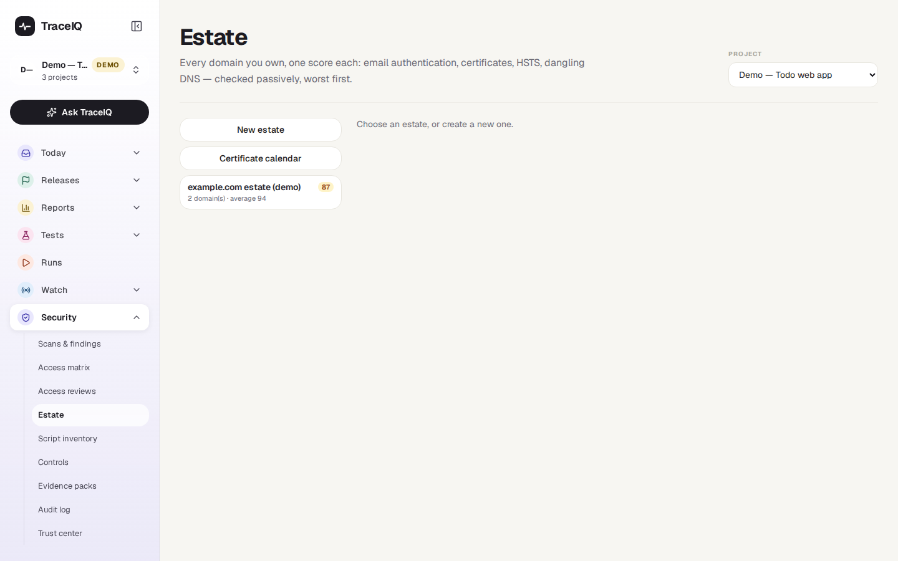
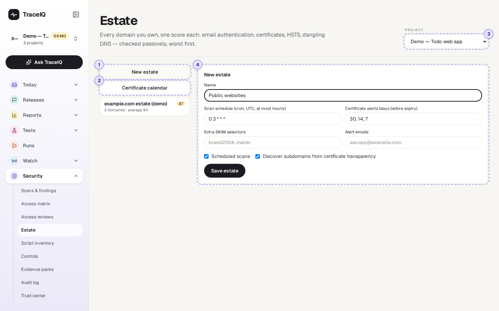
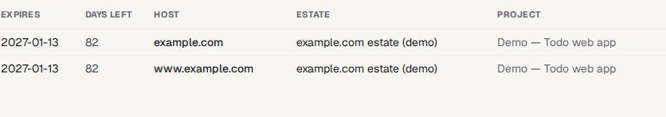

<!-- Generated from estate.html by e2e/docs-capture/export_md.py. Edit the HTML, not this file. -->

# Estate

Security · Everyone with access to the project can see it · Editors can add domains and scan

> **In short**
>
> A list of your organisation's domains (web addresses such as `example.com`), each checked from the outside and given a score out of 100. It catches the slow, quiet problems: a certificate about to run out, email that anyone could fake in your name, or an old address still pointing at a service you stopped paying for.

## What it is for

Your **estate** is everything you have on the public internet: the main site, the shop, the help centre, the forgotten marketing site from three years ago. Each of them can let you down in ways that have nothing to do with your app's code. The Estate page answers **"Which of our domains are weak, and what exactly is wrong with each?"**

The checks are **passive**: TraceIQ only reads public records and visits each site the way a browser would. It never scans ports or sends attack traffic.

> **Security leads**
>
> One score per domain, worst first, with the reason for every point lost.

> **IT and operations**
>
> Get warned weeks before a certificate expires, instead of finding out when the site breaks.

> **Email and marketing**
>
> See whether others can send email that pretends to come from your domain.

**Where to find it:** in the sidebar, open **Security → Estate**.

## A tour of the screen

The page opens on the list of the project's estates; the demo's web project has one:

The picture below shows the form behind **New estate**. The numbers match the sections below.

*Starting a new estate in the demo's web project (not saved). Click the picture to see it larger.*

## 1. Estates

An **estate** is a named group of domains, for example "Public websites" or "Payment domains". The list on the left shows each one with its **worst domain score** (the coloured number), how many domains it has and their average score. Click one to open it; **New estate** starts one.

## 2. Certificate calendar

A **certificate** is what lets a browser show the padlock for a site; it has an end date, and when it passes, visitors get a warning page instead of your site. The calendar lists every certificate seen on every domain, in every estate of the workspace that you can see, the soonest to expire first: the date, the days left, the host, the estate and the project. Seven days or fewer show in red, 30 or fewer in amber. Until a scan has run, it says "No certificates observed yet — scan an estate first."

*The demo's two certificates.*

## 3. Project

Estates belong to a project. This menu is the same choice as the project picker at the top of the sidebar: changing it here changes it for the whole app.

## 4. The estate's settings

| Field | What it does |
|---|---|
| **Name** | Required. |
| **Scan schedule** | When to check, written as a *cron* expression in UTC. The standard `0 3 * * *` means every day at 03:00 UTC (08:30 in India). It can't be more often than once an hour. |
| **Scheduled scans** | Untick to only scan when someone presses *Scan now*. |
| **Certificate alerts** | How many days before a certificate expires to warn you (standard: 30, 14 and 7). One warning per threshold, sent again after the certificate is renewed. |
| **Alert emails** | Who gets those warnings by email. They also go to the project's Slack or Teams channel, if it has one. |
| **Extra DKIM selectors** | DKIM is a signature on outgoing email. TraceIQ looks for the common names of these keys; add your own if your mail provider uses another name. |
| **Discover subdomains** | Every public certificate is written into open logs (*certificate transparency*). TraceIQ reads them to find more of your sub-domains, such as `shop.example.com`, and adds those on the project's allowed list (up to 200 per domain). |

Nothing is saved until you press **Save estate**.

### Inside an estate

Once saved, the estate's page has **Scan now**, **Settings** and **Delete estate** (which asks first and also deletes the scan history), and three parts:

![The demo estate, example.com estate (demo), last scan completed 2026-10-21, with Scan now, Settings and Delete estate buttons and the line Passive checks only. The domain table: example.com, zone apex, score 87, 82 days left on its certificate; www.example.com, score 100, 82 days. Below it the Add domains box and Import domains. On the right the checks for example.com, 87 out of 100: how the score is made (100 start, minus 3 SPF softfail, 6 DMARC p=none, 2 no CAA record, 2 no DNSSEC, equals 87) and every check with Pass or Warn. At the bottom the scan history: two scheduled scans, averages 94 and 91](../media/security/estate/estate.png)

*The demo estate with *example.com* opened: its score lost 13 points to four email and DNS warnings.*

- **The domain table**, lowest score first: the domain (with "from CT logs" if it was discovered, "zone apex" for a main domain), its score, a small trend line of up to 12 recent scores from the last 120 days, and the days left on its certificate. *Remove* takes a domain out of the estate, after asking (its past scan results are deleted too).
- **Add domains**: paste domains, one per line, comma-separated or the first column of a CSV, then press **Import domains**. Each one must be on the project's allowed list; refused ones are listed with the reason. An estate holds up to 500 domains.
- **A domain's checks**: click a domain to see every check, with what it found, why it matters, and the arithmetic of its score.

**Scan history** at the bottom lists every scan: when, whether it was scheduled or manual, how it ended, the average score and the number of domains.

### How the score is made

Every domain starts at 100. Each problem found takes off a fixed number of points, and the drill-down shows each line, for example `100 start − 10 dmarc_missing … = 78`. The score never goes below 0. In the list, 90 or more is green, 75–89 amber, below 75 red.

| Family | What is checked (largest deductions) |
|---|---|
| **Email** | *SPF*, *DKIM* and *DMARC* are DNS records that tell other mail servers which email really comes from you. Missing or weak ones let anyone send email in your name: up to 15 points (SPF that allows every server), 10 for no SPF or no DMARC, 6 for a DMARC that only watches. |
| **Certificate** | A certificate browsers don't trust (expired, wrong name, unknown issuer): 25 points. Expiring within 7 / 14 / 30 days: 10 / 5 / 2. |
| **HTTPS** | No *HSTS* header (which tells browsers to always use the secure version): 5; plain `http://` not sent on to `https://`: 3. |
| **Takeover** | A record pointing at a third-party service you no longer use, which someone else could claim and serve their content on your address: 40 points. A record pointing at a name that doesn't exist: 10. |
| **Hygiene** | No *CAA* record (any certificate authority may issue for you) or no *DNSSEC*: 2 each. |

## Watch it in use

[▶ Watch the video](../media/security/estate/walkthrough.mp4)

*About a minute, with a spoken commentary. The captions at the bottom show the same words, so it also works with the sound off. The estate in the video is not saved.*

## How to…

### …start watching your domains

1. Ask a project admin to allow security testing and list your domains under *Scans & findings → Authorization*. Estate refuses domains that aren't on that list.
2. Press **New estate**, give it a name, add the alert email addresses and press **Save estate**.
3. Paste your domains into **Add domains** and press **Import domains**.
4. Press **Scan now**. The page refreshes by itself until the scan has finished.
5. Click the lowest-scoring domain to see what to fix first.

### …see which certificates expire soon

1. Press **Certificate calendar**.
2. The top rows expire first. Red numbers are a week or less away.

### …fix a problem and confirm it

1. Click the domain and read the check's explanation.
2. Fix the record or the certificate with whoever runs your DNS or hosting.
3. Press **Scan now**. When the check passes, its finding is marked verified fixed in *Scans & findings*.

## Good to know

- **Only allowed domains are checked.** Every domain must be on the project's allowed list when it is added and again at every scan. A domain removed from the list is skipped, and the estate says so.
- **Problems become findings.** DNS, certificate and takeover problems appear in *Scans & findings* (as *estate-dns*, *estate-tls*, *estate-takeover*) with an owner, due date and status. One finding per problem is kept up to date; a clean rescan marks it verified fixed.
- **A check that couldn't run proves nothing.** If a DNS lookup fails or the site can't be reached, that family's earlier findings are left as they were rather than marked fixed.
- **Certificates are checked like a browser would.** TraceIQ never skips certificate checks to get through; a failing certificate is reported as untrusted.
- **One scan at a time.** Scan now is refused while a scan of the same estate is running.
- **Who can do what.** Anyone with access to the project can look. Creating, changing and deleting an estate, adding or removing domains and scanning need the *editor* role. Every change and every manual scan goes into the *Audit log*.

## Related pages

> **Script inventory**
>
> The next page in this guide: every script on your payment pages, each one approved with a reason.

> **Scans & findings**
>
> Where the allowed list is set and where estate problems are tracked to a fix.

> **Monitors**
>
> Check on a timer that your sites are up, not just correctly set up.

> **Trust center**
>
> Show customers a summary of your security, including findings, without the details.

## Video script

What the walkthrough says, in order. The video and every picture on this page are made by the Playwright script [`security-estate.spec.ts`](../../../../e2e/docs-capture/pages/security-estate.spec.ts).

1. Your estate is every web address your organisation owns, as the outside world sees it.
2. TraceIQ checks each one and gives it a score out of one hundred, worst first.
3. An estate is a named group of domains. The number is its worst domain's score.
4. New estate starts one: a name, how often to check, and who to warn.
5. Certificate alerts warn you a set number of days before a site's certificate runs out.
6. TraceIQ can also find more of your sub-domains in public certificate records.
7. After saving, you add the domains, and each one is only checked if it is on the project's list of sites that may be tested.
8. Certificate calendar lists every certificate in the workspace, the soonest to run out first.
