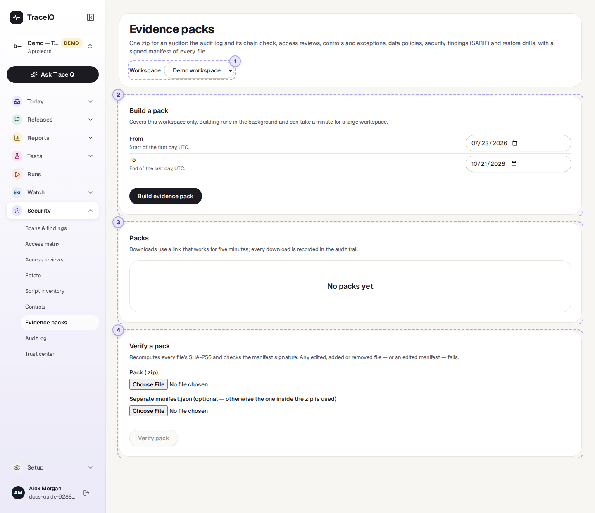
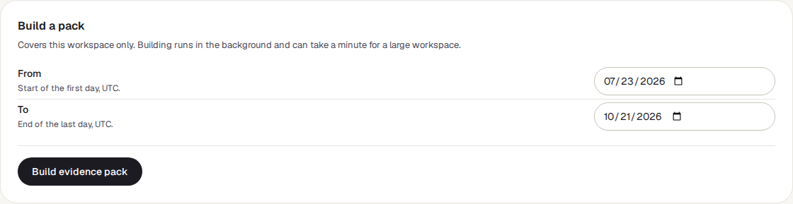
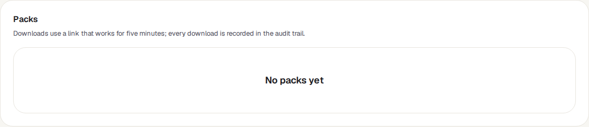
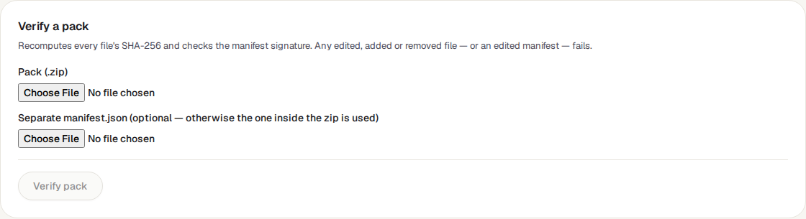

<!-- Generated from evidence-packs.html by e2e/docs-capture/export_md.py. Edit the HTML, not this file. -->

# Evidence packs

Security · Workspace admins only · Verifying: any member of the pack's workspace

> **In short**
>
> One zip file with the records an auditor usually asks for (the audit log, access reviews, controls, data policies, security findings and backup restore tests) for one workspace and one period. Every pack carries a signed list of its files, so anyone can later check that nothing in it was changed.

## What it is for

During an audit, the auditor asks for **evidence**: proof that what you say you do really happened. Collecting it by hand from several screens takes days, and an auditor can't easily tell whether a spreadsheet was edited afterwards. This page answers **"Can you send us everything for the last quarter, in a form we can trust?"** in a few clicks.

The trust comes from a **signed manifest**: a list of every file in the zip with its *fingerprint* (a SHA-256 value that changes if even one character of the file changes), signed with a key only your TraceIQ server has.

> **Compliance leads**
>
> Produce the audit pack for a period in minutes, not days.

> **Auditors**
>
> Get the records in one place, and check that they are complete and unchanged.

> **Security teams**
>
> Keep a dated copy of the evidence each quarter.

**Where to find it:** in the sidebar, open **Security → Evidence packs**.

## A tour of the screen

The page has four parts. The demo workspace has no packs yet. The numbers on the screenshot match the sections below.

*The Evidence packs page for the demo workspace. Click the picture to see it larger.*

## 1. Workspace

A pack covers one workspace. The page shows the workspace of the project selected in the sidebar; pick another here. The menu only appears if you belong to more than one.

## 2. Build a pack

Choose the period: **From** (start of that day, UTC) and **To** (end of that day, UTC). The last 90 days up to today are filled in; the end can't be in the future. Press **Build evidence pack**. Building happens in the background; the pack appears in the list below and the page refreshes by itself until it is ready.

| In the zip | What it contains |
|---|---|
| `README.txt` | What the pack is, for whom and for which period. |
| `audit/` | The workspace's audit log rows for the period, and the result of the chain check (which covers the server's whole audit trail). |
| `access-reviews/` | Today's access report (CSV and printable), plus every access review started or signed off during the period. |
| `controls/` | Every control with its status, and a printable summary. |
| `data-policies/` | What each project's test runs are allowed to record. |
| `security/` | Each project's security findings as a SARIF file, and the workspace's fix-by SLA. |
| `restore-drills/` | Backup restore tests reported during the period (these cover the whole server, since one database serves every workspace). |
| `manifest.json` | The signed list of every file with its size and fingerprint. |

## 3. Packs

Every pack, with its status, period, who asked for it and when, and, once ready, the number of files and the size.

| Status | What it means |
|---|---|
| queued | Waiting to be built. |
| building | Being put together. |
| ready | Ready to download. **Show contents** lists every file and size, and the zip's and manifest's fingerprints. |
| failed | It couldn't be built; the reason is shown. A pack still queued or building after 2 hours is shown as failed. |

**Download pack** fetches it through a link that works for five minutes. Every download is recorded in the *Audit log*.

## 4. Verify a pack

Choose a pack's zip file (and, if the manifest was sent separately, its `manifest.json`) and press **Verify pack**. TraceIQ recalculates every file's fingerprint and checks the signature, then shows Verified or Not verified with the workspace, period, who generated it and when. Any file changed, added or removed is listed, and an edited manifest fails the signature check.

## Watch it in use

[▶ Watch the video](../media/security/evidence-packs/walkthrough.mp4)

*About a minute, with a spoken commentary. The captions at the bottom show the same words, so it also works with the sound off.*

## How to…

### …prepare the pack for a quarterly audit

1. Pick the workspace, then set **From** and **To** to the first and last day of the quarter.
2. Press **Build evidence pack** and wait until it is *ready*.
3. Press **Show contents** to check that everything you expect is there.
4. Press **Download pack** and send the zip to the auditor.

### …check a pack someone sends back

1. Under **Verify a pack**, choose the zip file.
2. Press **Verify pack**.
3. *Verified* means every file is exactly as TraceIQ wrote it. Otherwise the list says which files differ.

## Good to know

- **One workspace only.** A pack never contains another workspace's audit rows, findings or project names.
- **One build at a time.** While a pack for the workspace is being built, another is refused.
- **Old keys still verify.** If the server's signing key has been replaced, packs signed with the earlier key still verify, and the result says "an earlier key".
- **Verification is private too.** The result is shown only to members of the workspace the pack belongs to.
- **Who can do what.** Building, listing and downloading packs need the *workspace admin* role, and a download must be made by a person, not an API key. Packs are deleted with the workspace.

## Related pages

> **Audit log**
>
> The next page in this guide: the record of who did what, which every pack includes.

> **Controls**
>
> Your compliance promises and their status, all included in the pack.

> **Access reviews**
>
> The reviews and access reports the pack contains.

> **Trust center**
>
> A public summary for customers, rather than a full pack for an auditor.

## Video script

What the walkthrough says, in order. The video and every picture on this page are made by the Playwright script [`security-evidence-packs.spec.ts`](../../../../e2e/docs-capture/pages/security-evidence-packs.spec.ts).

1. An evidence pack is one zip file with the records an auditor asks for, for one workspace and one period.
2. It holds the audit log, access reviews, controls, data policies, security findings and restore drills.
3. Choose the first and last day. The last ninety days are filled in for you.
4. Build evidence pack starts building it in the background.
5. Finished packs are listed here, ready to download. The demo workspace has none yet.
6. Every pack carries a signed list of its files. Verify a pack checks that nothing was changed.
7. So an auditor can trust the files really came from TraceIQ, exactly as they were made.
