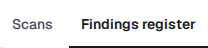
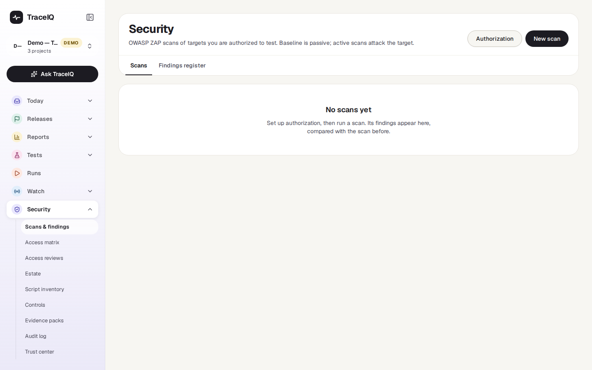
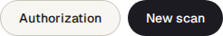
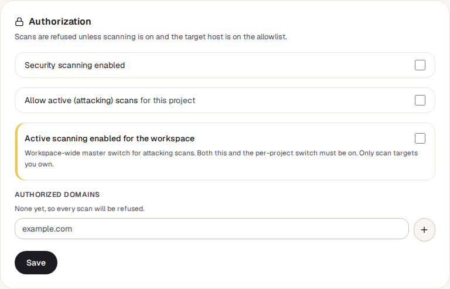
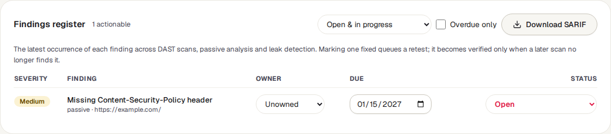
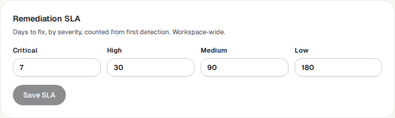

<!-- Generated from scans-and-findings.html by e2e/docs-capture/export_md.py. Edit the HTML, not this file. -->

# Scans & findings

Security · Everyone with access to the project can see it · Editors scan and work on findings; admins approve

> **In short**
>
> A list of the security weaknesses TraceIQ has found in your app, with who is fixing each one and by when. Findings come from security scans you start here, and from checks TraceIQ makes on every finished test run. A fix only counts once a later scan or run no longer finds the problem.

## What it is for

A **finding** is one security weakness, for example "this page doesn't tell the browser to block scripts from other sites". This page answers **"What security problems do we know about, who owns them, and are they really fixed?"**

A **security scan** is an automatic check of a website for known kinds of weakness. TraceIQ uses *OWASP ZAP*, a free and widely used scanning tool. A **baseline** scan only looks at what the site sends back, so it is safe to run. An **active** scan really tries attacks against the site, which can change or break data, so it needs extra permission and should only point at a test copy of your own site.

> **Security leads**
>
> Keep one list of every known weakness, with an owner and a due date for each, and see which ones are late.

> **Developers**
>
> See what is wrong, why it matters and how to fix it, then mark it fixed so TraceIQ checks again.

> **Auditors**
>
> See that risks were accepted on purpose, by whom, why and until when, and download the list in a standard format.

**Where to find it:** in the sidebar, open **Security → Scans & findings**. The page's own heading says **Security**.

## A tour of the screen

The page shows the project selected at the top of the sidebar. It has two views, **Scans** and **Findings register**. The picture shows the register; the numbers match the sections below.

*The Findings register for the demo's web project, with one finding. Click the picture to see it larger.*

## 1. Scans and Findings register

- **Scans** (shown when the page opens) is about one scan at a time: what it found, and what changed since the scan before.
- **Findings register** is the whole list: every finding the project still has, whatever found it.

Until someone runs a scan, the Scans view only says *No scans yet*, as in the demo:

Once there are scans, the Scans view shows:

- **Four numbers** for the selected scan: *New* and *Fixed since the previous scan* (compared with the last finished scan of the same address; a dash if there is none), *Still open* and *In progress*.
- **The scan's findings**, most serious first, on four tabs: *Open* (open and in progress), *Awaiting retest*, *Waived* (accepted risks and false positives) and *Verified fixed*.
- **A list of the 8 newest scans**, each with its status (*pending*, *running*, *completed* or *error*), address, kind and how many high, medium and low findings it had. The newest finished scan is selected when the page opens; click another to switch.
- **The selected finding** on the right: its severity, a *New since the previous scan* label if it is new, *Why it matters and how to fix it*, the *Evidence* the scanner saw, and buttons to change its status.
- **SARIF for scan #…** in the top-right corner downloads that scan's findings as a file (see [③](#register-tools)).

## 2. Authorization and New scan

Each button opens a box under the heading; press it again to close the box.

**Authorization** is where a project admin decides what may be scanned at all. TraceIQ refuses every scan until this is set up, so it can't be used against someone else's site.

| Setting | What it does |
|---|---|
| **Security scanning enabled** | The project's main switch. Off means no scan of any kind. |
| **Allow active (attacking) scans** | Allows active scans for this project. Baseline scans don't need it. |
| **Active scanning enabled for the workspace** | A second switch, for every project in the workspace. Active scans need both this and the project's switch. Only a workspace admin can change it, and **it is saved the moment you click it**, without the Save button. If the server forces it on for everyone, the box says so. |
| **Authorized domains** | The sites that may be scanned. A domain also covers its sub-domains: `example.com` allows `staging.example.com`. Type one and press Enter or **+**; the **×** next to one removes it. |

Changes to the project settings and domains are kept only when you press **Save**, which needs the project *admin* role.

**New scan** starts a scan:

- **Target URL**: the address to scan. Its site must be on the authorized domains.
- **Baseline (passive)** or **Active (attacking)**: the kind of scan.
- **Use saved session**: scan as a logged-in user, with the login TraceIQ saved from this project's login test. Without it, the scanner only sees what a visitor sees.
- **API import and token auth** (click to open): the address of an API description (an *OpenAPI* or *Swagger* file, also on an authorized domain), so the scanner reaches every documented address, not just the ones it finds by following links; and a token sent with every request (*Bearer*, *API key* or a header you name). The token is used for this scan only and never shown again.
- **I am authorized to scan this target**: you confirm the site belongs to you or your organisation. **Run scan** stays greyed out until it is ticked.

## 3. Filter and download

Above the register:

- **"1 actionable"** next to the title counts findings that are *Open* or *In progress* in the current list, followed by how many of them are overdue, if any.
- **The status filter** chooses which findings to list: *Open & in progress* (chosen first), *Awaiting retest*, *Accepted / false positive*, *Verified fixed* or *All*.
- **Overdue only** keeps just the findings past their due date.
- **Download SARIF** saves the project's findings as a *SARIF* file, a standard format that other security tools (GitHub code scanning, for example) can read. It contains every status, whatever the filter shows; accepted risks and false positives are marked as set aside.

## 4. The register

One row per finding, the most serious first and, within a severity, the one due soonest first. The same weakness found again by a later scan or run stays one row: the register shows its newest occurrence, and that row keeps its owner, due date and status.

| Column | What it shows |
|---|---|
| **Severity** | How serious it is: Critical High Medium Low Info. |
| **Finding** | Its name, then what found it and where: *zap* (a scan from this page), *passive* (the check of a test run's pages), *leak* (secrets found in a run's responses), *access_matrix* or *estate-…* (from the *Access matrix* and *Estate* pages), and the address. |
| **Owner** | Who is responsible. Choose from the people with editor access to the project, or *Unowned*. |
| **Due** | The date it should be fixed by, set from the SLA (see ⑤). Overdue appears under it once the date has passed and it is still Open or In progress. Only a project admin can change the date. |
| **Status** | Where it is in the workflow (table below). The menu only offers the moves that are allowed from the current status. |

Changing an owner, date or status in the register saves straight away; there is no Save button.

| Status | What it means |
|---|---|
| **Open** | Found, and nobody has started on it. Every new finding starts here. |
| **In progress** | Someone is working on it. |
| **Fixed — awaiting retest** | Someone says it is fixed. TraceIQ now waits for proof. For a scan finding it starts a new scan of the same address straight away (the "retest"); for a finding from a test run, the next run of the same suite that covers it is the check. |
| **Verified fixed** | A later scan or run looked and no longer found it. **Nobody can choose this by hand**; only that check can set it. |
| **Accepted risk** | Known, and deliberately left for now. Needs a reason, an end date at most a year away, and a project admin, who is recorded as the approver. When the date passes, it goes back to Open by itself. |
| **False positive** | Not a real problem (the scanner got it wrong). It stays set aside when it is found again. |

> **A fixed finding can come back**
>
> If a scan or run finds a weakness again after it was marked fixed (awaiting retest or verified), TraceIQ puts it back to *Open* by itself. The owner and the original due date stay, so a weakness that keeps coming back doesn't get a fresh deadline each time.

## 5. Remediation SLA

An **SLA** (service-level agreement) here is your own promise of how fast each kind of finding gets fixed. The numbers are days, counted from the day a finding was first found, and they set its due date. The standard values are 7 days for critical, 30 for high, 90 for medium and 180 for low; *Info* findings get no due date. The SLA is shared by every project in the workspace, and only a workspace admin can change it (others see the numbers greyed out).

A new SLA applies to findings found **from then on**. Findings that already have a due date keep it.

## Watch it in use

[▶ Watch the video](../media/security/scans-and-findings/walkthrough.mp4)

*About a minute, with a spoken commentary. The captions at the bottom show the same words, so it also works with the sound off.*

## How to…

### …run a first scan of your site

1. A project admin presses **Authorization**, ticks **Security scanning enabled**, adds your site under **Authorized domains** and presses **Save**.
2. Press **New scan** and type the address, preferably of a test copy of your site.
3. Keep **Baseline (passive)** unless you have permission for an active scan and both switches are on.
4. Tick **I am authorized to scan this target** and press **Run scan**. The scan appears in the list as *pending*, then *running*; the page checks for news every 15 seconds.
5. When it is *completed*, read its findings on the Scans view. They are in the register too.

### …work on a finding

1. Open **Findings register**. Tick **Overdue only** to start with the late ones.
2. Pick an **Owner** for the finding.
3. Set its status to **In progress** while it is being fixed.
4. Once the fix is live, set it to **Fixed — awaiting retest**. A message says whether a retest scan was started, or what will check it instead.
5. It moves to **Verified fixed** by itself when the check no longer finds it.

### …accept a risk on purpose

1. Choose **Accepted risk** (in the register's status menu) or press **Accept risk** (on the Scans view).
2. Write why it is acceptable, and choose the date until which it is accepted (at most a year).
3. Press **Accept risk**. You need the project *admin* role; you are recorded as the approver. TraceIQ reopens it on that date.

## Good to know

- **Test runs are checked automatically.** When a run finishes, TraceIQ looks at the pages and responses it already recorded, for missing protective headers, unsafe cookies, plain `http://` pages and secrets (such as cloud keys) in responses. Nothing extra is sent to your site, and no scan settings are needed for this.
- **Scans need the scanning service.** Whoever runs your TraceIQ server has to set up OWASP ZAP for it. Without that, a scan ends in *error* with "ZAP is not configured".
- **Who can do what.** Anyone with access to the project can look and download. Starting a scan and changing an owner or status needs the *editor* role. Changing a due date, accepting a risk, and the project's Authorization settings need the project *admin* role; the SLA and the workspace switch need a *workspace admin*.
- **Every change is recorded.** Owner, date and status changes, including the ones TraceIQ makes by itself (reopening, verifying), go into the *Audit log*.
- **A retest isn't always possible.** If the original scan used a token, TraceIQ didn't keep it, so it can't retest by itself; run a new scan with the token. It also won't retest if the scan settings would now refuse the scan.
- **Limits.** The register lists up to 500 findings; the Scans view lists the 8 newest scans.

## Related pages

> **Access matrix**
>
> The next page in this guide: check that each kind of user can reach only what they should. Its failures become findings here.

> **Estate**
>
> Your public domains and certificates, checked from the outside. Its problems are findings here too.

> **Runs**
>
> Each run's full result, including the pages and responses the automatic checks looked at.

> **Audit log**
>
> Who changed which finding, when, and what TraceIQ changed by itself.

## Video script

What the walkthrough says, in order. The video and every picture on this page are made by the Playwright script [`security-scans-and-findings.spec.ts`](../../../../e2e/docs-capture/pages/security-scans-and-findings.spec.ts).

1. Scans and findings is where TraceIQ keeps the security problems it has found in your app.
2. The Scans view lists the security scans run for this project. The demo project has none yet.
3. Before anyone can scan, a project admin says which sites may be scanned, under Authorization.
4. New scan starts a scan of one web address. You must confirm the site is yours.
5. The Findings register lists every security problem found, from scans and from ordinary test runs.
6. Each finding has a severity: how serious it is.
7. An owner, and a date it should be fixed by.
8. And a status. Marking it fixed asks TraceIQ to check again; only that check can confirm the fix.
9. Remediation SLA sets how many days each severity has, from the day it was first found.
