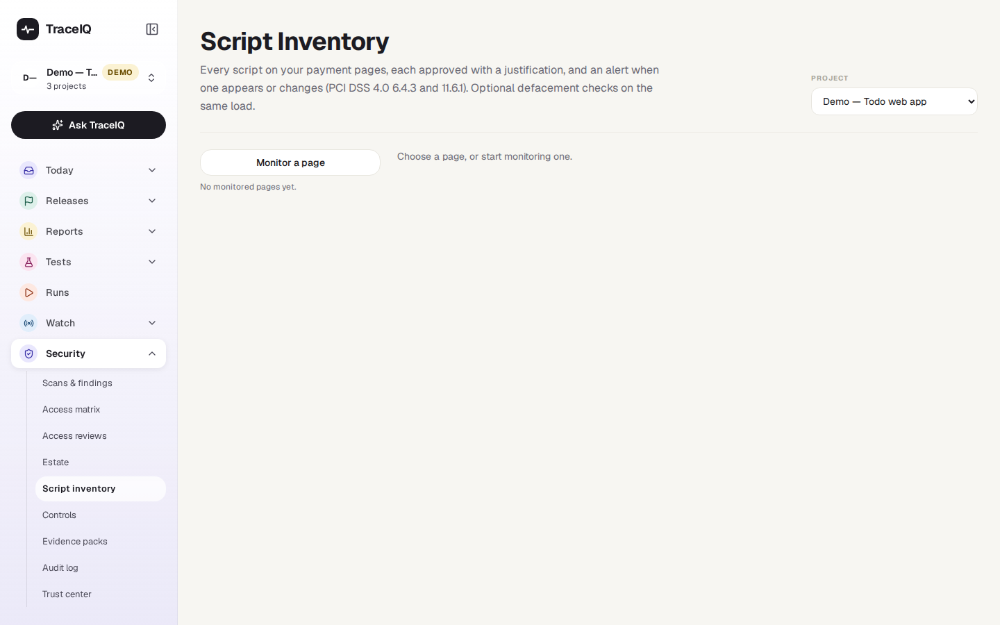
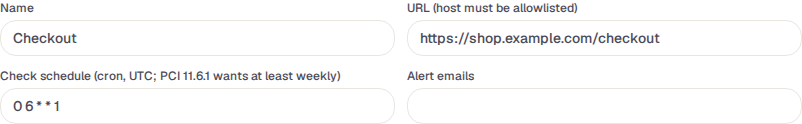
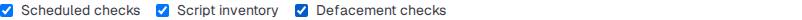
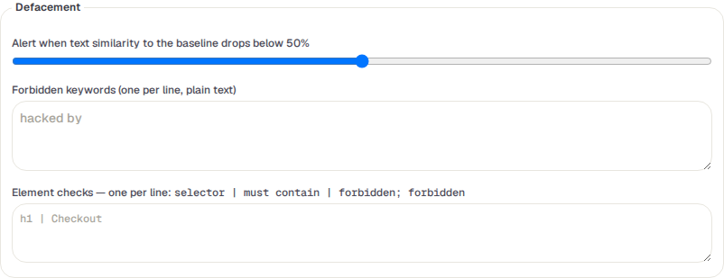

<!-- Generated from script-inventory.html by e2e/docs-capture/export_md.py. Edit the HTML, not this file. -->

# Script inventory

Security · Everyone with access to the project can see it · Editors can add pages and approve scripts

> **In short**
>
> TraceIQ opens your most sensitive pages, such as checkout, on a schedule and writes down every script that runs there. Each script needs someone to approve it with a reason. When a new script appears or an approved one changes, you are warned. It can also watch the page's text for signs that someone has defaced it.

## What it is for

A **script** is a piece of program code that a web page loads and runs in the visitor's browser: your own code, but often also code from other companies, for analytics, chat or payments. If an attacker manages to add a script, or change one at the supplier, it can quietly copy every card number typed on the page. This is called *skimming* (or a "Magecart" attack), and it is invisible to the customer.

The card-payment industry's security standard (**PCI DSS 4.0**) therefore asks for a list of every script on payment pages, a written reason for each one, a way to check each is unchanged (requirement 6.4.3), and a check at least once a week for unauthorised changes to those scripts and the page's security headers (11.6.1). This page does that, and answers **"Is anything running on our payment page that we didn't approve?"**

> **Security and compliance**
>
> Keep the script list and the reasons auditors ask for, with a weekly check.

> **Developers**
>
> See which scripts changed after a release, and approve the ones that should be there.

> **E-commerce teams**
>
> Hear quickly if the checkout page shows text it shouldn't.

**Where to find it:** in the sidebar, open **Security → Script inventory**. The page's own heading says **Script Inventory**.

## A tour of the screen

The demo project doesn't monitor any page yet, so the page first shows an empty list on the left:

The picture below shows the form behind **Monitor a page**, filled in for a checkout page with defacement checks switched on. The numbers match the sections below.

*A page being set up in the demo's web project (not saved). Click the picture to see it larger.*

## 1. Monitored pages

The pages this project watches, each with its last result and the number of scripts (and how many are unapproved). Click one to open it; **Monitor a page** adds one. The **Project** menu at the top right is the same choice as the project picker in the sidebar.

| Result | What it means |
|---|---|
| ok | Nothing changed since the last check. |
| changed | Something harmless changed: a script disappeared, or a security header changed. |
| alert | A new script appeared, a script's content changed, or a defacement check failed. The alert people are told. |
| error | The check couldn't be done, for example the site is no longer on the allowed list or no test machine answered. The reason is shown on the page. |
| new | Not checked yet. |

## 2. The page to watch

- **Name** and **URL** (both required). The page's site must be on the project's allowed list (*Scans & findings → Authorization*); otherwise saving is refused.
- **Check schedule**: a *cron* expression in UTC. The standard `0 6 * * 1` is every Monday at 06:00 UTC, which meets the weekly minimum. It can't be more often than once an hour.
- **Alert emails**: who is emailed when the result is *alert*. The project's Slack or Teams channel is told too, if it has one.

## 3. What to check

- **Scheduled checks**: untick to check only when someone presses *Check now*.
- **Script inventory**: record every script (on by default).
- **Defacement checks**: also look at the page's text (off by default). *Defacement* is when an attacker changes what a page says, for example to their own message.

## 4. Defacement

The first check records the page's text as the **baseline**. Later checks compare against it:

- **Similarity**: alert when the text is less than this much like the baseline (standard 50%).
- **Forbidden keywords**: words that should never be on the page, such as "hacked by". One per line.
- **Element checks**: one per line, a part of the page (a *selector*), the text it must contain, and words it must not contain, separated by `|`. For example `h1 | Checkout`.

All of these are plain text comparisons, ignoring capital letters. A failed check is a high-severity *Possible defacement* finding. When you have changed the page on purpose, **Accept current content as baseline** (on the page's view) starts the comparison afresh.

## 5. Save page

Nothing is kept until you press **Save page**. The first check happens at the next time in the schedule; press **Check now** on the saved page to run it at once.

### A monitored page

A saved page shows its result, when it was last checked, and the buttons **Check now** and **Delete page** (which asks first and deletes its inventory and history). It has three tabs:

- **Scripts**: one row per script, unapproved ones first. The *script* is its address, or "inline script" for code written into the page itself; it is marked *first party* (from your own site) or *third party*, with the day it was first seen. *SHA-384* is the script's fingerprint: any change to the code changes it. *SRI* says whether the page itself tells the browser to check that fingerprint ("none" means it doesn't). *Approval* is approved or unapproved. Tick **Include removed scripts** to see ones that have gone. **Security headers last seen** lists the protective headers the page sent.
- **Change history**: every script added, changed, removed or approved, every header change and every defacement alert, with its time.
- **Settings & defacement**: the same form as above.

## Watch it in use

[▶ Watch the video](../media/security/script-inventory/walkthrough.mp4)

*About a minute, with a spoken commentary. The captions at the bottom show the same words, so it also works with the sound off. The page in the video is not saved.*

## How to…

### …start watching your checkout page

1. Make sure the site is on the project's allowed list (*Scans & findings → Authorization*, project admin).
2. Press **Monitor a page**, type a name and the page's address, and add the alert email addresses.
3. Press **Save page**, then **Check now**. The first check records every script; that first list doesn't raise alerts.
4. Approve each script on the **Scripts** tab (below).

### …approve a script

1. On the **Scripts** tab, find the *unapproved* script and press **Approve…**.
2. Write why the page needs it, for example "Card form from our payment provider". At least 10 characters.
3. Press **Approve script**. The reason is shown under the script and recorded in the *Audit log*.

### …deal with an alert

1. Open the page and look at **Change history** to see what changed.
2. If a new or changed script is expected (a release, a supplier update), approve it again with a reason.
3. If not, treat it as a security incident: remove the script from the page and find out how it got there.

## Good to know

- **A changed script loses its approval.** The approval was for the code someone looked at, so when a script's fingerprint changes, it goes back to unapproved and the page raises an alert.
- **Unapproved scripts are findings.** Each one is a finding in *Scans & findings* (medium for third-party scripts, low for your own) until it is approved or goes away.
- **Scripts that hide are caught too.** A script that adds another script and then removes itself still shows up, because TraceIQ also watches what the page downloads, not only what is in the page at the end.
- **It only looks.** The check is an ordinary page visit. Inline scripts are stored only as fingerprints; cookies are never stored; page text is kept only when defacement checks are on, with secrets removed.
- **A check gives up after 15 minutes** and the page shows the error.
- **Who can do what.** Anyone with access to the project can look. Adding, changing, checking and deleting pages, and approving or withdrawing approvals, need the *editor* role.

## Related pages

> **Controls**
>
> The next page in this guide: your compliance promises, checked against TraceIQ's records.

> **Estate**
>
> Your domains and certificates, checked from the outside.

> **Scans & findings**
>
> Where unapproved scripts and defacements are tracked, and where the allowed list is set.

> **Audit log**
>
> Who approved which script, when, and why.

## Video script

What the walkthrough says, in order. The video and every picture on this page are made by the Playwright script [`security-script-inventory.spec.ts`](../../../../e2e/docs-capture/pages/security-script-inventory.spec.ts).

1. Script inventory keeps a list of every script that runs on your most sensitive pages, such as checkout.
2. A script added or changed by an attacker can steal card details, so each one must be approved.
3. The demo project monitors no pages yet. Monitor a page starts one.
4. Give the page a name and its address. The site must be on the project's list of sites that may be tested.
5. The schedule says how often to look. Card-industry rules ask for at least once a week.
6. Script inventory records the scripts. Defacement checks also watch the page's text.
7. You can be warned when the text changes a lot, or when words that should never appear show up.
8. Once saved and checked, every script is listed with its fingerprint, and someone approves it with a reason.
