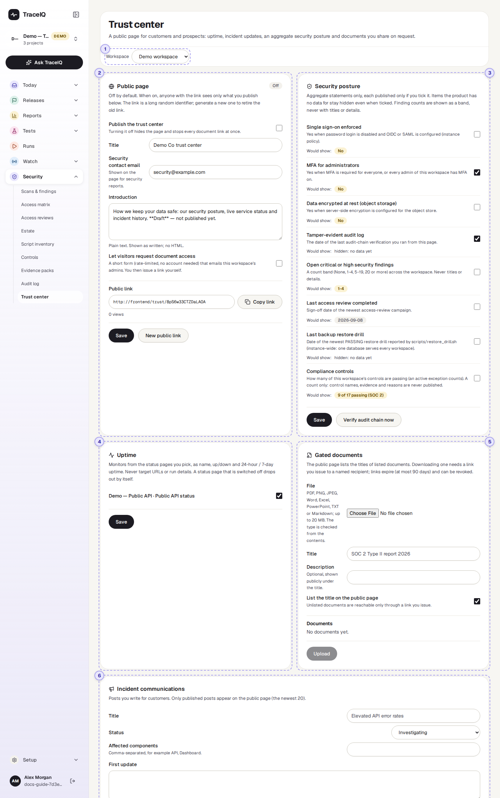
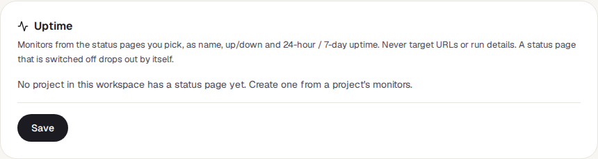

<!-- Generated from trust-center.html by e2e/docs-capture/export_md.py. Edit the HTML, not this file. -->

# Trust center

Security · Workspace admins only · The public page: anyone with its link

> **In short**
>
> Here a workspace admin sets up a public web page for customers and prospects: whether your services are up, updates during an incident, a few plain statements about your security, and documents (such as an audit report) that people can download only with a link you give them. It is off until you switch it on, and it shows only what you choose.

## What it is for

Before buying, customers' security teams ask the same questions: Do you use single sign-on? Is data encrypted? When was your last audit? Can we see the report? A **trust center** is the page you send them instead of answering by email each time. It answers **"Can we trust this supplier with our data?"**, using facts TraceIQ already knows, kept up to date by themselves.

> **Security and compliance**
>
> Answer customer questionnaires with one link, and share audit reports with named people only.

> **Sales and account teams**
>
> Send prospects a page that is always current.

> **Support and operations**
>
> Post updates for customers while an incident is going on.

**Where to find it:** in the sidebar, open **Security → Trust center**.

## A tour of the screen

The settings are in five boxes. In the demo workspace the trust center has been set up as a draft that is not published yet. The numbers on the screenshot match the sections below.

*The trust center settings of the demo workspace, saved but not published. Click the picture to see it larger.*

Each box has its own **Save** button and saves only its own settings.

## 1. Workspace

Each workspace has its own trust center. The page opens on the workspace of the project selected in the sidebar; pick another here. The menu only appears if you belong to more than one workspace.

## 2. Public page

- **Publish the trust center**: the main switch. Off hides the page and stops every document link at once. The label on the right says Published or Off.
- **Title**, **Security contact email** (where people report security problems) and **Introduction** (plain text, shown as written).
- **Let visitors request document access**: adds a short form to the public page. It emails this workspace's admins; you then decide whether to send a link.

After the first save, the box also shows the **public link** with **Copy link**, how many times the page has been viewed, and a **New public link** button. The link contains a long random code, so the page can't be found by guessing. A new link retires the old one: people who have it see "not found".

## 3. Security posture

![The Security posture box: a list of statements, each with a tick box, a hint and a Would show line. MFA for administrators and Tamper-evident audit log are ticked. Would show: Single sign-on enforced No; MFA for administrators No; Data encrypted at rest No; Tamper-evident audit log hidden: no data yet; Open critical or high security findings 1-4; Last access review completed 2026-09-08; Last backup restore drill hidden: no data yet; Compliance controls 9 of 17 passing (SOC 2). Save and Verify audit chain now buttons](../media/security/trust-center/posture.png)

Short statements TraceIQ works out from its own records. Tick the ones to publish; under each, **Would show** previews what visitors would see today.

| Statement | What it shows |
|---|---|
| **Single sign-on enforced** | Yes when the server allows sign-in only through your company's login (OIDC or SAML). |
| **MFA for administrators** | Yes when two-step login is required for everyone, or every admin of this workspace has it on. |
| **Data encrypted at rest** | Yes when the server encrypts the files it stores (screenshots, videos, reports). |
| **Tamper-evident audit log** | The date of the last audit-chain check made with **Verify audit chain now** in this box. |
| **Open critical or high security findings** | A band only (None, 1-4, 5-19, 20 or more) across the workspace. Never titles or details. |
| **Last access review completed** | The sign-off date of the newest *Access review*. |
| **Last backup restore drill** | The date of the newest passing restore test reported by the server's operator. |
| **Compliance controls** | How many of the workspace's *Controls* are passing. A count only. |

A statement TraceIQ has no data for ("hidden: no data yet") stays off the public page even if ticked; it is never shown as a "No".

## 4. Uptime

Tick the **status pages** (made from a project's monitors, under *Watch → Monitors*) whose monitors should appear. Visitors see each monitor's name, whether it is up or down, and its uptime over the last 24 hours and 7 days. Never the address it checks or any run details. A status page that is switched off drops out by itself. When no project has a status page, the box says so instead.

## 5. Gated documents

Documents you are willing to share, but only with people you choose, such as a SOC 2 report or a penetration-test summary. Upload a **file** (PDF, image, Word, Excel, PowerPoint, text or Markdown, up to 20 MB; the type is checked from the contents, not the name) with a **title** and optional description. **List the title on the public page** lets visitors see that it exists. Uploading needs the public page saved once first.

To give someone a document, open **Recipients and links** on it, type who it is for, choose how long the link should work (1, 7, 30 or 90 days) and press **Issue link**. Copy the link straight away: it is shown only once. Links can be revoked, and they stop working if the trust center is switched off or you stop being a workspace admin. Every download is recorded.

## 6. Incident communications

Posts you write for customers when something goes wrong: a title, a status (Investigating Identified Monitoring Resolved), the affected parts of the service, and updates as you learn more. A post is a *Draft* until you publish it (tick **Publish now**, or press **Publish** on the post); only published posts appear on the public page, the newest 20. Updates may use `**bold**`, `*italic*`, ``code`` and lists starting with `- `; links and HTML are shown as plain text.

## Watch it in use

[▶ Watch the video](../media/security/trust-center/walkthrough.mp4)

*About a minute, with a spoken commentary. The captions at the bottom show the same words, so it also works with the sound off. Nothing is saved in the video.*

## How to…

### …publish your trust center

1. Choose the workspace. In **Public page**, fill in the title, the security contact email and an introduction, tick **Publish the trust center** and press **Save**.
2. In **Security posture**, tick the statements you are happy to show (check the *Would show* line) and press **Save**.
3. Optionally tick status pages in **Uptime** and press **Save**.
4. Press **Copy link** (or **Open public page** at the top) and check the page as a visitor would see it.

### …share an audit report with one customer

1. In **Gated documents**, choose the file, give it a title and press **Upload**.
2. Press **Recipients and links**, type the person's name and company, choose an expiry and press **Issue link**.
3. Copy the link and send it to them. Revoke it later from the same list if needed.

### …keep customers informed during an outage

1. In **Incident communications**, write a title, the affected components and the first update, and keep the status at **Investigating**.
2. Tick **Publish now** and press **Create post**, or create it as a draft and press **Publish** on it later.
3. Post an update whenever things change, ending with **Resolved**.

## Good to know

- **Off means gone.** While the trust center is off, its link and every document link answer "not found".
- **Nothing sensitive leaves.** The public page shows only names, states and counts: never finding titles, test addresses, error messages or who did what. Every view is counted on the settings page.
- **No sign-in for visitors.** Anyone with the link can see the page. The access-request form can be sent at most 5 times an hour from one place, and the requester's email isn't written to the audit log.
- **Who can do what.** Only workspace admins can see or change these settings; others see "Workspace admins only". An API key limited to one project is refused.
- **Documents are downloaded through a short-lived link** (one minute) created when the visitor presses download, so the link in your email never points straight at the file.

## Related pages

> **Monitors**
>
> Where the status pages behind the Uptime box are made.

> **Controls**
>
> The compliance controls the trust center can count.

> **Access reviews**
>
> The reviews whose latest sign-off date can be shown.

> **Audit log**
>
> The tamper-evident record behind the audit-chain statement.

## Video script

What the walkthrough says, in order. The video and every picture on this page are made by the Playwright script [`security-trust-center.spec.ts`](../../../../e2e/docs-capture/pages/security-trust-center.spec.ts).

1. A trust center is a public web page that shows customers how you look after their data.
2. It is off until a workspace admin switches it on, and shows only what you choose.
3. Give it a title, a contact address for security reports, and a short introduction.
4. Security posture: simple statements, such as whether administrators use two-step login.
5. Under each one, you see what it would show today, before you publish it.
6. Uptime shows whether your monitored sites are up, from the status pages you pick.
7. Gated documents, such as an audit report, can only be downloaded with a link you send to a named person.
8. Incident communications are updates you write when something goes wrong. Only published posts are public.
