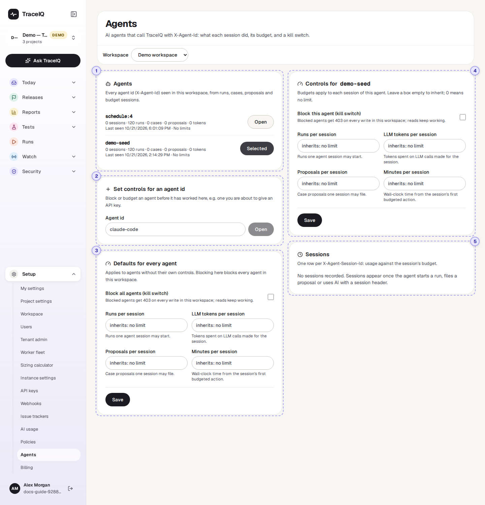
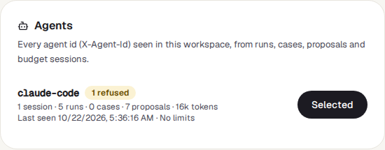
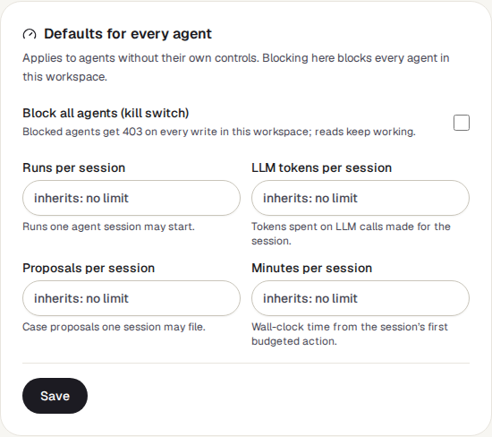
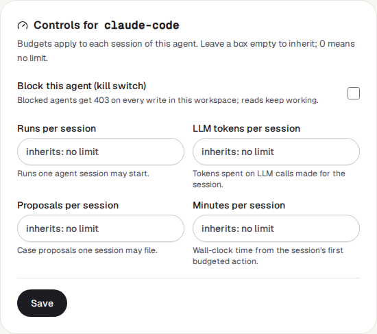
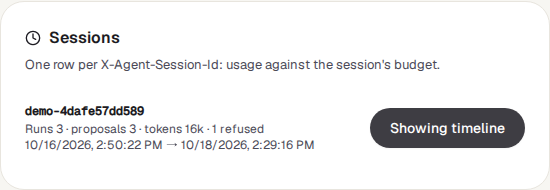

<!-- Generated from agents.html by e2e/docs-capture/export_md.py. Edit the HTML, not this file. -->

# Agents

Setup · Workspace admins only · Admins can change it

> **In short**
>
> An agent is a program, often an AI coding assistant, that uses TraceIQ on someone's behalf: it starts runs, writes tests or suggests fixes. This page shows what each agent did in the workspace, lets you limit how much one piece of its work may do, and has a kill switch that stops it changing anything.

## What it is for

Agents answer **"What have the AI tools been doing here, and how do I keep them in bounds?"** An agent can work fast and for a long time without anyone watching. A budget stops a confused agent from starting hundreds of runs; the kill switch stops it completely, at once.

> **Workspace admins**
>
> Give every agent sensible limits, and block one that misbehaves.

> **Developers**
>
> See exactly which runs, tests and suggestions their assistant produced in one task.

> **Security and audit**
>
> Follow what an automated tool changed, and when it was refused.

**Where to find it:** in the sidebar, open **Setup → Agents**.

> **Agents and sessions**
>
> - An agent names itself with every request it sends (technically, an `X-Agent-Id` header), for example `claude-code`. That name is its **agent id**.
> - A **session** is one piece of work by that agent, such as "fix the login test". The agent gives each one its own name (`X-Agent-Session-Id`). Budgets are counted per session.

## A tour of the screen

On the left: the agents, a box to set controls for a new agent, and the defaults for all agents. On the right: the agent you open. In the demo workspace no AI agent has worked yet, so the list is empty. The numbers match the sections below.

*The Agents page for the demo workspace, with demo-seed opened. Click the picture to see it larger.*

If you belong to more than one workspace, a **Workspace** menu sits under the heading. The page opens on the workspace of the project selected in the sidebar.

## 1. Agents

Every agent id that has worked in this workspace, the most recently active first. An agent appears once it has started a run, created a test, filed a proposal, or worked in a budgeted session. For each one:

- **Its name**, with Blocked when the kill switch is on (its own, or the one for all agents) and 3 refused when its sessions were refused something.
- **What it did**: sessions, runs, tests ("cases") created, proposals filed, and AI tokens used in its sessions.
- **Last seen**, and its limits per session, or *No limits*.
- **Open** shows the agent on the right.

> **Not everything here is an AI**
>
> Runs started by a TraceIQ *schedule* or monitor carry the name `schedule:` plus the schedule's number, and the demo's sample history carries `demo-seed`. These are not AI agents, so the list leaves them out, unless someone has set controls for one of those names.

## 2. Set controls for an agent id

To limit or block an agent *before* it has done anything here (for example one you are about to give an API key), type its exact agent id and press **Open**. Its controls appear on the right, ready to fill in. Nothing is saved until you press **Save** there.

## 3. Defaults for every agent

The same controls as for one agent (see ④), applied to every agent that has none of its own. **Block all agents (kill switch)** stops *every* agent in the workspace, including ones that have their own controls. An empty box here takes the server-wide default your administrator set; the grey text in the box says what that is (*"inherits: no limit"* when there is none).

## 4. Controls for one agent

- **Block this agent (kill switch)**: tick it and save, and the agent is refused every change it tries in this workspace: no runs, tests, suites or proposals, and its AI calls are skipped. It can still *read*, so it can report what happened. When ticked, a **Reason** box appears; the agent is shown that text.
- **Four limits per session:**

| Limit | What it counts |
|---|---|
| **Runs per session** | Runs the session may start. |
| **LLM tokens per session** | AI text (tokens) used for the session's work, including AI calls made while its runs ran. |
| **Proposals per session** | Suggested test changes the session may file. |
| **Minutes per session** | Time since the session first did something that counts. After that, everything above is refused for it. |

Leave a box **empty** to inherit (the agent's own value, then the workspace default, then the server default, in that order). Type **0** for "no limit". Only whole numbers are accepted; anything else shows a message and Save stays greyed out. **Save** applies the controls; **Remove controls** (shown once an agent has saved controls) deletes them, so the agent inherits everything again.

## 5. Sessions and timeline

One row per session of the opened agent, newest first (up to 100): its name, Out of runs (or tokens, proposals) when a budget is spent, how much it used against each limit (for example *Runs 12 / 50*), how many times it was refused, and when it started and last did something. The demo's two entries never send a session name, so it says *"No sessions recorded"*.

**Show timeline** opens the **Session timeline** below it: everything that session did, newest first (up to 500 items), each with a coloured label and, where there is one, a link:

| Label | What happened |
|---|---|
| Run | It started a run (with the run's result). |
| Case created / Suite created | It created a test or a suite. |
| Case edited | It changed a test during the session. |
| Proposal / Decision | It suggested a change, and what became of it (accepted, rejected or auto-applied). |
| LLM | An AI call made for it, with its tokens. |
| Refused | A rule said no, with the rule's name and the reason. |

## Watch it in use

[▶ Watch the video](../media/setup/agents/walkthrough.mp4)

*About a minute, with a spoken commentary. The captions at the bottom show the same words, so it also works with the sound off. Nothing is saved in the video.*

## How to…

### …stop an agent immediately

1. Press **Open** next to the agent (or type its id under **Set controls for an agent id**).
2. Tick **Block this agent (kill switch)**, type a reason the agent will see, and press **Save**.
3. Its next change is refused. If the agent might not name itself, also revoke its key in **Setup → API keys**.

### …give every agent a sensible budget

1. In **Defaults for every agent**, type limits, for example 50 runs and 120 minutes per session.
2. Press **Save**. Every agent without its own controls now gets these.
3. For an agent that needs more, open it and type a higher number (or 0 for no limit) in its own box.

### …see what an agent did in one task

1. Press **Open** next to the agent.
2. Under **Sessions**, find the session (the newest is at the top) and press **Show timeline**.
3. Click an item to open the run, test or proposal it points to.

## Good to know

- **Only workspace admins can see this page.** It covers every project in the workspace. Others see *"Workspace admins only"*.
- **Only people can change controls.** API keys are refused, so an agent can't unblock itself or raise its own budget. Every change is recorded in the *Audit log*.
- **A limit is reached when the count equals it.** With a limit of 50 runs, the 50th run starts and the 51st is refused. The agent gets a clear "budget exceeded" answer it can act on.
- **Budgets only cover agents that name their session.** Work sent without a session name is not budgeted. They are a safety net for well-behaved tools, not a lock. The kill switch covers any request that names the agent; for a tool that names nothing, revoke its API key.
- **People are never blocked here.** The controls apply to requests that carry an agent name; you working in the app are not affected.
- **Refusals also appear on the Policies page**, under *Recent denials*, where you can filter by agent id.

## Related pages

> **Billing**
>
> The next page in this guide: the workspace's plan and how much of it is used.

> **Policies**
>
> Every rule that can refuse an action, and the record of refusals.

> **API keys**
>
> The keys agents use to reach TraceIQ, and how to revoke one.

> **Proposals**
>
> The changes agents suggest, waiting for a person to accept or reject them.

## Video script

What the walkthrough says, in order. The video and every picture on this page are made by the Playwright script [`setup-agents.spec.ts`](../../../../e2e/docs-capture/pages/setup-agents.spec.ts).

1. Agents are programs, often AI assistants, that use TraceIQ on someone's behalf.
2. This list shows every agent name seen in the workspace, with what it did.
3. In the demo, these two are the monitor schedule and the sample-data generator.
4. Open an agent to see its controls and its sessions.
5. The kill switch stops this agent from changing anything here. It can still read.
6. Budgets limit each session: runs, AI tokens, proposals and minutes.
7. An empty box inherits the default. Zero means no limit.
8. Sessions appear when an agent sends a session name with its requests.
9. Defaults for every agent apply to any agent without its own controls.
10. Changes only take effect when an admin presses Save.
