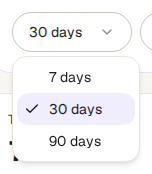
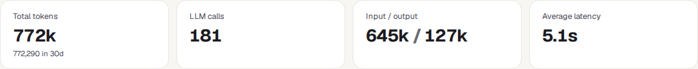
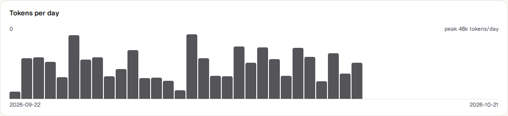
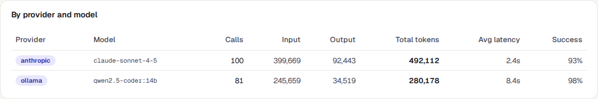
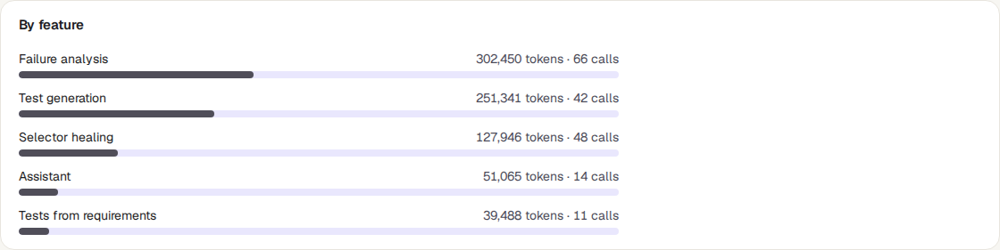

<!-- Generated from ai-usage.html by e2e/docs-capture/export_md.py. Edit the HTML, not this file. -->

# AI usage

Setup · Every workspace member can see it · Read-only page

> **In short**
>
> TraceIQ uses AI services for a few jobs, such as explaining why a test failed or repairing a test whose button moved. This page counts those calls for one workspace: how many there were, how much text they used, which AI service answered, and which feature asked.

## What it is for

AI usage answers **"How much AI are we using, and for what?"** AI services charge by the amount of text they read and write, and many plans have a monthly limit, so it helps to know where the usage comes from before the bill or the limit arrives.

> **Workspace admins**
>
> See whether the workspace is close to its monthly AI limit, and which feature uses the most.

> **Leads**
>
> Compare AI providers and models: how often their answers came back, and how long they took.

> **Anyone curious**
>
> Check that AI features are actually being used, or that nothing is calling AI when it shouldn't.

**Where to find it:** in the sidebar, open **Setup → AI usage**.

> **Two words you will see**
>
> - A **call** is one question TraceIQ sent to an AI service, and its answer.
> - A **token** is a small piece of text, roughly three-quarters of a word. AI services count, and charge, by tokens. **Input** tokens are what TraceIQ sent (the question, the error, part of the page); **output** tokens are the answer.

## A tour of the screen

The demo workspace has about a month of AI calls, made through two AI services. The numbers on the screenshot match the sections below. ("LLM", large language model, is the technical name for these AI services.)

*The AI usage page for the demo workspace. Click the picture to see it larger.*

## 1. Time window

How far back to count: the last **7**, **30** (the default) or **90** days. The window ends now and is counted in hours, not calendar days: "7 days" is the last 7 × 24 hours.

## 2. Workspace

AI usage is counted per **workspace**. This menu chooses which one. The page opens on the workspace of the project picked in the sidebar.

When the workspace has made no AI calls in the window, the page shows only these two menus and *"No LLM calls in the last 30 days"* in place of parts ③ to ⑥.

## 3. The four totals

| Tile | What the number means |
|---|---|
| **Total tokens** | Input plus output tokens of every call in the window, shortened (for example *1.2M* for 1.2 million). The exact number is underneath. |
| **LLM calls** | How many calls were made, including ones that failed. |
| **Input / output** | The same tokens split into what was sent and what came back. |
| **Average latency** | How long an answer took on average, in milliseconds (*ms*) or seconds (*s*). |

## 4. Tokens per day

A bar for each day that had calls; the tallest bar is the busiest day, and the top corner names its total. Days without any calls get no bar at all, so two bars side by side are not always two days in a row: read the dates. Point at a bar to see its date, tokens and number of calls. Days are calendar days in **UTC**, so in India a call made before 5:30 a.m. counts towards the previous day.

If the workspace's plan has a monthly AI limit, the top-right corner also shows it, for example *"2026-10: 120,000 / 1,000,000 tokens (12%)"*. That figure is for the **current calendar month**, whatever time window you picked.

## 5. By provider and model

One row per AI service (the **provider**, as your administrator named it) and **model** (the particular AI version, such as a "mini" or a "large" one), the most-used first. The columns give calls, input, output and total tokens, and the average wait. **Success** is the share of calls that got an answer; below 90% it turns peach, which usually means the service was refusing or timing out.

## 6. By feature

Which part of TraceIQ asked, with its tokens, calls and a bar showing its share of all tokens, the largest first:

| Feature | What it is |
|---|---|
| **Failure analysis** | The explanation of why a test failed, on the run page. |
| **Selector healing** | Repairing a test whose button or field can no longer be found (the "selector" is how a test finds it), during a run or afterwards as a suggestion. |
| **Test generation** | Writing a draft test from a description. |
| **Tests from requirements**, **Regression tests from incidents** | Draft tests written from an imported requirement, or from an incident. |
| **Assistant** | Questions asked through *Ask TraceIQ*. |
| **Other** | Calls that didn't say which feature made them. |

## Watch it in use

[▶ Watch the video](../media/setup/ai-usage/walkthrough.mp4)

*Under a minute, with a spoken commentary. The captions at the bottom show the same words, so it also works with the sound off.*

## How to…

### …check how close you are to the monthly limit

1. Choose the workspace in the menu under the heading.
2. Read the top-right corner of **Tokens per day**. If it shows no figure, the plan has no AI limit.
3. To see the plan and its limits, open **Setup → Billing**.

### …find out what is using the most AI

1. Choose **30 days** or **90 days**.
2. Look at **By feature**: the first bar is the biggest user.
3. Look at the tallest bars in **Tokens per day** to see when it happened, for example on a day with many failed runs.

### …switch AI off for a workspace

1. This page only reports. To stop AI use, a workspace admin opens **Setup → Policies** and turns off **Allow AI features**.
2. From then on, no new calls appear here for that workspace.

## Good to know

- **When the monthly limit is used up**, TraceIQ stops making AI calls for that workspace until the next calendar month (UTC). The features don't break: they fall back to what they do without AI. The refused calls are listed under *Recent denials* on the Policies page.
- **Calls made by the test machines count too.** When a test repairs itself during a run, the machine running it makes the call and reports it; it is counted in the run's workspace.
- **Failed calls are counted.** They appear in *LLM calls* and lower the *Success* rate, even when they used few or no tokens.
- **No money is shown here.** For costs in your currency, see *Costs* under Reports (it needs prices set up by your administrator).
- **It doesn't update by itself** while you look at it. It refreshes when you come back to its browser tab, or when you reload.
- **Everyone in the workspace sees the same numbers**, for all projects of the workspace together. There is no per-project split on this page.

## Related pages

> **Policies**
>
> The next page in this guide: switch AI off for a workspace, and see what TraceIQ refused and why.

> **Billing**
>
> Your plan and its monthly limits, AI tokens included.

> **Agents**
>
> AI agents that use TraceIQ, and the token budget each of their sessions may spend.

> **Costs**
>
> What testing and AI cost in money, per project, when prices are set up.

## Video script

What the walkthrough says, in order. The video and every picture on this page are made by the Playwright script [`setup-ai-usage.spec.ts`](../../../../e2e/docs-capture/pages/setup-ai-usage.spec.ts).

1. AI usage shows every call TraceIQ made to an AI service for your workspace.
2. Usage is counted per workspace. Choose the workspace here.
3. This menu picks how far back to look: seven, thirty or ninety days.
4. Four totals: tokens, calls, input and output, and the average wait.
5. Then a bar per day, and tables by AI provider and model, and by feature.
6. A token is a small piece of text. AI services count and charge by tokens.
7. This page only reports. To switch AI off for a workspace, use the Policies page.
