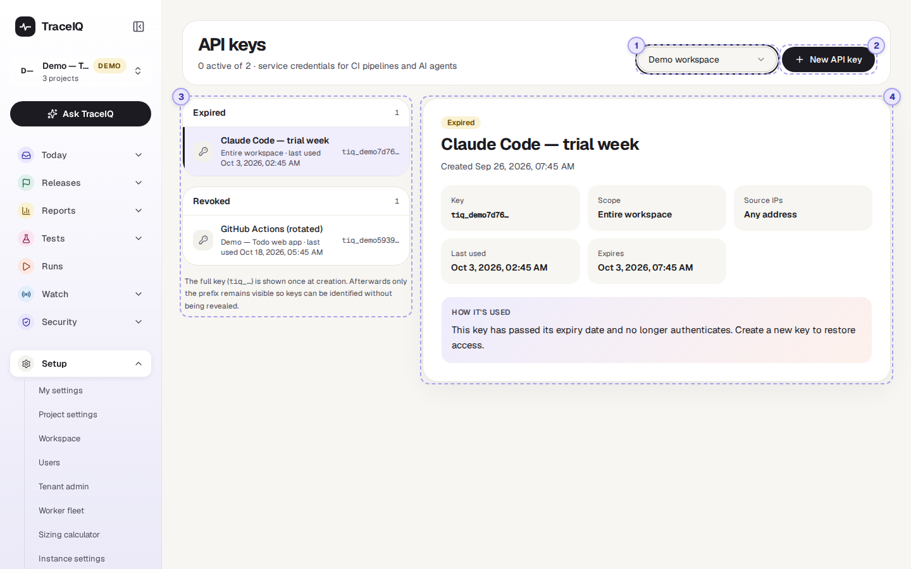
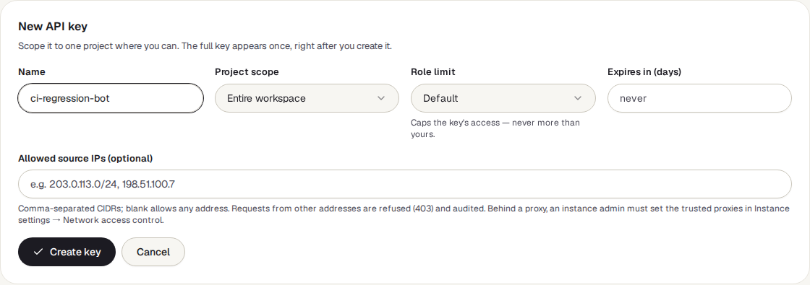
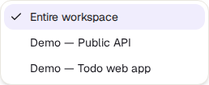
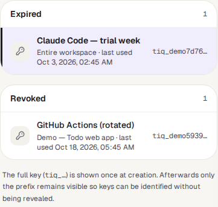
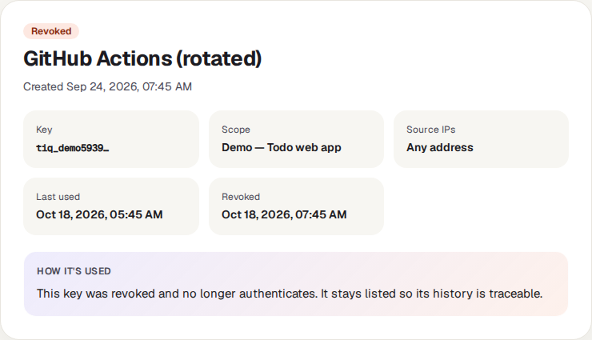

<!-- Generated from api-keys.html by e2e/docs-capture/export_md.py. Edit the HTML, not this file. -->

# API keys

Setup · Every member of the workspace can see it · Every member can create and revoke keys

> **In short**
>
> An API key is a long secret code that lets another program use TraceIQ in your name, without anyone signing in: a build pipeline that runs the tests after every change, a script, or an AI coding assistant. This page creates keys, limits what they can reach, and switches them off.

## What it is for

API keys answer **"How do our other tools talk to TraceIQ safely?"** The *API* is the way programs talk to TraceIQ. A program can't type a password or a two-factor code, so it sends a key with every request instead. Anyone who has the key can do what the key allows, so treat it like a password.

> **Developers**
>
> Let the CI pipeline (for example the TraceIQ GitHub Action) start a run for every pull request and wait for the result.

> **AI assistants**
>
> Connect Claude Code, Cursor or VS Code to TraceIQ through its MCP server, so the assistant can run and read tests.

> **Admins**
>
> See which keys exist and when each was last used, and revoke one that is no longer needed or may have leaked.

**Where to find it:** in the sidebar, open **Setup → API keys**. A shorter version of the same list is in *My settings → Account and API keys*.

## A tour of the screen

The numbers on the screenshot match the sections below. The demo workspace has two keys that no longer work: one expired, one revoked.

*The API keys page for the demo workspace. Click the picture to see it larger.*

The line under the heading counts the keys, here *"0 active of 2"*.

## 1. Workspace

Keys belong to a *workspace*, not to a person. If you are in more than one workspace, this menu chooses whose keys you see and where a new key is made. It is only shown when you belong to more than one.

## 2. New API key

Opens the form for a new key:

| Field | What it does |
|---|---|
| **Name** | Required. Say who uses the key, such as "ci-regression-bot" or "claude-code", so it can be recognised later. |
| **Project scope** | *Entire workspace*, or one project. Limit it to one project whenever you can: a key for one project is refused for everything in other projects: suites, tests, runs, results, reports and quality gates. |
| **Role limit** | Optional cap on what the key may do: Project Viewer, Editor or Admin, or Workspace Member or Admin. *Default* means no extra cap. It never gives the key more than its creator has (see below). |
| **Expires in (days)** | After this many days the key stops working by itself. Empty means it never expires. |
| **Allowed source IPs** | Optional. Network addresses (written like `203.0.113.0/24`, separated by commas) the key may be used from. A request from anywhere else is refused and recorded in the audit log. Empty means any address. |

*Project scope lists the workspace's projects.*

Press **Create key**. A yellow box marked Shown once then shows the whole key, which starts with `tiq_`, with a **Copy key** button. **This is the only time the full key is ever shown.** Copy it into the place that needs it (for example your CI system's secret settings) before pressing **Done**. If it is lost, revoke it and make a new one.

> **A key never does more than its creator can**
>
> A key acts with the access of the person who created it, and no more: the projects they can see, and their role in each. The **Role limit** lowers that further (a key limited to Project Viewer can only read, even if you are an admin), and a key only works in the workspace it was made for. **Project scope**, an expiry and source IPs narrow it more. If the creator's account is deactivated, their keys stop working too.

## 3. The list of keys

Keys are listed in up to three groups, **Active keys**, **Expired** and **Revoked** (a group with no keys is left out). Each row shows the key's name, its scope (a project, or "Entire workspace"), when it was last used, and the first few characters of the key, so you can tell keys apart without seeing them. A workspace with no keys at all shows *"No API keys yet"*.

## 4. The selected key

*A revoked key. Expired and revoked keys have no buttons.*

Click a key to see its details on the right (the first key is shown until you pick another):

- **Status**: Active, Expired or Revoked.
- **Key, Scope, Source IPs, Last used**, and when it expires (or was revoked).
- **Edit source IPs** (active keys only) changes the allowed addresses. Only the key's creator or a workspace admin may do this.
- **Revoke key** (active keys only) switches it off for good, after you confirm. Everything using it loses access at once. A revoked key stays in the list, so its history can still be traced.

## Watch it in use

[▶ Watch the video](../media/setup/api-keys/walkthrough.mp4)

*About a minute, with a spoken commentary. The captions at the bottom show the same words, so it also works with the sound off. No key is created in the video.*

## How to…

### …make a key for a CI pipeline

1. Choose the workspace, then press **New API key**.
2. Name it after the pipeline, choose the one project it tests under **Project scope**, and set an expiry, such as 90 days.
3. Press **Create key**, then **Copy key**.
4. Paste it into the pipeline's secret settings (for GitHub, a repository secret), not into a file in the code.
5. Press **Done**.

### …switch off a key that may have leaked

1. Find the key in the list (the first characters shown match the start of the leaked key).
2. Click it, press **Revoke key**, and confirm. It stops working straight away.
3. Make a new key for whatever needs one, and look up the key's use in *Security → Audit log*.

### …replace a key before it expires

1. Make a new key with the same scope.
2. Put the new key where the old one was used.
3. Once **Last used** of the old key stops changing, revoke it.

## Good to know

- **Any member of the workspace can create, see and revoke its keys.** They see every key in the workspace, not only their own, but never the full key.
- **A key can't make or revoke keys.** A program using a key is refused if it tries; only a signed-in person can.
- **Creating and revoking are recorded** in the audit log, with the key's name and first characters, never the key itself.
- **Programs send the key in a header** called `X-API-Key`. The details for developers are in TraceIQ's API documentation and the GitHub Action's README.
- **Deactivating a person stops their keys.** Keys work only while the person who created them is active. Moving a key to someone else isn't possible; make a new one.

## Related pages

> **Webhooks**
>
> The next page in this guide: TraceIQ calls your systems when a run finishes, the opposite direction to a key.

> **My settings**
>
> The same keys in a shorter list, and the settings for connecting an AI assistant through MCP.

> **Agents**
>
> What AI agents using your keys have done, with limits and a switch to stop them.

> **Audit log**
>
> Every key created or revoked, and every request refused because of a key's source IPs.

## Video script

What the walkthrough says, in order. The video and every picture on this page are made by the Playwright script [`setup-api-keys.spec.ts`](../../../../e2e/docs-capture/pages/setup-api-keys.spec.ts).

1. A P I keys let other tools, such as a C I pipeline or an A I agent, use TraceIQ without a person signing in.
2. Keys belong to a workspace. Pick the workspace here.
3. Keys are listed as active, expired or revoked. The demo has one expired and one revoked key.
4. New API key opens a short form.
5. Give it a name that says who uses it, and if you can, limit it to one project.
6. You can let it expire after a number of days, and accept it only from certain addresses.
7. The role limit caps what the key may do. It never gets more than its creatoru2019s own access.
8. After Create key, the full key is shown once. Copy it then: it can never be shown again.
9. Click a key to see when it was last used. An active key also has a Revoke button.
