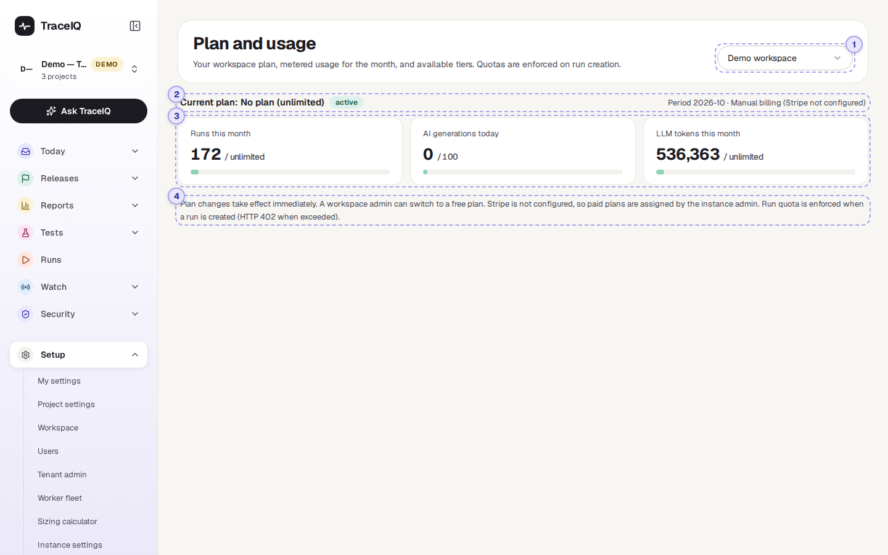
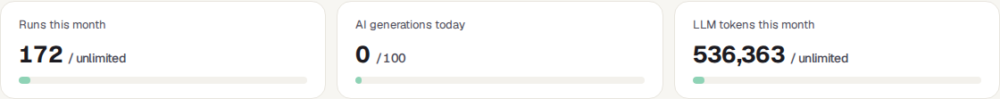

<!-- Generated from billing.html by e2e/docs-capture/export_md.py. Edit the HTML, not this file. -->

# Billing

Setup · Every workspace member can see it · Workspace admins can change the plan

> **In short**
>
> Each workspace has a plan, which can set limits such as how many test runs it may start in a month. This page shows the current plan, how much of this month's allowance has been used, and the other plans you could switch to.

## What it is for

Billing answers **"How much have we used this month, and are we about to hit a limit?"** When a run is refused because the month's allowance is spent, this is the page that shows it, and where an admin moves the workspace to a bigger plan.

> **Workspace admins**
>
> Keep an eye on the meters and change the plan before the team runs out.

> **Team members**
>
> Find out why a run was refused with "Monthly run quota reached".

> **Budget holders**
>
> See which plan the workspace is on, and what each plan includes.

**Where to find it:** in the sidebar, open **Setup → Billing**. The page's own heading says **Plan and usage**.

## A tour of the screen

The server used for this guide has no plans set up, so the demo workspace shows *"No plan (unlimited)"* and its usage this month, and no list of plans. The numbers on the screenshot match the sections below.

*The Plan and usage page for the demo workspace. Click the picture to see it larger.*

## 1. Workspace

Plans belong to a **workspace**. This menu chooses which one. The page opens on the workspace of the project picked in the sidebar.

## 2. Current plan

- **Current plan**: the plan's name. *No plan (unlimited)* means the server has no plans at all, so nothing is limited.
- **The green label** is the subscription's state, normally *active*. With card payments it can also show what the payment service reports, such as *canceled*.
- **Period**: the month the meters count, as year and month (for example *2026-10*). Months follow UTC, so in India a new month starts at 5:30 a.m. on the 1st.
- **Manual billing (Stripe not configured)** appears when the server takes no card payments. Then an admin simply switches the plan here.

## 3. The three meters

Each meter shows what has been used, against the plan's limit (*unlimited* when there is none). With a limit, the bar fills up and changes colour:

| Bar colour | Meaning |
|---|---|
| Green | Less than 70% of the limit used. |
| Yellow | 70% to 89% used. Plan ahead. |
| Orange | 90% or more used. The limit is close. |

| Meter | What it counts |
|---|---|
| **Runs this month** | Runs started this calendar month by people, the API, CI pipelines, benchmarks, access-matrix checks and suggested-fix checks. A request that runs a suite in three browsers counts as three runs. Runs started by *schedules* and *monitors* are not counted. |
| **AI generations today** | Draft tests written by AI today (UTC), against the workspace's own daily limit for AI test writing (100 unless changed). When it is reached, more drafts are refused until UTC midnight. |
| **LLM tokens this month** | AI text (tokens) used by the workspace this calendar month. The same number as on *AI usage*. |

> **Which limits actually stop anything**
>
> Two limits are enforced. When **runs per month** is used up, new runs are refused with *"Monthly run quota reached"* until the next month. When **LLM tokens per month** is used up, AI features are skipped and fall back to their non-AI behaviour. The workspace's daily limit on AI test writing (the middle meter) is enforced too. The other limits listed on a plan (seats, concurrent runs, retention and AI generations per day) are shown for information only on this version: nothing checks them. (The number of runs at the same time is limited per workspace, in its own settings.)

## 4. The note at the bottom

A reminder that plan changes take effect immediately, how plans are changed on this server (free plans by a workspace admin; paid plans by card payment or, without it, by the instance admin), and that the run limit is checked when a run is created.

## Plans

When the server offers plans, a **Plans** section appears between the meters and the note, with one card per plan. The server used for this guide has none, so the section is not shown in the pictures. Each card shows:

- The plan's name, and Current on the one the workspace is on.
- Its price per month, *Free*, or *Custom* for the enterprise plan.
- Its limits: runs per month, seats, concurrent runs, retention in days, AI generations per day and LLM tokens per month. *Unlimited* means no limit.
- A button: **Current plan** (greyed out) on your plan; **Upgrade** on paid plans when the server takes card payments, which opens the payment page; otherwise **Switch to …**, which changes the plan straight away. A workspace admin sees *Switch to* on free plans and *Upgrade* on paid ones. Without card payments, a paid plan can only be assigned by the *instance admin* (the person who runs the TraceIQ server); a workspace admin sees "Ask the instance admin to assign this plan" there instead.

## Watch it in use

[▶ Watch the video](../media/setup/billing/walkthrough.mp4)

*About 45 seconds, with a spoken commentary. The captions at the bottom show the same words, so it also works with the sound off.*

## How to…

### …check whether you are close to the run limit

1. Choose the workspace in the menu at the top right.
2. Read **Runs this month**. A yellow or orange bar means it is getting close.
3. Remember that runs in several browsers count once per browser.

### …move the workspace to another plan

1. You need to be a workspace admin (for a paid plan on a server without card payments, the instance admin).
2. Under **Plans**, press **Upgrade** (card payment) or **Switch to …** on the plan you want.
3. With *Switch to*, the new limits apply at once and the message "Plan updated" appears. With *Upgrade*, the plan changes once the payment has gone through.

### …find out why a run was refused

1. If the message says *"Monthly run quota reached (50/50)"*, the month's runs are used up: the meter here shows the same numbers.
2. Ask a workspace admin to move to a bigger plan (or, without card payments, the instance admin), or wait until the 1st of next month (UTC).

## Good to know

- **Counters start again every month**, on the 1st at midnight UTC. Unused allowance doesn't carry over.
- **The run limit is checked before a run is created.** While a single run is left, one request that starts several runs (for example in three browsers) still goes through, so the meter can end slightly above the limit.
- **Everyone in the workspace can see this page.** Switching to a free plan and card payment need the workspace admin role; assigning a paid plan without card payment needs the instance admin. Others don't see those buttons.
- **Without a plan, nothing is limited.** A workspace that was never given a plan is on the *free* plan if the server has one, and unlimited if it has none.
- **Money for AI and test machines** is on *Costs* under Reports, not here.

## Related pages

> **AI usage**
>
> Where the month's AI tokens went, by feature and provider.

> **Policies**
>
> The rules that refuse runs and AI calls when a plan limit is reached.

> **Workspace**
>
> The workspace's own settings, including how many runs may run at once.

> **Costs**
>
> What testing and AI cost in money, per project.

## Video script

What the walkthrough says, in order. The video and every picture on this page are made by the Playwright script [`setup-billing.spec.ts`](../../../../e2e/docs-capture/pages/setup-billing.spec.ts).

1. Billing shows a workspace's plan, and how much of it has been used this month.
2. Plans belong to a workspace. Choose the workspace here.
3. The current plan. Here there is no plan, so nothing is limited.
4. The month the counters cover, and how billing works on this server.
5. Three meters: runs this month, AI generations, and AI tokens this month.
6. With a limit, the bar fills up and turns yellow, then orange, as it gets close.
7. When the server offers plans, they are listed below, with a button to switch.
8. This server has no plans set up, so only the note about plan changes follows.
