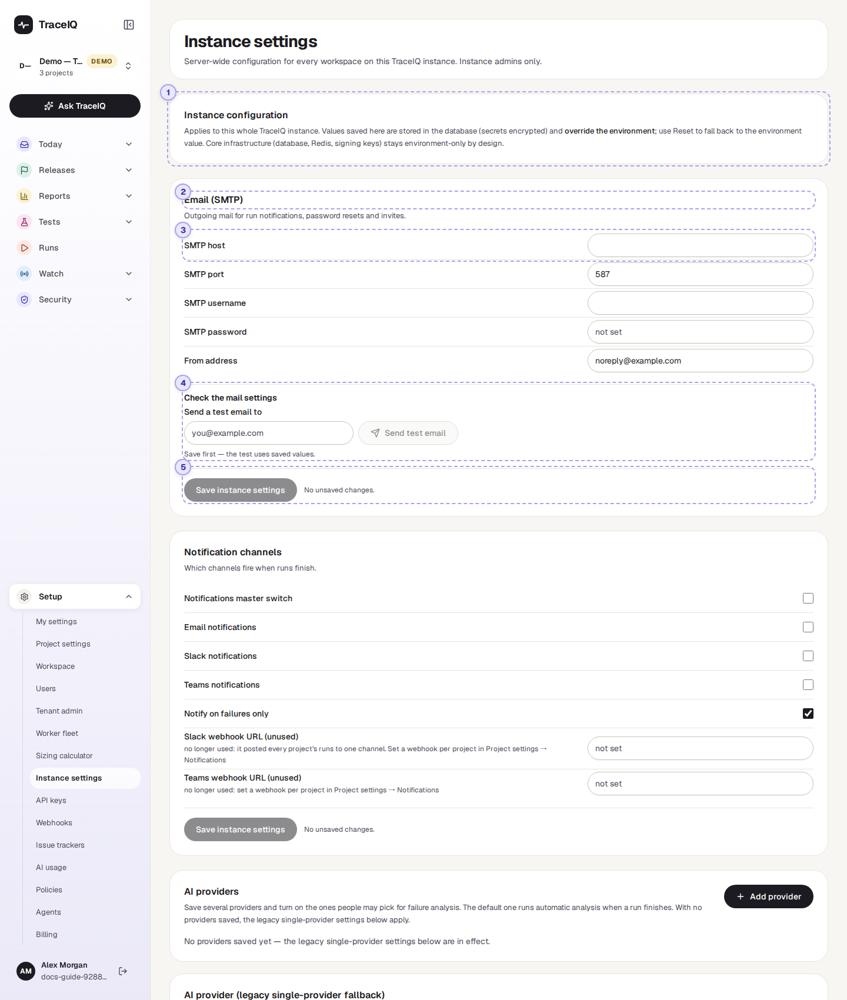
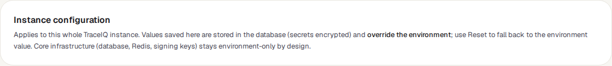
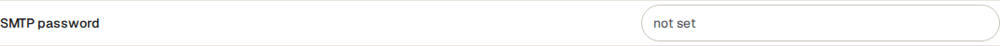
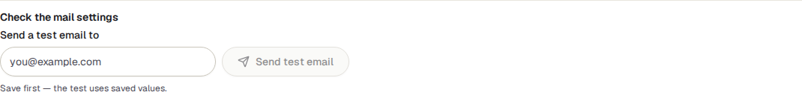
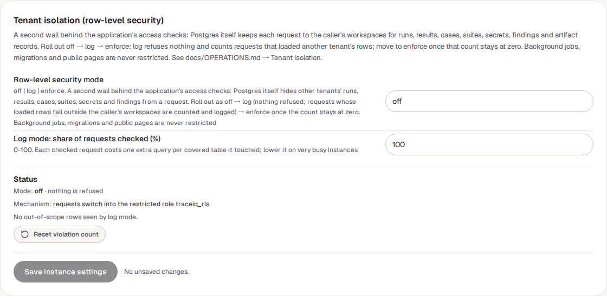
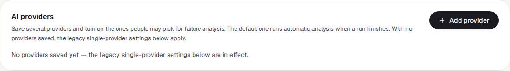

<!-- Generated from instance-settings.html by e2e/docs-capture/export_md.py. Edit the HTML, not this file. -->

# Instance settings

Setup · Instance admin only · Changes affect everyone

> **In short**
>
> The settings of the TraceIQ server itself: how it sends email, which AI service it uses, how people sign in, where it keeps screenshots and videos, and more. They apply to every workspace and every person on this installation, so only the instance admin can see or change them.

## What it is for

A TraceIQ server starts with a configuration file prepared when it was installed. This page lets the instance admin change most of those settings from the browser instead, without editing files or restarting the server, and see which value is in use.

The **instance admin** is the first person who signed up on this installation, or someone they made instance admin. Being the admin of your own organisation (a *tenant admin*) is not enough: everyone who signs up gets an organisation of their own, so that role can't be trusted with the whole server. Anyone else who opens the page sees "Instance settings can only be managed by the instance admin".

**Where to find it:** in the sidebar, open **Setup → Instance settings**.

## A tour of the screen

The page is a long column of cards, one per group of settings. The picture shows the top of the page; every group below works the same way. The numbers match the sections below.

*The top of the Instance settings page. Click the picture to see it larger.*

## 1. Where values come from

Every setting has two possible sources:

- **The server's configuration** (called the *environment*), set when TraceIQ was installed. This is what applies until someone changes the setting here.
- **A value saved on this page.** It is kept in TraceIQ's database and **wins** over the configuration. Passwords and keys are stored encrypted.

A few things can only be set in the configuration, never here: the database, the message queue (Redis) and the keys TraceIQ signs logins with. A mistake on this page can't take those away.

## 2. The groups

Each card is one group, with a title and a sentence on what it covers. In order:

| Group | What it is for |
|---|---|
| **Email (SMTP)** | The mail server TraceIQ sends from: run notifications, password resets, invitations. |
| **Notification channels** | Whether notifications are sent at all, and by which channels (email, Slack, Teams), and whether only for failures. |
| **AI providers** and **AI provider (legacy)** | The AI services TraceIQ may use to explain failures (see below). |
| **Storage** | Where screenshots, videos and traces are kept. Needs a server restart. |
| **Single sign-on (OIDC)**, **(SAML 2.0)**, **LDAP / Active Directory** | Letting people sign in with their company account. A **Set up a provider** card fills in most values for well-known providers. |
| **Federated provisioning** | Which workspace people who sign in with a company account land in, and with which role. |
| **Test inbox & webhook capture** | A mailbox tests can receive email in (for "wait for email" steps). |
| **SIEM streaming**, **Security alerts** | Sending TraceIQ's audit trail to your security team's tools, and alerts for suspicious activity such as many failed logins. |
| **Policies** | Server-wide rules: whether everyone must use two-step sign-in (MFA), whether a suggested change needs a second person to approve it, limits for AI agents, how much a test may record (screenshots, video…), which outside websites TraceIQ may contact, and how long runs and the audit trail are kept. |
| **Execution workers** | Settings the test machines pick up by themselves (every 60 seconds), and which websites tests may reach. |
| **Network access control** | Which proxies and addresses TraceIQ trusts. A wrong value can lock out your sign-in provider, so values are checked when you save. |
| **Observability** | Monitoring tools TraceIQ reads server measurements and traces from. |
| **Tenant isolation** | An extra wall in the database that keeps each organisation's data apart, with its current status. |
| **Cost** | Your own prices, so the *Costs* page can show money. Nothing is priced until a currency is set. |

## 3. One setting

Each row is one setting: its name on the left (with a short explanation under it when one is needed) and its value on the right: a text box, a number, a tick box or a list. The box shows the value in use now, whichever source it comes from. Two labels may appear next to the name:

| Label | What it means |
|---|---|
| Saved here | The value was saved on this page and overrides the configuration. A **Reset** button appears next to it: it deletes the saved value, so the configuration's value applies again. |
| Needs restart | The change only takes effect after the TraceIQ server restarts (the storage settings). |

**Passwords and keys are never shown**, not even to the instance admin:

The box says *not set*, or shows dots and "set — type to replace" when one exists. Typing in it replaces the stored value when you save; leaving it empty keeps it.

## 4. Test buttons

Some groups have a button that tries the settings out: **Send test email** (Email), **Test LLM connection** (the AI provider) and **Test inbox connection** (Test inbox). They use the **saved** values, so save first, then test. The result appears as a short message at the bottom of the screen.

Two groups show a live status instead: **Tenant isolation** (which mode is on, and whether anything has been caught) and **SIEM streaming** (whether events are being delivered).

## 5. Saving

Every group ends with the same **Save instance settings** button. It saves **all** your changes on the page at once, in every group, not just the one it sits in. Next to it, TraceIQ counts your unsaved changes.

- Changes take effect within about **15 seconds** everywhere on the server (storage: after a restart).
- Some settings are **checked when you save**, for example the single sign-on settings, the workspace company sign-ins land in, the test inbox, monitoring addresses and prices. If a value is wrong, nothing is saved and the message says why.
- **Every change is recorded** in TraceIQ's audit trail: who changed which setting, from what to what. For passwords and keys only the fact that they changed is recorded, never the value.

## The AI providers card

TraceIQ can use an AI service to explain why a test failed and to suggest fixes. In this card the instance admin saves one or more AI services, switches each on or off, and picks a **default**: that one explains failures automatically when a run finishes. People can pick any switched-on service when they ask for an explanation again.

The **AI provider (legacy single-provider fallback)** group under it only applies while *no* service is saved in this card.

> **The test machines keep their own settings**
>
> Most of these settings are read by the TraceIQ server. The machines that run the tests (the *workers*) keep their own configuration for AI and storage, so a change here doesn't reach them, except for the settings in the **Execution workers** group, which they fetch every 60 seconds.

## Watch it in use

[▶ Watch the video](../media/setup/instance-settings/walkthrough.mp4)

*Under a minute, with a spoken commentary. The captions at the bottom show the same words, so it also works with the sound off.*

## How to…

### …set up outgoing email

1. In **Email (SMTP)**, fill in the mail server, port, user name, password and the address mail should come from. Your email provider or IT team has these.
2. Press **Save instance settings**.
3. Type your own address under **Send a test email to** and press **Send test email**. Check your inbox.
4. In **Notification channels**, tick the master switch and **Email notifications**, then save.

### …undo a change

1. Find the setting. It has the Saved here label.
2. Press **Reset** next to it. The server's configured value applies again within about 15 seconds.

### …let TraceIQ explain failures with AI

1. In **AI providers**, press **Add provider** and enter the service and its key.
2. Make it the default, so failures are explained automatically.
3. Use the test button next to it to check that the key works.

## Good to know

- **One server, everyone.** A change here applies to every workspace on the installation, not just yours.
- **You can't lock yourself out with sign-in settings.** Instance admins can always sign in with their password, even when password login is switched off for everyone else.
- **Slow websites need three time limits raised together.** In **Execution workers**: *Default step timeout (ms)* is how long a test waits for a page or an element (a page is tried up to 3 times); *Maximum job duration (ms)* is the most one test may take in total, so keep it above three page waits plus the checks; *Stuck-run timeout (minutes)* is how long a test may go without a result after a test machine picked it up before it is marked *Timed out*, so keep it above the maximum job duration. For example 300000, 1800000 and 35. Tests still waiting in the queue are never marked Timed out by this, however long the queue is. The test machines pick up the first two within 60 seconds; the third applies from the server's next check (every 5 minutes).
- **Leaving the page loses unsaved changes.** Nothing is saved until you press Save.

## Related pages

> **API keys**
>
> The next page in this guide: keys that let other tools and scripts use TraceIQ.

> **Worker fleet**
>
> The machines that run tests, and whether they are alive.

> **Costs**
>
> Where the prices from the Cost group are used.

> **AI usage**
>
> How much the AI services are being used, per provider.

## Video script

What the walkthrough says, in order. The video and every picture on this page are made by the Playwright script [`setup-instance-settings.spec.ts`](../../../../e2e/docs-capture/pages/setup-instance-settings.spec.ts).

1. Instance settings change how the whole TraceIQ server behaves, for every workspace.
2. A value saved here wins over the server’s own configuration.
3. Settings come in groups. Email is the server that sends notifications and invites.
4. Passwords and keys are never shown. A dotted box means one is set; type to replace it.
5. Every group has the same Save button. It saves all your changes, in every group, at once.
6. AI providers lists the AI services TraceIQ may use to explain failures.
7. Further down: sign-in, security alerts, workers, network rules and prices.
