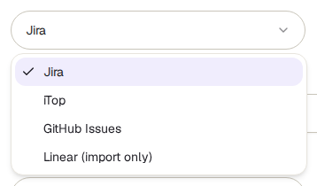

<!-- Generated from issue-trackers.html by e2e/docs-capture/export_md.py. Edit the HTML, not this file. -->

# Issue trackers

Setup · Every workspace member can see it · Workspace admins can change it

> **In short**
>
> An issue tracker is the tool your team files bugs in, such as Jira or GitHub. Connect it here once, and anyone can turn a failed test run into a ticket in one click, with the screenshots and recordings attached. The same connection can also bring requirements from Jira or Linear into TraceIQ.

## What it is for

This page answers **"How do failures get from TraceIQ to the people who fix them?"** Without a connection, someone copies the error, downloads the screenshots and writes the ticket by hand. With one, TraceIQ writes the ticket and uploads the evidence itself.

> **Testers**
>
> File a bug from the run page or from Failure triage without leaving TraceIQ.

> **Developers**
>
> Get tickets with the error message, the code version and the run's trace, video and screenshots already attached.

> **Leads**
>
> Import user stories from Jira or Linear so you can see which of them have tests.

**Where to find it:** in the sidebar, open **Setup → Issue trackers**.

## A tour of the screen

The demo workspace has one tracker, a Jira connection that is switched off, listed on the left. The screenshot shows the form you get after pressing **Add tracker**, filled in with example values (the token box is left empty on purpose). The numbers match the sections below. The list and a saved tracker are described after them, under [Your trackers](#list).

*The Issue trackers page for the demo workspace, with the form open. Click the picture to see it larger.*

## 1. Workspace

Tracker connections belong to a **workspace** and are shared by everyone in it. This menu chooses whose connections you see. The page opens on the workspace of the project picked in the sidebar. Next to it, **Add tracker** (workspace admins only) opens the form; it is hidden while the form is open.

## 2. Provider and name

**Provider** is the tool you are connecting. **Name** is what people will see in the "choose a tracker" menus, for example *Team Jira*. Choose a name that says which project or team the tickets go to.

| Provider | What it can do |
|---|---|
| **Jira** | File tickets (with the files attached) and import requirements. |
| **iTop** | File tickets (with the files attached). |
| **GitHub Issues** | File issues. GitHub can't take attachments this way, so the issue gets *links* to the files instead, and those links stop working after **one hour**. |
| **Linear (import only)** | Import requirements only. It is never offered for filing tickets. |

## 3. Base URL

The web address of your tracker, for example `https://yourcompany.atlassian.net` for Jira Cloud. For GitHub type `https://api.github.com` (or your company's GitHub Enterprise address). For Linear you can leave it empty: TraceIQ uses Linear's standard address.

## 4. Account and token

How TraceIQ signs in to the tracker. The labels change with the provider:

| Provider | Left box | Right box |
|---|---|---|
| Jira | The email address of the Jira account | An API token for that account |
| iTop | The iTop username | Its password |
| GitHub Issues | Not used (greyed out) | A personal access token |
| Linear | Not used (greyed out) | A Linear API key |

> **Use an account made for this**
>
> Every ticket is created as this account, and anyone in the workspace can file tickets through it. Ask your tracker's administrator for an account (or token) that can create tickets only in the project you want, not your personal one. The token is stored encrypted and is never shown again, not even to you.

## 5. Settings JSON

Where the tickets should go, written in a small structured format called JSON. The box starts with an example for Jira; replace the values, keep the quotes and the braces. The hint next to the label lists what each provider needs:

| Provider | What to put in |
|---|---|
| Jira | `{"project_key": "PROJ", "issue_type": "Bug"}`: the short key of the Jira project, and the kind of issue to create (Bug if left out). |
| iTop | `{"class": "UserRequest", "org_id": 3}`: the kind of ticket (UserRequest if left out) and, if your iTop needs it, the organisation's number. |
| GitHub Issues | `{"repo": "owner/name"}`: the repository the issues go to. |
| Linear | Nothing; you can empty the box. |

The example stays the Jira one when you switch provider, so change it yourself. If the text isn't valid JSON, saving fails with *"Settings must be valid JSON"*.

## 6. Add or cancel

**Add tracker** saves the connection, switched on. It stays greyed out until there is a name, a base URL (except for Linear) and a token. **Cancel** closes the form without saving. TraceIQ doesn't try the connection when you save; the first ticket you file shows whether it works.

## Your trackers

*The demo's tracker, switched off. Nothing reaches the address: it ends in `.invalid`.*

The left side lists every tracker of the workspace in one box, **Trackers**. Each row shows the name, the provider and the base URL, and On or Off. Click a row to see it on the right (the first one is shown until you pick another). A workspace with no trackers shows *"No trackers yet"* instead.

- Enabled or Disabled, the name and the provider.
- **Connection**: the base URL and the account name. The token is never shown.
- **What this does**: a reminder of where the tracker is offered.
- **Disable** / **Enable**: a disabled tracker stays saved but is not offered anywhere until you enable it again.
- **Remove**: deletes the connection after you confirm. Tickets already filed stay in your tracker. Requirements imported through it stay in TraceIQ but can no longer be refreshed.

## Watch it in use

[▶ Watch the video](../media/setup/issue-trackers/walkthrough.mp4)

*About a minute, with a spoken commentary. The captions at the bottom show the same words, so it also works with the sound off. The video cancels the form, so nothing is saved.*

## How to…

### …connect Jira

1. In Jira, create an API token for the account TraceIQ should use, and note the key of the project the tickets should go to (the short code in front of its ticket numbers, such as `PROJ` in PROJ-123).
2. Here, press **Add tracker** and keep **Jira** as the provider. Type a name.
3. Paste your Jira address into **Base URL**, the account's email into **Jira email** and the token into **API token**.
4. In **Settings JSON**, replace `PROJ` with your project key.
5. Press **Add tracker**.

### …file a ticket from a failed run

1. Open the run (from *Runs* or *Overview*) and press **Create ticket**.
2. Choose the tracker. Leave the summary empty to get *"[TraceIQ] suite name — failed"*, or type your own.
3. Untick **Trace**, **Video** or **Screenshots** if you don't want them attached (all three are on), then create it. TraceIQ files it in the background. The dialog lists the run's tickets with a link to each once it exists, how many files were uploaded, and the reason if it failed.

To file *one* ticket for a problem that failed many times, use **Failure triage** instead.

### …change a tracker's token or settings

1. The page can't edit a saved connection. Press **Add tracker** and create a new one with the new details.
2. Check that it works by filing a ticket.
3. Click the old one and press **Remove**.

## Good to know

- **Only workspace admins can add, switch off and remove trackers**, because a connection holds a shared account. Other members see the list without the buttons. A tracker address TraceIQ won't connect to (for example an internal address) is refused with the reason shown as-is.
- **Filing a ticket needs the editor role** on the run's project. Viewers can see the run but are refused (*"Editor role required"*).
- **What a ticket from a run says:** the run number and result, how many tests passed and failed, the error message, and the code version, branch and pull request if the run was given them. Then the trace, video and screenshots, for whichever of those the run recorded.
- **Only switched-on trackers are offered.** The *Create ticket* menus on runs and in Failure triage list enabled Jira, iTop and GitHub trackers; Requirements lists enabled Jira and Linear ones.
- **The run page asks for a workspace first** if you belong to several. Pick the workspace the run's project belongs to.
- **Failure triage only offers trackers of the project's own workspace**, so a problem can't be filed into another team's tracker by mistake.
- **The demo's Jira tracker is a placeholder.** Its address can't be reached and its token is not real, so enabling it would only make ticket filing fail. To try the page, add your own test connection, then remove it.

## Related pages

> **AI usage**
>
> The next page in this guide: how much AI TraceIQ used on your behalf, and for what.

> **Failure triage**
>
> Failures grouped by cause, with one ticket per problem instead of one per failure.

> **Runs**
>
> Each run's full result, and the Create ticket button.

> **Requirements**
>
> Import user stories from Jira or Linear and see which of them are tested.

## Video script

What the walkthrough says, in order. The video and every picture on this page are made by the Playwright script [`setup-issue-trackers.spec.ts`](../../../../e2e/docs-capture/pages/setup-issue-trackers.spec.ts).

1. Issue trackers connect TraceIQ to the tool your team files bugs in.
2. Connections belong to a workspace. Choose it here.
3. The demo has one Jira connection, switched off. Add tracker opens the form for another.
4. Pick the tool: Jira, iTop, GitHub, or Linear. Linear is for importing only.
5. Give it a name, and the web address of your tracker.
6. Then the account TraceIQ signs in with, and its token. The token is stored encrypted.
7. Settings say where tickets go. For Jira: the project key and the issue type.
8. Add tracker saves it. We cancel here, so nothing is saved.
9. Once saved and enabled, Create ticket on a run and on Failure triage offers it.
