<!-- Generated from my-settings.html by e2e/docs-capture/export_md.py. Edit the HTML, not this file. -->

# My settings

Setup · Everyone has one · Only you can change yours

> **In short**
>
> Your own corner of TraceIQ. Here you choose which browser your runs use when nothing else decides, what your runs record, which emails you get, and whether signing in needs a code from your phone. Nothing here changes anyone else's settings.

## What it is for

My settings answers **"How do I want TraceIQ to behave for me?"** A *run* is one execution of your tests; when you start one, TraceIQ uses some of the choices on this page to fill in what the test itself leaves open. Settings that everyone in a project shares, such as how long runs are kept, are not here: they are in *Project settings*.

> **Testers**
>
> Run every test on Firefox and WebKit as well as Chromium without editing each suite, and keep a video of failed runs.

> **Developers**
>
> Get an email only when a run fails, and switch off emails from projects you only look at now and then.

> **Everyone**
>
> Protect your account with an authenticator app, and check the name and email address TraceIQ has for you.

**Where to find it:** in the sidebar, open **Setup → My settings**.

## A tour of the screen

The list on the left switches between five sections; the cards of the chosen section appear on the right. The numbers on the screenshot match the sections below.

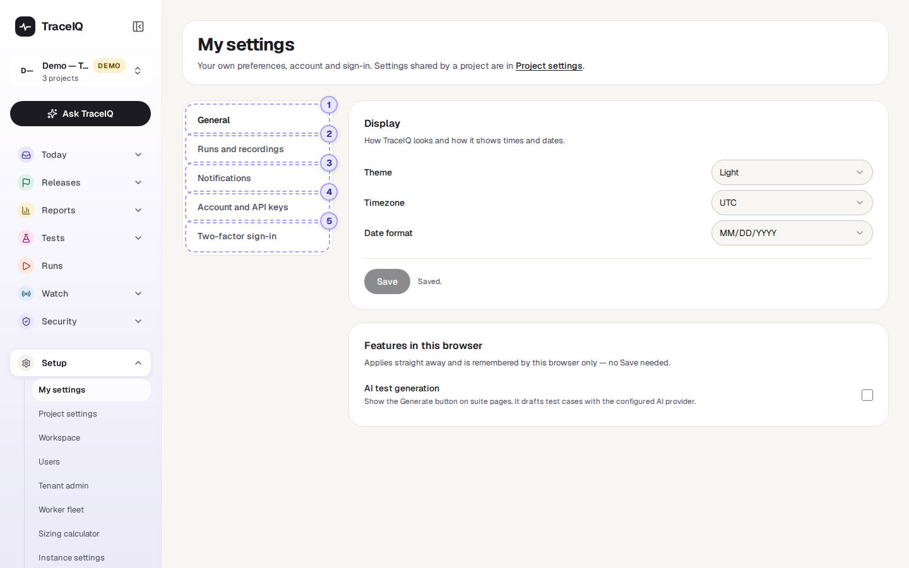

*My settings, opened on its General section. Click the picture to see it larger.*

> **Each card saves on its own**
>
> Most cards have their own **Save** button, which saves only that card. It stays grey until you change something; then the card says "Unsaved changes." and a **Discard** button puts the card back as it was. Saving one card never touches another, so you can change one thing at a time. Two places save straight away instead, without a Save button: *Features in this browser* and the *Per project* email choices.

## 1. General

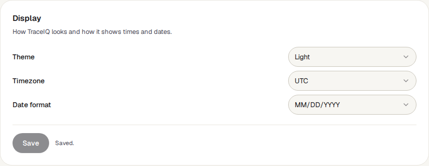

**Display** holds a theme (Light, Dark or Auto), a time zone and a date format.

> **These three have no effect yet**
>
> TraceIQ saves them with your account, but in this version nothing else in the app reads them: changing the theme does not darken the screens, and dates and times are not reformatted.

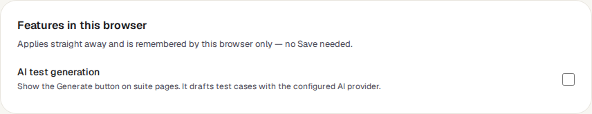

**Features in this browser** has one switch, **AI test generation**. Ticked, suite pages show a **Generate** button that drafts test cases with the AI provider your organisation has set up. The choice is remembered by *this browser only*: on another computer, or after clearing the browser's data, it is off again.

## 2. Runs and recordings

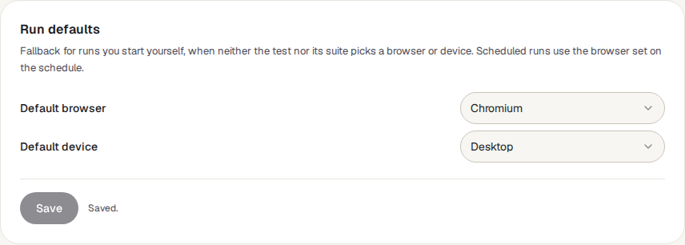

**Run defaults** pick the browser and the device for runs you start, but only as a last resort. TraceIQ takes the first answer it finds, in this order:

1. the browser or device you chose when starting the run;
2. what the test itself asks for;
3. what its suite (the folder of tests it belongs to), or a suite above it, asks for;
4. **your defaults on this page**;
5. Chromium, on a desktop-sized window.

"Desktop" means no device imitation. The other devices (Mobile, iPhone 13, Pixel 5) make the browser behave like that phone's screen.

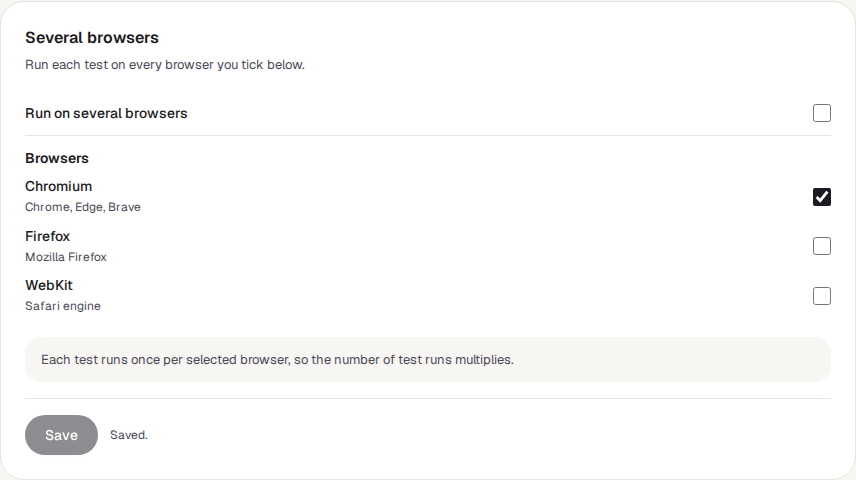

**Several browsers** and **Several devices** work the same way. Tick *Run on several browsers*, tick the browsers, and save: from then on, each test in a run you start runs once on every ticked browser, instead of once on your default browser. Three browsers and two devices make six copies of every test, so runs take longer.

Below these cards, a short card called **Timeouts, retries and parallel runs** explains where those are set instead: on each suite's page (retries, execution mode) and by your instance admin (step timeout). They are not personal, so every run of a suite behaves the same whoever starts it.

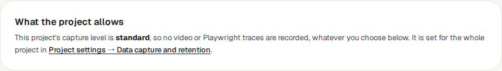

**What the project allows** shows the *capture level* of the project selected in the sidebar: how much a run in that project is allowed to record. It is set in Project settings, and it is the ceiling for your own choices below.

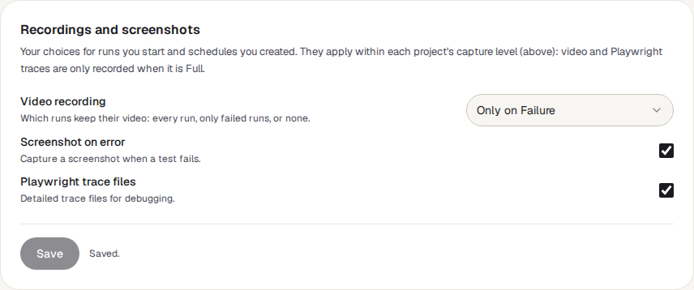

| Choice | What it does | Needs capture level |
|---|---|---|
| **Video recording** | Keep a video of every test (*Always Record*), only of tests that failed (*Only on Failure*, the default), or none. | Full |
| **Screenshot on error** | Take a picture of the page when a test fails. | Minimal or higher |
| **Playwright trace files** | Keep a trace: a detailed recording of every step that developers can replay. | Full |

Your choices can only make a run record *less* than the project allows, never more. They apply to runs you start and to scheduled runs of schedules you created.

The last card, **Retention**, only explains that how long runs are kept is a project setting (in *Project settings → Data capture and retention*).

## 3. Notifications

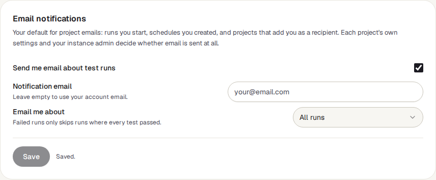

**Email notifications** is your default for emails about runs. TraceIQ emails you about a run when you started it, when it came from a schedule you created, or when a project admin has added you to the project's email list.

- **Send me email about test runs**: untick it to get no run emails by default.
- **Notification email**: an address to use instead of the one you sign in with. Leave it empty to use your account email.
- **Email me about**: *All runs*, or *Failed runs only*, which skips runs that passed.

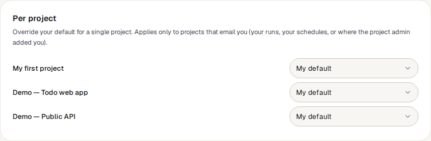

**Per project** lists every project you can see, and lets you override your default for one of them: *My default* (follow the card above), *All runs*, *Failed runs only* or *Nothing*. A choice here is saved the moment you pick it.

> **Why you might still get no email**
>
> These are your wishes, not the last word. A project can switch email off for everyone in its own notification settings, and the server must have email set up by your instance admin. The demo projects never send email at all.

## 4. Account and API keys

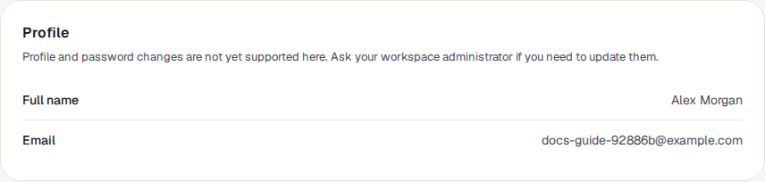

**Profile** shows the name and email address TraceIQ has for you. You can't change them here; ask your workspace administrator.

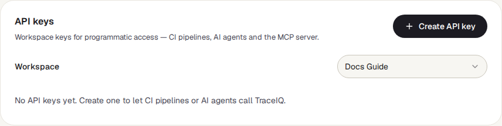

**API keys** is a short version of the *API keys* page: the keys of one workspace, with their name, the first characters of the key, whether they are still active, and when they were last used. If you belong to more than one workspace, choose it in the **Workspace** menu. Keys are shared by the workspace, not personal, and the *API keys* page explains them fully.

**Connect an IDE through MCP** shows the settings to paste into a code editor (Claude Code, Cursor or VS Code) so an AI assistant in it can use TraceIQ through an API key.

## 5. Two-factor sign-in

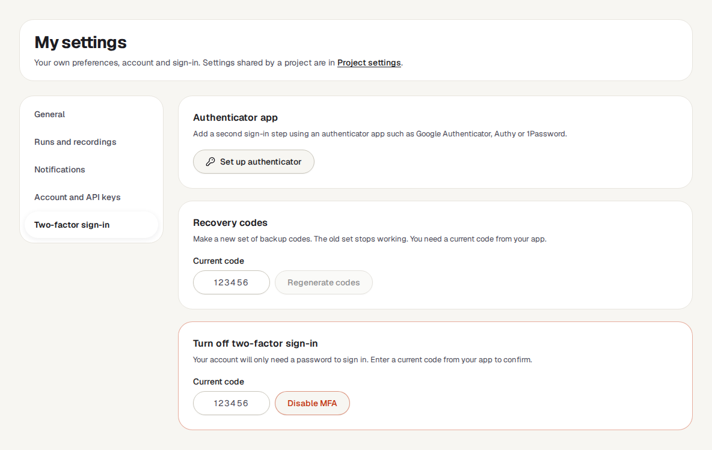

Two-factor sign-in means that signing in with your password also needs a 6-digit code from an *authenticator app* on your phone (Google Authenticator, Authy, 1Password and similar). Someone who learns your password still can't get in.

- **Authenticator app**: set it up (see [How to…](#how-to)).
- **Recovery codes**: a fresh set of 10 backup codes, for when you don't have your phone. Each code works once. Making a new set needs a current code from the app, and the old set stops working.
- **Turn off two-factor sign-in**: enter a current code and press **Disable MFA** to go back to password only. Your recovery codes are deleted too.

> **The page doesn't say whether it is on**
>
> All three cards are always shown, whether or not you have two-factor sign-in. If you press **Set up authenticator** when it is already on, TraceIQ refuses with "MFA is already enabled"; to move to a new phone, turn it off first with a code from the old one, then set it up again.

## Watch it in use

[▶ Watch the video](../media/setup/my-settings/walkthrough.mp4)

*About a minute, with a spoken commentary. The captions at the bottom show the same words, so it also works with the sound off.*

## How to…

### …run your tests on several browsers

1. Open **Runs and recordings**.
2. In **Several browsers**, tick **Run on several browsers**, then tick each browser you want.
3. Press **Save** on that card.
4. Start a run as usual. Tests whose suite doesn't choose its own browsers now run once per ticked browser.

### …get emails only when something fails

1. Open **Notifications**.
2. Make sure **Send me email about test runs** is ticked, and set **Email me about** to **Failed runs only**.
3. Press **Save**.
4. To silence one busy project completely, set it to **Nothing** under **Per project** (saved at once).

### …turn on two-factor sign-in

1. Install an authenticator app on your phone.
2. Open **Two-factor sign-in** and press **Set up authenticator**. A QR code appears.
3. Scan it with the app (or type in the key shown next to it). The app starts showing 6-digit codes.
4. Type the current code and press **Verify and turn on**.
5. TraceIQ shows 10 recovery codes, once. Copy them somewhere safe, then press **I've saved them**.

## Good to know

- **Your settings follow you, not the project.** A colleague who starts the same suite gets their own defaults. That is why suite settings win over yours: a suite that names its browsers behaves the same for everyone.
- **Scheduled runs don't use your browser defaults.** A schedule runs on the browser set on the schedule. Your recording choices do apply to schedules you created.
- **There is a limit of 120 copies of one test per run.** Browsers × devices (× screen sizes and identities, if the run uses them) above that, and TraceIQ refuses to start the run.
- **Two-factor sign-in is for password sign-in**, including a company directory (LDAP) password. If you sign in through your company's single sign-on (SSO), TraceIQ doesn't ask for its code; your company's own sign-in decides whether you need a second step. Your instance admin can also make two-factor sign-in compulsory; you are then asked to set it up the next time you sign in with a password.
- **Turning two-factor sign-in on or off is recorded** in TraceIQ's audit trail, with the time.
- **Codes allow a little clock drift.** A code from the previous or next 30 seconds is accepted too, so a phone clock that is slightly off still works.

## Related pages

> **Project settings**
>
> The next page in this guide: settings shared by everyone in a project, including the capture level and how long runs are kept.

> **API keys**
>
> Create and revoke the keys that let CI pipelines and AI agents use TraceIQ.

> **Suites**
>
> Where a suite can choose its own browsers, devices and retries, which win over your defaults.

> **Schedules**
>
> Runs on a timer. They pick their own browser; your recording choices still apply.

## Video script

What the walkthrough says, in order. The video and every picture on this page are made by the Playwright script [`setup-my-settings.spec.ts`](../../../../e2e/docs-capture/pages/setup-my-settings.spec.ts).

1. My settings holds your own preferences. They never change anyone else’s.
2. The list on the left switches between five sections.
3. Each card has its own Save button, and saves only that card.
4. AI test generation shows a Generate button on suite pages, in this browser only.
5. Run defaults choose the browser and device when the test and its suite don’t.
6. Recordings: which of your runs keep a video, a screenshot and a trace.
7. The project’s capture level, just above, is the limit. Your choice can only record less.
8. Email notifications: your default for emails about test runs.
9. Per project overrides that default for one project. A change there saves at once.
10. Account shows your name and email, and the A P I keys of your workspace.
11. Two-factor sign-in asks for a code from an authenticator app as well as your password.
