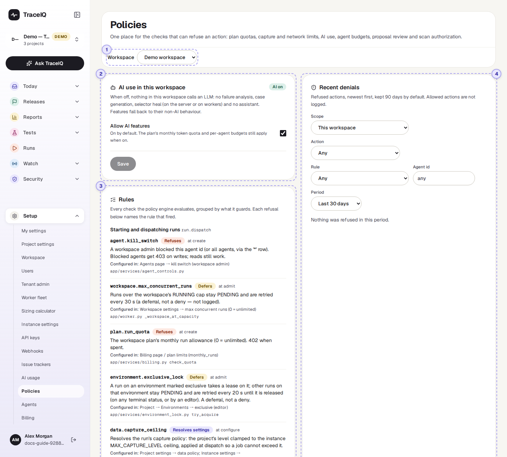
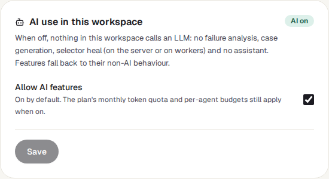
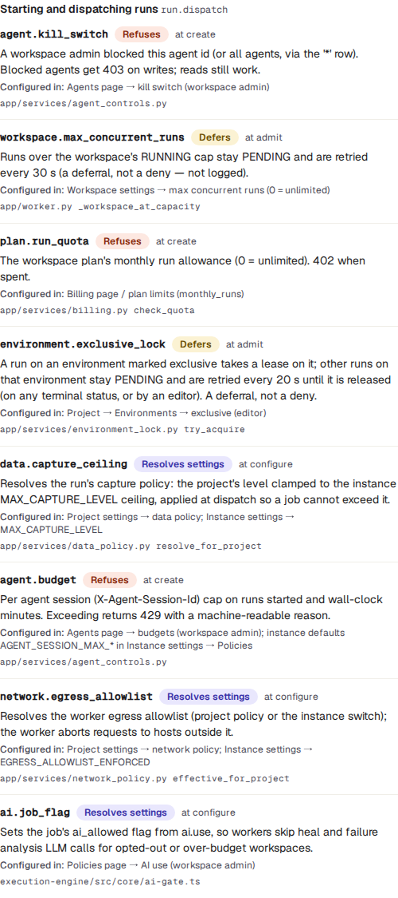
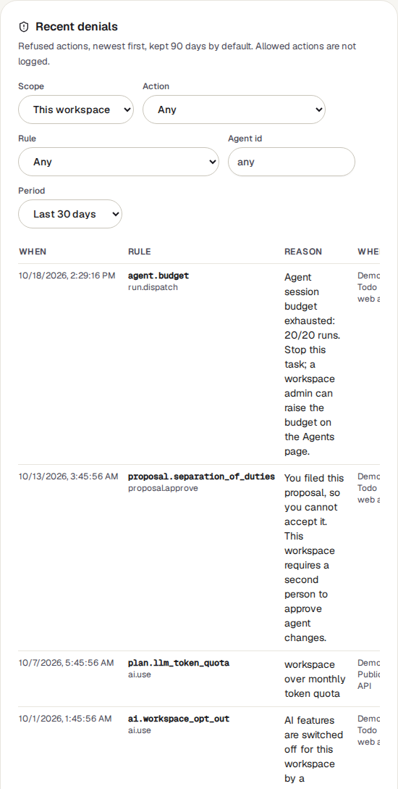

<!-- Generated from policies.html by e2e/docs-capture/export_md.py. Edit the HTML, not this file. -->

# Policies

Setup · Every workspace member can see the rules · Workspace admins see refusals and can change it

> **In short**
>
> TraceIQ has a set of rules that can stop something from happening: a run beyond your plan's limit, an AI agent that has been blocked, a suggested fix nobody has checked. This page lists every one of those rules in plain sight, has the one switch that turns AI off for the whole workspace, and shows what was actually refused, and why.

## What it is for

Policies answers **"Why was this refused, and what could refuse it?"** When a run won't start or a suggestion can't be accepted, the message names a rule. This page explains that rule and where its setting lives, and keeps a record of refusals so you can see a pattern instead of a single error.

> **Workspace admins**
>
> Decide whether the workspace may use AI at all, and check what has been refused lately.

> **Compliance and security**
>
> Show which controls exist and prove they work: every refusal is recorded with who, what and when.

> **Anyone refused**
>
> Look up the rule named in an error message and find out who can change it.

**Where to find it:** in the sidebar, open **Setup → Policies**.

## A tour of the screen

The page has four parts. The numbers on the screenshot match the sections below.

*The Policies page for the demo workspace. Click the picture to see it larger.*

## 1. Workspace

The AI switch and the refusals belong to one **workspace**. The page opens on the workspace of the project selected at the top of the sidebar; this menu picks another. It is only shown if you belong to more than one workspace.

## 2. AI use in this workspace

One switch for the whole workspace. The label at the top right says AI on or AI off.

- **Allow AI features** is ticked by default. Untick it and press **Save** to stop every AI call for this workspace: no explanations of failures, no AI-written tests, no automatic repair of tests (neither on the server nor on the test machines), and no answers from *Ask TraceIQ*. Those features fall back to what they do without AI.
- **Save** only becomes active once you have changed the box. Nothing changes until you press it.
- Only workspace admins can change it; everyone else sees *"Only workspace admins can change this"* and a greyed-out box. It can't be changed with an API key, so an AI agent can't switch AI back on for itself.
- When AI is on, the plan's monthly token limit (see *Billing*) and each agent's budget (see *Agents*) still apply.

## 3. Rules

Every check TraceIQ makes before it lets certain actions happen, grouped by the action they guard. The list is the same for every workspace: it describes the rules, not your settings. Each rule shows:

- **Its name**, for example `plan.run_quota`. Error messages quote this name.
- **What it does** to the action: Refuses stops it, Defers makes it wait and try again shortly (a run stays *Queued*), Resolves settings never stops anything but works out a setting the action runs with.
- **When it is checked**, for runs: *at create* (when someone asks for the run), *at admit* (just before it starts), *at configure* (while its settings are put together).
- **A description**, and **Configured in**: the page or setting that controls it. The grey line under it names the program file, for your technical team.
- Enforced inline marks the one rule that is applied directly where it is needed rather than by the rule engine (the network-safety check on addresses TraceIQ visits). It is listed so the picture is complete, and its refusals are not recorded below.

| Group | What its rules check, in plain words |
|---|---|
| **Starting and dispatching runs** | The agent isn't blocked or over budget; the plan's monthly run limit isn't used up; the workspace isn't running its maximum number of runs at once (otherwise the run waits); a test environment marked "one run at a time" is free (otherwise the run waits); and how much the run may record, which addresses it may reach, and whether it may use AI. |
| **Using AI (LLM calls)** | The workspace switch above is on; the agent isn't blocked or over its token budget; the plan's monthly AI token limit isn't used up. |
| **Agent writes** | A blocked agent can't change anything in the workspace. |
| **Filing proposals** | A blocked or over-budget agent can't suggest changes to tests. |
| **Accepting proposals** | A suggested fix has passed its check run when that is required, and the person accepting it isn't the one who suggested it when the workspace asks for that. |
| **Auto-applying proposals** | Suggestions are never applied automatically to a protected suite, when a check run is required, or when the server has switched auto-apply off. |
| **Security scans** | Security testing is allowed for the project and the target. |
| **Backend outbound requests** | Addresses TraceIQ's server visits itself (webhooks, API documents, pages it checks) are not on a private network unless your administrator allows that, and never lead to cloud-internal services. |

## 4. Recent denials

A **denial** is one time a rule said no. The list shows them newest first, 50 to a page (**Newer** and **Older** move between pages). In the demo workspace nothing has been refused, so it says *"Nothing was refused in this period"*.

| Filter | What it does |
|---|---|
| **Scope** | *This workspace*, or *Whole instance*: every workspace on the server. Only offered to server administrators (instance admins). |
| **Action** | Only refusals of one kind of action (the groups above). |
| **Rule** | Only one rule. The menu lists the rules of the chosen action. |
| **Agent id** | Only refusals of one agent. Type its exact name. |
| **Period** | The last 24 hours, 7, 30 (the default) or 90 days. |

Each row says **when**, which **rule** (and action), the **reason** TraceIQ gave, **where** (the project, if there was one) and **who**: the agent and its session if an agent asked, and the person's email, or *system* when TraceIQ itself was acting.

## Watch it in use

[▶ Watch the video](../media/setup/policies/walkthrough.mp4)

*About a minute, with a spoken commentary. The captions at the bottom show the same words, so it also works with the sound off. Nothing is changed or saved in the video.*

## How to…

### …turn AI off for a workspace

1. Make sure the right workspace is shown (menu at the top, or the project in the sidebar).
2. Untick **Allow AI features** and press **Save**. The label changes to AI off.
3. Runs that start from now on make no AI calls. To allow AI again, tick the box and save.

### …find out why something was refused

1. Note the rule name in the error message, for example `plan.run_quota`.
2. Find it under **Rules** and read **Configured in**: that is where the limit or switch can be changed, and by whom.
3. Under **Recent denials**, choose that rule to see how often it has happened, and to whom.

### …check what an AI agent was refused

1. Type the agent's name in **Agent id** and choose a period.
2. Read the reasons. For budgets and blocking, go to **Setup → Agents**.

## Good to know

- **Only refusals are recorded.** Actions that were allowed leave no row here, and neither do waits (*Defers*): a run waiting for a free slot isn't a refusal.
- **Repeats within a minute count once.** The same refusal of the same person or agent for the same reason, again within 60 seconds, is normally recorded only the first time, so a retrying script doesn't flood the list.
- **Refusals are kept 90 days** by default, then removed automatically. Your server administrator can change that period.
- **Who sees what.** Every workspace member sees the AI switch and the rules. Recent denials are for workspace admins: others see *"Workspace admin access required"* in that card. API keys limited to one project can't read them.
- **Switching AI on or off is recorded** in the *Audit log*, with who did it.
- **The rules list doesn't change with your settings.** A rule appears even when its limit isn't set (for example a plan with no run limit). Whether it can ever refuse depends on the setting named in *Configured in*.

## Related pages

> **Agents**
>
> The next page in this guide: block an AI agent, or give its sessions a budget.

> **Billing**
>
> The plan limits that the run and token rules check.

> **AI usage**
>
> How much AI the workspace has used, by feature and by provider.

> **Proposals**
>
> Suggested test changes, and the review rules for accepting them.

## Video script

What the walkthrough says, in order. The video and every picture on this page are made by the Playwright script [`setup-policies.spec.ts`](../../../../e2e/docs-capture/pages/setup-policies.spec.ts).

1. Policies gathers every check that can stop something from happening in TraceIQ.
2. First, one switch: may this workspace use AI at all?
3. Only workspace admins can change it, and they press Save to apply it.
4. Rules lists every check, grouped by what it protects.
5. Each rule says what it does, and where its setting lives.
6. Refuses stops the action. Defers makes it wait. Resolves settings only adjusts it.
7. Recent denials lists what was actually refused, newest first.
8. Narrow it down by action, rule, agent or period.
9. Nothing was refused in the demo workspace, so the list is empty.
