<!-- Generated from project-settings.html by e2e/docs-capture/export_md.py. Edit the HTML, not this file. -->

# Project settings

Setup · Everyone with access to the project can see it · Project admins can change it

> **In short**
>
> The settings that belong to one project and apply to everyone working in it: who is told about its runs, how much its runs may record, which secrets are wiped out before anything is stored, and how long old runs are kept.

## What it is for

Project settings answers **"What are the rules for this project?"** A *project* is one application you test, with its own tests, runs and people. Whatever is set here applies to every run in the project, whoever starts it. Your personal preferences are on *My settings* instead.

> **Project admins**
>
> Decide who is emailed, connect the team's Slack or Teams channel, and set how long results are kept.

> **Security and privacy**
>
> Limit what runs record, and make sure passwords, card numbers and personal data never end up in screenshots or logs.

> **Everyone else**
>
> See why a run has no video, or why nobody got an email, and choose whether this project emails you.

**Where to find it:** in the sidebar, open **Setup → Project settings**. The page shows the project selected at the top of the sidebar, and names it under the heading. With no project selected it shows only "Select a project in the sidebar to see its settings."

## A tour of the screen

The list on the left switches between five sections. The numbers on the screenshot match the sections below.

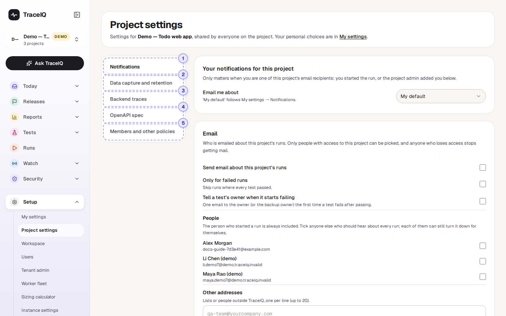

*Project settings for the demo's web project, opened on Notifications. Click the picture to see it larger.*

> **Looking is open to all, changing is not**
>
> Anyone with access to the project can open every section. If you are not a project admin, a line at the top says "You can see these settings; changing them needs the project admin role", and the cards say "Only project admins can change this." Two exceptions: your own email choice (the first card) is yours to change, and the OpenAPI spec can be changed by editors as well; its section says so instead. The line is not shown under "Members and other policies".

## 1. Notifications

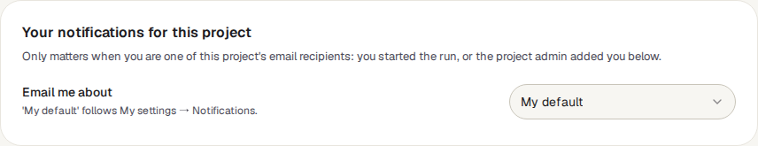

**Your notifications for this project** is the one card that is about you: *My default* (follow My settings → Notifications), *All runs*, *Failed runs only* or *Nothing*. It is saved the moment you pick, and it is the same choice as this project's line in My settings → Per project.

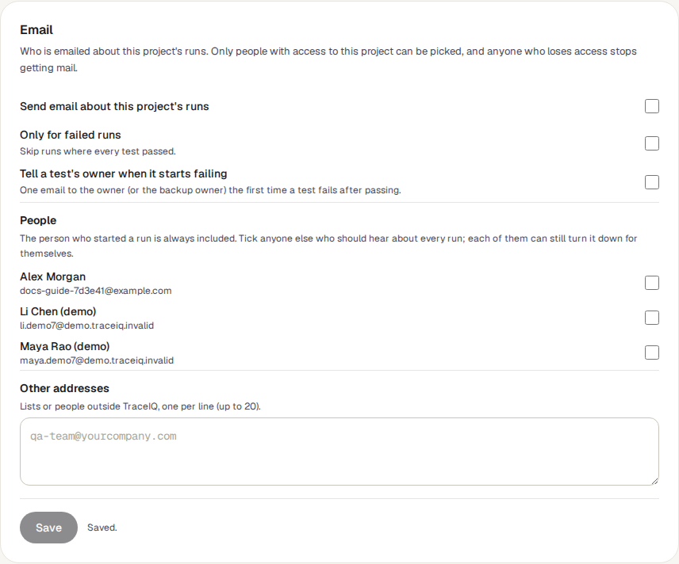

| Setting | What it does |
|---|---|
| **Send email about this project's runs** | The main switch. Off, nobody is emailed about this project's runs, whatever their own choices. |
| **Only for failed runs** | Skip runs that passed. This also applies to the Slack and Teams posts below. |
| **Tell a test's owner when it starts failing** | One email to the test's owner (or its backup owner, if there is no owner) the first time it fails after passing. Owners are set on the *Test review* page. |
| **People** | Project members to email about every run. The person who started a run is always included. Each person can still say no for themselves. |
| **Other addresses** | Up to 20 addresses outside TraceIQ, such as a team mailing list, one per line. These always get the email: there is nobody to ask. |

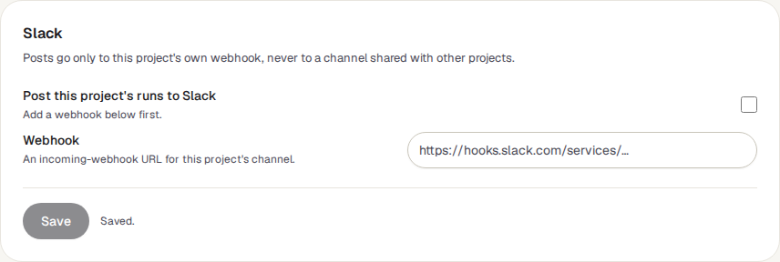

**Slack** and **Microsoft Teams** post a message about each run to a channel. In the chat tool, create an *incoming webhook* for the channel (an address that accepts messages), paste it into **Webhook**, tick **Post this project's runs to…** and save. Once saved, the address is never shown again in full, only a short hint of it; paste a new one to replace it, or press **Remove the webhook**.

> **The server has the last word**
>
> Your instance admin can switch email, Slack or Teams off for the whole server, or send only failures everywhere. When that happens these settings are kept but have no effect. The demo projects never send anything.

## 2. Data capture and retention

One card, **Data capture and redaction**, with a single **Save data policy** button at the bottom. Changes apply to the next run that starts.

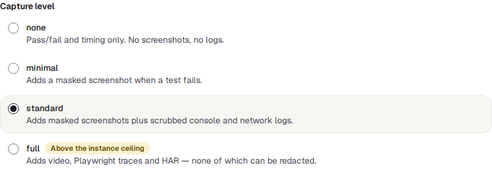

The **capture level** decides how much a run is allowed to record:

| Level | What runs record |
|---|---|
| **none** | Whether each step passed or failed, and how long it took. Nothing else. |
| **minimal** | Adds a screenshot when a test fails. |
| **standard** | Adds screenshots, the browser's console messages and a list of network requests, all with secrets removed. Also screenshot comparisons. The level a new project starts at. |
| **full** | Adds video, Playwright traces and HAR files (a full record of the network traffic). None of these can have secrets removed, so choose it only if the app shows no sensitive data. |

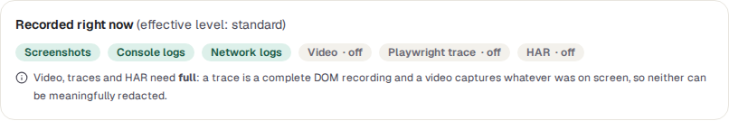

**Recorded right now** shows what is really recorded. It can be less than you chose: your instance admin sets a ceiling for the whole server. A level above it is marked "Above the instance ceiling", and if the project asks for more than the ceiling, a note at the top says which level actually applies.

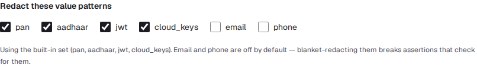

**Redaction** means replacing secrets with a placeholder before anything is stored. **Redact these value patterns** looks for kinds of values wherever they appear:

- `pan`: payment card numbers, `aadhaar`: Indian Aadhaar numbers. Both are checked with their checksum, so an order number that happens to be 16 digits is left alone.
- `jwt`: sign-in tokens; `cloud_keys`: access keys for AWS, GitHub, Slack, Stripe, Google and Azure, and private keys.
- `email` and `phone`: off at first, because removing every email address breaks tests that check one is shown.

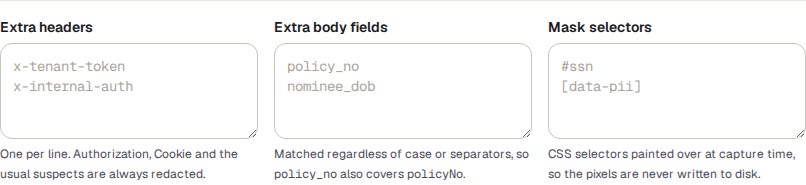

- **Extra headers**: names of request headers to blank out, one per line. Authorization, Cookie and similar are always blanked.
- **Extra body fields**: names of fields in requests and responses to blank out. `policy_no` also catches `policyNo` and `Policy-No`.
- **Mask selectors**: parts of the page to paint over in screenshots, written as CSS selectors (the way a test points at an element, such as `#ssn`). The covered pixels are never saved.

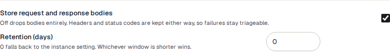

- **Store request and response bodies**: untick to keep only headers and status codes of network traffic, never its content.
- **Retention (days)**: runs older than this are deleted, with their screenshots and files. 0 means "use the server's setting". If both are set, the shorter one wins; if neither is, runs are kept forever. The clean-up runs every hour.

## 3. Backend traces

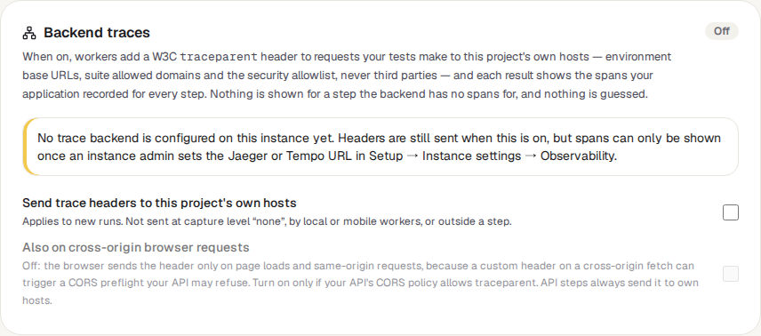

For teams whose servers record *traces* (a timeline of what each server did to answer a request) in Jaeger or Tempo. When this is on, the requests a test makes to your own sites carry a label, and each test step's result can show what your servers did for it. It is off at first.

- **Send trace headers to this project's own hosts**: "own hosts" are the addresses in the project's environments, its suites' allowed sites and its security settings, never third-party sites. Not sent when the capture level is *none*.
- **Also on cross-origin browser requests**: leave off unless your developers say otherwise; it can make the browser refuse some requests.

Both checkboxes save the moment you click them. Showing the server's side also needs your instance admin to connect TraceIQ to Jaeger or Tempo; until then the card says "No trace backend is configured on this instance yet".

## 4. OpenAPI spec

An *OpenAPI spec* is a file that describes an API: its addresses and what each answer should look like. Store your API's spec here, and API tests can check that every answer matches it, instead of each test spelling out the expected shape.

- **Choose file** uploads a JSON file; **Fetch and save** downloads it from an address.
- Once stored, the card shows its title, version and the first 12 of its operations, and a **Remove spec** button.
- Every new upload is kept as a numbered version. With two or more, a **Version history** appears: pick two versions under **Compare from (older)** and **To (newer)** to see what changed for the API's users, grouped by operation, naming the project's tests that use each changed operation. Only **breaking** changes are listed until you tick **Show compatible changes**; **Export SARIF** downloads the comparison for code-scanning tools.

The picture shows the demo's *Public API* project, whose spec has two versions: version 1.1.0 removed `GET /ip` and made a request field required, two breaking changes. A project with no spec, like the demo's web project, says "No spec stored for this project".

Editors can change the spec, not only project admins. Tests created from an OpenAPI file (through TraceIQ's API, by a CI script or an AI agent) also store the spec here.

## 5. Members and other policies

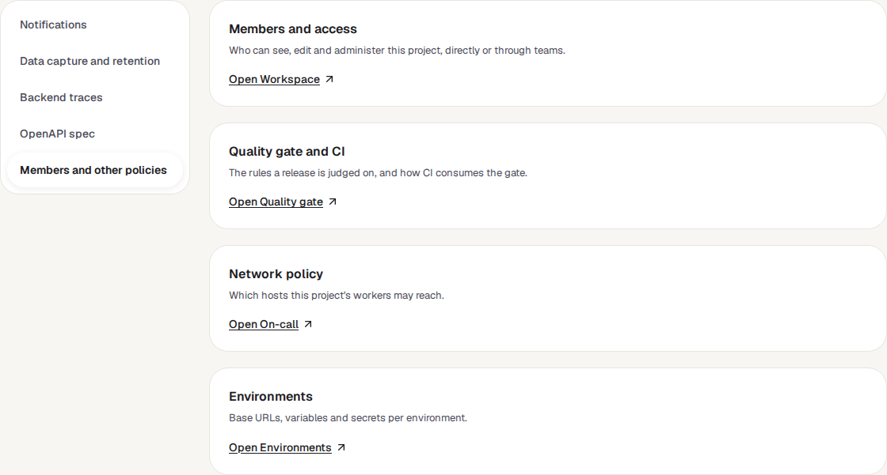

Other rules for the project live on pages of their own. This section only links to them:

- **Members and access** → *Workspace*: who can see, edit and run this project.
- **Quality gate and CI** → *Quality gate*: the rules a release is judged on.
- **Network policy** → *On-call*: which sites this project's tests may reach.
- **Environments** → *Environments*: addresses, variables and secrets for each place the app runs.

## Watch it in use

[▶ Watch the video](../media/setup/project-settings/walkthrough.mp4)

*About a minute and a quarter, with a spoken commentary. The captions at the bottom show the same words, so it also works with the sound off.*

## How to…

### …email the whole team when a run fails

1. Open **Notifications**.
2. In **Email**, tick **Send email about this project's runs** and **Only for failed runs**.
3. Tick the people under **People**, or type the team's mailing list under **Other addresses**.
4. Press **Save**.

### …post run results to a Slack channel

1. In Slack, create an incoming webhook for the channel and copy its address.
2. Open **Notifications**, paste the address into **Webhook** on the **Slack** card.
3. Tick **Post this project's runs to Slack** and press **Save**.

### …keep personal data out of screenshots

1. Open **Data capture and retention**.
2. Make sure the capture level is **standard** or lower, so nothing is recorded that can't be cleaned.
3. Under **Mask selectors**, add the parts of the page that show personal data, one per line (ask a tester or developer for the selectors).
4. Tick **email** or **phone** under the value patterns if the app shows them, then press **Save data policy**.

## Good to know

- **Changes are recorded.** Every change to the notification settings or the data policy is written to the audit log with who made it. Webhook addresses are never written there, only that one was set or removed.
- **Old runs keep what they recorded.** Raising or lowering the capture level, or adding a redaction rule, affects new runs only.
- **A shorter retention deletes for real.** Lowering it means the next hourly clean-up deletes every run older than the new number of days, with its files. There is no undo.
- **Email recipients must belong to the project.** Only people with access to it are listed under People, and someone who loses access stops getting mail.
- **Webhook addresses are checked.** TraceIQ checks a Slack or Teams address when it is saved and again before every post, and refuses one that points into a private or internal network unless your instance admin allows that.

## Related pages

> **Workspace**
>
> The next page in this guide: members, teams and who may see each project.

> **My settings**
>
> Your own email defaults and recording choices, which work inside the limits set here.

> **Environments**
>
> The addresses and secrets your tests use, per environment.

> **Test review**
>
> Where each test gets an owner, who can be emailed when it starts failing.

## Video script

What the walkthrough says, in order. The video and every picture on this page are made by the Playwright script [`setup-project-settings.spec.ts`](../../../../e2e/docs-capture/pages/setup-project-settings.spec.ts).

1. Project settings belong to the project chosen in the sidebar, and are shared by everyone on it.
2. Five sections. Anyone on the project can look; mostly only project admins can change.
3. Notifications: who is emailed about this project’s runs.
4. Slack and Teams post to this project’s own channel, through a webhook address.
5. The capture level decides how much a run may record: from pass or fail only, up to video and traces.
6. This box shows what is actually recorded right now.
7. Redaction removes card numbers, tokens and other secrets before anything is stored.
8. Retention: after how many days old runs are deleted.
9. Backend traces link each test step to what your own servers recorded for it. Off by default.
10. Open A P I spec: a description of your A P I that A P I tests can check responses against.
11. The last section links to the pages that hold the other project rules.
