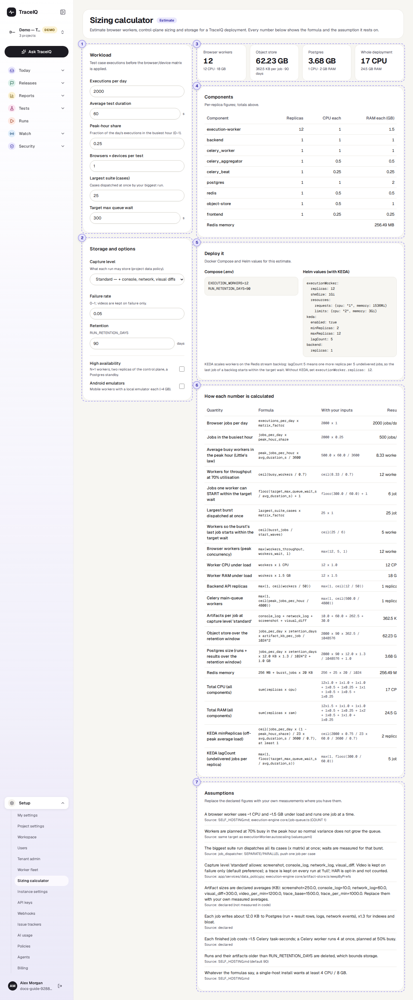
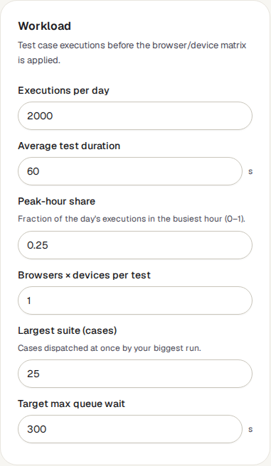
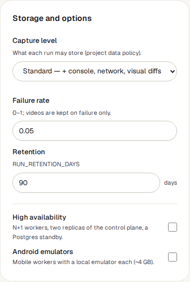
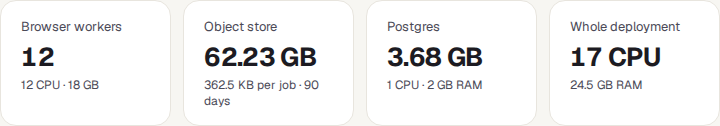
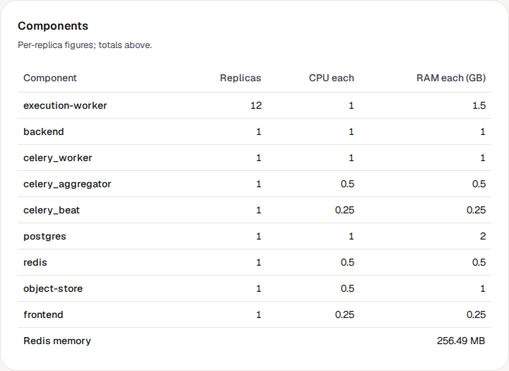
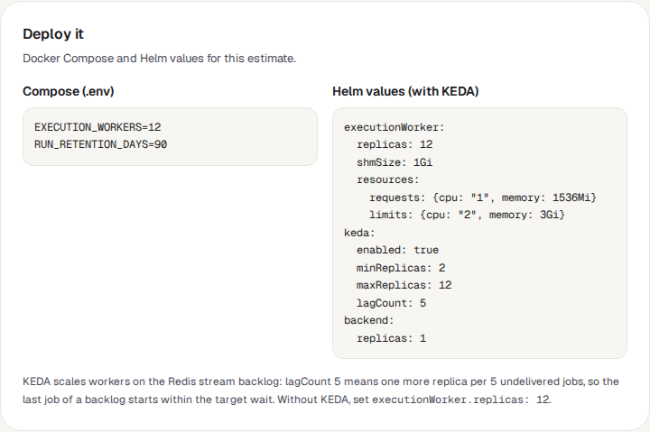
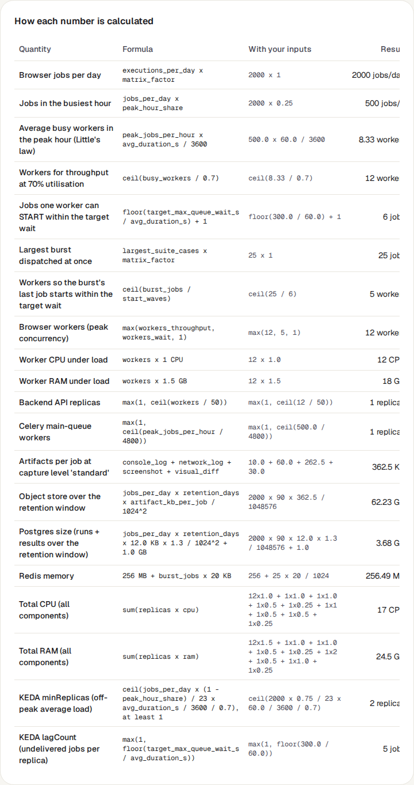
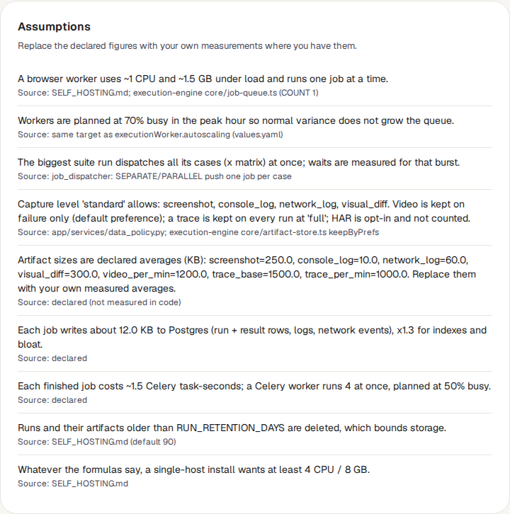

<!-- Generated from sizing-calculator.html by e2e/docs-capture/export_md.py. Edit the HTML, not this file. -->

# Sizing calculator

Setup · Everyone who is signed in can use it · Saves nothing

> **In short**
>
> A calculator for whoever plans the servers TraceIQ runs on. Describe how much testing you expect, and it estimates how many browser workers you need, how much processing power and memory, and how much storage, showing the sum behind every number.

## What it is for

The sizing calculator answers **"How big a machine, or how many, do we need for TraceIQ?"** TraceIQ runs each test in a *browser worker*: a small program that opens a real browser, does what the test says, and reports back. One worker runs one test at a time, so the more tests you run at once, the more workers (and the more processing power and memory) you need. Results, screenshots and logs also take up storage until they are deleted.

> **IT and operations**
>
> Order the right server, or set the right number of workers, before the first team starts using TraceIQ.

> **Leads and buyers**
>
> See what growing from 2,000 to 20,000 tests a day would cost in hardware, and why.

> **Anyone curious**
>
> Try numbers freely: nothing is saved, and none of your own data is read.

**Where to find it:** in the sidebar, open **Setup → Sizing calculator**.

## A tour of the screen

Your inputs are on the left, the estimate on the right. The numbers on the screenshot match the sections below.

*The Sizing calculator with its starting figures. Click the picture to see it larger.*

The page opens with example figures already filled in (2,000 tests a day, one minute each), so it shows an answer straight away. Change any number and the estimate is worked out again a moment later; "Recalculating…" shows at the top right while it happens.

## 1. Workload

| Field | What to enter |
|---|---|
| **Executions per day** | How many times a test is run per day, counting each test separately (a suite of 20 tests run 10 times is 200). |
| **Average test duration** | How long one test takes, in seconds. |
| **Peak-hour share** | How much of the day's testing happens in the busiest hour, as a fraction: 0.25 means a quarter. Nightly runs that all start at once make this high. |
| **Browsers × devices per test** | How many copies of each test run: 3 if every test runs on Chromium, Firefox and WebKit. |
| **Largest suite (cases)** | How many tests your biggest run starts at the same moment. |
| **Target max queue wait** | How long, in seconds, the last test of that biggest run may wait for a free worker. |

## 2. Storage and options

- **Capture level**: how much each test records (see *Project settings → Data capture and retention*). More recording means more storage.
- **Failure rate**: the share of tests that fail, as a fraction. It matters because a failed test keeps an extra screenshot and, at Full, a video.
- **Retention**: how many days results are kept before they are deleted.
- **High availability**: plan for the installation to keep running if one machine fails: one spare worker, two copies of the main services, a standby database.
- **Android emulators**: add machines for testing Android apps; each emulator needs about 4 GB of memory and a host that supports hardware virtualisation (KVM).

## 3. The estimate

| Tile | What it means |
|---|---|
| **Browser workers** | How many workers to run, with the processing power (CPU) and memory they need together. |
| **Object store** | Storage for screenshots, logs and other files over the retention period, and the average size per test. |
| **Postgres** | The size of the database that holds results, and the CPU and memory to give it. |
| **Whole deployment** | Everything added up. "fits one host" means it can all run on a single machine (16 CPU and 64 GB or less). |

The number of workers is the larger of two answers: enough workers to handle the busiest hour while staying 70% busy, and enough for the biggest run's last test to start within the wait you set. For a single machine, a yellow note may add that TraceIQ still wants at least 4 CPU and 8 GB, whatever the sums say.

## 4. Components

The same total, split into TraceIQ's parts: the browser workers, the web server (backend), the background workers, the database, the queue (Redis), the file store and the screens (frontend). *Replicas* is how many copies of each part to run; the CPU and memory figures are for one copy.

## 5. Deploy it

Ready-made settings to give to whoever installs TraceIQ: two lines for the `.env` file of a Docker Compose install (the number of workers and the retention), and settings for a Kubernetes install with Helm. The Helm settings use KEDA, which adds and removes workers automatically depending on how many tests are waiting.

## 6. How each number is calculated

Every number on the page, in the order it is worked out: the formula, the same formula with your figures put in, and the result. Use it to check the estimate by hand, or to explain it to someone else.

## 7. Assumptions

The fixed figures the sums rest on, each with where it comes from: for example that a worker uses about 1 CPU and 1.5 GB of memory, or how big an average screenshot is. Lines marked "declared" are TraceIQ's own estimates, not measurements.

## Watch it in use

[▶ Watch the video](../media/setup/sizing-calculator/walkthrough.mp4)

*About a minute, with a spoken commentary. The captions at the bottom show the same words, so it also works with the sound off.*

## How to…

### …size a first installation

1. Estimate how many tests you will run a day, and how long a typical test takes (a run page shows each test's duration).
2. Enter them under **Workload**, with the size of your biggest suite.
3. Set **Capture level** and **Retention** to what your projects will use.
4. Read the four tiles. If the last one says "fits one host", one machine of that size is enough.
5. Pass the **Deploy it** settings to whoever installs TraceIQ.

### …see what growth would cost

1. Start from your current figures.
2. Change one thing at a time, for example **Browsers × devices per test** from 1 to 3, and watch the tiles.
3. Open **How each number is calculated** to see which line grew.

### …shorten how long tests wait

1. Lower **Target max queue wait**.
2. See how many more **Browser workers** that takes. Waiting is usually cheaper than workers, so pick the wait people can live with.

## Good to know

- **It is an estimate.** The file sizes it assumes (a screenshot is counted as 250 KB, for example) are not measured from your tests. Real figures can be quite different.
- **Nothing is saved.** Leave the page and the starting figures come back. Write down or copy what you need.
- **It doesn't look at your installation.** It reads no runs, projects or workers; it only does the sums. To see the workers you really have, an instance admin opens *Worker fleet*.
- **Video is counted for failed tests only**, at capture level Full, because that is the default recording choice. A trace is counted for every test at Full.
- **Impossible numbers are refused.** A field left empty, or a value out of range (such as a peak-hour share above 1), makes the estimate stop updating, or shows a yellow note saying what is wrong.

## Related pages

> **Instance settings**
>
> The next page in this guide: server-wide settings, including the retention that applies to every project.

> **Worker fleet**
>
> The browser workers actually running, how busy they are, and how many tests are waiting.

> **Project settings**
>
> The capture level and retention of each project, which decide how much storage it uses.

## Video script

What the walkthrough says, in order. The video and every picture on this page are made by the Playwright script [`setup-sizing-calculator.spec.ts`](../../../../e2e/docs-capture/pages/setup-sizing-calculator.spec.ts).

1. The sizing calculator estimates the machines a TraceIQ installation needs.
2. On the left, describe the work: how many tests run a day, and how long each one takes.
3. On the right, the answer: how many browser workers, and how much storage.
4. Change a number and the estimate is worked out again straight away.
5. Nothing is saved. It is a calculator, and it reads none of your data.
6. Components splits the total into the parts of TraceIQ, with how many copies of each to run.
7. Deploy it gives ready-made settings for whoever installs TraceIQ.
8. Further down, every number shows the formula behind it, with your own figures put in.
9. And the assumptions each figure rests on, with where it comes from.
