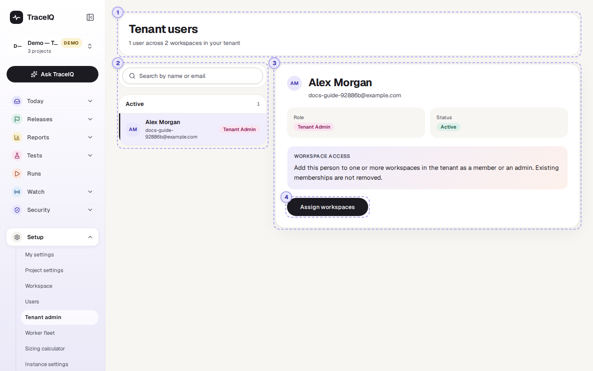
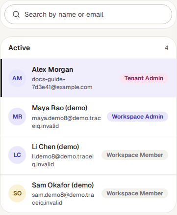
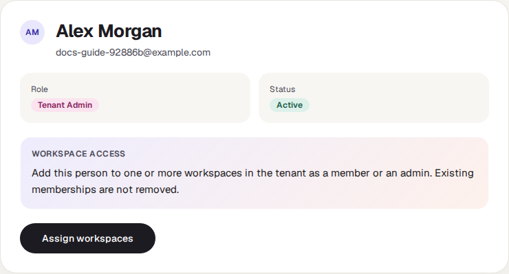
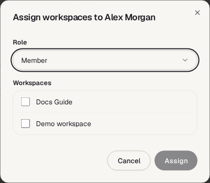

<!-- Generated from tenant-admin.html by e2e/docs-capture/export_md.py. Edit the HTML, not this file. -->

# Tenant admin

Setup · Tenant admins only

> **In short**
>
> For the administrators of your whole organisation: a list of every person in it, across all of its workspaces, with a way to add someone to several workspaces in one go.

## What it is for

Tenant admin answers **"Who is in our organisation, and how do I give someone access to several workspaces?"** In TraceIQ a *tenant* is your organisation: it holds one or more *workspaces*, and each workspace holds projects. A *tenant admin* manages the whole organisation. The person who signs up and creates the organisation becomes its first tenant admin.

> **Tenant admins**
>
> See everyone at once, spot accounts that are no longer active, and add a new starter to every workspace they need.

> **Everyone else**
>
> This page isn't in your sidebar. Ask a tenant admin, or use *Users* to see your own workspace's people.

**Where to find it:** in the sidebar, open **Setup → Tenant admin**. It is only listed for tenant admins. The page's own heading says **Tenant users**.

## A tour of the screen

The numbers on the screenshot match the sections below.

*The Tenant users page for the guide's own organisation, which has one person. Click the picture to see it larger.*

## 1. The summary line

Under the heading, for example *"1 user across 2 workspaces in your tenant"*: how many people are in the organisation, and how many workspaces it has.

## 2. The list of people

Everyone who belongs to at least one of the organisation's workspaces, plus its tenant admins, each listed once. Search by name or email. People are grouped into **Active** and **Inactive** (accounts that have been deactivated and can no longer sign in).

The label on the right is the person's **highest role** anywhere in the organisation:

| Label | What it means |
|---|---|
| Tenant Admin | Manages the whole organisation: every workspace, its people and its settings. |
| Workspace Admin | Manages at least one workspace. |
| Workspace Member | An ordinary member, who sees the projects they have been given access to. |

## 3. The selected person

Click someone in the list to see their name, email, role and status. Until you do, the first active person is shown.

## 4. Assign workspaces

Adds the selected person to one or more of the organisation's workspaces at once. Pick the **Role** (*Member* or *Admin*), tick the workspaces, and press **Assign**. They are added straight away; there is nothing for them to accept. When a ticked workspace already has them, the dialog stays open and lists what happened in each one: added, role changed (for example *Member → Admin*), unchanged, or the reason it was refused. **Done** closes it.

> **It never removes anyone**
>
> For a workspace the person already belongs to, Assign sets their role there to the one you picked, and reports it. It never takes anyone out of a workspace; to do that, use *Users*. Demoting the last admin of a workspace is refused.

## Watch it in use

[▶ Watch the video](../media/setup/tenant-admin/walkthrough.mp4)

*About 50 seconds, with a spoken commentary. The captions at the bottom show the same words, so it also works with the sound off.*

## How to…

### …give a new starter access to several workspaces

1. Make sure they have signed up, or are already in one workspace, so that they appear in the list.
2. Find them with the search box and click them.
3. Press **Assign workspaces**, choose **Member**, and tick the workspaces.
4. Press **Assign**. Then give them access to the right projects on *Workspace → Projects* or through a team.

### …check for accounts that should no longer have access

1. Read down the **Active** group for people who have left.
2. Remove them from each workspace on *Users*, or start an *Access review* to check everyone formally.

## Good to know

- **Only your organisation.** The list and the workspaces in the dialog come only from the organisations you are a tenant admin of. People in other organisations on the same server never appear.
- **Someone who is in no workspace yet** (and is not a tenant admin) doesn't appear here. Invite them on *Users* instead.
- **This page can't remove or deactivate anyone.** It only adds people to workspaces.
- **Every addition is recorded** in the audit log of the workspace concerned, as a role granted by you.
- **Not a tenant admin?** Opening the page's address directly shows "No users found.", because TraceIQ refuses to list anyone for you.

## Related pages

> **Worker fleet**
>
> The next page in this guide: the browser workers that run your tests, for instance admins.

> **Users**
>
> The people of one workspace, with invitations and removal.

> **Workspace**
>
> Teams, and access to each project.

> **Access reviews**
>
> A formal, signed-off check of who has access to what.

## Video script

What the walkthrough says, in order. The video and every picture on this page are made by the Playwright script [`setup-tenant-admin.spec.ts`](../../../../e2e/docs-capture/pages/setup-tenant-admin.spec.ts).

1. Tenant admin lists every person in your organisation, across all of its workspaces.
2. Only tenant admins, who manage the whole organisation, see this page in the sidebar.
3. The line at the top counts the people and the workspaces.
4. People are split into active and inactive. Each shows their highest role.
5. Pick someone to see their details on the right.
6. Assign workspaces adds this person to one or more workspaces, as a member or an admin.
7. Choose the role, tick the workspaces, then Assign. Nothing they already have is taken away.
8. To take someone out of a workspace, use the Users page instead.
