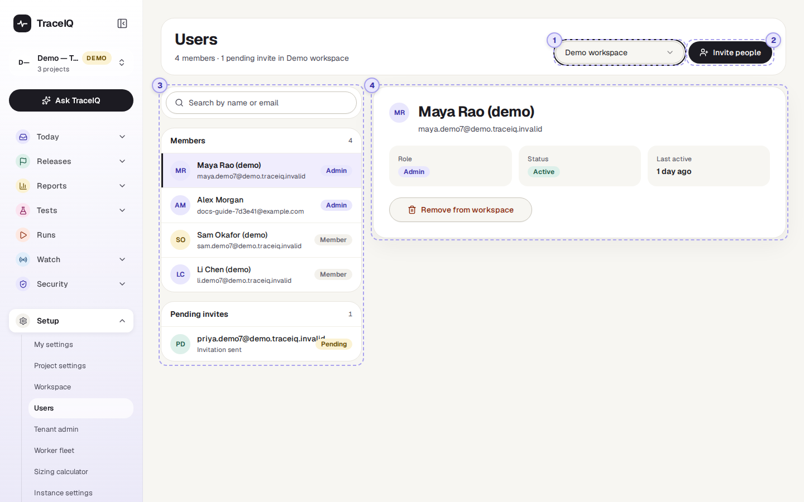
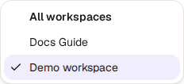
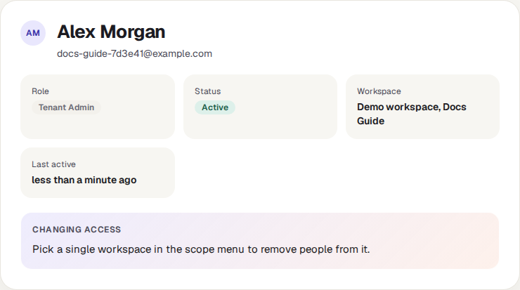
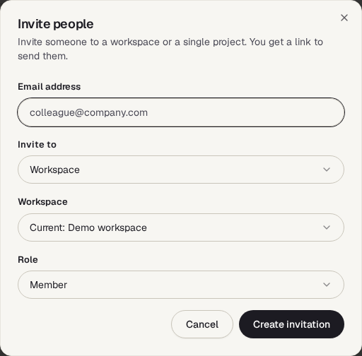
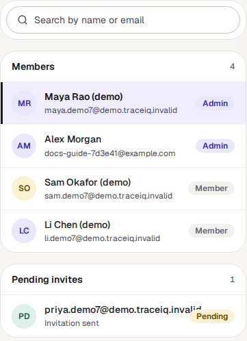
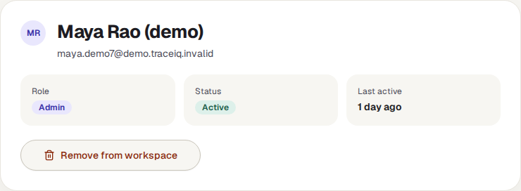

<!-- Generated from users.html by e2e/docs-capture/export_md.py. Edit the HTML, not this file. -->

# Users

Setup · Everyone in a workspace can see it · Workspace admins invite and remove

> **In short**
>
> The list of people in a workspace: their role, whether they are active, and when they last signed in. Workspace admins also invite new people here, to the whole workspace or to a single project, and remove people who should no longer have access.

## What it is for

Users answers **"Who has access, and how do I add or remove someone?"** A *workspace* is the space your team's projects live in; to work on a project, a person must first be a member of its workspace. The *Workspace* page does the same for teams and for access to each project; this page is about the people themselves.

> **Workspace admins**
>
> Bring a new colleague in, and take someone out when they leave the team.

> **Tenant admins**
>
> See everyone in the organisation at once, across all its workspaces.

> **Everyone else**
>
> Look up who else is in the workspace and who its admins are.

**Where to find it:** in the sidebar, open **Setup → Users**.

## A tour of the screen

The numbers on the screenshot match the sections below.

*The Users page for the demo workspace: four members and one pending invitation. Click the picture to see it larger.*

The line under the heading counts what is shown, for example *"4 members · 1 pending invite in Demo workspace"*.

## 1. Whose people

The menu chooses the workspace whose people are listed. If you are a *tenant admin* (an administrator of the whole organisation, see *Tenant admin*), it has one more choice, **All workspaces**, and starts there. Everyone else starts on their first workspace.

**All workspaces** lists each person in the organisation once, with their highest role anywhere in it (for example *Tenant Admin*) and the workspaces they belong to. It doesn't list pending invitations, and to remove someone you first pick a single workspace.

## 2. Invite people

Only shown to people who may manage the workspace's members (workspace admins and tenant admins). The dialog asks:

- **Email address** of the person.
- **Invite to**: the whole *Workspace*, or one *Project* (then pick the project).
- **Workspace**: the one you are looking at, another of yours, or *Create a new workspace* (only tenant admins may create one).
- **Role**: for a workspace, *Member* or *Admin*; for a project, *Project Admin*, *Editor* or *Viewer*.

| Role | What it allows |
|---|---|
| **Workspace Admin** | Everything in the workspace: every project, its people, teams and settings. |
| **Workspace Member** | Belongs to the workspace, but sees only the projects they are given access to, directly or through a team. |
| **Project Viewer** | Can look at the project's tests and results. |
| **Editor** | Can also create, change and run tests. |
| **Project Admin** | Can also manage the project's members, settings, and delete things. |

> **What "Create invitation" does**
>
> - **If the person already has a TraceIQ account** with that email, they are added straight away. Nothing to accept.
> - **If not**, TraceIQ keeps a pending invitation, listed under *Pending invites*. **No email is sent**: the dialog shows the **invitation link** with **Copy invitation link**, once, for you to send. When they sign up from it with exactly that address, they join with the role you chose.
> - A project admin who is not a workspace admin can only invite people who are already in the workspace.

## 3. The list

Type in the search box to find someone by name or email. The list has up to two groups:

- **Members**: each person, with their email and their role in this workspace on the right. Admin roles have a lavender label.
- **Pending invites**: invitations for addresses that have no account yet, marked Pending. They can't be withdrawn on this page yet.

## 4. The selected person

Click someone in the list to see them here: their **role**, their **status**, and **Last active**, which is when they last signed in ("Never" if they haven't yet).

**Remove from workspace** (admins only) takes the person out of the workspace, after you confirm, together with everything they held in it: their team memberships, access given to them directly on its projects or tests, and their API keys for this workspace, which stop working. Their account itself is kept, and so is everything they created. The removal is recorded in the audit log. TraceIQ refuses to remove the workspace's last admin.

## Watch it in use

[▶ Watch the video](../media/setup/users/walkthrough.mp4)

*About a minute, with a spoken commentary. The captions at the bottom show the same words, so it also works with the sound off.*

## How to…

### …give a new colleague access to one project

1. Ask them to sign up to TraceIQ with their work email (or do the next steps first; they join when they sign up).
2. Pick the workspace in the menu, then press **Invite people**.
3. Type their email, set **Invite to** to **Project**, and choose the project.
4. Choose **Viewer**, **Editor** or **Project Admin**, and press **Create invitation**. Send them the link it shows.

### …remove someone who has left

1. Pick the workspace in the menu and find the person with the search box.
2. Press **Remove from workspace** and confirm.
3. Open *Workspace → Projects* and remove them from each project's **Direct members**.
4. If they had API keys, those keep working until the account is deactivated or the keys are revoked: revoke them on *API keys*.

### …find out who the admins are

1. Pick the workspace.
2. Look for the lavender **Admin** labels on the right of the list.

## Good to know

- **Who you see depends on who you are.** Workspace and tenant admins see every member, the pending invitations, *Invite people* and *Remove from workspace*. Other members see only the people who have been given access to the same projects as them, one by one (access through a team doesn't count here), and nothing to change.
- **Removing is immediate and can't be undone**, but you can invite the person again; an existing account is added straight back.
- **Inviting someone who is already a member changes nothing**, not even their role. There is no button to change a workspace role in this version: remove the person and invite them again with the new role.
- **Pending invitations don't expire** for people who sign up with the invited address, whenever they do.
- **With single sign-on**, people may be added to the workspace automatically when they first sign in, depending on how your instance admin set it up.

## Related pages

> **Tenant admin**
>
> The next page in this guide: everyone in the organisation, and adding a person to several workspaces at once.

> **Workspace**
>
> Teams, and who may use each project, as viewer, editor or admin.

> **Access reviews**
>
> Regular checks that everyone still needs the access they have.

> **API keys**
>
> Keys made by a person keep working until revoked or until that person is deactivated.

## Video script

What the walkthrough says, in order. The video and every picture on this page are made by the Playwright script [`setup-users.spec.ts`](../../../../e2e/docs-capture/pages/setup-users.spec.ts).

1. Users lists the people in your workspaces, and lets admins invite or remove them.
2. The menu at the top chooses whose people you see. Tenant admins can also see all workspaces at once.
3. The line under the title counts members and pending invitations.
4. Search by name or email. Each person shows their role on the right.
5. The card on the right shows the selected person: role, status and when they last signed in.
6. Admins can remove someone from this workspace and all of its teams.
7. Invite people adds someone to a workspace, or to a single project.
8. Type their email, choose where to invite them, and their role.
