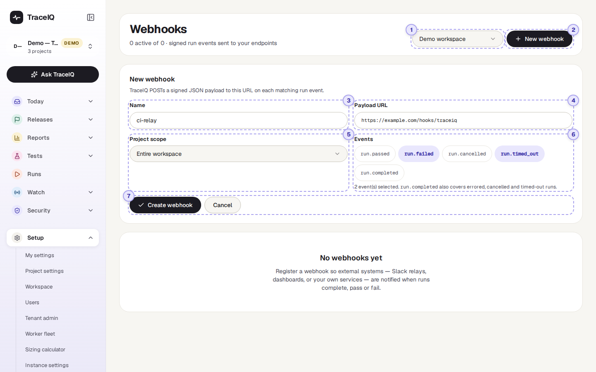
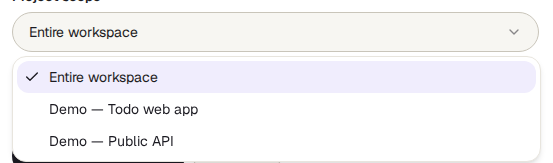
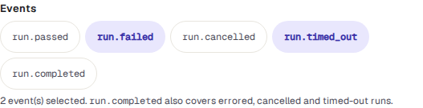

<!-- Generated from webhooks.html by e2e/docs-capture/export_md.py. Edit the HTML, not this file. -->

# Webhooks

Setup · Workspace admins only · Admins can change it

> **In short**
>
> A webhook is a message TraceIQ sends to another system the moment a test run finishes: "run 471 failed", with the details. You give TraceIQ a web address, choose which results to send, and the other system (a chat relay, a dashboard, your own service) can react straight away.

## What it is for

Webhooks answer **"How do I let another tool know about a run without anyone having to check TraceIQ?"** Instead of the other tool asking TraceIQ again and again whether something has finished, TraceIQ tells it once, as soon as it happens.

> **Developers**
>
> Let a build pipeline or a deployment tool continue, or stop, depending on whether the tests passed.

> **Team leads**
>
> Feed results into your own dashboard or chat channel through a small relay service.

> **Workspace admins**
>
> See whether each message arrived, and send one again when the receiving system was down.

**Where to find it:** in the sidebar, open **Setup → Webhooks**.

> **Two words you will see**
>
> - A **run** is one go at running tests: a whole suite (a folder of tests) or a single test.
> - A **delivery** is one message sent to one webhook. If it doesn't arrive, TraceIQ tries again, so one delivery can have several **attempts**.

## A tour of the screen

The demo workspace has no webhooks yet, so the page shows *"No webhooks yet"*. The screenshot below shows the form you get after pressing **New webhook**, filled in with example values. The numbers match the sections below. What the page looks like once webhooks exist is described after them, under [The list of webhooks](#list).

*The Webhooks page for the demo workspace, with the form open. Click the picture to see it larger.*

The line under the heading counts the webhooks, for example *"2 active of 3"*: three webhooks exist and two of them are switched on.

## 1. Workspace

Webhooks belong to a **workspace**, not to one person. If you belong to more than one workspace, this menu chooses whose webhooks you see. The page opens on the workspace of the project picked in the sidebar. If you belong to only one workspace, the menu isn't shown.

## 2. New webhook

Opens the form below the heading. Press it again, or press **Cancel**, to close the form without saving.

## 3. Name

A name for people, shown in the list, for example *ci-relay* or *Release dashboard*. It isn't sent anywhere. It is required.

## 4. Payload URL

The web address that should receive the messages. The team that runs the receiving system gives you this. It must start with `http://` or `https://`.

> **Some addresses are refused**
>
> For safety, TraceIQ checks the address when you save it and again before every message. Addresses on your own private network (such as `192.168…` or `10…`) are refused unless your administrator has allowed them for this server; addresses that lead to a cloud provider's internal services are always refused. If the address is refused, the form shows *"Webhook URL rejected"* with the reason.

## 5. Project scope

**Entire workspace** (the default) sends a message for runs in every project of the workspace, including projects added later. Choose one project to hear only about that project's runs.

## 6. Events

An **event** is the kind of result that triggers a message. Click a button to select it (it turns lavender); click again to clear it. **Select none** to receive every finished run.

| Event | Sent when |
|---|---|
| `run.passed` | The run finished and Passed. |
| `run.failed` | The run finished and Failed. |
| `run.cancelled` | Someone stopped the run before it finished (Cancelled). |
| `run.timed_out` | The run went past TraceIQ's time limit (Timed out). |
| `run.completed` | Any other ending, mainly Error (something went wrong around the tests). If you select it, you *also* get cancelled and timed-out runs. It does **not** include passed or failed runs. |

> **"Tell me when something is wrong"**
>
> Select `run.failed` and `run.completed`. Together they cover failed, error, cancelled and timed-out runs, and leave out the passes.

## 7. Create or cancel

**Create webhook** saves it, switched on. **Cancel** closes the form and nothing is saved.

Straight after you create a webhook, a box labelled Shown once appears with its **signing secret**: a long random code. The receiving system uses it to check that a message really came from your TraceIQ and wasn't changed on the way. Press **Copy secret** and pass it to whoever looks after the receiving system, then press **Done**.

> **The secret is shown only this once**
>
> TraceIQ stores the secret encrypted and never shows it again. If it is lost, delete the webhook and create a new one; the new one gets a new secret. Treat it like a password: don't paste it into a chat or a ticket.

## The list of webhooks

Once a workspace has webhooks, they are listed on the left, in up to three boxes:

| Box | What is in it |
|---|---|
| **Failing** | Switched on, but the most recent attempt did not get through. Its icon is peach. |
| **Active** | Switched on, and the last attempt got through (or nothing has been sent yet). Its icon is mint. |
| **Disabled** | Switched off. Nothing is sent to it. |

Each row shows the webhook's name, its address and, once something has been sent, the answer code of the last attempt on the right: 200 (or another code in the 200s) means it arrived, a peach code means the receiver refused it, and 0 means no answer came back at all. Click a row to show it on the right. Until you do, the first one in the first box is shown.

## The selected webhook

- **Status labels**: Active or Disabled, and, if the last attempts failed, how many in a row, for example 3 consecutive failure(s). Every attempt counts, retries included; one that gets through sets it back to zero.
- **Scope**: *Entire workspace* or the project's name. **Last delivery**: the answer code and time of the last attempt, or *Never delivered*. **Created**: when it was made.
- **Events**: the events it was set up for, or All events.
- **Verifying deliveries**: a reminder for the receiving team of how to check the signature.
- **Recent deliveries**: the delivery log (below).
- **Disable delivery** / **Enable delivery** switches it off or on without losing it. **Delete webhook** asks you to confirm, then removes it and its log for good.

### Recent deliveries

One row per attempt, newest first, up to the 50 most recent. **All** and **Failed** at the top filter the list. Each row shows:

| Part of the row | What it means |
|---|---|
| OK 200 / Failed | Whether this attempt arrived, with the receiver's answer code. A lavender pending is being sent right now. |
| Event and run | Which event it was, and a link to the run it was about. |
| attempt 2 · time · 140 ms | Which try this was (or *manual redelivery*), when, and how long the receiver took to answer. |
| Reason (peach) | Why it failed, in a few words, for example *HTTP 503*, *ConnectTimeout* or *redirect not followed (302)*. The receiver's reply itself is never stored or shown. |
| Next automatic retry | When TraceIQ will try again by itself. |
| 8 letters and **Redeliver** | The start of the delivery's ID (the same on every attempt), and a button to send it again now. |

## Watch it in use

[▶ Watch the video](../media/setup/webhooks/walkthrough.mp4)

*About a minute, with a spoken commentary. The captions at the bottom show the same words, so it also works with the sound off. The video cancels the form, so no webhook is created.*

## How to…

### …send failed runs to another system

1. Ask the team that runs the receiving system for the web address to use.
2. Press **New webhook**, type a name and paste the address into **Payload URL**.
3. Under **Project scope**, keep *Entire workspace* or choose one project.
4. Under **Events**, select `run.failed` (and `run.completed` to include errors, cancellations and time-outs).
5. Press **Create webhook**, then **Copy secret**, and hand the secret to the receiving team in a safe way.

### …find out why messages aren't arriving

1. Look in the **Failing** box and click the webhook.
2. Under **Recent deliveries**, choose **Failed** and read the reason on each row.
3. Pass the reason to the receiving team. *HTTP 4xx/5xx* means their system answered but refused; a word like *ConnectTimeout* means it didn't answer at all.
4. Once they have fixed it, press **Redeliver** on the messages they missed.

### …pause messages for a while

1. Click the webhook and press **Disable delivery**. It moves to the **Disabled** box.
2. Runs that finish while it is disabled are not sent, not even later. Press **Enable delivery** when you are ready again.

## Good to know

- **Only workspace admins can see this page.** A webhook receives every run of the workspace, and its address often contains a password of its own, so other members see *"Workspace admins only"*. Creating, switching, deleting and redelivering are recorded in the *Audit log*.
- **Failed messages are retried by themselves** after 1, 5 and 30 minutes, so up to four attempts in all. There is no retry when the receiver answers *410 Gone*, when the address is refused for safety, or for a message you redelivered by hand (press it again instead).
- **Redirects are not followed.** If the receiver answers "this has moved" (a 3xx code), the attempt counts as failed. Use the final address.
- **The receiver has 10 seconds** to answer each attempt.
- **A redelivered message is the same message.** It has the same delivery ID as before, so a receiver that already handled it can skip it. Redeliver also works on a disabled webhook, which is handy for testing a receiver before switching it back on.
- **The log keeps 30 days.** Older attempts are removed automatically. The log refreshes every 15 seconds while it is open.
- **What a message contains:** the run's number, result, suite and test names, browser and device, how many tests passed and failed, how long it took, its error message, links to its trace and video, the code version it tested (if it was given one), who or what started it, and the name, result and error of up to 100 tests.
- **The demo workspace never sends anything.** TraceIQ skips webhooks for demo data, and for the check runs it makes to try out a suggested fix (see *Proposals*).
- **The settings can't be edited.** To change a webhook's address, scope or events, create a new one and delete the old one.
- **Not the same as chat notifications.** Messages to Slack or Microsoft Teams are set up for each project in *Project settings*. Webhooks are for systems your team builds or runs.

## Related pages

> **Issue trackers**
>
> The next page in this guide: connect Jira, GitHub or iTop to file a ticket from a failed run.

> **API keys**
>
> The other direction: let another system start runs and read results in TraceIQ.

> **Project settings**
>
> Email, Slack and Teams notifications for one project.

> **Audit log**
>
> Who created, changed, deleted or redelivered a webhook, and when.

## Video script

What the walkthrough says, in order. The video and every picture on this page are made by the Playwright script [`setup-webhooks.spec.ts`](../../../../e2e/docs-capture/pages/setup-webhooks.spec.ts).

1. A webhook tells another system, straight away, when a test run has finished.
2. Webhooks belong to a workspace. Choose the workspace here.
3. This workspace has none yet. New webhook opens the form.
4. Give it a name, and the web address that should receive the message.
5. Project scope: every project in the workspace, or just one.
6. Events: pick which run results to send. Pick none to get them all.
7. After you create it, the signing secret is shown once. Copy it then.
8. We will cancel here, so nothing is saved.
9. Each webhook then appears in a list, with its recent deliveries and a switch to pause it.
