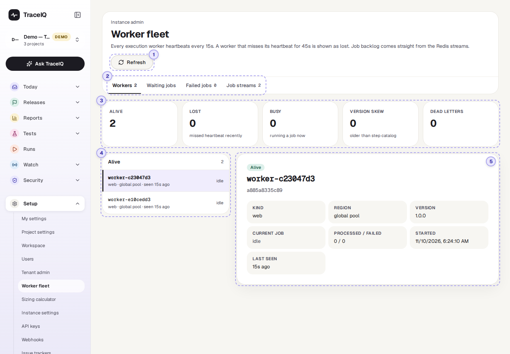
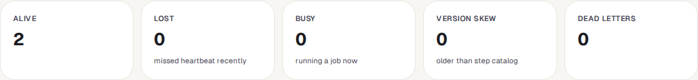
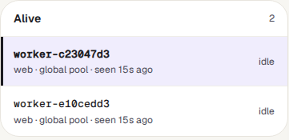
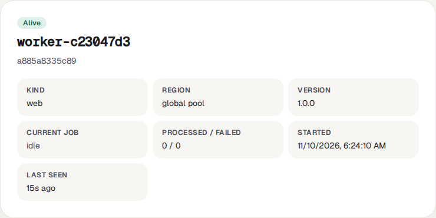
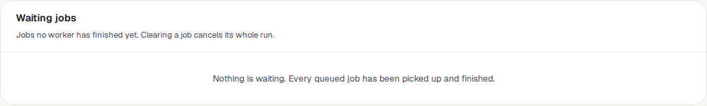
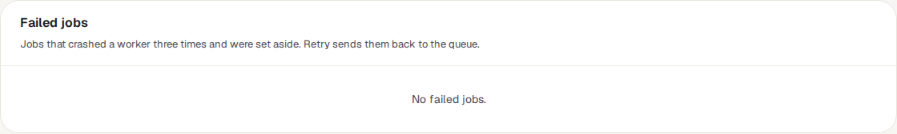
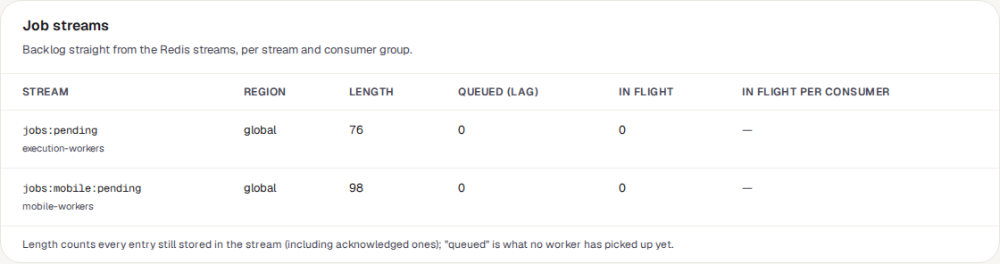

<!-- Generated from worker-fleet.html by e2e/docs-capture/export_md.py. Edit the HTML, not this file. -->

# Worker fleet

Setup · Instance admin only · Can cancel queued work

> **In short**
>
> Tests don't run inside the TraceIQ website itself: they run on separate machines called *workers*, each with its own browser. This page shows those workers, whether each one is alive, what it is doing, and which jobs are waiting for them. From here you can also cancel work that is stuck in the queue and retry jobs that failed.

## What it is for

Worker fleet answers **"Can TraceIQ run tests right now, and if not, why not?"** When runs stay *Queued* for a long time, the reason is usually here: no worker is alive, every worker is busy, or a worker is too old to run a new kind of step.

It is a page for the person who looks after the TraceIQ server (the *instance admin*). Everyone else sees "Instance admins only", because it names every machine and region in the installation.

**Where to find it:** in the sidebar, open **Setup → Worker fleet**. The sidebar shows it to organisation admins too, but only an instance admin can open it.

## A tour of the screen

Under the page's heading are four tabs; only the open tab's contents are shown. The number tiles (and any warning) stay above the tabs' contents whichever tab is open. The page opens on **Workers**. The numbers on the screenshot match the sections below.

*The Worker fleet page with two workers alive and the Workers tab open. Click the picture to see it larger.*

Under the heading, the page reminds you how it decides that a worker is alive: every worker checks in every **15 seconds**, and one that hasn't checked in for **45 seconds** is shown as lost.

## 1. Refresh

The page updates itself every 15 seconds. **Refresh** updates it straight away; its arrows turn while it loads.

## 2. Tabs

| Tab | What it shows |
|---|---|
| **Workers** | Every worker, with how many there are (parts ④ and ⑤). |
| **Waiting jobs** | Work no worker has finished yet, by run. You can cancel it here. |
| **Failed jobs** | Jobs set aside after crashing a worker, with how many there are. You can retry or discard them here. |
| **Job streams** | The queues themselves, with how many there are. |

The last three are described under [The other tabs](#other-tabs) below.

## 3. The five tiles

| Tile | What the number means |
|---|---|
| **Alive** | Workers that checked in within the last 45 seconds and can take tests. |
| **Lost** | Workers that stopped checking in: stopped, crashed or cut off. A lost worker stays on the page for **10 minutes** after its last check-in, then disappears. When there are any, the tile carries a Lost label. |
| **Busy** | Alive workers that are running a test at this moment. |
| **Version skew** | Alive workers older than the TraceIQ server: they don't know some of the step types the server offers, so tests using those steps fail on them. The fix is to update the workers. When there are any, the tile carries a Skew label. |
| **Dead letters** | Jobs that failed to run several times in a row and were set aside, so they don't block the queue. They need someone to look at them, on the **Failed jobs** tab. |

If something needs attention (a queue with no worker to serve it, workers too old, jobs set aside), a box headed **Needs attention** under the tiles says so in a sentence.

## 4. Workers

The **Workers** tab lists every worker in two groups: **Lost** first, then **Alive**, each with how many it holds. Each row shows the worker's name; its kind, region and how long ago it last checked in; and on the right Skew if it is too old, Busy if it is running a test, or else *idle* or *lost*. Click a worker to see its details on the right. When the page opens, the first worker in the list is shown.

When no worker has ever checked in, the tab says *No workers reporting* instead.

## 5. A worker's details

At the top, labels: Alive or Lost, Busy while it runs a test, and Version skew if it is too old. Then the worker's name and, under it, the machine it runs on.

| Box | What it shows |
|---|---|
| **Kind** | *web* (browser tests), *mobile* (phone app tests) or *local* (a developer's own computer). |
| **Region** | Where it runs; *global pool* means it takes work from everyone. |
| **Workspace** | Only for local workers: the workspace it belongs to. |
| **Version** | The worker's software version, and under it the first characters of the code revision it was built from, when it reports one. |
| **Current job** | The run it is working on, as a link, or *idle*. |
| **Processed / failed** | How many jobs it has finished since it started, and how many of those did not pass. A test that failed counts as failed here too, so this is not a measure of the worker's health on its own. |
| **Started**, **Last seen** | When the worker started, and how long ago it last checked in. |

A worker with version skew also lists **Step types this worker lacks**, with the advice to rebuild the worker image. "This worker did not report its step types" means it is too old to say, so TraceIQ can't tell.

## The other tabs

### Waiting jobs

*Here nothing is waiting, which is the normal state between runs.*

Every job that no worker has finished yet, grouped by the run it belongs to. The run that has been waiting longest is at the top. Click **Show jobs** under a run to see its jobs one by one (and **Hide jobs** to fold them away again): the test's name, the browser, and whether it is still *queued* or already *on* a worker (with the worker's name).

| Column | What it shows |
|---|---|
| **Run** | The run, as a link, and its status. *Background checks* collects jobs that belong to no run: site crawls, page checks and persona refreshes. |
| **Project / suite** | Where the run came from. |
| **Jobs** | How many of the run's jobs are waiting, and how many of those a worker has already taken. |
| **Oldest waiting** | How long the run's oldest job has been in the queue. |
| **Action** | **Cancel run** (or **Clear** for background checks). Asks you to confirm first. |

**Clearing a job cancels its whole run.** The run is marked *Cancelled*, its waiting jobs are removed, and it keeps the results it already has. A cancelled run counts as neither a pass nor a failure and sends no notifications. A job a worker is already running is not cut off mid-step: the worker stops before its next step. **Clear whole queue** (top right of the tab, shown when something is waiting) does the same for every run with a waiting job. Every cancel is written to the audit log.

The table lists up to 200 jobs per queue. When more are waiting, a note under the table says so; **Clear whole queue** still covers all of them.

### Failed jobs

Jobs that crashed a worker three times in a row and were set aside so they don't block the queue (the **Dead letters** tile counts them). Each row shows the run, the test, why it failed and when it was set aside.

- **Retry** puts the job back in the queue for another worker to try. **Retry all** (top right of the tab) does it for every row.
- **Discard** deletes the job for good. **Discard all** asks you to confirm first.

### Job streams

A *job stream* is a queue of work. When you start a run, TraceIQ puts one job per test on a queue, and workers take jobs from it. Browser tests and phone tests have their own queues, and each region has its own.

| Column | What it shows |
|---|---|
| **Length** | Every job still stored in the queue, *including finished ones*. A large number here is normal. |
| **Queued (lag)** | Jobs no worker has picked up yet. This is the number that means waiting. Shown in a yellow label when above zero. |
| **In flight** | Jobs a worker has taken but not finished yet. |
| **In flight per consumer** | Which worker holds those jobs, and how many each. |

## Watch it in use

[▶ Watch the video](../media/setup/worker-fleet/walkthrough.mp4)

*Under a minute, with a spoken commentary. The captions at the bottom show the same words, so it also works with the sound off.*

## How to…

### …find out why runs stay queued

1. Look at **Alive**. If it is zero, no worker is running: start the workers on the server.
2. If workers are alive, look at **Busy**. If every alive worker is busy, runs are waiting their turn; more workers would help.
3. Open the **Job streams** tab and find the queue whose **Queued** number is in a yellow label. If the **Needs attention** box says no live worker serves it (for example a region with no worker), start a worker for that region.
4. Open the **Waiting jobs** tab to see which runs are holding the queue up.

### …get rid of a run that is stuck in the queue

1. Open the **Waiting jobs** tab and find the run. **Show jobs** lists its jobs if you want to check them first.
2. Click **Cancel run**, then confirm. The run shows as *Cancelled* and its jobs leave the queue.
3. To empty the queue completely, click **Clear whole queue** (top right of the tab) instead. Every run with a waiting job is cancelled.

### …retry jobs that were set aside

1. Open the **Failed jobs** tab and read *Why it failed*. If the cause is fixed (for example a worker that kept crashing was replaced), click **Retry**.
2. If the job is not worth running again, click **Discard**.

### …check that an update reached every worker

1. Look at the **Version skew** tile. It should be zero.
2. On the **Workers** tab, no worker should carry a yellow **Skew** label. Click a worker to see its **Version**.

## Good to know

- **It updates by itself** every 15 seconds. **Refresh**, under the heading, updates it straight away.
- **Lost isn't always bad.** A worker that was stopped on purpose, or replaced by a new one, shows under **Lost** for 10 minutes and then leaves the list.
- **Workers are added on the server, not here.** Starting, stopping or adding workers is done by whoever runs your TraceIQ server.
- **Cancelling can't be undone.** To run the tests again, start a new run.
- **Local workers** (on a developer's computer) appear here while they are running, with their workspace shown in their details.

## Related pages

> **Sizing calculator**
>
> The next page in this guide: how many workers you need for the tests you run.

> **Instance settings**
>
> Server-wide settings, including the ones every worker picks up.

> **Runs**
>
> Every run, including the ones still queued.

## Video script

What the walkthrough says, in order. The video and every picture on this page are made by the Playwright script [`setup-worker-fleet.spec.ts`](../../../../e2e/docs-capture/pages/setup-worker-fleet.spec.ts).

1. Worker fleet shows the machines that run your tests, and the work waiting for them.
2. Alive counts the workers that checked in during the last forty-five seconds.
3. Lost workers stopped checking in. Busy ones are running a test right now.
4. Dead letters are tests that failed to run several times and were set aside.
5. The Workers tab lists every worker. Click one to see its version, current job, and how many jobs it has done.
6. Waiting jobs lists every run with work in the queue. Cancel run clears its jobs and cancels the run.
7. Failed jobs were set aside after crashing three times. You can retry them or discard them.
8. Job streams are the queues. Queued means waiting for a worker; in flight means being run.
9. The page refreshes itself every fifteen seconds.
