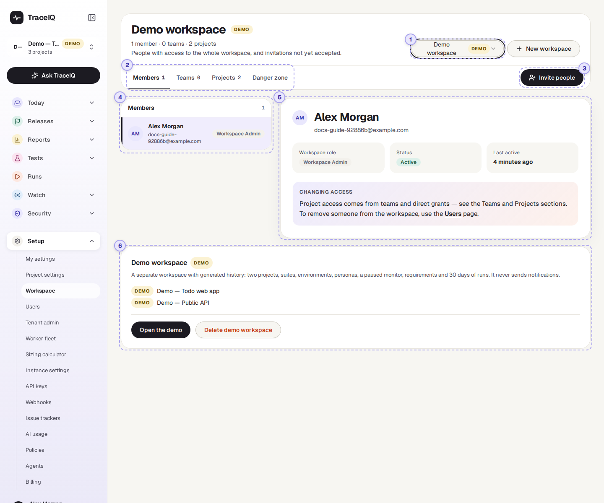
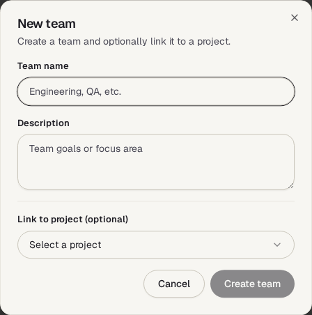
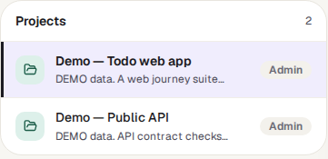
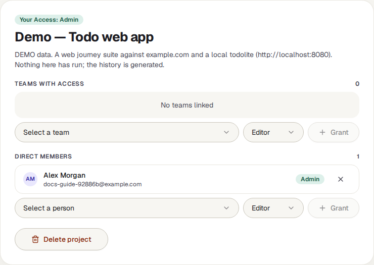
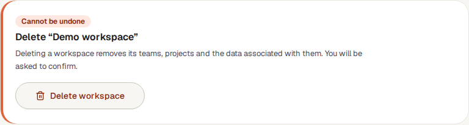
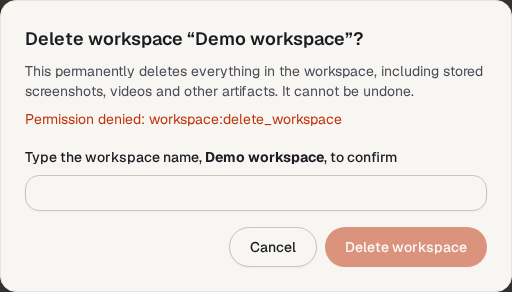
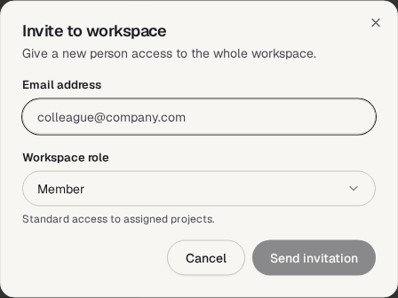
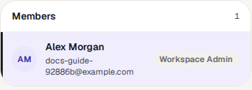
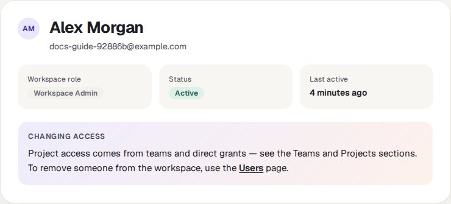
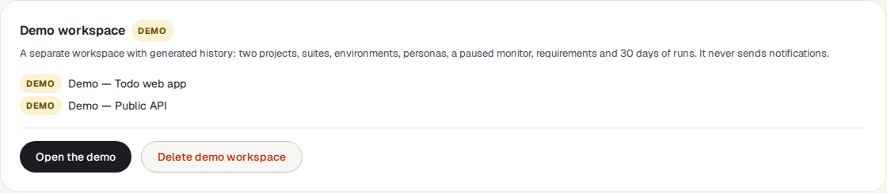

<!-- Generated from workspace.html by e2e/docs-capture/export_md.py. Edit the HTML, not this file. -->

# Workspace

Setup · Every member of the workspace can see it · Admins make most changes

> **In short**
>
> The place where a workspace is organised: who is in it, which teams it has, which projects it holds, and who may use each project. It is also where new projects and teams are made.

## What it is for

Workspace answers **"Who can work on which project?"** A *workspace* is your team's shared space; it holds *projects* (one per application you test), and its *members* are the people allowed in. Being a member is not enough to see a project: a person also needs access to it, either given to them directly, or through a *team* (a named group of people, such as "QA" or "Payments developers").

> **Workspace admins**
>
> Make teams, link them to projects, and decide who is a viewer, editor or admin of each project.

> **Project admins**
>
> Give people and teams access to their own project.

> **Everyone**
>
> Check which teams you are in and what access you have to each project; create a new project.

**Where to find it:** in the sidebar, open **Setup → Workspace**. The page's heading is the name of the workspace you are looking at, for example **Demo workspace**.

## A tour of the screen

The numbers on the screenshot match the sections below. The page opens on your first workspace; the picture shows the demo workspace, picked in the menu.

*The Workspace page for the demo workspace, on the Members tab. Click the picture to see it larger.*

Under the heading, a line counts the workspace's members, teams and projects, and says what the current tab is for.

## 1. Workspace menu

If you belong to more than one workspace, choose which one the page shows. Demo workspaces carry a DEMO label. Next to it, **New workspace** makes another workspace with a name and an optional description; only tenant admins (administrators of the whole organisation) may do this, and anyone else is refused.

## 2. The tabs

Four tabs, each with a count. The page opens on **Members**.

### Members

Everyone in the workspace, with their workspace role, and invitations not yet accepted (shown only to admins). This is a read-only view: invite people with the button (③), and remove them on the *Users* page.

### Teams

A team gives several people the same access to a project at once, and new members of the team get that access automatically. The demo workspace has no teams yet, so the tab says "No teams created yet". Once there are teams, pick one to see its members and three buttons:

- **Add member**: add someone already in the workspace, or type an email. Someone with an account is added at once; for an address with no account, TraceIQ keeps an invitation and adds them when they sign up.
- **Link project**: give the whole team access to a project, as viewer, editor or admin.
- **Delete team**, after you confirm. The people stay in the workspace, but lose any access they had only through this team.

The **×** next to a member takes them out of the team at once, without asking. Making, changing and deleting teams needs a workspace admin; the one exception is that anyone may take themselves out of a team.

### Projects

The workspace's projects that you can see, each with your own access level. Pick one to see who can use it:

- **Teams with access**: the teams linked to this project and their level.
- **Direct members**: people given access one by one.
- Under each list, pick a team or a person, choose **Viewer**, **Editor** or **Admin**, and press **Grant**. The **×** removes access at once, without asking.
- **Delete project** deletes the project with all its suites, tests and runs, after you confirm. It can't be undone.

| Level | What the person or team can do in the project |
|---|---|
| **Viewer** | Look at tests, runs and reports. |
| **Editor** | Also create, change and run tests. |
| **Admin** | Also manage who has access, change the project's settings, and delete things. |

Granting and removing access needs a workspace admin or an admin of that project. Workspace admins can use every project in the workspace without being listed.

### Danger zone

**Delete workspace** deletes the whole workspace: every team, project, test, run and stored file in it. TraceIQ first shows what would be removed, then asks you to type the workspace's exact name. The audit history is kept.

> **Deleting a workspace is refused in this version**
>
> The server currently refuses this for everyone, admins included: the dialog shows "Permission denied: workspace:delete_workspace" where the list of what would be removed should be. A demo workspace can still be removed with **Delete demo workspace** on its own card (⑥).

## 3. The tab's button

The button on the right of the tabs changes with the tab:

- **Invite people** (Members): an email address and a workspace role, *Member* or *Admin*. Someone who already has an account is added at once. For a new address, TraceIQ keeps a pending invitation; no email is sent in this version, so tell the person, and they join when they sign up with exactly that address. Needs a workspace admin.
- **New team** (Teams): a name, a description, and optionally a first project to link it to.
- **New project** (Projects): a name and a description. Any member of the workspace can create one, and becomes its admin.

## 4. The list

The people, teams or projects of the current tab. Click one to see it on the right.

## 5. The details

For a person: their workspace role, status and when they last signed in, with a reminder that project access comes from teams and direct grants. For a team or a project: the members and controls described under ②.

## 6. Demo workspace

Always at the bottom of the page. A demo workspace is a separate workspace filled with made-up sample data (two projects and 30 days of test history), for trying TraceIQ out. Nothing in it really runs, and it never sends emails or messages.

- **Create demo workspace**: makes yours. Each person can have one.
- **Open the demo**: switches the sidebar to the demo's first project.
- **Delete demo workspace**: removes it and everything you added to it, after you confirm. Your real workspaces are not touched.

## Watch it in use

[▶ Watch the video](../media/setup/workspace/walkthrough.mp4)

*About a minute, with a spoken commentary. The captions at the bottom show the same words, so it also works with the sound off.*

## How to…

### …give a group of people access to a project

1. On **Teams**, press **New team**, name it, and choose the project and level under **Link to project**. Press **Create team**.
2. Pick the team and press **Add member**, then **Add** next to each person.
3. Everyone in the team can now use the project at that level.

### …give one person access to a project

1. Make sure they are a member of the workspace (see *Users*).
2. On **Projects**, pick the project.
3. Under **Direct members**, choose the person and a level, and press **Grant**.

### …check what access someone has

1. On **Projects**, pick each project in turn and look at **Teams with access** and **Direct members**.
2. On **Teams**, check which teams the person is in.
3. For a formal check of everyone at once, use *Access reviews*.

## Good to know

- **Removing a person is on Users, not here.** And removing someone from the workspace does not remove access given to them directly on a project: remove them from *Direct members* too.
- **Many changes save at once, without asking.** Grant, the × buttons and Add take effect immediately. Only deletions ask you to confirm.
- **Someone in two teams** linked to the same project, or with a direct grant as well, gets the highest of those levels.
- **A team can only be linked to projects of its own workspace.**
- **Members who aren't admins** see a shorter Members list (only the people given access to the same projects as them), no pending invitations, and get "Permission denied" if they try an admin-only change.

## Related pages

> **Users**
>
> The next page in this guide: invite people to a workspace or one project, and remove them.

> **Project settings**
>
> Notifications, data capture and the other rules of a single project.

> **Tenant admin**
>
> Everyone in the organisation, across all its workspaces.

> **Access reviews**
>
> A signed-off check that everyone still needs their access.

## Video script

What the walkthrough says, in order. The video and every picture on this page are made by the Playwright script [`setup-workspace.spec.ts`](../../../../e2e/docs-capture/pages/setup-workspace.spec.ts).

1. A workspace holds your projects and the people who work on them.
2. If you belong to several workspaces, pick one here.
3. The line under the name counts its members, teams and projects.
4. Members: everyone in the workspace, with their role. Click a person to see their details.
5. Workspace admins invite people with Invite people.
6. Teams group people, so a whole team can be given access to a project at once.
7. Projects: choose one to see who can use it.
8. Access comes from teams, or from a direct grant to one person: viewer, editor or admin.
9. The danger zone deletes the whole workspace. It asks you to type its name first.
