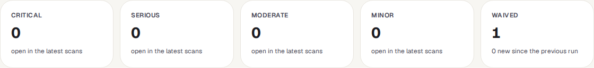
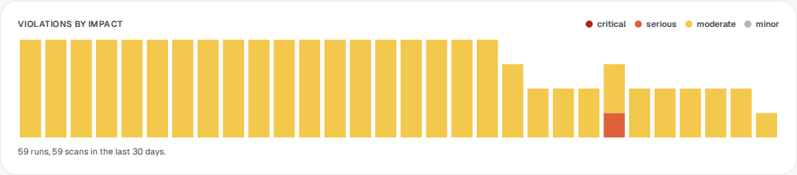
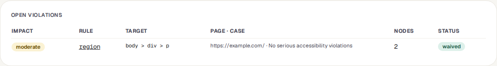
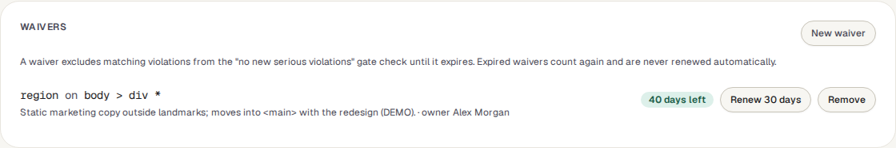

<!-- Generated from accessibility.html by e2e/docs-capture/export_md.py. Edit the HTML, not this file. -->

# Accessibility

Tests · Everyone with access to the project can see it · Editors manage waivers

> **In short**
>
> A register of every accessibility problem your tests have found: how serious it is, where on the page, whether it is new, and how the numbers move from day to day. Known problems you can't fix yet can be set aside for a limited time with a waiver.

## What it is for

An **accessibility problem** is something that makes a page hard or impossible to use for some people, for example text with too little contrast, a button a screen reader can't name, or a form field without a label. Tests find them with a **check-accessibility** step, which runs the widely used *axe* checker on the page. This page answers **"Are we getting better or worse, and what is new?"**

> **Testers**
>
> See what the latest runs found, and which problems appeared since the run before.

> **Developers**
>
> Get the rule, the element and a link to the explanation of how to fix it.

> **Leads**
>
> Watch the trend, and keep accepted problems on a deadline instead of ignoring them.

**Where to find it:** in the sidebar, open **Tests → Accessibility**. It shows the project selected at the top of the sidebar.

## A tour of the screen

The demo's web project runs an accessibility check on its landing page in every run, so the page shows a month of results. The numbers on the screenshot match the sections below.

*The Accessibility page for the demo's web project. Click the picture to see it larger.*

## 1. Window

How far back to look: the last 7, 30 (shown first), 90 or 180 days of runs.

## 2. The numbers and charts

- **Five number tiles**: how many *critical*, *serious*, *moderate* and *minor* problems are open in the latest scans, and how many are *waived* (with how many are new since the run before). A waived problem counts under Waived, not under its impact.
- **Violations by impact**: a bar per day, stacked by how serious the problems were, with the number of runs and scans it is based on.
- **New per day** and **Fixed per day**: problems that appeared, and problems that went away, compared with the previous run of the same test.

*In the demo, one run found a serious problem (orange) as well as the usual moderate ones; the next run no longer had it.*

Until a test with a *check-accessibility* step has run in the window, this part of the page only says *"No accessibility scans yet"*.

| Impact | What it means |
|---|---|
| critical | Blocks some people from using the page at all. |
| serious | Makes the page very hard to use for some people. |
| moderate | Gets in the way, but there is usually a way round it. |
| minor | A small annoyance. |

## 3. Open violations

The problems in the latest scan of each test. Each row shows the impact, the **rule** (click it for the axe explanation of what is wrong and how to fix it), the **target** (the selector of the element, see *Suites*), the page and test, the number of matching elements ("nodes"), and its status: new if the previous scan of that test didn't have it, waived if a waiver covers it, otherwise a **Waive** button that opens the waiver form already filled in for that rule and element.

## 4. Waivers

A **waiver** says "we know about this problem and accept it until a set date". While it lasts, matching problems are shown as waived and don't count against the *quality gate* (see Good to know).

**New waiver** opens the form. Once there are scans it opens above the Open violations table; before the first scan, inside the Waivers box.

| Field | What to fill in |
|---|---|
| **Rule** | The axe rule name, for example `color-contrast`. |
| **Selector pattern** | Which elements it covers. `*` matches anything, so `*` alone covers the rule everywhere and `#footer *` only inside the footer. |
| **Reason** | Required: why it is accepted for now, for example "Vendor widget, fix scheduled". |
| **Length** | 1 to 90 days (default 30). |
| **Owner** | Who is responsible for getting it fixed. You, unless you pick someone else. |

Each waiver in the list shows its rule and pattern, the reason, the owner, and how many days are left. **Renew 30 days** extends it, **Remove** ends it straight away.

## Watch it in use

[▶ Watch the video](../media/tests/accessibility/walkthrough.mp4)

*About 40 seconds, with a spoken commentary. The captions at the bottom show the same words, so it also works with the sound off.*

## How to…

### …start checking a page for accessibility

1. Open a test that visits the page (**Tests → Suites**) and press **Edit steps**.
2. After the step that opens the page, add a **check-accessibility** step, and save.
3. Run the test. Its results appear on this page.

### …set a known problem aside

1. In **Open violations**, press **Waive** on its row. The rule and element are filled in.
2. Write the reason, choose how many days, pick an owner, and press **Add waiver**.
3. Before it runs out, either fix the problem or press **Renew 30 days**, if there is still a good reason.

## Good to know

- **Who can do what.** Anyone with access to the project can see the register and the waivers. Adding, renewing and removing waivers needs the *editor* role. Every waiver change is recorded in the audit log.
- **Waivers always run out.** An expired waiver says "Expired — counts again", and its problems count again. TraceIQ never renews one by itself.
- **No page text is stored.** Only the rule, impact, element selector and count are kept, and selectors are trimmed so that values such as web addresses inside them are removed.
- **"New" compares like with like**: the same test, browser and device, in the previous run. The first scan in the window has nothing to compare with, so its problems aren't marked new here.
- **The quality gate can block on new problems.** On the *Quality gate* page, the rule "No new accessibility violations at serious or above" fails when a run finds a serious or critical problem that wasn't there in the previous comparable run and isn't waived. If a test has never been scanned before, everything it finds counts as new, so waive known problems first.
- **Days are UTC days** in the charts.

## Related pages

> **Import Playwright**
>
> The next page in this guide: bring in tests written in Playwright code.

> **Quality gate**
>
> Switch on the rule that blocks a release on new serious accessibility problems.

> **Suites**
>
> Add the check-accessibility step to a test.

> **Frontend quality**
>
> Storybook tests that include an accessibility check per component.

## Video script

What the walkthrough says, in order. The video and every picture on this page are made by the Playwright script [`tests-accessibility.spec.ts`](../../../../e2e/docs-capture/pages/tests-accessibility.spec.ts).

1. Accessibility collects every problem the accessibility checks in your tests have found.
2. A problem is something that makes the page hard to use, for example with a screen reader.
3. The tiles count the open problems in the latest scans, by how serious they are.
4. The window chooses how many days of scans to look at.
5. Open violations lists each problem: its rule, the element, and the test that found it.
6. This one is waived: set aside for a limited time, so it doesn’t block a release.
7. A waiver lasts up to ninety days. New waiver adds one.
8. It names the rule, which elements it covers, a reason, how long, and an owner.
9. Cancel closes the form without adding anything.
