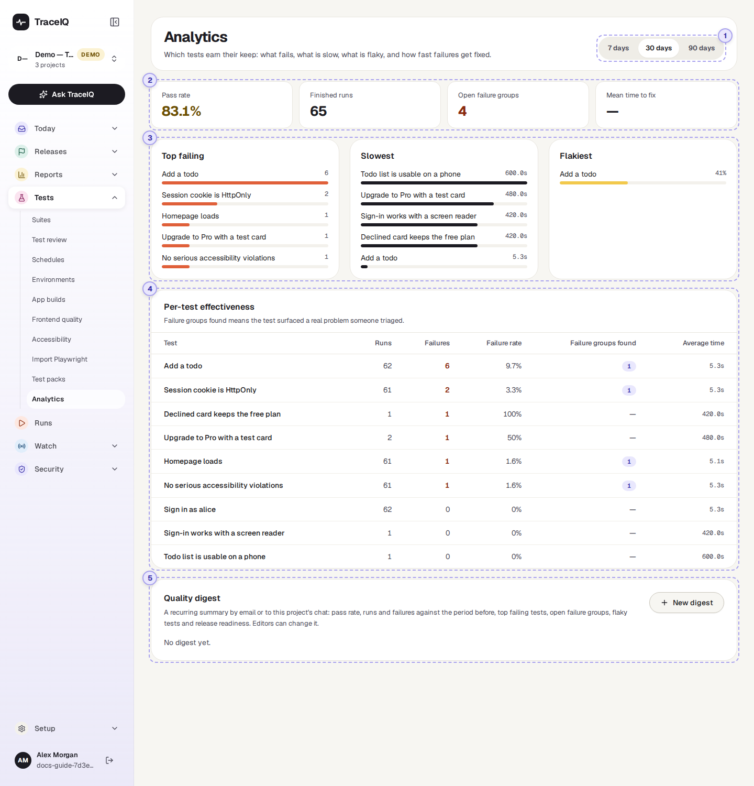
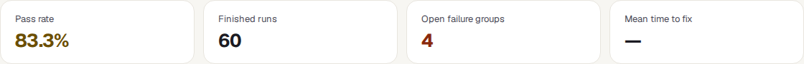
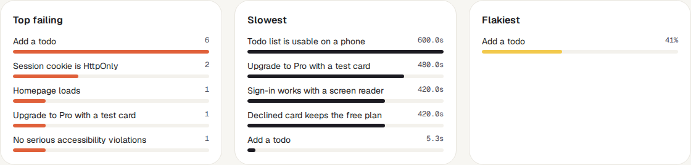
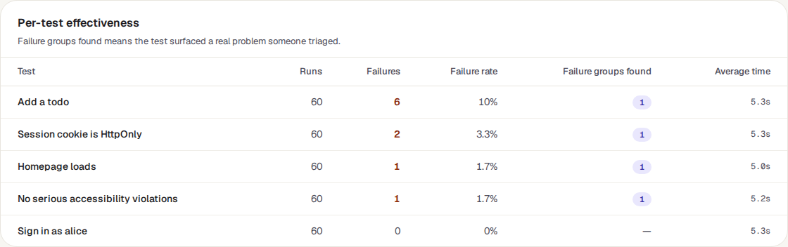
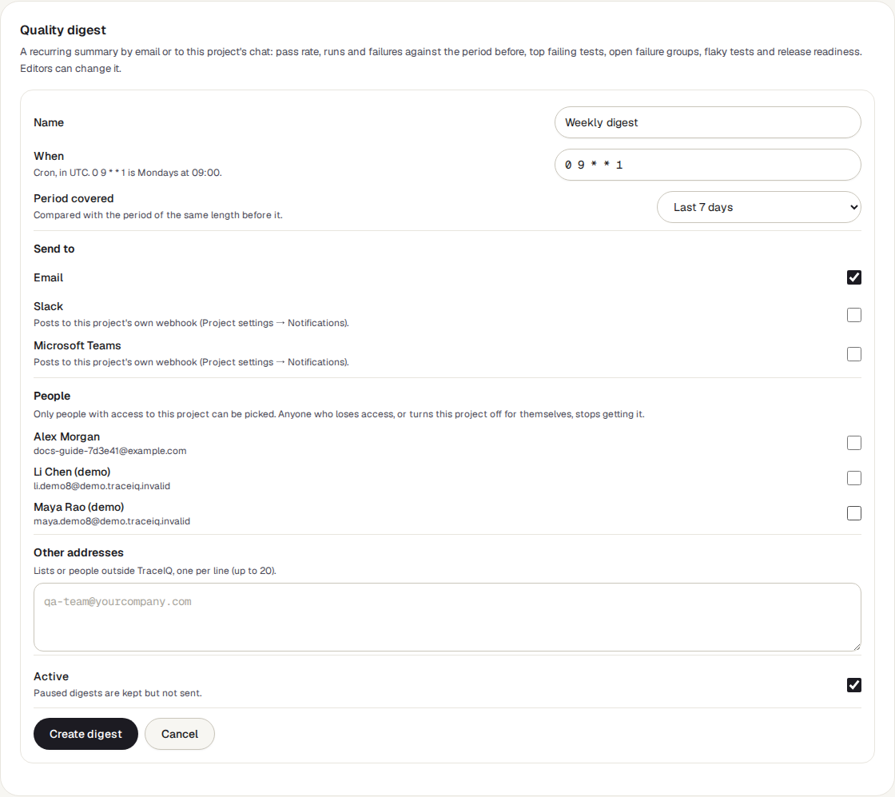

<!-- Generated from analytics.html by e2e/docs-capture/export_md.py. Edit the HTML, not this file. -->

# Analytics

Tests · Everyone with access to the project can see it · Editors manage digests

> **In short**
>
> How one project's tests have done over the last 7, 30 or 90 days: the pass rate, how many problems are still open and how fast they get fixed, and which tests fail most, run slowest or are the least reliable.

## What it is for

*Overview* tells you how things are today. Analytics answers **"Which tests earn their keep?"**: a test that fails a lot may be catching real bugs, or may be badly written; a slow test holds every run up; a flaky one makes people stop trusting the results. This page shows where to spend effort.

> **Testers**
>
> Find the tests worth repairing, speeding up or retiring.

> **Developers**
>
> See which areas of the app break most often.

> **Leads**
>
> Follow the pass rate and the time to fix, and get them by email every week.

**Where to find it:** in the sidebar, open **Tests → Analytics**. It shows the project selected at the top of the sidebar.

## A tour of the screen

The page has five parts. The numbers on the screenshot match the sections below.

*The Analytics page for the demo's web project, over 30 days. Click the picture to see it larger.*

## 1. Time window

**7 days**, **30 days** (shown first) or **90 days**, counted back from this moment. Everything below is recounted when you switch, except where the sections below say otherwise.

## 2. The four tiles

| Tile | What the number means |
|---|---|
| **Pass rate** | Of the runs in the window that finished with a verdict (passed, failed or error), the share that passed. It turns yellow below 90% and orange below 60%. With no finished runs it shows 0%. |
| **Finished runs** | How many runs that is. |
| **Open failure groups** | How many problems on the *Failure triage* page are still *Open*, whenever they appeared. This tile ignores the time window. |
| **Mean time to fix** | For problems marked *Resolved* during the window: the average number of hours from when each was first seen to when it was resolved. "—" when none was resolved. |

## 3. Top failing, Slowest, Flakiest

The five highest tests in each list, with a bar that compares them with the top one.

- **Top failing**: how many times each test ended *Failed* or *Error* in the window.
- **Slowest**: the average time one run of the test takes, in the window.
- **Flakiest**: each test's flakiness score, the chance that it fails without anything having changed (see *Flaky tests*). This list comes from TraceIQ's flakiness records and does *not* follow the time window.

## 4. Per-test effectiveness

| Column | What it means |
|---|---|
| **Runs** | How many times the test ran in the window (a suite run with the test in it counts once per browser and device). |
| **Failures**, **Failure rate** | How many of those ended *Failed* or *Error*, and what share that is. |
| **Failure groups found** | How many different problems on *Failure triage* this test's failures belong to. A test that surfaced a real problem someone triaged earns its keep. |
| **Average time** | How long one run of the test takes on average. |

The tests with the most failures come first; up to 50 tests are listed.

## 5. Quality digest

A **digest** is a summary sent on a timer, by email or to the project's chat channel: the pass rate, runs and failures compared with the period before, the top failing tests, open failure groups, flaky tests and release readiness. **New digest** opens the form:

- **When**: a cron expression in UTC (see *Schedules*); `0 9 * * 1` is Mondays at 09:00 UTC.
- **Period covered**: the last 7, 14 or 30 days, compared with the same length of time before it.
- **Send to**: *Email*, and/or *Slack* or *Microsoft Teams*, which post to the chat link set in this project's notification settings.
- **People**: project members to email. Anyone who loses access, or switches this project's emails off for themselves, stops receiving it. **Other addresses**: up to 20 more email addresses.

Saved digests are listed with their timing, channels and recipients, when one was last sent and what happened, and the buttons **Send now**, **Edit** and remove.

## Watch it in use

[▶ Watch the video](../media/tests/analytics/walkthrough.mp4)

*About 50 seconds, with a spoken commentary. The captions at the bottom show the same words, so it also works with the sound off.*

## How to…

### …find the tests worth fixing first

1. Choose **30 days**.
2. In **Per-test effectiveness**, look at the top rows: many failures but *0* failure groups found usually means a badly behaved test; failures with failure groups mean real problems.
3. Check **Flakiest**: a test there wastes everyone's time even when the app is fine. Open it on the *Flaky tests* page.

### …speed up the suite

1. Look at **Slowest**.
2. Open the slowest test (**Tests → Suites**) and look for long waits or steps that repeat what another test already does.

### …get this summary every Monday

1. In **Quality digest**, press **New digest**. The defaults are already "Mondays at 09:00 UTC, last 7 days, by email".
2. Tick the people who should get it, and add any other addresses.
3. Press **Create digest**. Use **Send now** once to see what it looks like.

## Good to know

- **Who can do what.** Anyone with access to the project can see the page. Creating, changing, sending and removing digests needs the *editor* role.
- **Tests are counted by name.** Two tests with the same name in different suites are added together in the lists and the table.
- **What is left out.** Runs that are cancelled, timed out, queued or still running have no verdict and don't count towards the pass rate. Re-runs that TraceIQ makes only to check a suggested fix (see *Proposals*) are left out everywhere.
- **One project at a time.** Switch project at the top of the sidebar.
- **The demo never sends digests**: emails and chat messages are switched off for demo projects.
- **It doesn't update by itself**, but it does refresh when you come back to its browser tab.

## Related pages

> **Overview**
>
> How testing is going today, across all your projects.

> **Failure triage**
>
> The failure groups counted here, one problem at a time.

> **Flaky tests**
>
> The scores behind the Flakiest list, and quarantine.

> **Executive summary**
>
> A shorter summary for leadership, which can be shared as a link.

## Video script

What the walkthrough says, in order. The video and every picture on this page are made by the Playwright script [`tests-analytics.spec.ts`](../../../../e2e/docs-capture/pages/tests-analytics.spec.ts).

1. Analytics shows how one project’s tests have done over a period of time.
2. Choose the last 7, 30 or 90 days here.
3. Pass rate is the share of finished runs that passed in that period.
4. Open failure groups counts the problems still waiting on the Failure triage page.
5. Below: the tests that fail most, the slowest, and the flakiest.
6. The table gives every test’s runs, failures, failure rate and average time.
7. Switching to 7 days recounts everything for the last week only.
8. At the bottom, a quality digest can send this summary by email on a timer.
