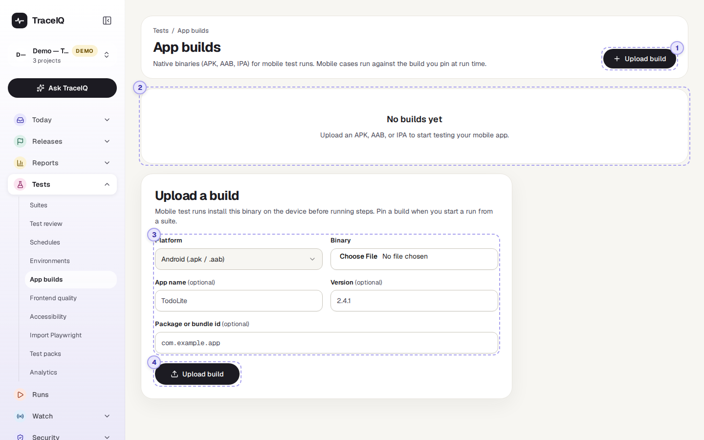
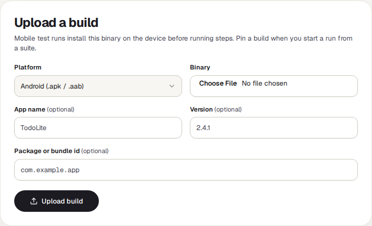

<!-- Generated from app-builds.html by e2e/docs-capture/export_md.py. Edit the HTML, not this file. -->

# App builds

Tests · Everyone with access to the project can see it · Editors can upload and delete

> **In short**
>
> Mobile tests run your real app on a phone (or a phone simulator). This page keeps the app files they install: you upload a version of your Android or iOS app once, then pick it when you start a run.

## What it is for

A web test opens a web address; a mobile test has to install the app first. Each file you upload here is a **build**: one version of the app, such as "TodoLite 2.4.1 for Android". Keeping the builds in TraceIQ answers **"Which version of the app was this run testing?"** and lets you test a new version before it goes to the app stores.

> **Testers**
>
> Upload the release candidate and run the mobile suite against it.

> **Developers**
>
> Check that a fix works in the real app, on the device the tests use.

> **Release managers**
>
> Keep every candidate version in one place, with its version number and upload date.

**Where to find it:** in the sidebar, open **Tests → App builds**. It shows the project selected at the top of the sidebar.

## A tour of the screen

The demo has no app builds, so the screenshot shows the page as it first appears in a project: a note that there are no builds, and the upload form. The numbers match the sections below.

*The App builds page in a project without builds. Click the picture to see it larger.*

## 1. Upload build

The button at the top right opens the upload form on the right of the page. When a project has no builds yet, the form is already open below the note.

## 2. The list of builds

While there are none, this place says *"No builds yet"*. Once you have uploaded builds, it becomes a list, boxed into **Android** and **iOS**. Each row shows the app's name, its version, when it was uploaded and the file size. Click a row to see the build on the right:

- **Version**, **Size** and **Uploaded** (in your own time zone).
- **Package or bundle id**: the app's unique name on the phone, such as `com.example.app`.
- **Download binary** downloads the exact file that was uploaded. The download link it opens works for one hour.
- **Delete build**, after asking. The file is removed. Runs that were set to use this build no longer get an app to install.

## 3. The upload form

| Field | What to fill in |
|---|---|
| **Platform** | *Android* takes an `.apk` or `.aab` file, *iOS* an `.ipa` file. A file whose ending doesn't match the platform is refused. |
| **Binary** | The app file itself, as your developers or build system produce it. |
| **App name** | Optional. Without it, the file name is used (without its ending). |
| **Version** | Optional, for example `2.4.1`. TraceIQ doesn't read it from the file, so type the version you want to see in the list. |
| **Package or bundle id** | Optional. The app's unique name on the phone. |

## 4. Uploading

**Upload build** sends the file to TraceIQ's file storage; a large app can take a while. When it is done, the build appears in the list and is selected.

## Watch it in use

[▶ Watch the video](../media/tests/app-builds/walkthrough.mp4)

*About 40 seconds, with a spoken commentary. The captions at the bottom show the same words, so it also works with the sound off.*

## How to…

### …test a new version of the app

1. Press **Upload build**, choose the platform and the file, and type the version number.
2. Press **Upload build** in the form and wait for it to appear in the list.
3. Open the mobile suite (**Tests → Suites**). Next to **Run suite**, a menu now offers the project's builds: choose the new one.
4. Press **Run suite**. The build is installed on the device before the tests start.

### …get a copy of a build

1. Click the build in the list.
2. Press **Download binary**. The file opens in a new tab and downloads; the link stops working after an hour, so press the button again later rather than sharing the link.

## Good to know

- **Who can do what.** Anyone with access to the project can see and download builds. Uploading and deleting needs the *editor* role.
- **The build menu on a suite** only appears once the project has at least one build. It holds "No app build (web)" plus every build, and the choice applies to runs started from that page.
- **Mobile tests need a phone to run on.** Your TraceIQ administrator has to set up the mobile test machine (an Android emulator or a device cloud). iOS apps run on a device cloud only.
- **Builds belong to one project.** To use the same app in another project, upload it there too.

## Related pages

> **Frontend quality**
>
> The next page in this guide: broken links, page speed and fragile selectors on your website.

> **Suites**
>
> Where you pick a build next to Run suite.

> **Environments**
>
> The addresses and secrets tests use, for web and mobile alike.

> **Runs**
>
> The result of every mobile run, with screenshots and a screen recording.

## Video script

What the walkthrough says, in order. The video and every picture on this page are made by the Playwright script [`tests-app-builds.spec.ts`](../../../../e2e/docs-capture/pages/tests-app-builds.spec.ts).

1. App builds keeps the files of your mobile app, for tests that run on a phone.
2. This project has none yet, so the page starts with the upload form.
3. First choose Android or iOS. Android takes an A P K or A A B file. iOS takes an I P A file.
4. The name, version and package id are optional. They help you tell builds apart.
5. Upload build stores the file. Each build then appears in a list, grouped by platform.
6. When you run a suite, you pick the build to install on the device.
