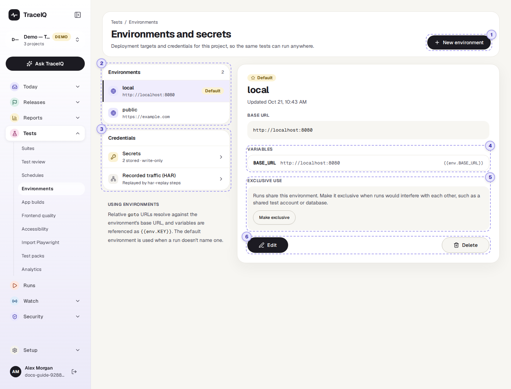
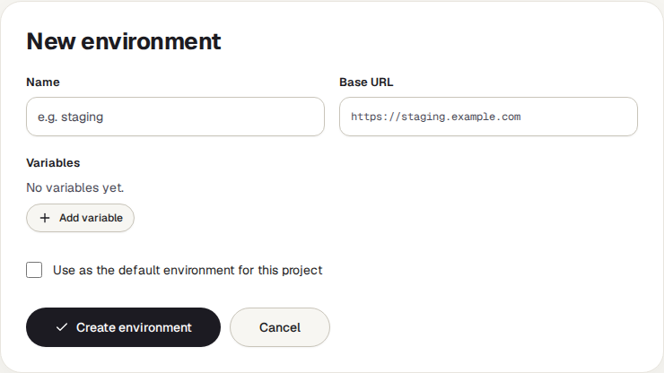
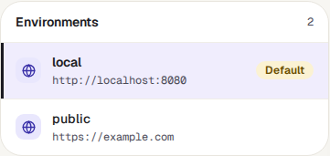
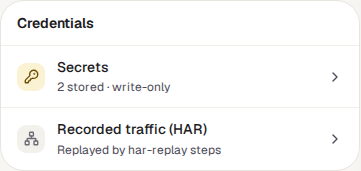
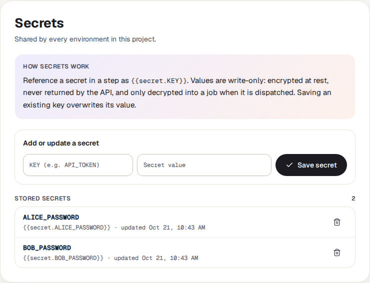
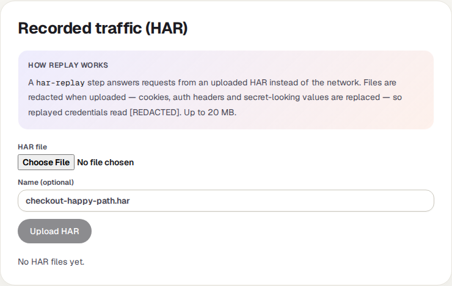
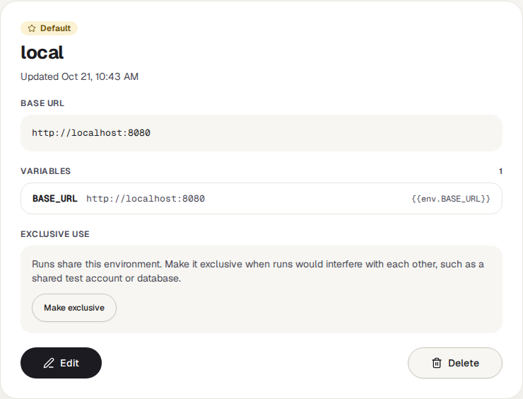
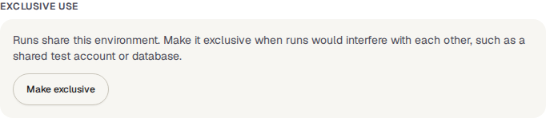

<!-- Generated from environments.html by e2e/docs-capture/export_md.py. Edit the HTML, not this file. -->

# Environments

Tests · Everyone with access to the project can see it · Editors can change it

> **In short**
>
> An environment is a place your tests can run against, such as a test copy of your site or the live site. This page holds each environment's web address and values, the project's secrets (passwords and tokens), and recorded network traffic for tests to replay.

## What it is for

The same test should work on the test site today and the live site tomorrow. Instead of writing the address and the test account's password into every test, the test says `{{env.BASE_URL}}` and `{{secret.ALICE_PASSWORD}}`, and the environment fills them in when the test runs. Change the environment, and every test follows.

> **Testers**
>
> Run the same suite against the test site and the live site, without editing a single test.

> **Developers**
>
> Add a staging environment and keep its API token out of the tests.

> **Security**
>
> See that passwords are kept encrypted and are never shown again once saved.

**Where to find it:** in the sidebar, open **Tests → Environments**. The page's own heading says **Environments and secrets**. It shows the project selected at the top of the sidebar.

## A tour of the screen

The list is on the left; the environment, secrets or recorded traffic you pick is shown on the right. When the page opens, the default environment is shown. The numbers on the screenshot match the sections below.

*The Environments page for the demo's web project. Click the picture to see it larger.*

## 1. New environment

Opens a form on the right: a **name** (for example "staging"; two environments in a project can't share one), a **base URL**, any number of **variables**, and whether it becomes the default. Nothing is saved until you press **Create environment**.

## 2. The environments

Each row shows the environment's name and base URL. Default marks the one used when a run doesn't name an environment. In use replaces it while an *exclusive* environment is taken by a run (see ⑤). **Click a row** to show it on the right.

## 3. Secrets and recorded traffic

**Secrets** are passwords, tokens and keys. They belong to the whole project, not to one environment, and are used in a step as `{{secret.NAME}}`.

- **Write-only.** Once saved, a secret's value is never shown again, to anyone. You can replace it (type the same name and a new value) or delete it, but not read it.
- **Encrypted.** Values are stored encrypted and only unlocked when a run starts, to be handed to the test machine.
- **Names** may contain only letters, numbers and underscores, for example `API_TOKEN`.
- Deleting a secret makes every step that uses it fail, so TraceIQ asks first.

**Recorded traffic (HAR)** holds files of recorded network requests and answers. A *har-replay* step in a test answers the page's requests from such a file instead of the real server, for example to test against a fixed set of data. Files are up to 20 MB, and cookies, sign-in headers and secret-looking values are removed from them on upload, before they are stored.

## 4. Base URL and variables

- **Base URL**: the start of every web address. A step that opens just `/login` opens `http://localhost:8080/login` in this environment. Without a base URL, such steps don't work in this environment.
- **Variables**: named values. Each row shows the name, the value, and how a step writes it, for example `{{env.BASE_URL}}`.

> **Variables are not secret**
>
> Everyone with access to the project can read variable values on this page. Put passwords, tokens and keys under **Secrets**, never in a variable.

## 5. Exclusive use

Normally several runs can use an environment at the same time. **Make exclusive** lets only one run use it at a time, which helps when runs would get in each other's way, for example two runs signing in with the same test account. While a run holds it, this box says *In use by run #…* (click it to open that run), and other runs wait, marked *Queued*, and start by themselves when it is free. **Allow parallel runs** switches it back.

**Force release** appears while a run holds the environment. Use it only if a run is stuck: the run keeps going, and the next waiting run starts alongside it.

## 6. Edit, Set as default, Delete

- **Edit** turns the details into the same form as *New environment*.
- **Set as default** (on environments that aren't the default) makes it the default; the old default stops being one.
- **Delete** removes the environment, after asking. It can't be undone.

## Watch it in use

[▶ Watch the video](../media/tests/environments/walkthrough.mp4)

*About a minute, with a spoken commentary. The captions at the bottom show the same words, so it also works with the sound off.*

## How to…

### …add a staging environment

1. Press **New environment**.
2. Name it "staging" and enter its base URL, for example `https://staging.example.com`.
3. Add the same variables the other environments have, with staging's values, so the tests find them.
4. Press **Create environment**. Choose it in the environment menu of a suite before pressing *Run suite*.

### …keep a password out of the tests

1. Click **Secrets** on the left.
2. Type a name such as `ADMIN_PASSWORD` and the password, then press **Save secret**.
3. In the test's step, type `{{secret.ADMIN_PASSWORD}}` where the password goes.

### …change a password that has changed

1. Click **Secrets**.
2. Type the existing name and the new value. The button now says **Update secret**; press it.

## Good to know

- **Who can do what.** Anyone with access to the project can see the environments, their variables and the *names* of the secrets. Adding, changing and deleting any of them needs the *editor* role. The buttons are shown to everyone, but TraceIQ refuses the change for others.
- **Which environment a run uses.** The one chosen in a suite's environment menu; otherwise the default; otherwise none.
- **Exports never contain secrets.** Exporting a suite keeps the `{{secret.…}}` placeholders but not the values.
- **Exclusive environments refresh by themselves.** When any environment is exclusive, the list refreshes every 15 seconds so the *In use* labels stay current.
- **The demo's secrets** are sample passwords for the demo's local todo app, made for this guide.

## Related pages

> **App builds**
>
> The next page in this guide: the mobile app files that mobile tests install.

> **Suites**
>
> Choose the environment for a run, and use `{{env.…}}` and `{{secret.…}}` in steps.

> **Test packs**
>
> Ready-made suites whose values are filled into an environment when you import them.

> **Runs**
>
> Each run shows which environment it used.

## Video script

What the walkthrough says, in order. The video and every picture on this page are made by the Playwright script [`tests-environments.spec.ts`](../../../../e2e/docs-capture/pages/tests-environments.spec.ts).

1. An environment is a place your tests can run against, such as a test site or the live site.
2. This project has two. The default one is used when a run doesn’t name another.
3. Each one has a base address, and variables that test steps can use by name.
4. Click another environment to see its values.
5. Exclusive use lets only one run at a time use the environment. Others wait their turn.
6. Secrets hold passwords and tokens. They are shared by every environment in the project.
7. Only their names are shown. Once saved, a secret value can be replaced, but never read back.
8. New environment adds another, for example a staging copy of your site.
