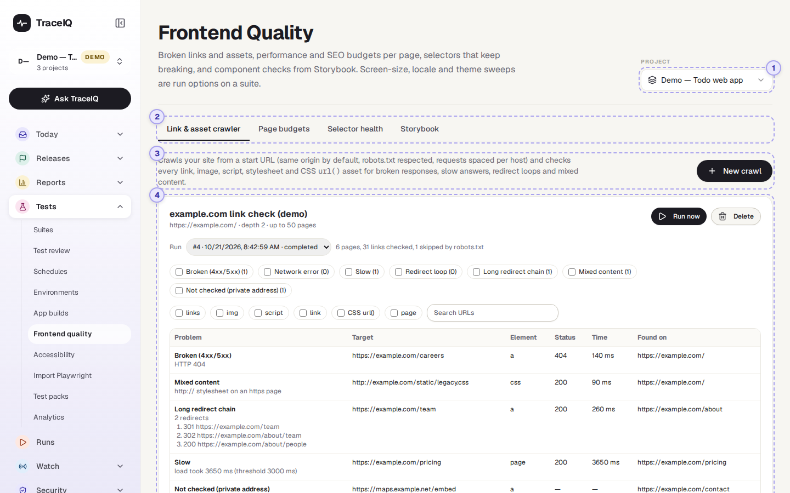
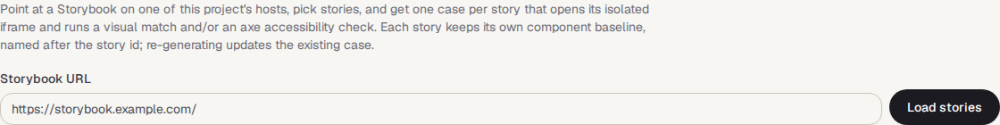

<!-- Generated from frontend-quality.html by e2e/docs-capture/export_md.py. Edit the HTML, not this file. -->

# Frontend quality

Tests · Everyone with access to the project can see it · Editors can set up crawls and generate tests

> **In short**
>
> Checks on how well your website itself is built, beyond what single tests check: broken links and pictures across the whole site, whether pages stay fast and light, which page elements tests keep failing to find, and tests made straight from a component library.

## What it is for

A test checks one journey. Frontend quality looks across the site and answers **"What is quietly getting worse?"**: a link to a page that no longer exists, a picture that doesn't load, a page that got twice as heavy last month, a button the tests can only find by luck.

> **Testers**
>
> Find broken links and fragile tests before users or the next release do.

> **Developers**
>
> See which page got slower or heavier, and which run it started in.

> **Designers**
>
> Turn every component in the design system's Storybook into a visual and accessibility check.

**Where to find it:** in the sidebar, open **Tests → Frontend quality**. The page's own heading says **Frontend Quality**.

## A tour of the screen

The demo's web project has one saved crawl of example.com with two runs, a month of page measurements and a few selectors that broke, so every tab has something to show. The numbers match the sections below.

*The Frontend Quality page for the demo's web project, on its first tab. Click the picture to see it larger.*

## 1. Project

Which project the page shows. It is the same choice as the project picker at the top of the sidebar: changing it here changes it there too.

## 2. The four tabs

| Tab | What it shows |
|---|---|
| **Link & asset crawler** | Visits your site page by page and checks every link, picture, script and style sheet. Shown first. |
| **Page budgets** | Speed and size of pages, measured every time a test with a *check-page-budget* step runs, against the limits ("budgets") set in that step. |
| **Selector health** | The page elements tests keep failing to find, or that TraceIQ keeps having to repair. |
| **Storybook** | Makes one test per component story from your Storybook (a catalogue of a site's building blocks). |

## 3. The crawler

A **crawl** starts at one address, follows the links it finds to other pages of the same site, and checks everything each page uses. **New crawl** opens its settings:

| Setting | What it does |
|---|---|
| **Start URL** | Where to begin. It must be on one of the project's own sites (the hosts of its environments and suites, listed under the field). |
| **Max depth**, **Max pages** | How many clicks away from the start page to go (0–10, default 3), and the most pages to visit (1–1000, default 100). |
| **Delay between requests** | How long to wait between two requests to the same site, so the crawl doesn't overload it (default 250 ms). |
| **Slow threshold** | Anything that takes longer than this to answer is reported as slow (default 3000 ms = 3 seconds). |
| **Also crawl these project hosts** | Other sites of the same project to follow links into, such as a blog on its own address. |
| **Schedule** | Optional cron expression, in UTC, to repeat the crawl, at most once an hour. See *Schedules* for how cron works. |
| **Respect robots.txt** | Skip the pages the site asks robots not to visit. On by default. |
| **Check links to other sites** | Also check that links to other websites still answer. Those sites are only asked for a status, never crawled. |

## 4. Crawls and their problems

*The demo's crawl, on its latest run.*

Each saved crawl is a box with its start address and limits, **Run now** and **Delete**. After a run, a **Run** menu picks one of its runs and the box shows how many pages were crawled and links checked, then a table of problems with what was wrong, the address, the kind of element, the status, the time it took, and the page it was found on. Tick the problem types or element kinds to filter, or search the addresses. The table shows 100 problems at a time.

| Problem | Meaning |
|---|---|
| **Broken (4xx/5xx)** | The address answered with an error, such as 404 "not found". |
| **Network error** | No answer at all. |
| **Slow** | Answered, but slower than the slow threshold. |
| **Redirect loop**, **Long redirect chain** | The address sends the browser round in circles, or through many steps before arriving. |
| **Mixed content** | A secure (https) page loads something over plain http. |
| **Not checked (private address)** | The link points at a private or internal address, which TraceIQ doesn't visit. |

## Page budgets

In the demo, the test *Homepage loads* measures example.com's home page. Nothing appears here until a test contains a **check-page-budget** step. Then every run of that test measures the page, and this tab lists the pages measured in the last 30 days, those that went over budget first. Click a page to see, for its latest run and as small bars for recent runs:

- **LCP** (how long the main content takes to appear), **CLS** (how much the layout jumps while loading), **INP** (how quickly the page reacts to a click), **TTFB** (how long the server takes to start answering), **page weight** and **number of requests**. A red bar is a run that went over that budget.
- **Budgets**: each limit set in the step, and whether the page was within it or over.
- **SEO checks**: basic search-engine checks such as a page title. They only fail the test if the step says so.

## Selector health

![The Selector health tab: a Window menu set to Last 90 days, the line 2 selectors, 1 heal, 7 failures, and two selectors: #todo-list li in Add a todo (6 failed, 1 heal proposal) with the sturdier locator [data-testid=todo-item] and a Copy button, and h1 in Homepage loads (1 failed) with role=heading[name=Example Domains]](../media/tests/frontend-quality/selectors.png)

A **selector** is the short code a test step uses to find an element on the page. When a page changes, selectors break. This tab lists the ones with the most trouble in the chosen window (30, 90, 180 or 365 days), worst first. For each one: the test and step it belongs to, how often it failed, how often TraceIQ proposed or made a repair, a bar per week, reasons it is fragile, and **sturdier locators** worked out from the page as it was when the step failed, with a **Copy** button. Suggestions are never applied for you: edit the test to use one.

## Storybook

1. Enter the address of your Storybook (it must be on one of the project's sites) and press **Load stories**.
2. Tick the stories you want, choose the suite to add the tests to, and whether each test checks the look (**Visual match**), **Accessibility**, or both.
3. Press **Generate**. You get one test per story. Generating again for a story updates its existing test instead of making a second one, and keeps its saved reference picture.

## Watch it in use

[▶ Watch the video](../media/tests/frontend-quality/walkthrough.mp4)

*About 50 seconds, with a spoken commentary. The captions at the bottom show the same words, so it also works with the sound off.*

## How to…

### …check a site for broken links every night

1. On the **Link & asset crawler** tab, press **New crawl**.
2. Give it a name, enter the home page as the **Start URL**, and under **Schedule** type `0 3 * * *` (3 a.m. UTC every day).
3. Press **Save crawl**, then **Run now** for a first result. The box shows "running…" until it is done.
4. Tick **Broken (4xx/5xx)** to see only the links that need fixing, and the page each was found on.

### …keep a page fast

1. In a test that opens the page, add a **check-page-budget** step with the limits you want, for example how long the main content may take.
2. Run the test. The page appears on the **Page budgets** tab.
3. Check back after a few runs: red bars show the runs that went over.

## Good to know

- **Who can do what.** Anyone with access to the project can see every tab. Creating, running and deleting crawls, and generating tests from Storybook, need the *editor* role.
- **Only your own sites are crawled.** The start address and extra hosts must belong to the project. Links to other websites are only checked for an answer, and private or internal addresses are never visited.
- **Limits.** A project can hold up to 20 crawls, run up to 3 at the same time, and a crawl stops after 15 minutes or 1,000 pages, whatever its settings say ("stopped at a limit").
- **Crawl schedules are in UTC**, unlike suite schedules, which have their own time zone.
- **Re-runs that check a suggested fix don't count.** Page budgets and selector health leave out the check runs TraceIQ makes for proposals.
- **Screen sizes, languages and themes** are not on this page: they are run options on a suite (*Screen sizes & locales*, see *Suites*).

## Related pages

> **Accessibility**
>
> The next page in this guide: every accessibility problem the tests found, and waivers for known ones.

> **Suites**
>
> Add the check-page-budget step, and run suites on several screen sizes and languages.

> **Proposals**
>
> Repairs TraceIQ suggests for broken selectors.

> **Visual review**
>
> Where the visual matches of Storybook tests are reviewed.

## Video script

What the walkthrough says, in order. The video and every picture on this page are made by the Playwright script [`tests-frontend-quality.spec.ts`](../../../../e2e/docs-capture/pages/tests-frontend-quality.spec.ts).

1. Frontend quality checks how well your website itself is built, beyond single tests.
2. It has four tabs. The first crawls your site and checks every link and file.
3. New crawl sets one up: where to start, how deep to go, and how many pages.
4. Only this project’s own sites can be crawled. Cancel closes the form.
5. Page budgets tracks page speed and size, measured by a step in your tests.
6. Selector health lists the page elements that tests keep failing to find.
7. Storybook turns each story of a component library into a test.
